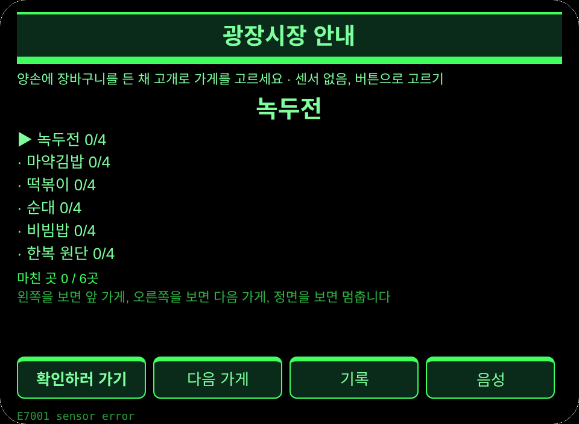
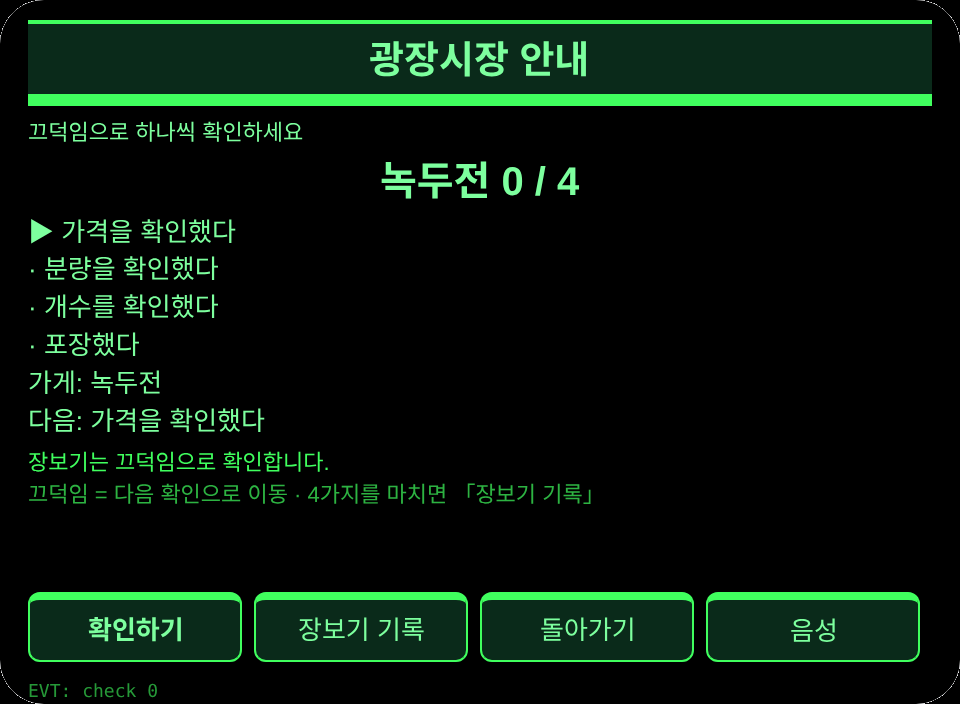
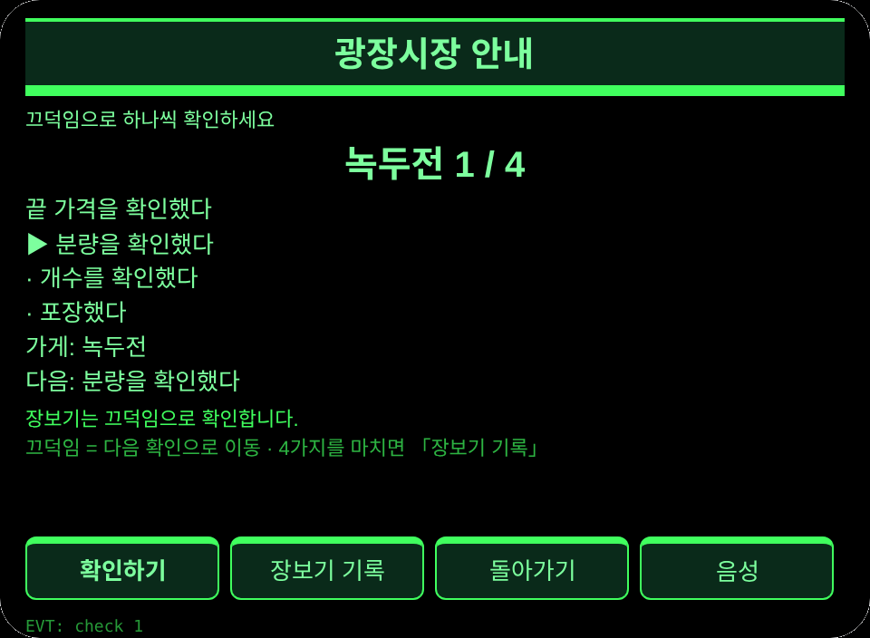
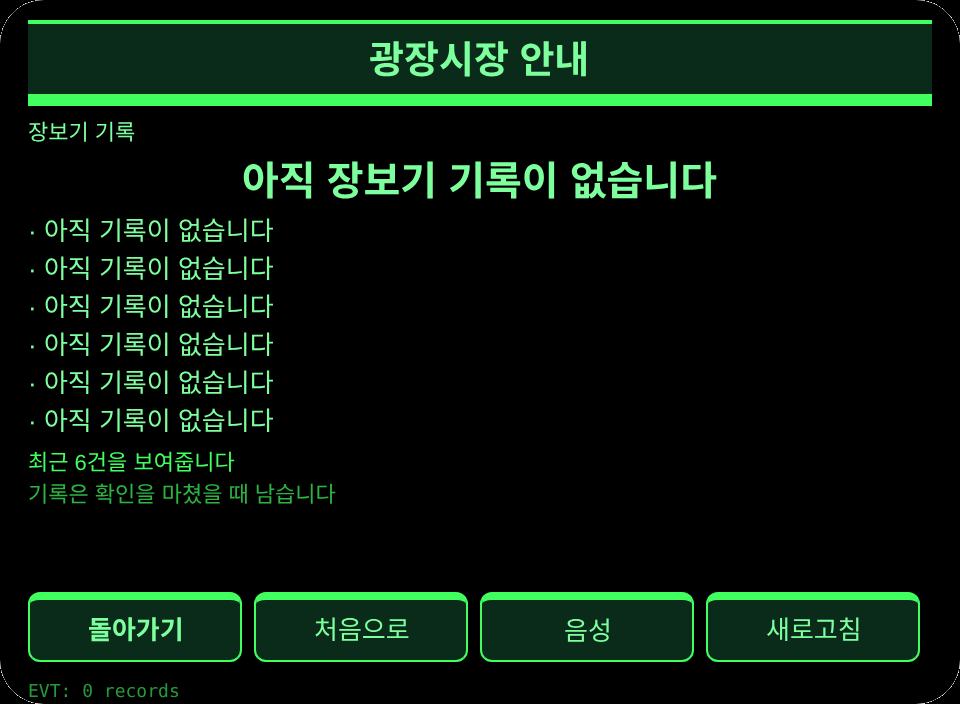

# 광장시장 안내

**Studio 가져오기 주소**(Global AIUI Studio Import Project 입력란에 복사):

```
https://github.com/sakai55/rokid/tree/agent-gwangjang-guide
```

[gwangjang-guide.aix](https://raw.githubusercontent.com/sakai55/rokid/main/aix/gwangjang-guide.aix)

## 개요

광장시장에서 장보는 사람이 양손에 장바구니를 든 채 고개를 돌려 가게를 고르고, 끄덕임으로 확인 항목을 하나씩 마친 뒤, 장보기가 끝나면 기록을 남긴다. 가게 6곳 × 확인 4가지, 모두 24가지 확인 항목이다.

## 장면

광장시장에서 장보는 사람이 양손에 장바구니를 든 채 고개를 돌려 가게를 고르고, 끄덕임으로 확인을 마친 뒤, 장보기가 끝나면 기록을 남긴다.

## 방향 구성

한국 현지 × 방향성(고개를 돌려 가게 고르기) × 주의력(확인 항목 하나씩 지키기). 방향성은 가게를 고르는 일을 맡고, 주의력은 확인을 하나씩 마치는 일을 맡는다.

## 안경 전용 기능

시선과 머리 방향 맞추기: 양손에 장바구니를 들고 있을 때는 휴대전화를 꺼낼 수 없지만, 고개를 돌리면 그 가게가 골라지고 끄덕이면 확인이 하나씩 진행되며, 다음 확인은 음성으로 들을 수 있다. 접선: pages/index/index.ink의 _startSensor(AbsoluteOrientationSensor, 존재 여부 확인)와 _onYaw(±0.35에서 가게 바꾸기, 정면으로 돌아오면 다시 준비) + onHeadGesture('nod')가 주 확인과 같다. 센서를 쓸 수 없을 때는 버튼으로 가게를 고를 수 있고, 센서 읽기 실패는 E7001을 남긴다.

## 솔직한 경계

- 가격과 분량은 현장 가게 간판이 기준이며, 안에 있는 목록은 보기이다.
- 4가지를 확인하지 않은 가게는 기록하지 않는다.
- 센서를 쓸 수 없을 때는 버튼으로 가게를 고를 수 있다.

## 페이지

| 페이지 | 페이지 |
|---|---|
| pages/index | 가게 6곳 목록, 고개로 고르기 |
| pages/guide | 고른 가게에서 4가지 확인을 끄덕임으로 하나씩 마치고 장보기가 끝나면 기록 |
| pages/record | 최근 6건의 장보기 기록과 합계 |

## 내용 집합

가게 6곳(녹두전／마약김밥／떡볶이／순대／비빔밥／한복 원단) × 확인 4가지(가격을 확인했다／분량을 확인했다／개수를 확인했다／포장했다), 모두 24가지 확인 항목이다. 기록은 건수로 센다.

## 저장

저장 키 `gwangjangGuideV1`. 고른 가게, 가게마다 확인한 항목 수, 장보기 기록 배열, lastError를 저장한다.

## 권한

권한 없음. 음성 읽기는 권한이 필요 없고, 카메라와 위치 정보는 사용하지 않는다.

## 제스처

| 한 번 누르기 | Enter | 주 확인(가게 고르기·확인하기) |
| 위아래 밀기 | ArrowUp / ArrowDown | 가게 선택 바꾸기 |
| 끄덕임 | onHeadGesture('nod') | 주 확인과 동일 |
| 두 번 누르기 | Backspace | 돌아가기 |

## 오류 코드

- `E5001` 저장 쓰기 실패
- `E5002` 저장 읽기 실패
- `E3005` 음성 읽기 실패
- `E8001` 페이지 이동 실패
- `E7001` 머리 센서를 쓸 수 없거나 읽기 실패

실패하면 화면에 있는 그대로의 코드를 보여주고, lastError에는 코드와 slug, 버전, 원래 문구를 함께 남긴다.

## 미리보기 스크린샷






## 제출 자료

### Feature Description

광장시장에서 장보는 사람이 양손에 장바구니를 든 채 고개를 돌려 가게를 고르고, 끄덕임으로 확인 항목을 하나씩 마친 뒤, 장보기가 끝나면 기록을 남긴다. 가게 6곳 × 확인 4가지, 모두 24가지 확인 항목이다.

### Opening Message

광장시장에서 양손에 장바구니를 들어도 괜찮아요. 고개를 돌려 가게를 고르고, 끄덕여 확인을 마쳐요.

### Preview Media

[preview-gwangjang-guide-video.mp4](https://raw.githubusercontent.com/sakai55/rokid/main/screenshots/gwangjang-guide/preview-gwangjang-guide-video.mp4)


### Change Log

- Features：초판 기능은 위와 같다.
- Improvements：없음.
- Fixes：없음.

## 기기 테스트 정보

| 항목 | 내용 |
|---|---|
| Studio 이름 | 미기입 |
| Version / Build | 미기입 |
| App Category | 미기입 |
| Intent Description | 미기입 |
| Agent ID | 미기입 |
| 상태 | 미기입 |
