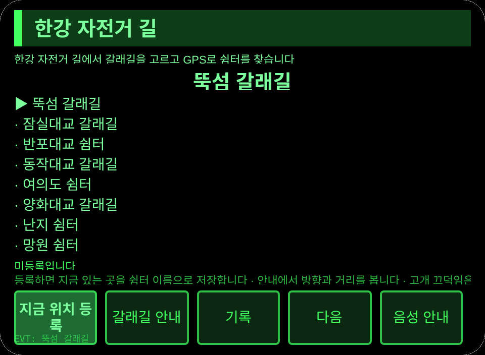
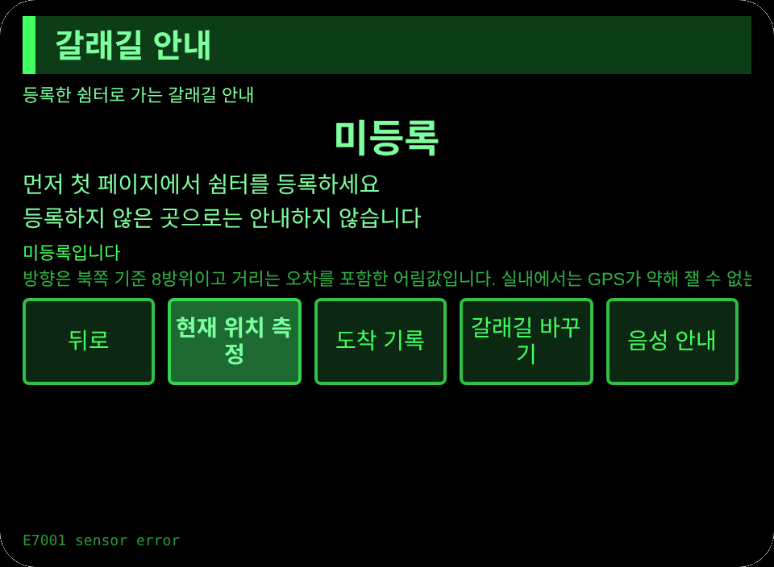

# 한강 자전거 길

**Studio 가져오기 주소**(Global AIUI Studio의 Import Project 입력란에 복사):

```
https://github.com/sakai55/rokid/tree/agent-hangang-cycle
```

**최신 AIX 내려받기:** [hangang-cycle.aix](https://raw.githubusercontent.com/sakai55/rokid/main/aix/hangang-cycle.aix)

## 개요

한강 자전거 길에서 자전거를 타는 사람이 양손으로 손잡이를 잡은 채로 갈래길을 고르고 GPS로 쉼터를 찾아 도착을 기록합니다. 버전 1.0.0, 3개 페이지입니다.

## 장면

한강 자전거 길을 달리는 사람이 갈래길 앞에서 멈추지 않고, 머리 방향으로 갈래길을 고른 뒤 GPS 방향과 거리로 쉼터를 찾아갑니다.

## 방향 구성

한국 현지 x 지향성 x 주의. 한국 현지(한강 자전거 길의 실제 갈래길과 쉼터) x 지향성(머리 방향 갈래길 선택과 GPS 방향 안내) x 주의(갈래길과 쉼터를 빠짐없이 확인하고 도착을 기록)가 한 장면에서 모여야 한 번의 이용이 성립합니다.

## 안경 전용 능력

- 양손이 묶인 첫 시점: 양손으로 손잡이를 잡은 채로 고개를 끄덕여 확인하고 머리 방향으로 갈래길을 고릅니다. 손으로 휴대전화를 꺼낼 수 없는 순간에 쓰는 능력입니다.
- 머리 방향 조율: pages/guide의 센서가 머리 좌우 각도를 읽어 왼쪽 갈래길, 직진, 오른쪽 갈래길 가운데 하나를 고릅니다.
- GPS 방향 고정: 등록한 쉼터로 8방위 방향과 거리를 안내합니다. 휴대전화 앱으로 같은 일을 하려면 손을 떼야 하므로 이 장면에서는 안경이 더 낫습니다.

GPS 세 가지 증거: 권한 선언은 app.json의 permissions에 GEOLOCATION. 위치 취득은 pages/index의 saveTap과 pages/guide의 primaryTap이 함께 쓰는 _geo 안의 getCurrentPosition 호출. 방향 환산은 pages/guide의 _calc(atan2 방위각을 CARD 8방위로 바꾸고 하버사인 거리식을 10m 단위로 반올림).

## 페이지

| 페이지 | 역할 |
|---|---|
| pages/index | 갈래길과 쉼터 8곳 목록, 지금 위치 등록, 안내와 기록으로 이동 |
| pages/guide | 머리 방향 갈래길 표시, 지금 위치 측정으로 8방위와 거리 안내, 도착 기록 |
| pages/record | 최근 6건의 도착 기록과 합계 |

## 내용집

갈래길과 쉼터 8곳. 도착 기록은 실제 건수대로 셉니다.

## 저장

세션을 넘는 저장 키 `hangangCycleV1`입니다. 선택 갈래길, 등록한 쉼터의 위도와 경도와 등록 시각, 도착 기록 배열, lastError를 저장합니다.

## 권한

`GEOLOCATION`만 씁니다. 위치 이용을 거부하면 측위하지 않고 거부된 사실을 표시합니다. TTS와 머리 센서는 별도 권한이 필요 없고 카메라는 호출하지 않습니다.

## 제스처

한 번 두드리기(Enter)는 주 확인, 위아래 밀기는 선택 바꾸기, 고개 끄덕임은 주 확인과 같음, 두 번 두드리기는 앞 페이지로 돌아가기입니다.

## 오류 코드

- `E7001` 머리 센서 실패(센서를 쓸 수 없거나 읽기 오류. 센서가 없어도 버튼으로 갈래길을 바꿀 수 있음)
- `E7002` 측위 실패(GPS를 쓸 수 없거나 측위 오류)
- `E7003` 측위 거부(위치 이용 허가가 없음)
- `E5001` 저장 쓰기 실패
- `E5002` 저장 읽기 실패
- `E3005` 음성 실패
- `E8001` 이동 실패

실패는 언제나 맨 코드만 화면에 보이고 lastError에 코드와 slug와 버전과 원문이 함께 남습니다.

## 미리보기 스크린샷

미리보기 사진은 본선 수합 단계에서 촬영합니다. 자리는 아래와 같습니다.





## 제출 자료

### 기능 설명

한강 자전거 길에서 자전거를 타는 사람을 위한 안내입니다. 갈래길과 쉼터 8곳 가운데 하나를 고르고 지금 위치를 등록한 뒤 머리 방향으로 갈래길을 고르고 GPS 8방위와 거리로 쉼터를 찾아가 도착을 기록합니다.

### 시작 메시지

한강 자전거 길 안내를 시작합니다. 갈래길을 고르고 쉼터를 등록한 뒤 방향과 거리로 찾아가세요.

### 미리보기 미디어

사진 3장(페이지마다 1장)과 영상 1편을 기기 단계에서 채웁니다.

### 변경 로그

- 1.0.0: 기능 추가 - 갈래길과 쉼터 8곳, 머리 방향 갈래길 선택, GPS 8방위와 거리 안내, 도착 기록.

## 기기 테스트 정보

| 항목 | 값 |
|---|---|
| Studio 이름 | 미입력 |
| 버전 | 1.0.0 |
| 카테고리 | 미입력 |
| 인텐트 설명 | 미입력 |
| Agent ID | 미입력 |
| 상태 | 미제출 |
