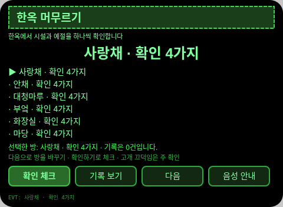
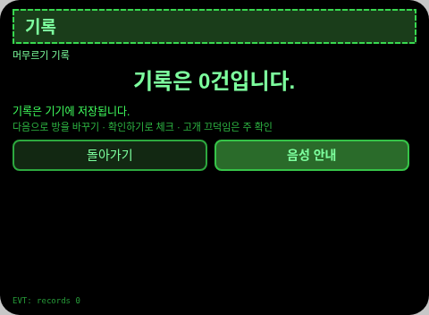
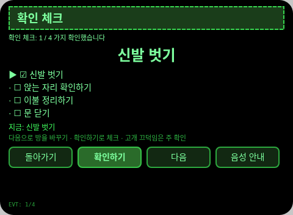
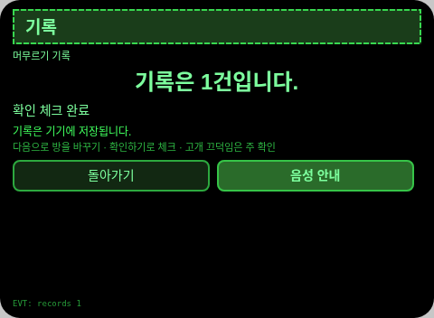

# 한옥 머무르기

**Studio 가져오기 주소**(Global AIUI Studio의 Import Project 입력란에 붙여 넣으세요):

```
https://github.com/sakai55/rokid/tree/agent-hanok-stay
```

KR18 · 한국 현지 × 커브 컷 × 주의. 처음 한옥에 머무는 여행객이 방마다 시설과 예절을 항목별로 확인해 실례를 피합니다

## 미리보기 스크린샷







## 방향 구성

- 이 Agent의 방향 구성: 한국 현지 × 커브 컷 × 주의. 각 방향은 장면 안에서 대체할 수 없는 한 고리를 맡으며, 기능을 짜깁기한 것이 아닙니다.
- 한 줄 장면: 처음 한옥에 머무는 여행객이 방마다 시설과 예절을 항목별로 확인해 실례를 피합니다.

## 구조와 기능

3개 페이지: `pages/index/` 방 목록(6곳, 각 4항목); `pages/check/` 확인 체크(선택한 방의 4항목을 하나씩 체크하고, 다 되면 TTS로 알리며 완료 기록을 남김); `pages/record/` 기록(최근 6건 + 총개수). 한국어 문구 기계 검사: 일본어 가나=0, CJK 한자=0.

콘텐츠 집합 수: 방 6곳, 체크 항목 24개(6×4), 완료 기록은 실제 건수대로 셉니다. 세션을 넘는 지속성: 저장 키 `hanokStayV1`(선택 항목, 체크/답안/카운트 상태, 완료 기록 배열, `lastError`).

## 제스처 매핑

| 제스처 (안경다리 터치패드) | 키 이벤트 | 이 Agent에서의 역할 |
|---|---|---|
| 한 번 탭 | Enter | 주 확인(각 페이지의 주 버튼) |
| 위로 / 아래로 스와이프 | ArrowUp / ArrowDown | 옵션 전환 / 위아래 항목 |
| 고개 끄덕임 (머리가 안정됐을 때) | `onHeadGesture('nod')` | 주 확인과 동등 |
| 두 번 탭 | Backspace | 이전 페이지로 돌아가기(하위 페이지) |

## 권한

없음. TTS와 센서는 매니페스트 권한이 필요 없고, 카메라는 호출하지 않습니다.

## 정직한 경계

- 시설과 예절은 수록된 정형 안내입니다. 실제 숙소의 안내가 기준이며, 다르면 현장 안내를 따릅니다.
- 체크는 본인의 확인만을 기록합니다.

## 오류 코드

실패하면 안경 화면에 코드만 표시되고, TTS는 코드만 읽으며, 가장 최근 오류는 지속 데이터의 `lastError`에 기록됩니다(코드, 이 기기의 slug, 버전, 원문 포함). 이 기기에서 나타날 수 있는 코드:

- `E5001` 기록 저장 실패(스토리지 쓰기 중 예외 발생)
- `E5002` 기록 읽기 실패(읽기/파싱 중 예외 발생)
- `E3005` 음성 안내 실패(TTS speak 중 예외 발생)
- `E8001` 페이지 전환 실패(navigateTo/navigateBack 중 예외 발생)

## 기기 테스트 정보

| 항목 | 내용 |
|---|---|
| Studio 이름 | 기입 예정 |
| Version | 1.0.0 |
| App Category | 기입 예정 |
| Intent Description | 기입 예정 |
| Agent ID | 기입 예정 |
| 상태 | 실기기 검증 전 |

## 심사 자료 (Review Submission)

Feature Description: 한옥 머무르기: 한국 전통 가옥에서의 첫 숙박을 방 하나하나씩 안내합니다. 방 여섯 곳, 방마다 시설과 예절 확인 네 가지씩, 고개 끄덕임으로 체크하고 그대로 저장됩니다.

Opening Message: 한옥에 처음 머무르시나요. 방마다 시설과 예절을 하나씩 확인해 보세요.

Preview Media:
- `preview-hanok-stay-index.png`
- `preview-hanok-stay-check.png`
- `preview-hanok-stay-record.png`
- `preview-hanok-stay-check-s2.png`
- `preview-hanok-stay-record-s2.png`

> 정식 심사 제출에는 미디어 파일 3~5개가 필요하고 동영상(≤60초) 1개 이상이 포함되어야 합니다. 동영상은 GO가 실기기로 녹화한 뒤 추가합니다.

Change Log — Build 1.0.0:

- Features added: 첫 버전. 처음 한옥에 머무는 여행객이 방마다 시설과 예절을 항목별로 확인해 실례를 피합니다
- Improvements: 없음 (첫 버전)
- Fixes: 없음 (첫 버전)
