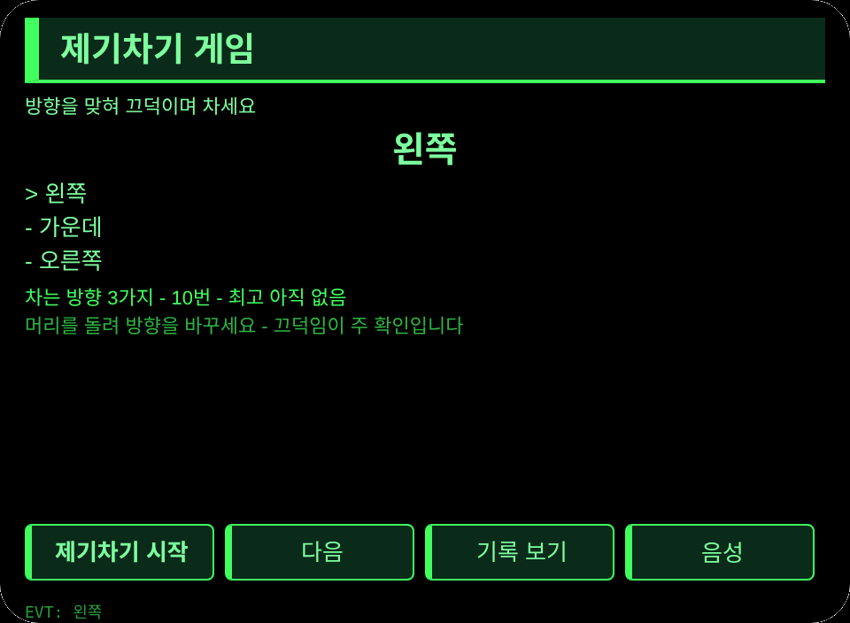
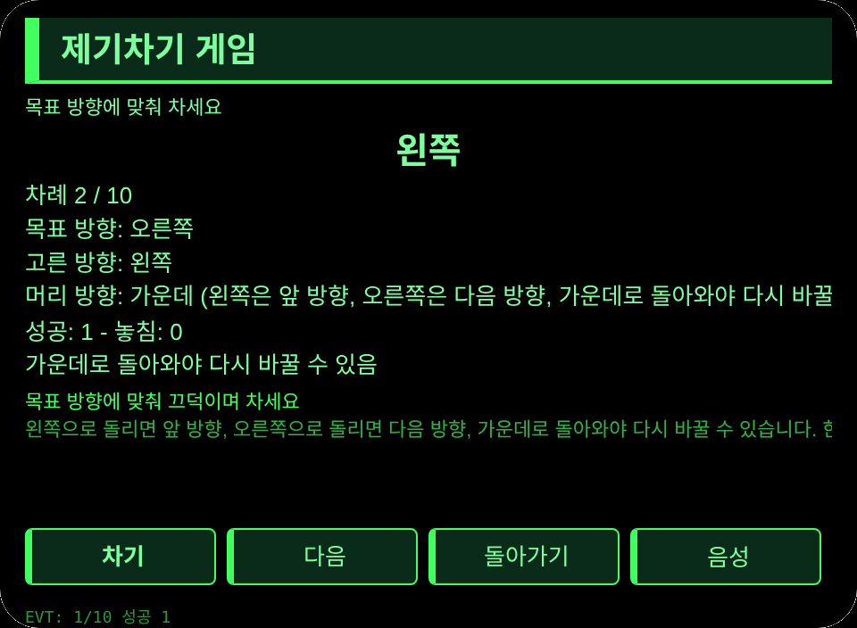
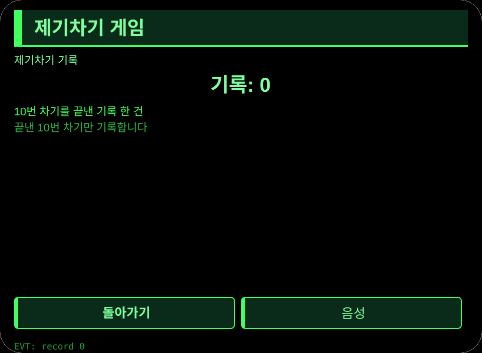

# 제기차기 게임

**Studio 가져오기 주소**(Global AIUI Studio Import Project 입력란에 복사):

```
https://github.com/sakai55/rokid/tree/agent-jegichagi-game
```

[jegichagi-game.aix](https://raw.githubusercontent.com/sakai55/rokid/main/aix/jegichagi-game.aix)

## 기능

명절에 가족이 모였을 때, 머리 움직임만으로 제기차기를 하며 10번 차서 승부를 가립니다. 방향을 맞혀 차면 성공하고, 최고 기록은 다음에도 남습니다.

## 장면

명절에 가족이 모였을 때, 머리 움직임만으로 제기차기를 하며 10번 차서 승부를 가립니다.

## 방향 구성

한국 현지 × 게임 × 방향성(머리 움직임으로 차는 방향 고르기). 게임이 차기 놀이를 맡고, 방향성이 머리 방향으로 차는 방향을 고르는 일을 맡는다.

## 안경 전용 능력

머리 방향의 연계 + 끄덕임이 주 확인: 명절에 두 손이 바쁠 때도, 머리를 돌려 차는 방향을 고르고 끄덕이기만 하면 찰 수 있다. 접선: pages/play/index.ink의 _startSensor(AbsoluteOrientationSensor, 존재 여부 확인) + _onYaw(왼쪽/가운데/오른쪽 3방향, 가운데로 돌아와야 다시 바꿀 수 있음, 한 번 돌릴 때 한 방향만) + onHeadGesture('nod')가 primaryTap과 같은 주 확인으로 차기를 한다. 센서가 안 될 때는 버튼으로 방향을 고른다. 차기 판정은 시연 판정이며, 실제 제기 움직임을 알아보는 것이 아니다.

## 페이지

| 페이지 | 페이지 |
|---|---|
| pages/index | 차는 방향 3가지와 최고 점수 |
| pages/play | 10번 차기, 방향 맞히기, 끄덕이며 차기, 승부 가리기 |
| pages/record | 제기차기 기록 |

## 내용 집합

차는 방향 3가지(왼쪽/가운데/오른쪽) × 10번 고정 차례 [0, 2, 1, 0, 1, 2, 0, 1, 2, 1] — 코드에 적힌 고정 차례. 제기는 한국의 전통 민속놀이로, 발로 제기(작은 술래)를 차 올리는 놀이다.

## 세션 간 저장

저장 키 `jegichagiGameV1`(최고 점수, 끝낸 기록, lastError).

## 권한

선언한 권한 없음. 음성 읽기는 숙주 관리이며 선언이 필요 없다.

## 제스처 대응

| 한 번 누르기 | Enter | 주 확인 |
| 위아래 밀기 | ArrowUp / ArrowDown | 선택 전환 |
| 끄덕임 | onHeadGesture('nod') | 주 확인과 동일 |
| 두 번 누르기 | Backspace | 돌아가기 |

## 오류 코드

- `E5001` 저장 쓰기 실패
- `E5002` 저장 읽기 실패
- `E3005` 음성 읽기 실패
- `E8001` 페이지 이동 실패
- `E7001` 머리 센서 사용 불가 또는 읽기 실패

- 점수는 실제 끄덕임과 누르기로만 정하며, 지어낸 점수는 없다.
- 차기 판정은 시연 판정이다. 실제 제기의 움직임을 알아보는 것이 아니며, 방향을 맞혔는지로만 성공을 정한다.
- 한 번 머리를 돌릴 때는 한 방향만 바뀌며, 가운데로 돌아와야 다시 바꿀 수 있고, 빙빙 돌리지 않는다.
- 센서가 안 될 때는 버튼으로 방향을 고른다. 차기 판정은 달라지지 않는다. 센서 실패는 E7001을 남긴다.

## 미리 보기 이미지






## 심사 자료

### Feature Description

명절에 가족이 모였을 때, 머리 움직임만으로 제기차기를 하며 10번 차서 승부를 가립니다. 방향을 맞혀 차면 성공하고, 최고 기록은 다음에도 남습니다.

### Opening Message

제기차기 게임에 오신 것을 환영합니다. 방향을 맞혀 끄덕이며 차세요. 10번 차면 승부가 납니다.

### Preview Media

[preview-jegichagi-game-video.mp4](https://raw.githubusercontent.com/sakai55/rokid/main/screenshots/jegichagi-game/preview-jegichagi-game-video.mp4)


### Change Log

- Features：초판 기능은 위와 같다.
- Improvements：없음.
- Fixes：없음.

## 기기 시험 정보

| Studio 이름 | 미기입 |
|---|---|
| Studio 이름 | 미기입 |
| Version / Build | 미기입 |
| App Category | 미기입 |
| Intent Description | 미기입 |
| Agent ID | 미기입 |
| 상태 | 미기입 |
