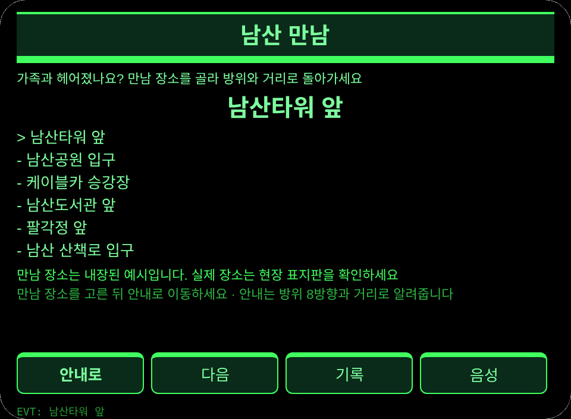
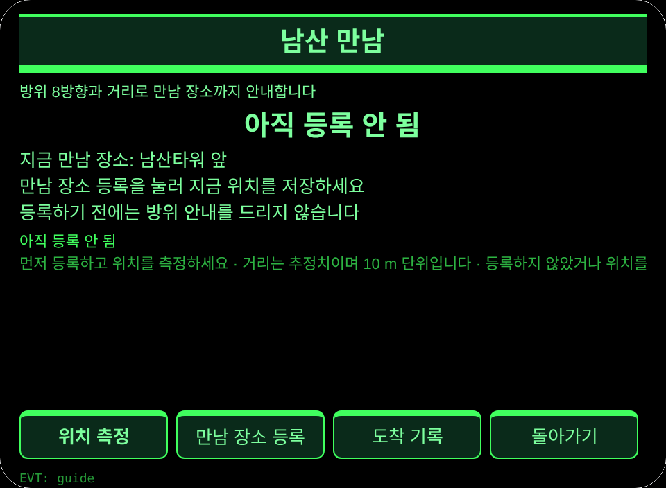
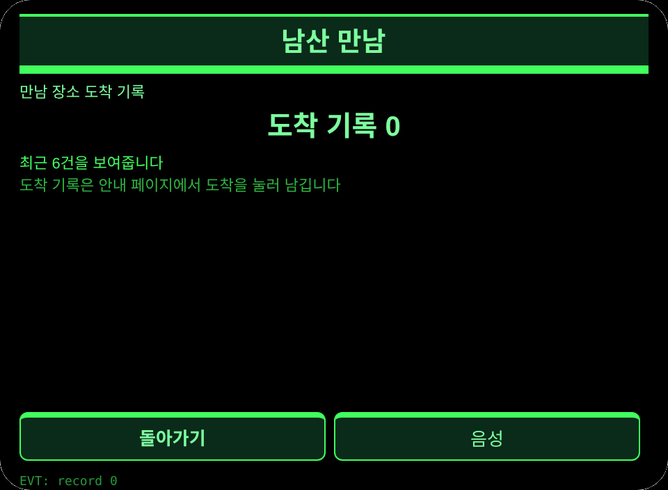

# 남산 만남

**Studio 가져오기 주소**(Global AIUI Studio Import Project 입력란에 복사):

```
https://github.com/sakai55/rokid/tree/agent-namsan-meet
```

[namsan-meet.aix](https://raw.githubusercontent.com/sakai55/rokid/main/aix/namsan-meet.aix)

## 개요

서울 남산타워 아래에서 가족과 헤어진 나이 많은 관광객이 휴대전화를 꺼내지 않고 GPS 방위와 거리로 등록한 만남 장소까지 돌아간다.

## 장면

서울 남산타워 아래에서 가족과 헤어진 관광객이 휴대전화를 꺼내지 않고 GPS 방위와 거리로 등록한 만남 장소까지 돌아간다.

## 방향 구성

한국 현지 × 방향성(GPS 방위 거리) × 배려 설계(나이 많은 관광객이 휴대전화를 꺼내지 않고 고개를 숙이지 않는다). 방향성은 방위 거리 안내를 맡고, 배려 설계는 손에 들고 있지 않아도 되는 등록과 도착 과정을 맡는다.

## 안경 전용 기능

만남 장소에 고정된 방향(GPS 방위 + 거리로 돌아가기): 등록과 안내는 눈앞에서 끝나고, 손에 짐을 들고 아이 손을 잡은 채로는 휴대전화를 꺼내 만남 장소까지 걸어갈 수 없다. 접선: app.json에 GEOLOCATION 선언, pages/guide/index.ink의 saveTap이 navigator.geolocation.getCurrentPosition으로 등록하고, 같은 페이지의 primaryTap이 다시 위치를 재서 _calc(위경도 차이 → 방위각 → 8방향 변환 + haversine 거리, 10 m 단위)로 방위와 거리를 낸다. 등록하지 않았거나 위치를 쓸 수 없을 때는 솔직히 낮춰서 알리고 지어내지 않는다.

## 솔직한 경계

- 등록하지 않았을 때는 안내 페이지에 등록하지 않았다고 밝히고 방위 안내를 지어내지 않는다.
- 위치를 거부당하면 E7003, 그 밖의 위치 실패는 E7002를 남긴다. 거리는 추정치이며 10 m 단위로 끊는다.
- 등록한 만남 장소는 이용자 본인의 위치이지, 찾아낸 장소가 아니다.

## 페이지

| 페이지 | 페이지 |
|---|---|
| pages/index | 만남 장소 6곳 고르기, 안내나 기록으로 이동 |
| pages/guide | 만남 장소 등록, 방위 거리 측정, 도착 기록 |
| pages/record | 최근 6건의 도착 기록과 합계 |

## 내용 집합

만남 장소 6곳: 남산타워 앞, 남산공원 입구, 케이블카 승강장, 남산도서관 앞, 팔각정 앞, 남산 산책로 입구. 도착 기록은 실제 수로 센다.

## 저장

저장 키 `namsanMeetV1`. 고른 만남 장소, 등록한 만남 장소 이름과 위경도 및 등록 시각, 도착 기록 배열, lastError를 저장한다.

## 권한

`GEOLOCATION`. 음성 읽기는 권한이 필요 없고, 카메라는 사용하지 않는다.

## 제스처

| 한 번 누르기 | Enter | 주 확인(안내 페이지에서는 위치 측정) |
| 위아래 밀기 | ArrowUp / ArrowDown | 만남 장소 전환 |
| 끄덕임 | onHeadGesture('nod') | 주 확인과 동일 |
| 두 번 누르기 | Backspace | 돌아가기 |

## 오류 코드

- `E5001` 저장 쓰기 실패
- `E5002` 저장 읽기 실패
- `E3005` 음성 읽기 실패
- `E8001` 페이지 이동 실패
- `E7002` 위치를 가져올 수 없거나 위치 실패
- `E7003` 위치 정보 이용이 거부됨

실패하면 화면에 있는 그대로의 코드를 보여주고, lastError에는 코드와 slug, 버전, 원래 문구를 함께 남긴다.

## 미리보기 스크린샷





## 제출 자료

### Feature Description

서울 남산타워 아래에서 가족과 헤어진 나이 많은 관광객이 휴대전화를 꺼내지 않고 GPS 방위와 거리로 등록한 만남 장소까지 돌아간다.

### Opening Message

남산에서 가족과 헤어졌나요? 만남 장소를 먼저 고르면 방위와 거리로 데려다줄게요. 휴대전화를 꺼낼 필요가 없어요.

### Preview Media

[preview-namsan-meet-video.mp4](https://raw.githubusercontent.com/sakai55/rokid/main/screenshots/namsan-meet/preview-namsan-meet-video.mp4)


### Change Log

- Features：초판 기능은 위와 같다.
- Improvements：없음.
- Fixes：없음.

## 기기 테스트 정보

| 항목 | 내용 |
|---|---|
| Studio 이름 | 미기입 |
| Version / Build | 미기입 |
| App Category | 미기입 |
| Intent Description | 미기입 |
| Agent ID | 미기입 |
| 상태 | 미기입 |
