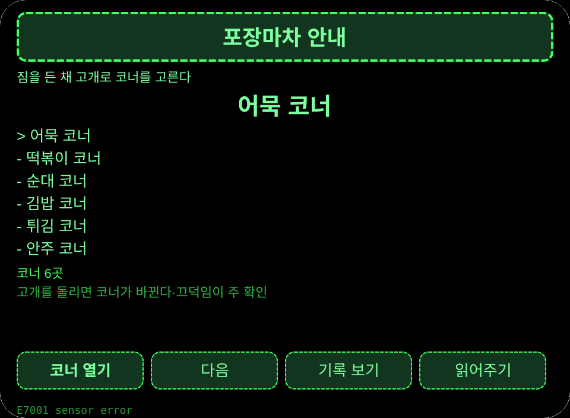
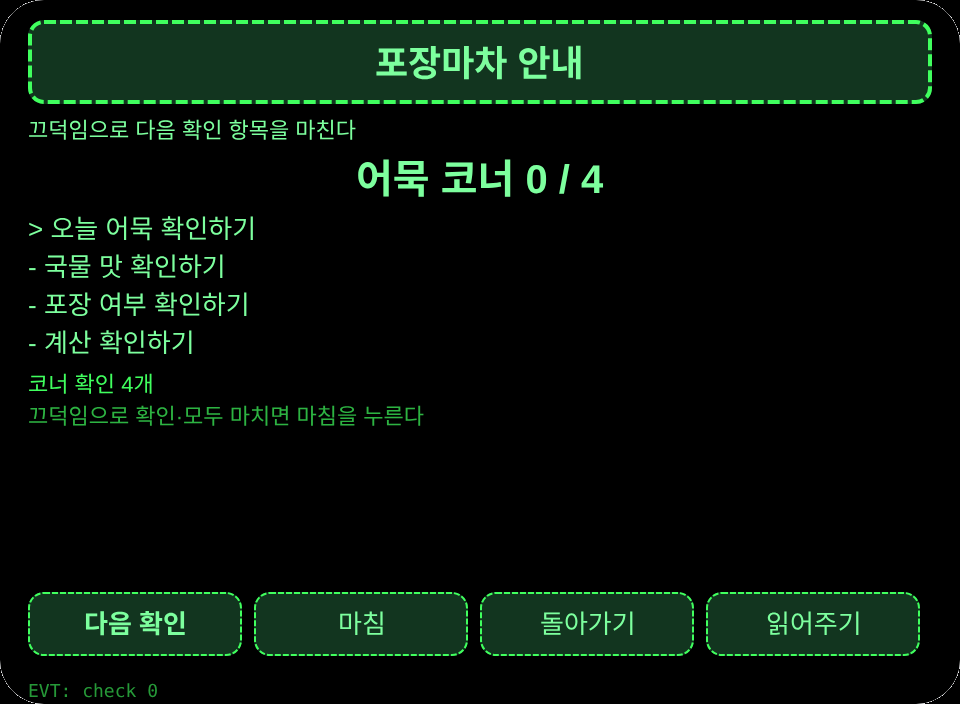
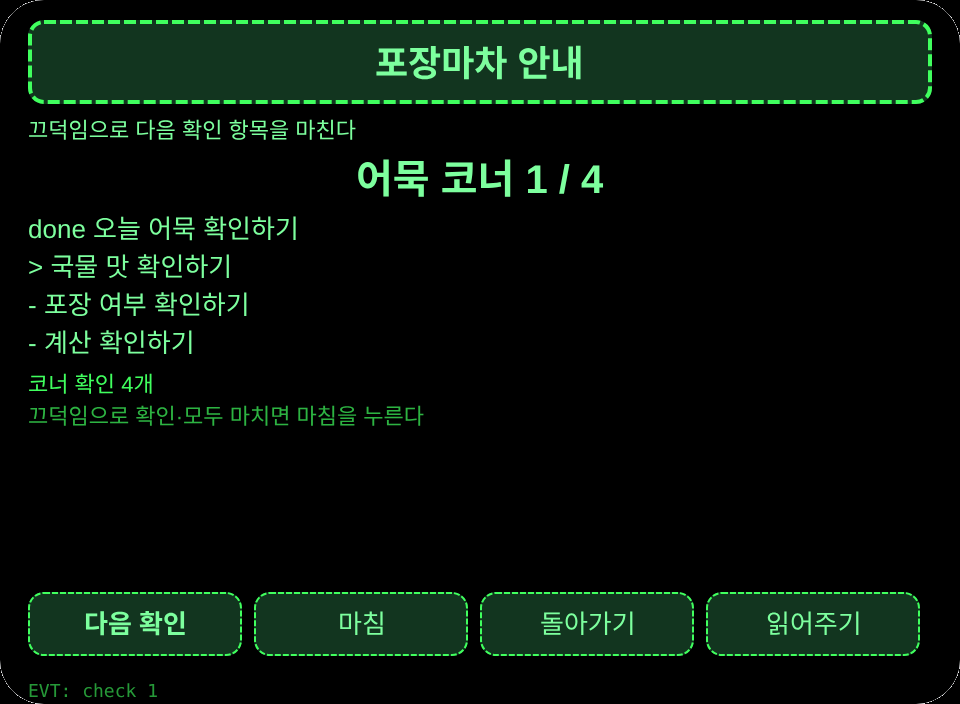
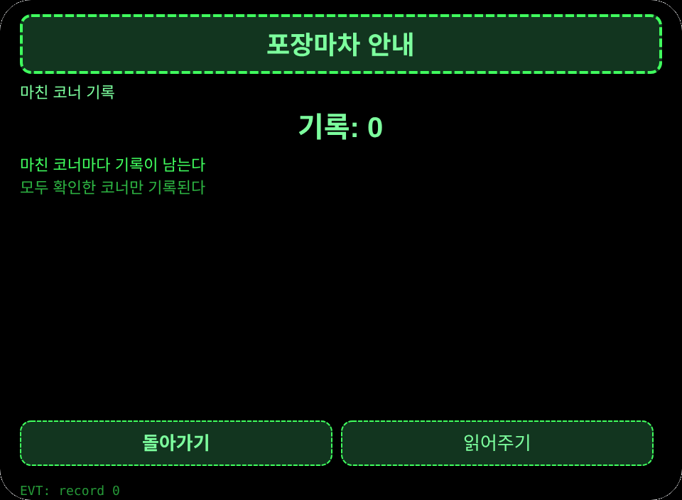

# 포장마차 안내

**Studio 가져오기 주소**(Global AIUI Studio Import Project 입력란에 복사):

```
https://github.com/sakai55/rokid/tree/agent-pojangmacha-guide
```

[pojangmacha-guide.aix](https://raw.githubusercontent.com/sakai55/rokid/main/aix/pojangmacha-guide.aix)

## 기능

부산 포장마차에서 밤참을 먹는 사람이 양손으로 접시를 든 채 머리 방향으로 포장마차를 고르고 끄덕임으로 확인 항목을 마친다。

## 장면

부산 포장마차에서 밤참을 먹는 사람이 양손으로 접시를 든 채 머리 방향으로 포장마차를 고르고 확인을 마친다。

## 방향 구성

한국 현지 × 방향성(머리 방향 포장마차 선택) × 주의력(확인 항목 지킴)。

## 안경 전용 능력

시선과 머리 방향 조정: 접시를 든 손으로는 휴대전화를 꺼낼 수 없을 때, 고개를 돌린 포장마차가 선택된다. 접선: pages/index/index.ink의 _startSensor와 _onYaw, 끄덕임은 primaryTap이다。

## 페이지

| 페이지 | 페이지 |
|---|---|
| pages/index | 코너 6곳 목록 |
| pages/detail | 확인 항목 4개 |
| pages/record | 마친 코너 기록 |

## 내용 집합

코너 6곳 × 확인 항목 4개 = 24개 확인 항목。

## 세션 간 저장

저장 키 `pojangmachaGuideV1`(선택 코너, 마친 코너 기록, lastError)。

## 권한

권한 선언 없음. 음성 읽기는 호스트 관리로 선언이 필요 없다。

## 제스처 대응

| 한 번 누르기 | Enter | 주 확인 |
| 위아래 밀기 | ArrowUp / ArrowDown | 선택 전환 |
| 끄덕임 | onHeadGesture('nod') | 주 확인과 동일 |
| 두 번 누르기 | Backspace | 돌아가기 |

## 오류 코드

- `E5001` 저장 쓰기 실패
- `E5002` 저장 읽기 실패
- `E3005` 음성 읽기 실패
- `E8001` 페이지 이동 실패
- `E7001` 머리 센서 사용 불가 또는 읽기 실패

- 가격과 맛은 현장 포장마차가 기준이며, 내장 목록은 예시이다.
- 센서가 없을 때는 버튼으로 코너를 고를 수 있다.

## 미리 보기 이미지






## 심사 자료

### Feature Description

부산 포장마차에서 밤참을 먹는 사람이 양손으로 접시를 든 채 머리 방향으로 포장마차를 고르고 끄덕임으로 확인 항목을 마친다。

### Opening Message

부산 포장마차에서 밤참을 먹는 사람이 양손으로 접시를 든 채 머리 방향으로 포장마차를 고르고 끄덕임으로 확인 항목을 마친다。

### Preview Media

[preview-pojangmacha-guide-video.mp4](https://raw.githubusercontent.com/sakai55/rokid/main/screenshots/pojangmacha-guide/preview-pojangmacha-guide-video.mp4)


### Change Log

- Features：초판 기능은 위와 같다.
- Improvements：없음.
- Fixes：없음.

## 기기 시험 정보

| Studio 이름 | 미기입 |
|---|---|
| Studio 이름 | 미기입 |
| Version / Build | 미기입 |
| App Category | 미기입 |
| Intent Description | 미기입 |
| Agent ID | 미기입 |
| 상태 | 미기입 |
