# 서울 생활 수첩

**Studio 가져오기 주소**(Global AIUI Studio의 Import Project 입력란에 붙여 넣으세요):

```
https://github.com/sakai55/rokid/tree/agent-seoul-life-hub
```

**AIX 직접 다운로드**(최신 버전): [seoul-life-hub.aix](https://raw.githubusercontent.com/sakai55/rokid/main/aix/seoul-life-hub.aix)

KR19 · 한국 현지 × 집합 총괄 × 주의. 서울에서 일주일을 사는 방문객이 수첩 한 권으로 일상 도구 20가지를 끝까지 사용합니다

## 미리보기 스크린샷

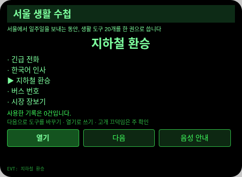

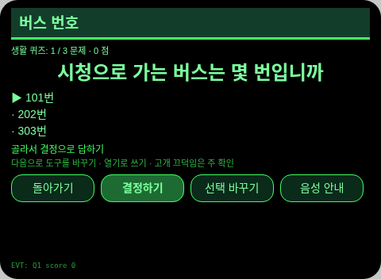
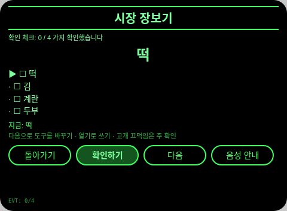
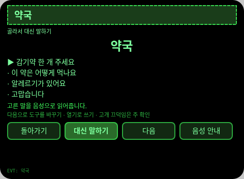
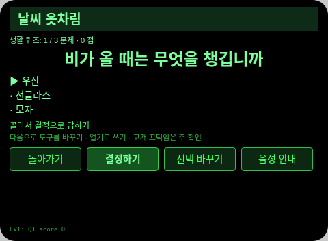
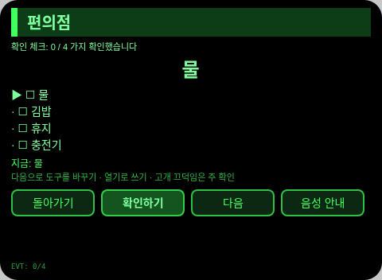
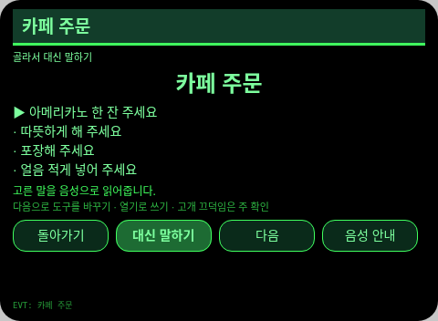
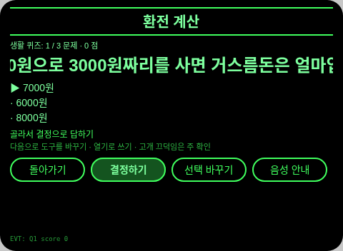
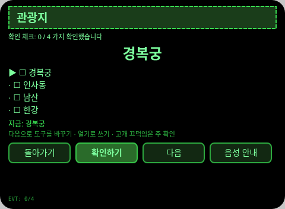
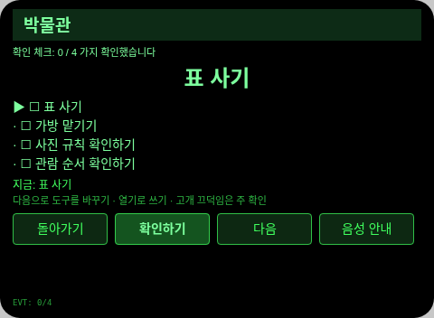
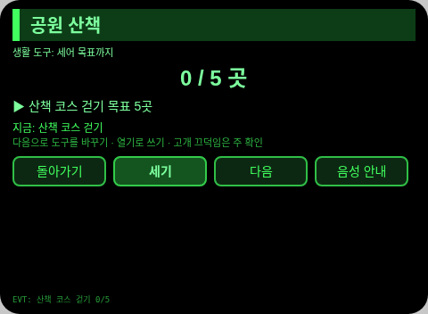
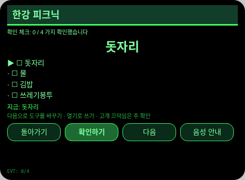
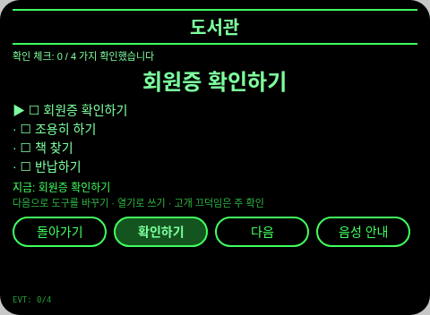
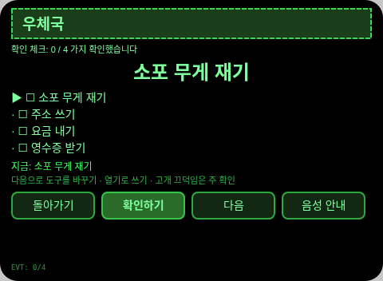
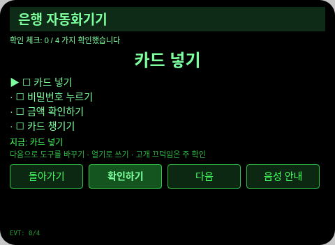
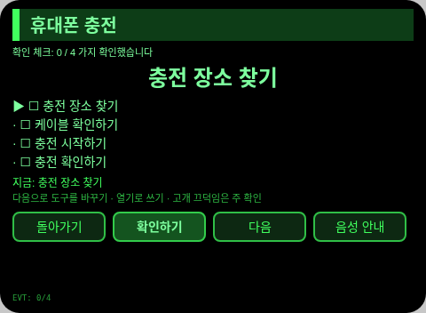
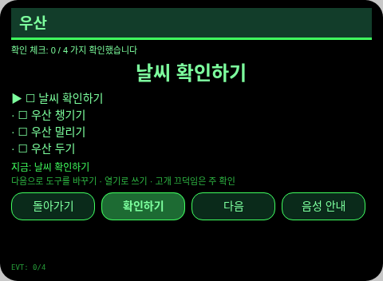
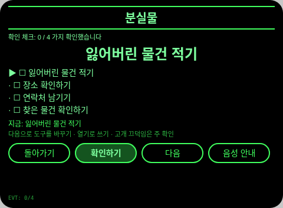
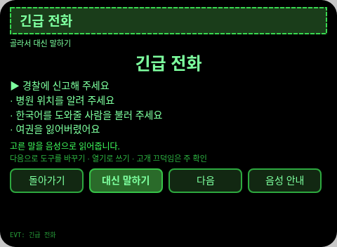
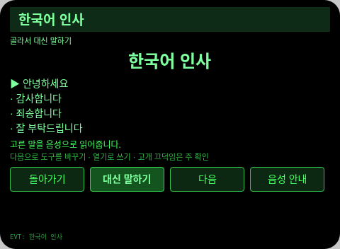
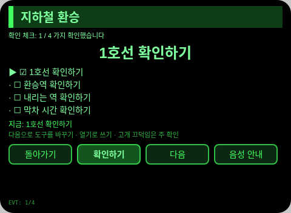

## 방향 구성

- 이 Agent의 방향 구성: 한국 현지 × 집합 총괄 × 주의. 각 방향은 장면 안에서 대체할 수 없는 한 고리를 맡으며, 기능 짜깁기가 아닙니다. (기획 당시에는 지향성도 올렸으나, 완성 후 재검토에서 도구 페이지 20개 모두 방향 메커니즘을 담지 않아 세 방향으로 정정했고, 부풀려 표시하지 않습니다.)
- 한 줄 장면: 서울에서 일주일을 사는 방문객이 수첩 한 권으로 일상 도구 20가지를 끝까지 사용합니다.

## 구조와 기능

21개 페이지: `pages/index/` 생활 수첩 목록(도구 이름 20개를 다섯 개씩 창에 표시, 위아래로 고르고 Enter로 열기). 도구 페이지는 각 하나의 기능입니다. 확인 체크리스트 13개 페이지(각 4항목, 고개 끄덕임으로 항목마다 체크, 다 되면 완료 기록), 선택형 문답 3개 페이지(각 3문항, 3지선다, 정오 TTS + 해설), 대신 말하기 문구 3개 페이지(각 고정 문구 4개, 주 확인 즉시 TTS가 대신 말하고 기록), 세기 1개 페이지(산책 목표 5곳 세기). 각 도구 페이지의 기능과 콘텐츠 집합은 서로 다르고, 상태 변형을 페이지 수로 세지 않습니다.

콘텐츠 집합 수: 생활 도구 20개, 체크리스트 13개 페이지 × 4항목, 문답 3개 페이지 × 3문항, 문구 3개 페이지 × 4문장, 세기 1개 페이지 목표 5곳, 사용 기록은 실제 건수대로 셉니다. 세션을 넘는 지속성: 저장 키 `seoulLifeHubV1`(선택 항목, 체크/답안/카운트 상태, 완료 기록 배열, `lastError`).

## 제스처 매핑

| 제스처 (안경다리 터치패드) | 키 이벤트 | 이 Agent에서의 역할 |
|---|---|---|
| 한 번 탭 | Enter | 주 확인(각 페이지의 주 버튼) |
| 위로 / 아래로 스와이프 | ArrowUp / ArrowDown | 옵션 전환 / 위아래 항목 |
| 고개 끄덕임 (머리가 안정됐을 때) | `onHeadGesture('nod')` | 주 확인과 동등 |
| 두 번 탭 | Backspace | 이전 페이지로 돌아가기(하위 페이지) |

## 권한

없음. TTS와 센서는 매니페스트 권한이 필요 없고, 카메라는 호출하지 않습니다.

## 정직한 경계

- 각 도구의 안내와 문장은 수록된 정형 내용입니다. 실제 가게와 기관의 안내가 기준입니다.
- 대신 말하기는 본인이 고른 정형 문장만을 읽습니다. 현장에서 새로 만든 말이 아닙니다.

## 오류 코드

실패하면 안경 화면에 코드만 표시되고, TTS는 코드만 읽으며, 가장 최근 오류는 지속 데이터의 `lastError`에 기록됩니다(코드, 이 기기의 slug, 버전, 원문 포함). 이 기기에서 나타날 수 있는 코드:

- `E5001` 기록 저장 실패(스토리지 쓰기 중 예외 발생)
- `E5002` 기록 읽기 실패(읽기/파싱 중 예외 발생)
- `E3005` 음성 안내 실패(TTS speak 중 예외 발생)
- `E8001` 페이지 전환 실패(navigateTo/navigateBack 중 예외 발생)

## 기기 테스트 정보

| 항목 | 내용 |
|---|---|
| Studio 이름 | 기입 예정 |
| Version | 1.0.0 |
| App Category | 기입 예정 |
| Intent Description | 기입 예정 |
| Agent ID | 기입 예정 |
| 상태 | 실기기 검증 전 |

## 심사 자료 (Review Submission)

Feature Description: 서울 생활 수첩: 서울에서의 일주일을 위한 수첩 한 권. 일상 도구 스무 가지(체크리스트, 퀴즈, 대신 말하기 문구, 세기)가 각자의 집합을 갖추고 사용 기록이 저장됩니다.

Opening Message: 서울에서 일주일을 보내시나요. 생활 도구 스무 개를 한 권의 수첩으로 써 보세요.

Preview Media:
- `preview-seoul-life-hub-index.png`
- `preview-seoul-life-hub-t01.png`
- `preview-seoul-life-hub-t02.png`
- `preview-seoul-life-hub-t03.png`
- `preview-seoul-life-hub-t04.png`
- `preview-seoul-life-hub-t05.png`
- `preview-seoul-life-hub-t06.png`
- `preview-seoul-life-hub-t07.png`
- `preview-seoul-life-hub-t08.png`
- `preview-seoul-life-hub-t09.png`
- `preview-seoul-life-hub-t10.png`
- `preview-seoul-life-hub-t11.png`
- `preview-seoul-life-hub-t12.png`
- `preview-seoul-life-hub-t13.png`
- `preview-seoul-life-hub-t14.png`
- `preview-seoul-life-hub-t15.png`
- `preview-seoul-life-hub-t16.png`
- `preview-seoul-life-hub-t17.png`
- `preview-seoul-life-hub-t18.png`
- `preview-seoul-life-hub-t19.png`
- `preview-seoul-life-hub-t20.png`
- `preview-seoul-life-hub-t01-s2.png`

> 정식 심사 제출에는 미디어 파일 3~5개가 필요하고 동영상(≤60초) 1개 이상이 포함되어야 합니다. 동영상은 GO가 실기기로 녹화한 뒤 추가합니다.

Change Log — Build 1.0.0:

- Features added: 첫 버전. 서울에서 일주일을 사는 방문객이 수첩 한 권으로 일상 도구 20가지를 끝까지 사용합니다
- Improvements: 없음 (첫 버전)
- Fixes: 없음 (첫 버전)
