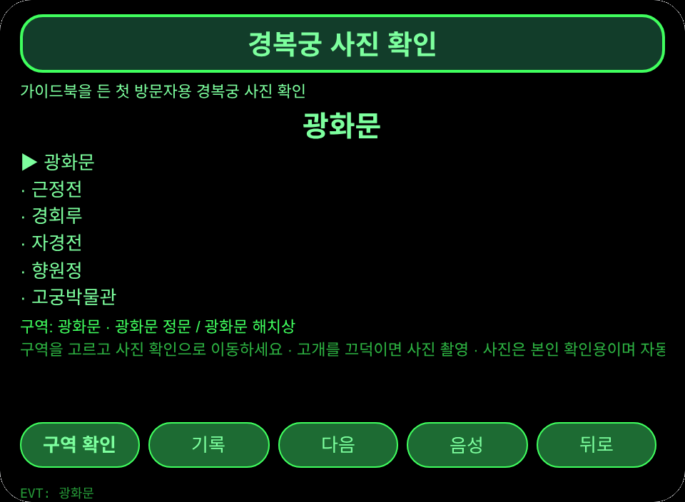
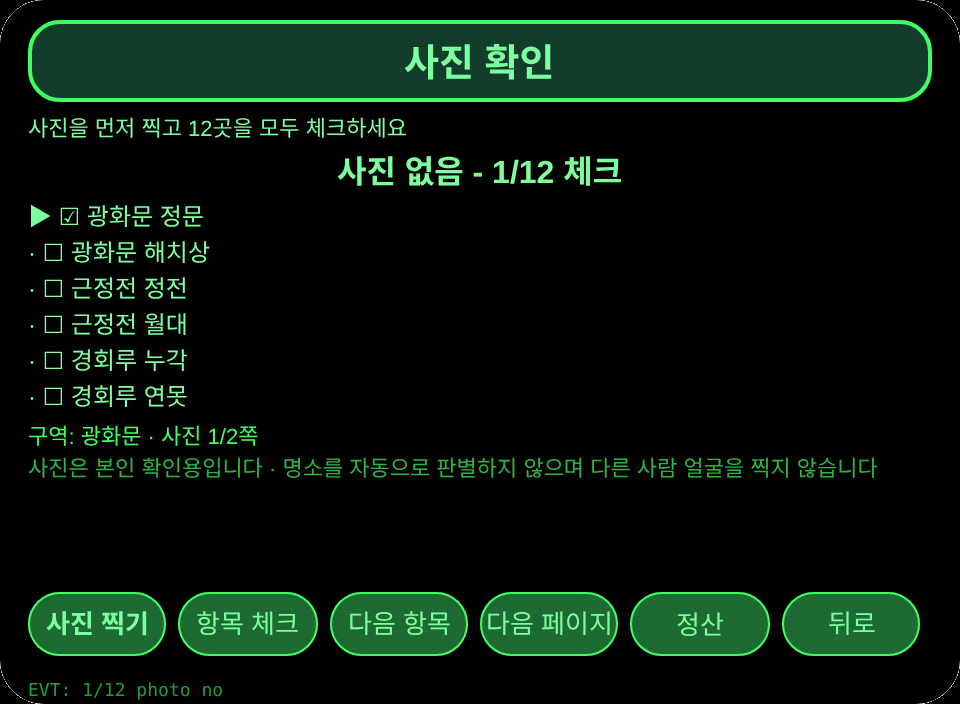
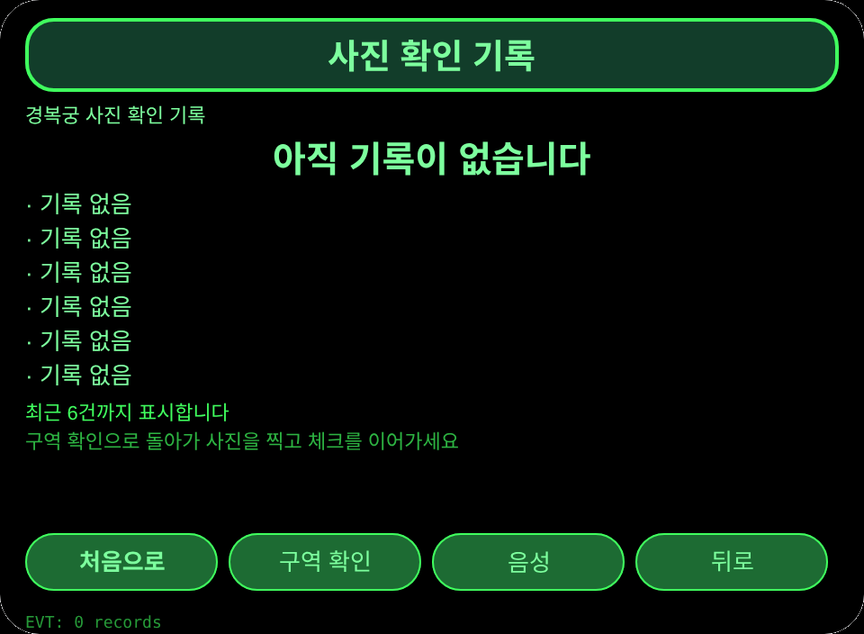

# 경복궁 사진 확인

**Studio 가져오기 주소**(Global AIUI Studio 가져오기 입력란에 복사):

```
https://github.com/sakai55/rokid/tree/agent-seoul-palace-photo
```

**최신 AIX 내려받기:** [seoul-palace-photo.aix](https://raw.githubusercontent.com/sakai55/rokid/main/aix/seoul-palace-photo.aix)

## 개요

KR27 seoul-palace-photo — 한국: 한국 현지 × 방향성 × 주의력. 가이드북을 든 경복궁 첫 방문자가 구역을 둘러보며 사진을 찍고 12곳을 체크합니다.

AIX 크기: 13339 B(배치 마감 단계에서 채웁니다).

## 장면

가이드북을 든 첫 방문자가 경복궁 구역을 둘러봅니다. 구역을 바라보고 고개를 끄덕여 사진을 찍고, 사진 확인 페이지에서 12곳을 체크합니다. 사진이 없거나 체크가 끝나지 않으면 정산할 수 없습니다.

## 방향 구성

한국 현지 × 방향성(바라본 구역을 사진으로 확인) × 주의력(12곳 체크와 정산 게이트). 세 가지가 모여야 정산 기록이 생깁니다.

## 안경 전용 기능

양손이 바쁜 첫 방문자를 위한 맨손 첫 시점 즉시 촬영: 카메라가 시선과 같은 방향을 보므로 구역을 바라보는 것만으로 사진 방향이 정해지고, 고개를 끄덕이면 손을 쓰지 않고 촬영합니다. 휴대폰을 꺼내면 그 순간을 놓치고 한 손이 묶입니다.

사진 연결 증거: pages/check/index.ink photoTap에서 getUserMedia와 ImageCapture takePhoto(넓은 화각)를 실행하고, Blob을 arrayBuffer와 나눈 btoa로 변환한 뒤 사진 자체는 세션 메모리에만 두고 저장소에는 촬영 시각과 바이트 수만 남깁니다. 정산 게이트는 pages/check/index.ink checkoutTap입니다.

## 사생활 안내

사진은 방문자 본인의 확인용 증거일 뿐입니다. 명소를 자동으로 판별하지 않으며 다른 사람 얼굴을 찍지 않습니다. 체크는 방문자가 직접 합니다.

## 페이지

| 페이지 | 역할 |
|---|---|
| pages/index | 6개 구역, 각 구역의 사진 2곳, 사진 확인 또는 기록으로 이동 |
| pages/check | 12곳 체크, 고개를 끄덕여 사진 촬영, 사진과 전체 체크가 필요한 정산 게이트 |
| pages/record | 최근 6건 정산 기록과 전체 건수 |

## 내용 집합

6개 구역 × 12곳: 광화문(광화문 정문, 광화문 해치상), 근정전(근정전 정전, 근정전 월대), 경회루(경회루 누각, 경회루 연못), 자경전(자경전 침전, 자경전 정원), 향원정(향원정 정자, 향원정 연못), 고궁박물관(고궁박물관 전시실, 고궁박물관 정원). 정산 기록은 실제 건수로 셉니다.

## 저장

세션 간 저장 키 `seoulPalacePhotoV1`. 선택한 구역, 체크 상태, 사진 촬영 시각과 바이트 수, 정산 기록 배열, lastError를 저장합니다. 사진 자체는 저장하지 않습니다.

## 권한

`CAMERA`만 사용합니다. 음성 안내는 별도 권한이 필요 없고 위치는 사용하지 않습니다.

## 제스처

한 번 누르기(Enter)나 고개 끄덕이기가 사진 확인 페이지의 주 동작이며, 위아래 밀기로 항목을 바꾸고, 두 번 누르기로 돌아갑니다. 체크와 정산은 화면 버튼으로 실행합니다.

## 오류 코드

- `E8004` 카메라 연결 수단이 없음
- `E2001` 사진 촬영 실패
- `E2013` 사진 변환 실패
- `E5001` 저장 쓰기 실패
- `E5002` 저장 읽기 실패
- `E3005` 음성 안내 실패
- `E8001` 페이지 이동 실패

실패하면 화면에 코드만 표시하고, lastError에 코드와 slug, 버전, 원문을 남깁니다. 실패한 사진은 확인이 된 것처럼 표시하지 않습니다.

## 미리보기 스크린샷

미리보기 스크린샷은 배치 마감 단계에서 촬영합니다. 슬롯은 다음과 같습니다.






## 제출 자료

### 기능 설명

경복궁을 처음 방문한 사람이 가이드북을 든 채로 구역을 둘러보며 사진을 찍고 12곳을 체크합니다. 사진이 없거나 체크가 끝나지 않으면 정산할 수 없습니다. 사진은 본인 확인용이며 명소를 자동으로 판별하지 않습니다.

### 시작 메시지

구역을 고르고 사진을 찍은 뒤 12곳을 모두 체크하세요. 사진과 체크가 끝나야 정산할 수 있습니다.

### 미리보기 미디어

1개 동영상(preview-seoul-palace-photo-video.mp4) + 3개 이미지: preview-seoul-palace-photo-index.png, preview-seoul-palace-photo-check-s2.png, preview-seoul-palace-photo-record.png.

### 변경 기록

- 1.0.0: 기능 추가 - 6개 구역과 12곳, 바라본 방향 사진 촬영, 체크 확인, 사진 게이트 정산과 미체크 안내, 정산 기록.

## 기기 테스트 정보

| 항목 | 값 |
|---|---|
| Studio 이름 | 입력 전 |
| 버전 | 1.0.0 |
| 분류 | 입력 전 |
| 의도 설명 | 입력 전 |
| Agent ID | 입력 전 |
| 상태 | 가져오지 않음 |
