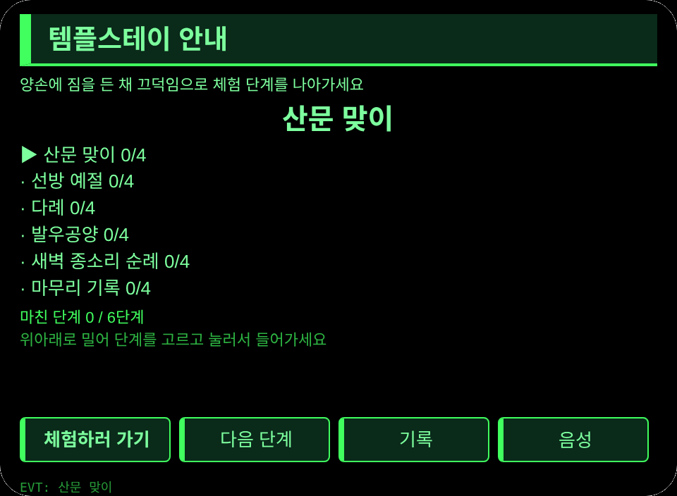
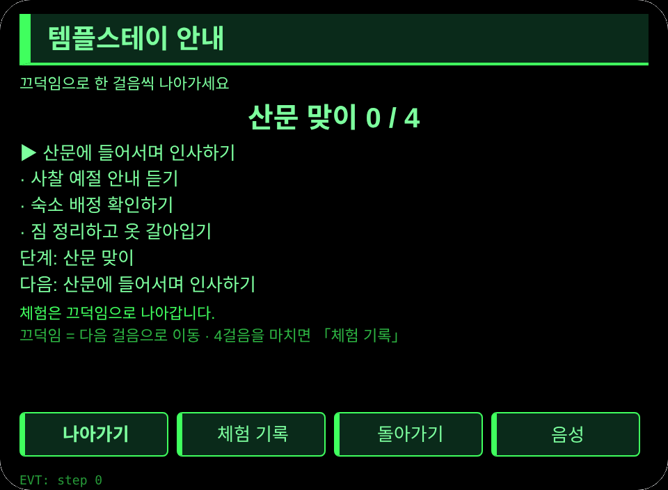
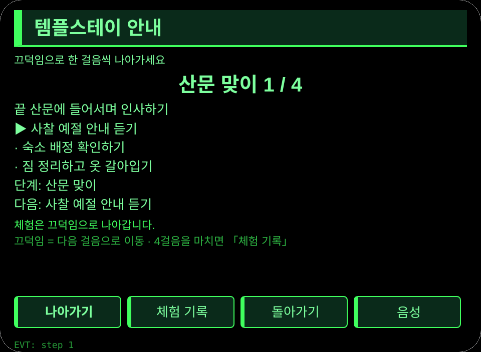
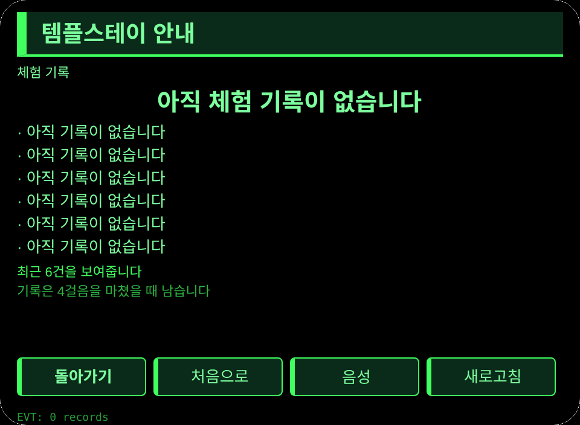

# 템플스테이 안내

**Studio 가져오기 주소**(Global AIUI Studio Import Project 입력란에 복사):

```
https://github.com/sakai55/rokid/tree/agent-templestay-guide
```

[templestay-guide.aix](https://raw.githubusercontent.com/sakai55/rokid/main/aix/templestay-guide.aix)

## 개요

템플스테이에 처음 온 사람이 양손에 짐을 든 채 휴대전화를 꺼내지 않고, 끄덕임으로 6단계 24걸음의 체험 과정을 하나씩 나아가며, 단계를 마치면 체험을 기록한다.

## 장면

템플스테이에 처음 온 사람이 양손에 짐을 든 채 휴대전화를 꺼내지 않고, 끄덕임으로 체험 과정을 나아가며, 마치면 기록을 남긴다.

## 방향 구성

한국 현지 × 커브컷(양손이 찬 처음 방문자) × 주의력(6단계 24걸음을 하나씩 지키기). 커브컷은 양손이 찬 상태에서의 이용을 맡고, 주의력은 걸음을 하나씩 나아가는 일을 맡는다.

## 안경 전용 기능

눈앞 단계별 안내와 양손이 바쁠 때 끄덕임으로 나아가기: 양손에 짐을 들고 있을 때는 휴대전화를 꺼낼 수 없지만, 눈앞에 지금 단계의 한 걸음이 크게 나오고, 끄덕이기만 하면 다음 걸음으로 나아가며, 다음 걸음은 음성으로 들을 수 있다. 접선: pages/guide/index.ink의 onHeadGesture('nod')가 primaryTap과 같은 한 걸음 나아가기이며, primaryTap은 다음 걸음을 음성으로 읽어준다. 끄덕임을 쓸 수 없을 때는 버튼으로 나아갈 수 있다.

## 솔직한 경계

- 체험 과정은 일반적인 템플스테이 흐름이며, 사찰마다 순서가 다를 수 있어 현장 안내가 기준이다.
- 수행 정도를 재지 않으며, 체험은 본인이 마치는 대로 기록한다.
- 4걸음을 마치지 않은 단계는 기록하지 않는다.
- 끄덕임을 쓸 수 없을 때는 버튼으로 나아갈 수 있다.

## 페이지

| 페이지 | 페이지 |
|---|---|
| pages/index | 체험 6단계 목록, 단계마다 나아간 걸음 |
| pages/guide | 고른 단계에서 4걸음을 끄덕임으로 하나씩 나아가고 마치면 기록 |
| pages/record | 최근 6건의 체험 기록과 합계 |

## 내용 집합

체험 6단계(산문 맞이／선방 예절／다례／발우공양／새벽 종소리 순례／마무리 기록) × 각 4걸음, 모두 24걸음이다. 기록은 건수로 센다.

## 저장

저장 키 `templestayGuideV1`. 고른 단계, 단계마다 마친 걸음 수, 체험 기록 배열, lastError를 저장한다.

## 권한

권한 없음. 음성 읽기는 권한이 필요 없고, 카메라와 위치 정보는 사용하지 않는다.

## 제스처

| 한 번 누르기 | Enter | 주 확인(단계 고르기·걸음 나아가기) |
| 위아래 밀기 | ArrowUp / ArrowDown | 단계 선택 바꾸기 |
| 끄덕임 | onHeadGesture('nod') | 주 확인과 동일 |
| 두 번 누르기 | Backspace | 돌아가기 |

## 오류 코드

- `E5001` 저장 쓰기 실패
- `E5002` 저장 읽기 실패
- `E3005` 음성 읽기 실패
- `E8001` 페이지 이동 실패

실패하면 화면에 있는 그대로의 코드를 보여주고, lastError에는 코드와 slug, 버전, 원래 문구를 함께 남긴다.

## 미리보기 스크린샷






## 제출 자료

### Feature Description

템플스테이에 처음 온 사람이 양손에 짐을 든 채 휴대전화를 꺼내지 않고, 끄덕임으로 6단계 24걸음의 체험 과정을 하나씩 나아가며, 단계를 마치면 체험을 기록한다.

### Opening Message

템플스테이에서 양손이 차도 괜찮아요. 눈앞의 한 걸음을 보고 끄덕여 나아가요.

### Preview Media

[preview-templestay-guide-video.mp4](https://raw.githubusercontent.com/sakai55/rokid/main/screenshots/templestay-guide/preview-templestay-guide-video.mp4)


### Change Log

- Features：초판 기능은 위와 같다.
- Improvements：없음.
- Fixes：없음.

## 기기 테스트 정보

| 항목 | 내용 |
|---|---|
| Studio 이름 | 미기입 |
| Version / Build | 미기입 |
| App Category | 미기입 |
| Intent Description | 미기입 |
| Agent ID | 미기입 |
| 상태 | 미기입 |
