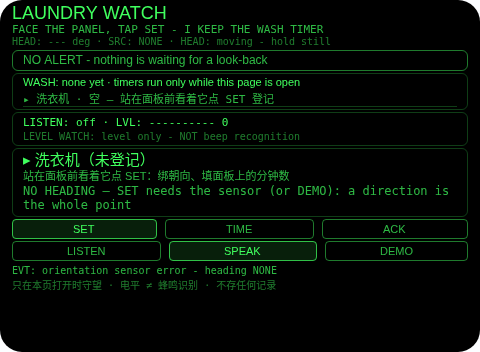
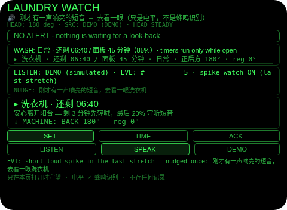
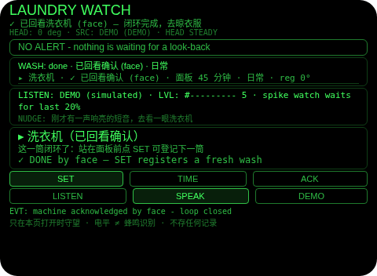

# laundry-watch · 洗衣守望

**Studio 导入地址**（复制到 Global AIUI Studio 的 Import Project 输入框）：

```
https://github.com/sakai55/rokid/tree/agent-laundry-watch
```


Rokid 眼镜 AIUI 智能体（注意力外挂系列 W03，守望型 WATCH）：洗衣机在阳台，洗完没人知道，衣服闷一天；反复跑去阳台看更费神。站在面板前看一眼登记——头部朝向就是洗衣机的地址，面板上显示的分钟数（你亲眼读的）就是唯一的时钟——之后倒计时在你视线里走着，你尽管离开阳台；剩 3 分钟它先轻喊一声，估时走完它按「相对你的方向」叫你回去晾衣，直到你真的走回去看回洗衣机（回看 = 确认）。可选的守听层只认电平的形状：最后 20% 时段里一声短促的响亮声音，提醒你去看一眼——**电平不是蜂鸣识别，它永远只说「刚才有一声响亮的短音」**。

## 预览截图

本地 `aix preview` 渲染（480×352，演示状态）：







## 解决的问题

- 洗衣机多在阳台/卫生间，洗完的提示音隔着门根本听不见，衣服在筒里闷一天发臭；
- 不放心就反复跑去看：一次洗衣来回跑三四趟，注意力全耗在「洗完没」上；
- 手机定时器能响，但它不知道洗衣机在哪、响完你没去它也不管，关掉闹钟照样忘。

## 注意力外包设计（为什么必须是眼镜）

- **朝向即地址**：登记时你正看着面板，头部朝向就是洗衣机的位置；到点播报的是「右后方的洗衣机」，胸前设备没有你的视线，不知道机器在你哪个方向。
- **回看即确认**：确认动作不是掏手机点掉闹钟，而是走回阳台、把视线落回洗衣机并停住 1 秒——确认与「人真的到了机器跟前」是同一件事，胸前设备看不见你的视线，做不了这种确认。
- **余光里的倒计时**：剩余时间与机器的相对方向常驻视线边缘，离开阳台后随时一瞥就知道还要等多久、等会儿往哪儿走，不必掏任何设备。
- **守听只借耳朵的余量**：全向电平流在最后 20% 才睁眼，一声短促响音换一次提醒；它不假装听懂声音，只把「好像有动静」这份不确定如实交还给你的眼睛判断。

## 功能流程

1. 站在洗衣机面板前看着它，点 **SET** 登记：当前头部朝向被绑定；下滑选衣量（小件 / 日常 / 大件），上滑选面板分钟数（15 / 30 / 45 / 60 / 90），再单击开始守望。**衣量只是标签，从不参与计算；时间以面板显示为准。**没有朝向读数时登记如实拒绝。
2. 洗涤中随时看指南框：洗衣机在你的哪个方向、还剩多久。点 **TIME** 加 5 分钟（脱水/漂洗比面板估时久时用）。洗涤中连点两次 SET 才能替换登记（先武装、再打开、确认才换），绝不静默丢弃当前这筒。
3. 还剩 3 分钟（仅估时 >5 分钟的筒）轻喊一次：「洗衣快结束了，还剩大约三分钟，准备晾衣服」。
4. 点 **LISTEN**（可选）开全向电平守听：只在最后 20%（或到点未确认期间）睁眼；一声短促响音（电平跳高又在 2 秒内落下）提醒一次「刚才有一声响亮的短音，去看一眼洗衣机」，同一段响声不重复，需 4 秒安静重新布防；窗口外的短音（电视、关门）忽略；持续轰鸣（脱水声）故意不作信号。再点一次 LISTEN 关闭并释放麦克风。
5. 估时走完：按洗衣机相对你的方向朗读一次「<方向>的洗衣机到时间了，去晾衣服」，横幅留在眼前不重复喊。走回阳台看向洗衣机、头稳住停满 1 秒 = 回看确认（记 `face`），或点 **ACK**（记 `tap`）。快速扫过不算数。
6. 点 **SPEAK** 或头部稳定时点头，随时听当前进度。
7. **DEMO**：播入一筒演示衣（面板 45 分钟、已洗 85%、洗衣机在正前方、模拟守听开启，约 2 秒后抛出一声短促响音触发提醒）；每点一次 DEMO 转头 +45° 并快进 6%：途中响起 3 分钟轻喊，估时走完报警，转回正对洗衣机停满 1 秒触发回看确认；转满一圈后再点一次退出，恢复你真实的这筒，全程不写任何存储。

## 手势映射

镜腿触控板手势为一等输入（宿主把触控板映射为按键事件，本 Agent 的按键分发逐一对应，档案 §3.2.1）：

| 手势 | 宿主事件 | 本 Agent 行为 |
| --- | --- | --- |
| 单击 | Enter | 情景主操作：登记中 = 开始守望；洗衣机在等回看 = 确认（ACK）；替换已武装 = 打开登记；其余 = 登记（无筒时）或朗读状态 |
| 滑动 | ArrowUp / ArrowDown | 登记中：上滑换面板分钟数（15→30→45→60→90 循环），下滑换衣量（小件→日常→大件循环） |
| 双击 | Backspace | 返回（宿主处理），Agent 不拦截 |
| 单指长按 | —（系统级） | 唤醒 AI 助手，与本 Agent 无关 |
| 点头（头部稳定时） | `onHeadGesture('nod')` | 朗读当前状态（等同 SPEAK）；**从不代替回看确认**——确认必须真的把视线落回洗衣机 |

主流程（登记 → 等待 → 到点 → 回看确认）全部可用手势单独完成（Node 断言第 7 组已走通）。屏幕保留 6 个按钮作为同义入口与状态可见性：

- **SET**：登记/替换洗衣机的唯一入口，保留——登记是低频但关键的显式动作；
- **TIME**：登记中 = 选面板分钟数（滑动的同义入口）；洗涤中 = 加 5 分钟，保留——「还没洗完、再给它几分钟」是高频小动作；
- **ACK**：回看确认的点按后备，保留——朝向传感器不可用时唯一的确认路径；
- **LISTEN**：麦克风开关（涉及权限与隐私），必须显式保留为按钮；
- **SPEAK**：朗读状态，点头的同义入口，保留——点头在嘈杂/不便时不总可用；
- **DEMO**：安全试玩入口（不写存储、不动真实登记之外的状态），保留。

## 权限

| 权限 | 用途 |
| --- | --- |
| `RECORD_AUDIO` | LISTEN 守听的全向麦克风电平流（只算 RMS 电平，不录制、不保存、不上传） |

- 不用相机、不用定位：登记靠头部朝向与你亲眼读的面板分钟数。
- **零持久化（构造级）**：本 Agent 不写任何存储——登记、剩余时间、电平读数只活在本次会话内存里，页面关掉一切消失。麦克风音频从不落盘。
- **守望只在本页打开时存在**：倒计时、轻喊、到点播报与电平守听只在 Agent 打开期间运行；关掉页面或眼镜息屏后不会有任何提醒，更不会推送到手机。界面底行常驻写明。
- TTS 从不设置语言属性（宿主不采纳）；全向麦克风模式只作用于电平流，本 Agent 没有语音识别环节。

## 打包与预览

```bash
cd ~/workspace/rokid/laundry-watch
~/tools/bin/aix pack . -o ../dist/laundry-watch.aix   # 产物进仓库 aix/laundry-watch.aix
~/tools/bin/aix preview . --html-out artifacts/preview.html
```

## 真机测试

海外版链路 Path 1（无线）：Global Studio 导入本分支 → 构建与提审里打包保存新版本 → Rokid AI App（海外版）设置 → 开发者选项 → AIUI → 更新眼镜资源包 → 等「智能体资源包下载成功」→ 对眼镜说「乐奇，打开洗衣守望智能体」。

真机核对清单：

- [ ] 站在面板前点 SET，指南框朝向与登记行 `reg` 角度符合登记时站位
- [ ] 上滑/下滑切档顺滑；单击开始后清单行显示剩余时间与相对方向
- [ ] 走开后回头看：方向箭头随转头实时变化（↖↗ 等 8 向）
- [ ] TIME 加 5 分钟生效（总数与剩余同步增加）
- [ ] 还剩 3 分钟轻喊只响一次；估时走完到点播报带正确方向、只响一次
- [ ] 回阳台看向洗衣机停 1 秒：横幅消失、记 `face`；快速转头扫过不触发
- [ ] LISTEN 开启后电平条跳动；在最后 20% 人为拍一下手（短促响声）→ 提醒一次且文案是「响亮的短音」而非「蜂鸣」；持续说话/放音乐（持续响）不触发
- [ ] 窗口外（刚开始洗时）拍手不触发提醒
- [ ] 头部稳定时点头只朗读、不确认；关掉页面后到点不再有任何声音（预期行为）

## 真机测试信息

| 字段 | 值 |
| --- | --- |
| Studio 名称 | 待导入后回填 |
| Version / Build | 待导入后回填 |
| App Category | 待导入后回填 |
| Intent Description | Laundry Watch: look-to-register panel-minutes wash timer with spike-level nudge and look-back acknowledgement |
| Agent ID | 待导入后回填 |
| 状态 | 本地构建完成（Node 断言 84/84 通过，aix 打包与本地预览已验证）；未导入 Studio、未真机测试 |

## 验证情况

已验证（本地，2026-10-24）：

- 静态校验：app.json / package.json / `<script def>` JSON 解析通过；页面脚本与 app.js `node --check` 通过；无 `Page(`/`App(`/`Widget(`/`workers:` 残留；6 个按钮绑定齐全。
- Node 断言 84/84（宿主 API 全桩件复刻）：无朝向/无传感器时 SET 如实拒绝；滑动选档与衣量标签不入算；倒计时逐拍递减；TIME +5 分钟；剩 3 分钟轻喊恰在 720 拍触发且只一次、短估时（≤5 分钟）不喊；到点播报带方向且只一次；回看确认的驻留语义（入锥只算开始、满 5 拍才确认、出锥重置、头不稳不算）；点按确认与非报警时 ACK 被忽略；替换登记先武装后确认、报警期间 SET 被拒；**电平守听纪律**：窗口外短音忽略、窗口内短音只提醒一次、同 episode 不重复、4 秒安静重新布防、新 episode 再提醒、8 拍（2 秒）边界算短音、9 拍算持续响不提醒、持续轰鸣不作信号、报警等待期间窗口保持开启、OverconstrainedError 回退默认麦并标注、LISTEN 关闭/onHide 释放轨道；点头纪律（不稳忽略、只朗读、从不确认、登记中忽略、非点头忽略）；纯手势全流程走通；DEMO 播种 85%、脚本短音触发提醒、快进跨过轻喊与到点、回看确认闭环、退出无损恢复真实筒；全程 wx 调用为 0、TTS 从不设 lang、所有播报文本无任何声音分类措辞。

未验证（必须如实说明）：

- **电平不是蜂鸣识别**：运行时没有声音分类器。本 Agent 只认「窗口内一声短促的响亮声音」这个电平形状——洗衣机完工提示音、微波炉、门铃、电视音效在电平上长得一样。它只负责说「刚才有一声响亮的短音，去看一眼」，判断那声是什么的是你的眼睛；窗口与 episode 纪律只是把误报压到可接受，不等于听懂了声音。
- **估时就是面板估时，不是真实结束时刻**：暂停、加衣、进水慢都会让真实结束漂移；到点播报只表示「面板估时走完了」，所以确认权设计在你的回看上，本 Agent 不替你断言衣服洗完了。
- 宿主真机上的 AnalyserNode 行为、`getUserMedia` 的 `microphoneMode: 'omnidirectional'` 支持度与 `getSettings()` 回读，需真机核对；不支持时回退默认麦克风并在界面标注。
- yaw 长期漂移（磁干扰）会让相对方向与回看锥失准；登记朝向只对登记时站位成立，换站位几何即变（同 #07 / #28 的已知限制）。
- TTS 在嘈杂阳台/洗衣机轰鸣环境中的可听度、宿主朝向传感器精度与稳定性事件的真实行为，需真机核对。
- 守望只在本页打开时成立：关页面/息屏后倒计时与守听都停摆，这是平台约束不是缺陷，但意味着「开着页面把眼镜放桌上等」与「戴着做别的事」才是预期用法。

## 提审资料 (Review Submission)

### Feature Description（457 字符 ≤500）

Register your washing machine by looking at its panel: the glasses bind the direction you face and count down the minutes the panel itself shows. A soft call at three minutes left, a spoken alert naming the machine's direction when the estimate ends, and an optional level watch that nudges you once if a short loud sound occurs near the end. You confirm by walking back and looking at the machine. Level is not beep recognition; timers run only while open.

### Opening Message（404 字符 ≤500，Markdown）

## Laundry Watch

Stand at the panel, look at it, and tap **SET** - I bind that direction and count down the minutes the panel shows.

- **TIME** adds 5 minutes when a cycle runs long
- **LISTEN** watches sound level near the end - a short loud sound earns one nudge (level only, never beep recognition)
- When time is up I call you by direction; walk back and look at the machine for a second to confirm

### Preview Media

- 图片 ×3：`preview-laundry-watch-index.png`、`preview-laundry-watch-spike.png`、`preview-laundry-watch-acked.png`（本目录 `../screenshots/laundry-watch/`，本地 aix preview 渲染）
- 视频 ×1：待真机录制后补（提审要求 3–5 个媒体文件、至少 1 图 1 视频、视频 ≤60 秒）

### Change Log

#### Build 1.0.0

**Features added**

- Look-to-register wash watch: heading binding at the panel, panel-minutes countdown (15/30/45/60/90 presets), load-size label that never enters the math
- Three-minute soft call (estimates over 5 minutes), zero-time spoken alert naming the machine's relative direction, +5-minute TIME extension, arm-then-confirm re-registration
- Look-back acknowledgement: face the machine with a steady head for 1 second, or tap ACK
- Optional LISTEN level watch over an omnidirectional mic stream: one nudge per short-loud-sound episode inside the last 20% (or while the alert waits), quiet re-arm, sustained noise deliberately ignored
- Gesture-first control (temple tap/slides, nod to hear status) and a self-restoring DEMO seeded at 85%

**Improvements**

- None (first build)

**Fixes**

- None (first build)
