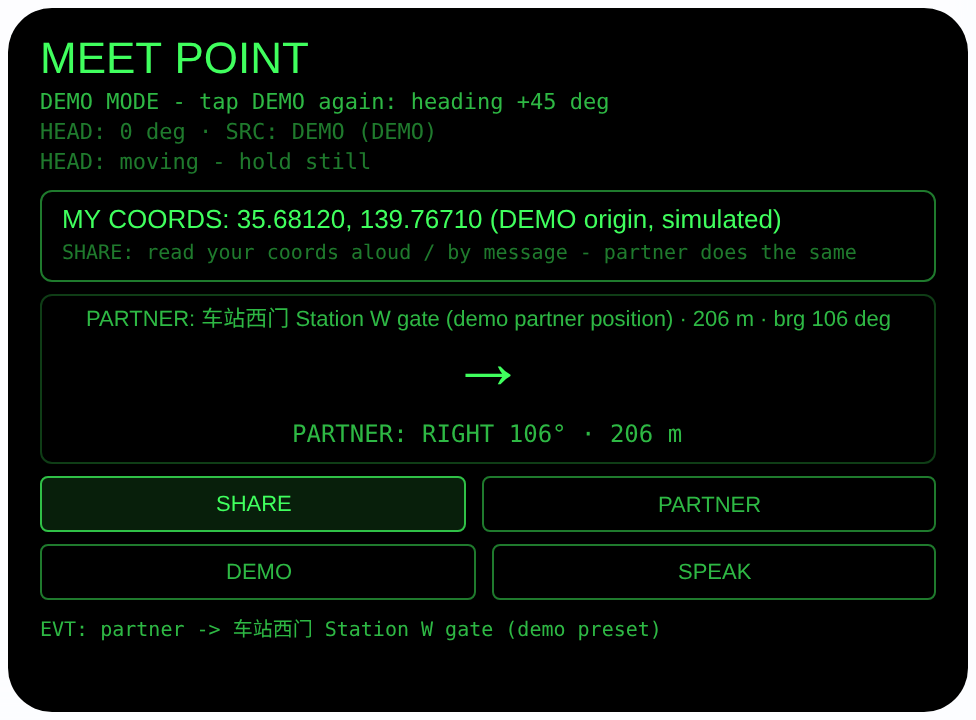
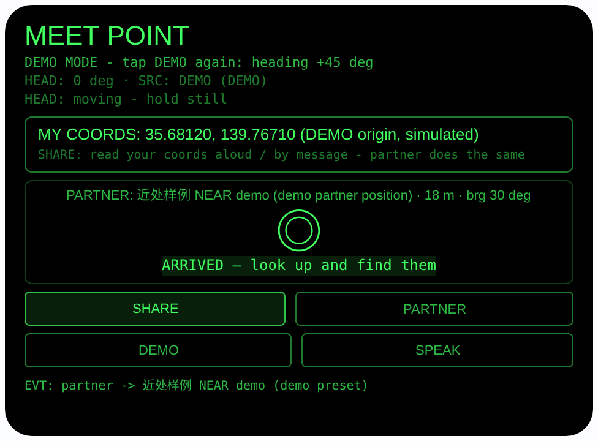

# meet-point — 汇合方位（Rokid 眼镜 AIUI Agent）

50 个「指向性生活问题」Agent 的第 08 个。在商场、景区和朋友走散，
电话里「我在那个店旁边」说了半天还是找不到人——本 Agent 把对方的
位置换算成相对你头部朝向的方向：大箭头 +「对方在你右前方 60°，
约 180 米」，转头让箭头朝上就往前走；走到约 25 米内，它直接说
「你到了，抬头找人」。

## 预览截图

截图统一存放于仓库根目录 `screenshots/meet-point/`。





## 解决的问题

走散后最难的不是知道对方在哪，是把「对方的位置」翻译成「我该往
哪走」。手机地图上两个蓝点看着近，人却转不清方向。本 Agent 只报
相对你头朝向的方向和距离，你转对了箭头就朝上，不用懂东南西北。

## 指向性设计（为什么必须用眼镜）

- **对方位置 → 相对头朝向（核心）**：用 Haversine 公式算对方距离、
  初始方位角公式算对方方位角，再算相对角 = 对方方位角 − 头部朝向
  （`AbsoluteOrientationSensor` 四元数 yaw，来源如实标注
  `SENSOR / DEMO / NONE`）。显示 8 向大箭头与
  「PARTNER: RIGHT-FRONT 60° · 183 m」；|相对角| ≤ 15° 高亮
  **ON COURSE — head that way**。
- **到达判定**：距离 < 25 米时 GPS 误差已经大过方向的意义，不再
  硬报角度，直接大字 **ARRIVED — look up and find them**——最后
  一步靠眼睛找人，这正是眼镜该做的收尾。
- **坐标朗读交换（诚实的通道）**：点 SHARE 定位后，自己的
  经纬度（5 位小数）大字显示，界面明示「把这组坐标念给对方」。
  双方用语音/消息互读坐标，就是位置交换的全部通道——运行时
  没有服务器，**不存在自动好友同步，本 Agent 不假装有**。
- **耳朵收指引**：SPEAK 用 TTS 念「对方在你右前方 60 度，约
  180 米」，由实时计算值生成；走路时不用低头看屏。
- **凝视确认**：`enableWorldAwareness()` 显示头部稳定状态
  （HEAD STEADY）；稳定时点头 = 重新定位并重算，走一段更新一次。

## 功能流程

1. 点 SHARE（或按 Enter / 稳定后点头）→ `navigator.geolocation`
   单次定位，自己的坐标大字显示；把坐标念/发给对方，对方同样操作
2. 对方位置用 PARTNER 切换：内置演示预设——广场北口
   （+0.0016, +0.0004，约 182 米）、车站西门（−0.0005, +0.0022，
   约 206 米）、咖啡店门口（+0.0002, −0.0011，约 102 米）、
   近处样例（约 18 米）；预设以「相对我定位的经纬度小偏移」表达，
   界面全程标注 `(demo partner position)`。真实使用时，把预设
   换成对方报给你的坐标，计算方式完全相同
3. 转头跟箭头走：箭头朝上 + ON COURSE = 方向对了；走一段点
   SHARE/UPDATE 重新定位重算；SPEAK 听相对方位播报
4. 距离 < 25 米 → ARRIVED 大字出现，抬头找人
5. DEMO 仿真：原点固定在标注了 DEMO 的演示坐标
   （35.68120, 139.76710），朝向从 0° 起每点一次 DEMO +45°；
   PARTNER 切到近处样例即进入 ARRIVED 态，预览可完整演示两态

> 诚实说明：运行时**没有好友实时同步服务**，对方位置来自双方
> 读坐标交换；预设是演示值并如实标注。箭头指直线方向，不是
> 逐向道路导航，实际道路请自行绕行。

## 权限

| 权限 | 用途 |
|---|---|
| GEOLOCATION | 单次定位自己的位置，计算对方相对方位与距离 |

仅此一项。定位只在用户触发时请求；朝向传感器不需要额外权限声明。

## 打包与预览

```bash
cd ~/workspace/rokid/meet-point
~/tools/bin/aix pack . -o ../dist/meet-point.aix
~/tools/bin/aix preview . --html-out artifacts/preview.html
```

本地预览截图走 `~/workspace/preview-tools/` 的本地 Ink + puppeteer 路线
（`shot-meet.js`；SEQ_A = DEMO→PARTNER 到车站西门指引态，
SEQ_B = PARTNER×2 到近处样例的 ARRIVED 态；按钮 canvas 坐标
PARTNER (352,248)、DEMO (120,282)）。

## 真机测试（海外版 · 云端下发 · Path 1）

1. 推到 GitHub 后，Global AIUI Studio（aiui-global.rokid.com，en-US）用
   分支导入：`https://github.com/sakai55/rokid/tree/agent-meet-point`
   （该分支根目录即本 Agent 文件）
2. Studio 的 **Device Debug** 页签填 Basic Information，在 AIX Packaging
   点 **Repackage and Save**，确认顶部出现绿色
   **● Debug version ready — Ready for device debugging**
3. **Hi Rokid**（海外版 `com.rokid.sprite.global.aiapp`，不是国内版
   Rokid Ai App）→ 设置 → 开发者选项 → AIUI → 更新眼镜资源包，
   等「智能体资源包下载成功」
4. 对眼镜说「乐奇，打开 meet-point」，和朋友各站一处点 SHARE，
   互读坐标后跟着箭头汇合

## 真机测试信息（Global AIUI Studio · Device Debug）

| 项目 | 值 |
|---|---|
| Agent Name（Studio） | 待导入后回填 |
| Version（Build） | 1.0.0（待导入后回填） |
| App Category | 待导入后回填 |
| Intent Description | 待导入后回填 |
| Agent ID | 待导入后回填 |
| AIX Package Size | 13.69 KB（本地打包 `dist/meet-point.aix`） |
| 状态 | 本地完成，待导入 Studio |
| Studio | aiui-global.rokid.com（en-US） |
| 下发方式 | 云端下发 → Hi Rokid（海外版）更新眼镜资源包 |

## 验证情况

**已验证**

- 静态检查：app.json / package.json JSON 解析通过；`<script def>` JSON
  解析通过；`<script setup>` 与 app.js 提取后 `node --check` 语法通过；
  全目录 grep 无 `Page(` / `App(` / `Widget(` / `workers:` 残留。
- 方位数学：用 Node 对同一套 Haversine / 方位角公式独立核算——演示
  原点下广场北口方位 11.5° / 182 米、车站西门 105.6° / 206 米、
  咖啡店门口 282.6° / 102 米、近处样例 30.1° / 18 米；朝向 0° 时
  车站西门相对角 +106°（RIGHT）与界面一致，近处样例 18 米 < 25 米
  正确进入 ARRIVED。
- 打包：`aix pack` 成功（大小见上表）；`aix list` 核对包内含
  AGENTS.md、app.js、app.json、package.json、README.md、
  pages/index/index.ink（artifacts/ 已被 .aixignore 排除）。
- 预览渲染：aix preview + 本地 Ink + puppeteer 截图两张（见下方
  Preview Media）：指引态完整渲染（车站西门 206 米、箭头 →、
  「PARTNER: RIGHT 106° · 206 m」）；切到近处样例后显示
  「ARRIVED — look up and find them」。预览主机无方向传感器，
  初始态如实显示 `SRC: NONE`（已处理，不崩溃）。

**未验证**

- 真机 AbsoluteOrientationSensor 朝向精度/零点、GEOLOCATION 精度
  与授权流程——预览主机都没有，未测；两人真机互读坐标汇合的
  全流程未实测。
- 真机头部稳定检测、点头重新定位、TTS 播报效果。
- **没有好友实时同步服务**：对方位置靠双方读坐标交换（预设为
  演示值）；运行时无地图/路径规划，箭头只指直线方向。

---

## 提审资料（Review Submission）

> Global AIUI Studio → Submit 页签的 Review Information 逐项对应下面四段，
> 提交时整段复制。每次提交前重新确认 Preview Media。

### Feature Description

Meet Point finds your friend, not just their dot on a map. Share your coordinates by reading them aloud, enter your partner's, and the glasses convert their position into a direction relative to your head: a big arrow plus "your partner is at your right-front, 60 degrees, about 180 metres." Turn until the arrow points up and walk. Within about 25 metres it switches to ARRIVED — look up and find them. No cardinal points, no staring at a phone.

### Opening Message

Hi, I'm **Meet Point** — I'll point you at your friend.

Tap **SHARE** and read your coordinates to your partner (they do the same). Then follow the **arrow**: it shows where your partner is *relative to your head*. Turn until it points up and **ON COURSE** lights up, then walk. Get within ~25 m and I'll say **ARRIVED — look up and find them**. Tap **SPEAK** anytime to hear it. No GPS? **DEMO** simulates the whole meeting.

### Preview Media

提交要求：3–5 个 JPG/PNG 图片或 MP4 视频，至少含 1 张图和 1 个视频，每次提交前重新确认。

- Image 1：`artifacts/preview-meet-point-index.png`（aix preview 指引态：车站西门预设 206 米、箭头 →、「PARTNER: RIGHT 106° · 206 m」，本地文件，提交时从本地上传）
- Image 2：`artifacts/preview-meet-point-arrived.png`（切到近处样例（约 18 米）后的到达态：大字「ARRIVED — look up and find them」，本地文件）
- Video：待真机补 — 真机录制「SHARE 定位 → 跟箭头走 → ARRIVED 抬头找到人」全过程（MP4），录好后放 `artifacts/` 并更新此处
- 状态：未齐（已有 2 张图；还需至少 1 个视频，总数补到 3–5 个后才可提交）

### Change Log

#### Build 1.0.0

**Features added**

- Partner direction relative to your head: partner coordinates converted via Haversine distance and initial bearing into a head-relative angle, shown as an 8-way arrow plus direction words and distance; ON COURSE highlight within 15 degrees, and an ARRIVED state under 25 metres that tells you to look up and find them.
- Honest coordinate exchange: SHARE shows your own lat/lon big to read aloud or message to your partner — no fake live friend sync; built-in labeled demo partner presets (plaza gate / station gate / coffee shop / a near sample) expressed as offsets around your fix.
- Spoken relative guidance in Chinese via SPEAK, generated from live values; nod (when head is steady) or Enter re-fixes position; DEMO simulation with a labeled origin and +45-degree heading steps shows both guidance and ARRIVED states.

**Improvements**

- None (initial release).

**Fixes**

- None (initial release).
