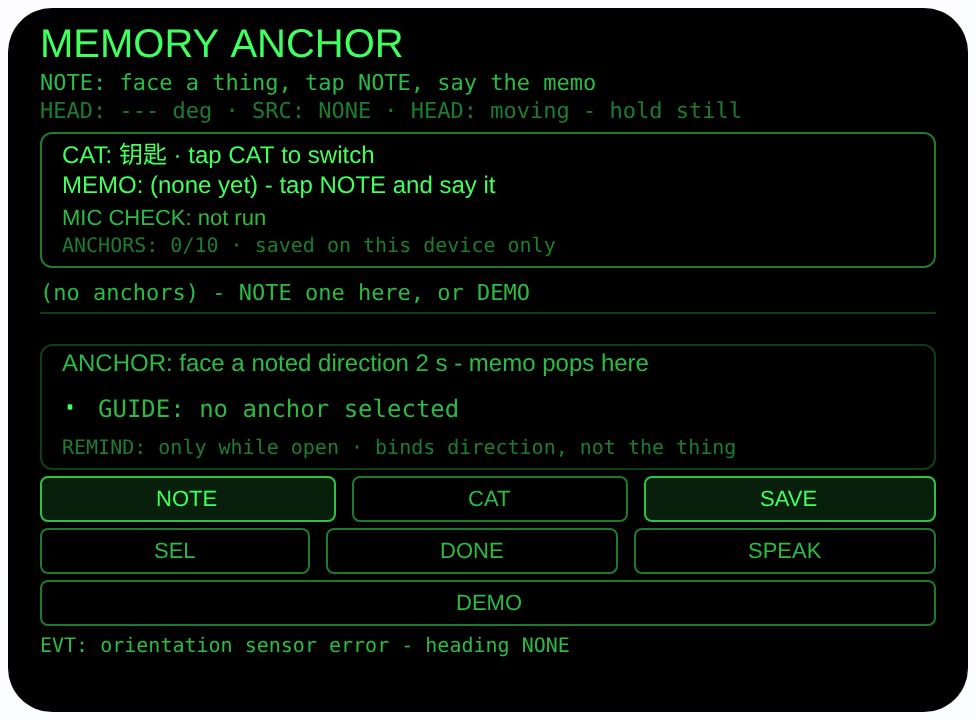
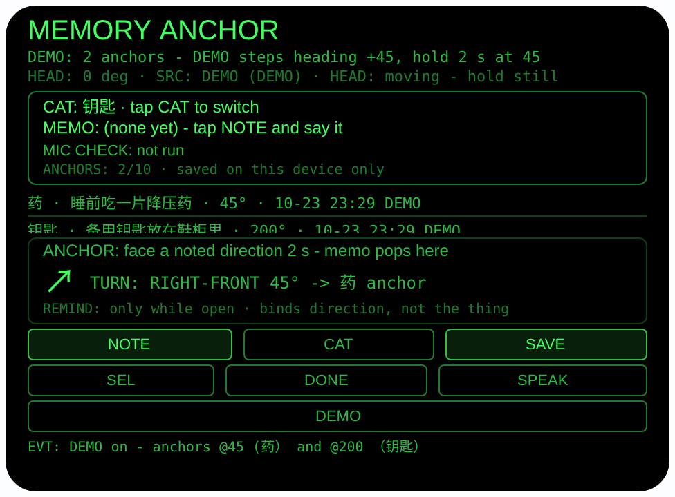
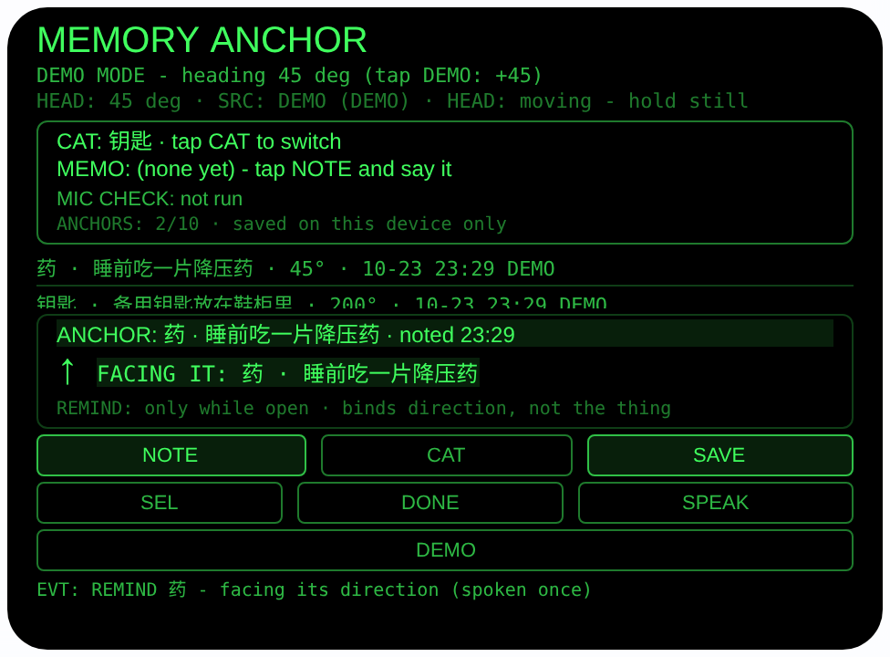

# memory-anchor — 记忆锚点（Rokid 眼镜 AIUI Agent）

**Studio 导入地址**（复制到 Global AIUI Studio 的 Import Project 输入框）：

```
https://github.com/sakai55/rokid/tree/agent-memory-anchor
```


50 个「指向性生活问题」Agent 的第 Z38 个。想法和待办总是「转头就忘」：
看着药瓶想起晚上要吃药，转身就没影；站在洗手台前想起要买牙膏，走到
门口已经忘了。本 Agent 让你看着相关物品说出备忘，把备忘与「物品分类
+ 你当时的头部朝向 + 时间」绑成一个锚点；下次你再朝向那个方向，
锚点自己弹出来提醒你。

## 预览截图

截图统一存放于仓库根目录 `screenshots/memory-anchor/`。







## 解决的问题

备忘的难点不是「记不住」，是「记下了也想不起来看」：手机备忘录要
掏手机、解锁、翻列表，而且和「当时你在看哪件东西」毫无关系。想法
冒出来的那一瞬间，人正看着某件东西——本 Agent 就把备忘钉在那一眼
的朝向上：记的时候看着它说一句，之后每次你的头转回那个方向，
备忘自己找上门。

## 指向性设计（为什么必须用眼镜）

- **朝向即锚点（HEAD）**：备忘与登记时的头部朝向（`AbsoluteOrientationSensor`
  四元数算 yaw）绑定。提醒的触发条件不是时间、不是地点围栏，而是
  「你又看向了当时那个方向」——这是只有头戴设备才有的触发器：
  手机不知道你在看哪儿。
- **停留 2 秒 = 真的在看（DWELL）**：朝向进入锚点 ±15° 锥内并连续
  停留 2 秒才触发提醒卡片 + 一次 TTS 朗读；只是转头路过不触发。
  离开锥外满 5 秒才重新布防，同一次面对只念一遍，不轰炸。
- **口述即记录（ASR verbatim）**：NOTE 先做佩戴者模式麦克风可用性
  检查（检查流读回设置即停，单独一行 `MIC CHECK:` 显示结果），
  备忘由宿主 `SpeechRecognition`（zh-CN）口述输入，**原样**显示
  等你核对，点 SAVE 或头部稳定时点头才锚定；没有待保存备忘时
  点头永远不会保存任何东西。
- **诚实边界常驻界面**：锚点绑的是**方向**，不是物品本身（眼镜
  没有物品识别）；物品被挪走，方向仍指向旧位置。提醒只在本
  Agent 打开时发生，没有后台提醒。界面常驻行写明：
  「REMIND: only while open · binds direction, not the thing」。

## 功能流程

1. 看着要记的东西，点 CAT 选分类（钥匙/文件/药/工具/食材/其他），
   点 NOTE 说出备忘（先过一遍 wearer 麦克风可用性检查，检查结果
   在 `MIC CHECK:` 行；口述由宿主识别完成）
2. 备忘原文显示在 MEMO 行，核对无误后点 SAVE（或头部稳定时点头）
   → 锚点存入本机（最多 10 条，超限丢弃最旧一条并出声说明丢了哪条）
3. 之后本 Agent 开着时，转头朝向锚点方向并停留 2 秒 → 提醒卡片
   弹出「ANCHOR： 分类 · 备忘 · noted 时间」，TTS 念一遍备忘；
   离开方向 5 秒后重新布防
4. SEL 轮换锚点看相对方向（TURN 提示，+ 为右）；SPEAK 朗读选中
   锚点；DONE 连点两次删除选中锚点（第一下只确认防误删）
5. DEMO 按钮：登记 2 个标注 DEMO 的锚点（药 @45° / 钥匙 @200°），
   再点 DEMO 每次把模拟朝向 +45°，转到 45° 停 2 秒即可在预览里
   看到提醒触发

> 诚实说明：提醒 = 朝向触发，不是物品识别，也不是定时/后台提醒；
> 备忘文字来自宿主 ASR 转写，听错会原样存下，所以 SAVE 前请看
> 一眼屏幕。麦克风的 wearer 模式只做可用性检查，不影响宿主识别
> 的收音（2026-10-24 能力边界审计口径）。

## 权限

| 权限 | 用途 |
|---|---|
| RECORD_AUDIO | NOTE 的佩戴者模式麦克风可用性检查（getUserMedia）与宿主 SpeechRecognition 口述备忘 |

不申请相机与定位：本设计没有拍照环节（朝向即锚点），朝向传感器在
AIUI 里不需要单独的权限声明。麦克风只在用户点 NOTE 时启动，检查流
读完设置立即停轨，识别结束即停止。

## 打包与预览

```bash
cd ~/workspace/rokid/memory-anchor
~/tools/bin/aix pack . -o ../dist/memory-anchor.aix
~/tools/bin/aix preview . --html-out artifacts/preview.html
```

本地预览截图走 `~/workspace/preview-tools/` 的本地 Ink + puppeteer 路线
（`shot-anchor.js`，独立页面副本 `preview-anchor.html`；点击序列为
canvas 内坐标 DEMO (240, 297)：清单图点 1 次，提醒图再点 1 次把模拟
朝向步进到 45° 并等待停留触发）。

## 真机测试（海外版 · 云端下发 · Path 1）

1. 推到 GitHub 后，Global AIUI Studio（aiui-global.rokid.com，en-US）用
   分支导入：`https://github.com/sakai55/rokid/tree/agent-memory-anchor`
   （该分支根目录即本 Agent 文件）
2. Studio 的 **Device Debug** 页签填 Basic Information，在 AIX Packaging
   点 **Repackage and Save**，确认顶部出现绿色
   **● Debug version ready — Ready for device debugging**
3. **Hi Rokid**（海外版 `com.rokid.sprite.global.aiapp`，不是国内版
   Rokid Ai App）→ 设置 → 开发者选项 → AIUI → 更新眼镜资源包，
   等「智能体资源包下载成功」
4. 对眼镜说「乐奇，打开 memory-anchor」，站在药柜前看着药瓶点
   NOTE 说备忘、SAVE 锚定；走开再回来转头朝向药柜停 2 秒，验证
   提醒卡片与朗读；再换个房间朝同一罗盘方向验证「绑方向不绑
   物品」的边界说明是否属实

## 真机测试信息（Global AIUI Studio · Device Debug）

| 项目 | 值 |
|---|---|
| Agent Name（Studio） | 待导入后回填 |
| Version（Build） | 1.0.0（待导入后回填） |
| App Category | 待导入后回填 |
| Intent Description | 待导入后回填 |
| Agent ID | 待导入后回填 |
| AIX Package Size | 约 20.0 KB（本地打包 `dist/memory-anchor.aix`） |
| 状态 | 本地完成，待导入 Studio |
| Studio | aiui-global.rokid.com（en-US） |
| 下发方式 | 云端下发 → Hi Rokid（海外版）更新眼镜资源包 |

## 验证情况

**已验证**

- 静态检查：app.json / package.json JSON 解析通过；`<script def>` JSON
  解析通过；`<script setup>` 与 app.js 提取后 `node --check` 语法通过；
  全目录 grep 无 `Page(` / `App(` / `Widget(` / `workers:` 残留。
- 状态机测试：Node 里以 wx 存根加载页面对象跑 **55 条断言全过**——
  覆盖：空存储加载、NOTE 无 ASR 时的预置回退与 verbatim 待保存、
  无朝向时 SAVE 拒绝、无待保存备忘时点头/SAVE 绝不保存、点头需
  头部稳定才确认、ASR 听写原文 verbatim 入库、上限 10 条丢最旧
  并有 EVT 说明、±15° 锥边界（15° 内 / 16° 外）、锥内停留 2 秒
  才触发且每次面对只朗读一遍、离开不足 5 秒瞥回不重复触发、
  离开满 5 秒重新布防后再次触发、相对角符号（+ 为右）、DONE
  两步删除、DEMO 两锚点同一时钟快照与 45° 停留触发提醒。
- 打包：`aix pack` 成功；`aix list` 核对包内含 README.md、AGENTS.md、
  app.js、app.json、package.json、pages/index/index.ink
  （artifacts/ 已被 .aixignore 排除）。
- 预览渲染：aix preview + 本地 Ink + puppeteer 截图三张（见
  Preview Media）：首页初始态完整渲染；DEMO 登记 2 个锚点后清单
  与 TURN 指引完整显示；朝向步进到 45° 停留 2 秒后药锚点提醒
  卡片高亮弹出、EVT 标注 spoken once。NOTE 的待保存 verbatim
  状态在预览主机上走宿主真实识别通路（识别服务不可达时如实显示
  ASR FAIL 与 MIC CHECK 结果），其预置回退与确认纪律由上面的
  Node 状态机测试覆盖。

**未验证**

- 真机 AbsoluteOrientationSensor 朝向精度与零点参考（宿主定义）：
  锥角与停留判定都建立在朝向读数上，真机需对已知方向核对左右
  与 15° 锥宽是否合用。
- 真机头部稳定检测、点头手势、TTS 朗读备忘的效果。
- 真机 SpeechRecognition（zh-CN）口述备忘的识别效果（预览主机
  上识别服务不可达时 NOTE 如实显示 ASR FAIL，预置回退路径在
  无识别能力的主机上才触发，两条路径真机待测）；wearer 模式
  可用性检查在真机 getUserMedia 上的读回值（预览主机上检查
  如实显示 FAIL 并写明原因）。
- 提醒的实际合用性：2 秒停留 / ±15° 锥 / 离开 5 秒重布防是按
  「路过不触发、回头不再吵」的取向定的，真机日常使用后再调。

---

## 提审资料（Review Submission）

> Global AIUI Studio → Submit 页签的 Review Information 逐项对应下面四段，
> 提交时整段复制。每次提交前重新确认 Preview Media。

### Feature Description

Memory Anchor pins a spoken memo to the direction you are facing. Look at the thing you want to remember, tap NOTE and say the memo: your words are kept verbatim, bound to a category, your head heading and the time. Later, while the agent is open, face that direction again and hold it for two seconds - the memo card pops up and is read aloud once. The anchor binds a direction, not the object itself, and nothing reminds you while the agent is closed.

（453 字符）

### Opening Message

Hi, I'm **Memory Anchor** — I remember what you were looking at when a thought struck.

Face the thing, tap **NOTE** and say the memo; check my words on screen, then tap **SAVE** or nod to anchor them to that direction and time. Later, with me open, face the same direction for two seconds and I'll show and speak the memo once. Tap **SEL** to browse anchors, **DONE** twice to delete one, **SPEAK** to hear the selected memo, or **DEMO** to try two sample anchors.

（465 字符）

### Preview Media

提交要求：3–5 个 JPG/PNG 图片或 MP4 视频，至少含 1 张图和 1 个视频，每次提交前重新确认。

- Image 1：`artifacts/preview-memory-anchor-index.png`（aix preview 首页：MEMORY ANCHOR 初始态，含分类/备忘/麦克风检查行、空锚点清单、提醒卡片区与 NOTE/CAT/SAVE/SEL/DONE/SPEAK/DEMO 按钮，本地文件，提交时从本地上传）
- Image 2：`artifacts/preview-memory-anchor-list.png`（DEMO 登记 2 个锚点后的清单态：药 @45° / 钥匙 @200° 两条记录、ANCHORS 2/10、TURN 指引指向药锚点，本地文件）
- Image 3：`artifacts/preview-memory-anchor-remind.png`（提醒触发态：模拟朝向步进到 45° 停留 2 秒后，药锚点卡片高亮弹出「ANCHOR: 药 · 睡前吃一片降压药 · noted 时间」、FACING IT 高亮、EVT 标注 spoken once，本地文件）
- Video：待真机补 — 真机录制「看着药瓶 NOTE 口述 → SAVE 锚定 → 走开转回来朝向药柜停 2 秒 → 提醒卡片弹出并朗读」全过程（MP4），录好后放 `artifacts/` 并更新此处
- 状态：未齐（已有 3 张图；还需至少 1 个视频，总数保持在 3–5 个后才可提交）

### Change Log

#### Build 1.0.0

**Features added**

- Direction-bound memos: face a thing, dictate a memo (host SpeechRecognition, zh-CN) after a wearer-mode microphone availability check - the check stream only verifies the mode opens (settings read back, tracks stopped at once) and does not feed or shape recognition; the dictated text is shown verbatim and only a confirmed memo can be anchored, bound to a category chip, the current head heading and the time, persisted in wx sync storage (key `memoryAnchors`, up to 10, oldest dropped with an on-screen note when full).
- Facing reminders: while the agent is open, holding your heading within ±15 degrees of an anchor for 2 continuous seconds surfaces its card ("ANCHOR: category · memo · noted time") and speaks the memo once per facing episode; re-arming needs 5 seconds outside the cone, so glancing around never spams.
- Anchor list with relative-direction guidance (rel = anchor − current heading, + is right, 8-way arrows and TURN prompts, FACING IT highlight), SPEAK playback of the selected anchor, and a two-step DONE delete that arms first to prevent accidents.
- DEMO seeds two labeled sample anchors (medicine at 45 degrees, spare key at 200 degrees) from a single clock snapshot and steps a simulated heading +45 degrees per tap, so the 2-second dwell reminder can be previewed end to end.

**Improvements**

- None (initial release).

**Fixes**

- None (initial release).