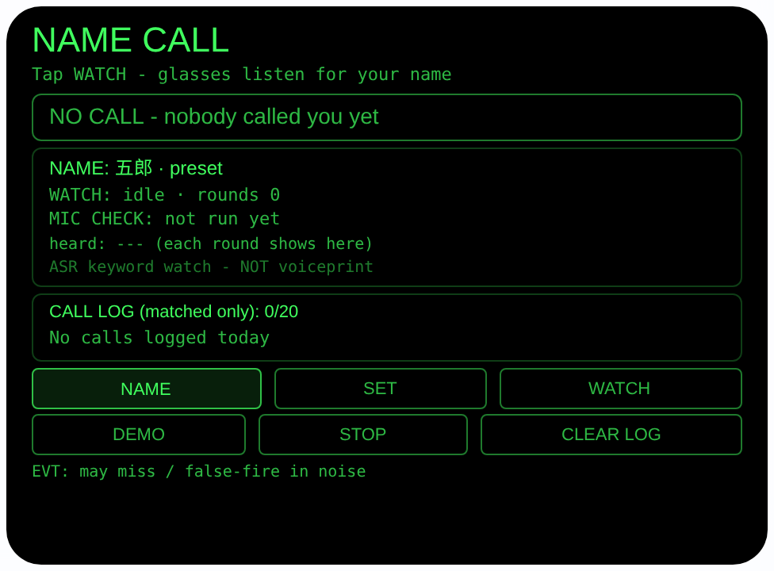
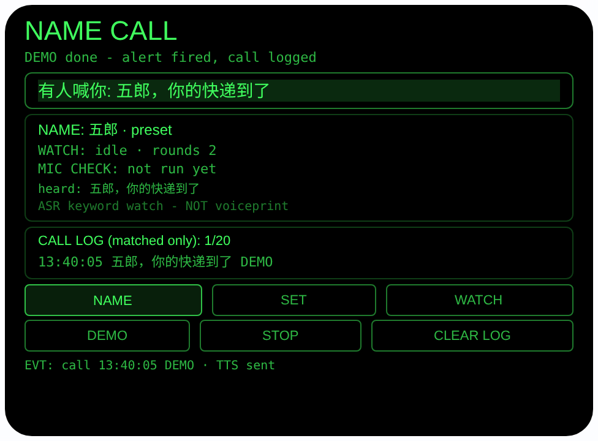

# name-call — 喊名提醒（Rokid 眼镜 AIUI Agent）

50 个「指向性生活问题」Agent 的第 19 个。在嘈杂的办公室、
车间或家庭聚会里，有人隔着房间喊你的名字，你却没听见 —
尤其当你戴着耳机或听力不太好时。手机不能替你听名字；
眼镜整天戴在你头上，可以替你守着：一轮一轮地听房间里
的说话声，识别结果里一出现你的名字，报警就亮在你眼前，
并出声告诉你「有人喊你」。

## 预览截图

截图统一存放于仓库根目录 `screenshots/name-call/`。





## 解决的问题

「喊了你三声你都没听见」是最常见的社交小事故：会议室
那头同事叫你、车间里师傅喊你、家里人隔着客厅叫你吃饭 —
声音到了，名字却被环境噪声吃掉了。错过一次没什么，
错过的是「有人找你」这件事本身。眼镜的麦克风就在你
头上、显示就在你眼前：它不需要识别「谁在说话」，它
只需要一轮一轮地把房间里的话转成文字，盯住你的名字 —
名字出现的那一刻，提醒就放在你不可能错过的地方：
你的视线正中央。

## 指向性设计（为什么必须用眼镜）

- **头戴守望（远场可用性检查 + 宿主 ASR 轮次）**：WATCH 先按
  文档方式用 `getUserMedia` 的 `captureSource:
  'microphone'` + `microphoneMode: 'far-field'` 做一次
  远场模式**可用性检查**（读回 `track.getSettings()`，
  查完立即停轨道）— 这次检查只证明眼镜上存在房间侧的
  远场麦克风模式，不为后面的识别供音：检查流停掉之后，
  真正的守望聆听由宿主 `SpeechRecognition`（zh-CN）用
  它自己的麦克风路径一轮接一轮地完成，远场模式对这些
  识别轮次没有任何作用（档案 §2.4/§2.8）。每轮听到的
  整句短暂显示为「heard: …」，轮次号与单独一行的
  `MIC CHECK` 结果常驻界面，互不冒充。检查时模式被
  设备拒绝（OverconstrainedError）时检查流回退默认
  麦克风并如实提示 — 那同样只影响检查结果的标注。
- **名字是你确认过的（NAME / SET）**：NAME 在预设
  （五郎 / 小明 / 小红 / 老王）间轮换；SET 让你自己
  说一次 — 听到的字符串**原样**成为目标并显示在
  屏幕上：ASR 把你的名字听错了一个字，守望就守错
  了人，所以你必须看得见、能重说。目标存本机
  （wx 存储 `nameCallTarget`）。
- **眼前报警（HANDS-FREE 显示）**：命中时单色绿显示
  正中央亮起「有人喊你: <整句原文>」— 你戴着耳机、
  听力不佳都不影响，报警是「看见」的，不是「听见」
  的；TTS「有人喊你」只是第二通道。

## 匹配规则（全部写在代码一处）

每轮识别文本与目标名字做**子串匹配**：文本里含有
目标字符串即命中。命中时报警 + 记日志（时间 + 整句
原文）；未命中的轮次文本只在界面上闪过，**不保存、
不落盘**。轮次衔接：每轮结束（onend）后 250ms 开
下一轮；no-speech（没人说话）安静计数不报错；
not-allowed 等持续性错误、或连续 5 轮出错，会停掉
守望并把原因写在界面上，不无限空转。

## 功能流程

1. 待机：显示目标名字（预设或「as you said it」)、
   WATCH 状态、诚实说明行与今日命中日志（从本机
   存储载入，只含命中的时间与整句）
2. NAME / SET：换预设名字，或自己说一次录下目标
   （听到的原样显示，错了重说）
3. WATCH：点 WATCH（或 Enter）→ 查 `SpeechRecognition`，
   不可用 FAIL 写明 → 远场可用性检查（仅检查，识别
   走宿主麦克风）→ 宿主 ASR 一轮接一轮识别，
   每轮整句短暂上屏，轮次计数实时更新
4. 命中：满足子串匹配 → 大字高亮 + 整句原文 →
   TTS 朗读「有人喊你」→ 时间与整句记入日志
   （wx 存储 `nameCallLog`，最多 20 条）
5. STOP 立即结束循环并 abort 识别器；CLEAR LOG
   清空日志；页面隐藏/卸载同样停机清理
6. DEMO：按节奏喂两轮合成文本（第 1 轮闲聊不命中，
   第 2 轮「<你的名字>，你的快递到了」命中），走
   同一套 `_handleTranscript` 匹配路径，日志条目
   标注 DEMO — 无麦克风也能完整演示

> 诚实说明：本 Agent 是 **ASR 关键词守望，不是声纹
> 识别**。它比对的是识别出来的文字里有没有你的名字，
> 与谁在说话无关 — 任何人的声音都可能触发，电视里
> 喊出同名也会触发；发音相近的词可能误触发；在真实
> 噪声里它**一定会漏喊**：喊得太远、被识别错字、多人
> 同时说话都会漏。它提高你听见的概率，不做任何保证。
> 另外请注意：守望期间麦克风在听整个房间 — 只有你
> 点 WATCH 才开始、点 STOP 就停；本 Agent 不录音、
> 不上传音频，未命中的话不会被保存。

## 权限

| 权限 | 用途 |
|---|---|
| RECORD_AUDIO | WATCH 时开麦听房间：`getUserMedia` 远场模式可用性检查（独立的检查流，停后不参与识别）+ 宿主 `SpeechRecognition`（用它自己的麦克风路径）逐轮识别找你的名字；不录音、不保存音频、不上传。唯一持久化的是目标名字与命中日志（时间 + 命中整句，本机 wx 存储） |

## 打包与预览

```bash
cd ~/workspace/rokid/name-call
~/tools/bin/aix pack . -o ../dist/name-call.aix
~/tools/bin/aix preview . --html-out artifacts/preview.html
```

本地预览截图走 `~/workspace/preview-tools/` 的本地 Ink + puppeteer 路线
（`shot-name.js`；报警截图的点击序列为 canvas 内 DEMO (83, 270)
点 1 次后等约 4 秒待两轮合成文本走完、第 2 轮命中点火 —
1.0.1 加了 MIC CHECK 独立行后按钮行下移，旧坐标 (83, 254) 会误点 NAME：
注意 artifacts/preview.html 需先把 importmap 的 jspm 地址
换成本地 `/ink/index.js` 再复制到 preview-tools/www/）。

## 真机测试（海外版 · 云端下发 · Path 1）

1. 推到 GitHub 后，Global AIUI Studio（aiui-global.rokid.com，en-US）用
   分支导入：`https://github.com/sakai55/rokid/tree/agent-name-call`
   （该分支根目录即本 Agent 文件）
2. Studio 的 **Device Debug** 页签填 Basic Information，在 AIX Packaging
   点 **Repackage and Save**，确认顶部出现绿色
   **● Debug version ready — Ready for device debugging**
3. **Hi Rokid**（海外版 `com.rokid.sprite.global.aiapp`，不是国内版
   Rokid Ai App）→ 设置 → 开发者选项 → AIUI → 更新眼镜资源包，
   等「智能体资源包下载成功」
4. 对眼镜说「乐奇，打开 name-call」：先点 SET 自己说一次名字，
   确认屏幕上的目标和你说的完全一致（听错就重说）；再点 WATCH，
   请家人到房间另一头正常音量喊你的名字，看眼前是否亮起
   有人喊你、日志是否记下时间和整句；然后让电视外放一段带
   人名的节目 5 分钟，记录误触发次数；最后到较吵的环境
   （开抽油烟机或放音乐）再喊几次，记录漏喊次数 — 这两组
   数字就是本 Agent 真机可用性的真实边界

## 真机测试信息（Global AIUI Studio · Device Debug）

| 项目 | 值 |
|---|---|
| Agent Name（Studio） | 待导入后回填 |
| Version（Build） | 1.0.1（待导入后回填） |
| App Category | 待导入后回填 |
| Intent Description | 待导入后回填 |
| Agent ID | 待导入后回填 |
| AIX Package Size | 约 17.7 KB（本地打包 `dist/name-call.aix`，分次打包有 ±0.01 KB 级抖动） |
| 状态 | 本地完成，待导入 Studio |
| Studio | aiui-global.rokid.com（en-US） |
| 下发方式 | 云端下发 → Hi Rokid（海外版）更新眼镜资源包 |

## 验证情况

**已验证**

- 静态检查：app.json / package.json JSON 解析通过；`<script def>` JSON
  解析通过；`<script setup>` 与 app.js 提取后 `node --check` 语法通过；
  全目录 grep 无 `Page(` / `App(` / `Widget(` / `workers:` 残留；
  6 个 bindtap 处理函数（nameTap / setTap / watchTap /
  stopTap / demoTap / clearTap）全部有定义。
- 匹配与轮次状态机验算：把页面对象以 wx 打桩 + 假
  `SpeechRecognition` 加载进 Node，共 27 项断言全过 —
  `_matches` 子串匹配（命中/不命中/空目标/空文本）；
  SET 把听到的字符串原样设为目标并持久化、NAME 轮换
  预设；WATCH 远场可用性检查读回 `far-field`（仅检查）、第 1 轮宿主 ASR 启动；
  无命中轮次只上屏不存日志、onend 衔接下一轮；
  no-speech 安静计数且循环继续；命中后日志记时间 +
  整句并持久化、报警行点亮、循环继续守望；
  not-allowed 停机且原因上屏；STOP abort 识别器且
  不再续轮；连续 5 轮 network 错误停机说明；
  DEMO 两轮走同一匹配路径、第 2 轮点火且日志带
  DEMO 标记；无 `SpeechRecognition` 的主机上 WATCH
  如实 FAIL、不假装在听。
- 打包：`aix pack` 成功；`aix list` 核对包内含 README.md、AGENTS.md、
  app.js、app.json、package.json、pages/index/index.ink
  （artifacts/ 已被 .aixignore 排除）。
- 预览渲染：aix preview + 本地 Ink + puppeteer 截图两张（见
  Preview Media）：首页待机态完整渲染（目标名字、规则与
  「NOT voiceprint」诚实说明行常驻，日志为空）；点 DEMO
  后两轮合成文本走完，第 2 轮命中：大字「有人喊你:
  五郎，你的快递到了」高亮、日志记入带 DEMO 标记的
  时间与整句。预览主机无 `SpeechRecognition`，
  WATCH / SET 的 FAIL/SKIP 路径为代码完备、已由 Node
  打桩测试覆盖，未在此环境触发截图。1.0.1 修复后已
  重截两张：首页新增独立的 `MIC CHECK: not run yet`
  行、守望行不再带模式名；另以 Node 打桩验算
  `_recompute` 四种检查结果（far-field OK / default mic /
  FAIL / n/a）下 MIC CHECK 行与 `(host ASR)` 守望行
  文案全对、守望行不含 far-field 字样。

**未验证**

- 真机 4 麦 `far-field` 模式在检查流上是否被接受（这只
  决定 `MIC CHECK` 一行的标注，不决定识别效果）；
  远场检查的回退路径未在真机触发过；真正决定守望
  效果的是宿主 ASR 在房间距离上的实际识别表现。
- 真实环境里的命中率与误报率 — 本 Agent 最大的未知数：
  隔房喊名（不同距离、隔门/隔墙）的漏喊率，电视/广播
  里出现同名或近音词的误报率，多人同时说话时的表现，
  只能真机多场景实测。
- SET 在真机上把名字听错的概率（目标听错 = 守错人，
  所以界面原样显示、请务必核对）；真机 TTS 报警在
  戴耳机场景下能否听清（视觉大字为主要通道）；
  wx 存储跨重启持久性。

---

## 提审资料（Review Submission）

> Global AIUI Studio → Submit 页签的 Review Information 逐项对应下面四段，
> 提交时整段复制。每次提交前重新确认 Preview Media。

### Feature Description

Name Call listens for your name, so a call across a noisy room reaches your eyes. Pick a preset name, or say your own once to set it. Tap WATCH: the glasses pass a far-field mic-mode availability check (that check does not power recognition), then run host speech-recognition rounds, showing each heard sentence. When a round contains your name, a big alert lights up, the glasses speak, and the time and sentence are logged. ASR keyword spotting, not a voiceprint - it can miss and false-fire.

### Opening Message

Hi, I'm **Name Call** - I listen to the room and light up when someone calls your name.

Set your name with **NAME** (presets) or **SET** (say it once - I keep exactly what I hear, so check the screen). Tap **WATCH**: after a far-field mic-mode check, I run host recognition rounds, showing what I hear; a round with your name fires the alert, speaks, and is logged. I match words, not voices: in noise I can miss, and similar words can fool me. **DEMO** plays both rounds.

### Preview Media

提交要求：3–5 个 JPG/PNG 图片或 MP4 视频，至少含 1 张图和 1 个视频，每次提交前重新确认。

- Image 1：`artifacts/preview-name-call-index.png`（aix preview 首页待机态：目标名字 五郎/预设、WATCH 待机、MIC CHECK 独立行、诚实说明行、空日志，本地文件，提交时从本地上传）
- Image 2：`artifacts/preview-name-call-alert.png`（DEMO 报警态：有人喊你 大字高亮、整句原文、DEMO 时间与整句入日志，本地文件）
- Video：待真机补 — 真机录制「点 WATCH → 家人在房间另一头喊名字 → 眼前亮起 有人喊你 → 日志记时记句」全过程（MP4），录好后放 `artifacts/` 并更新此处
- 状态：未齐（已有 2 张图；还需至少 1 个视频，总数补到 3–5 个后才可提交）

### Change Log

#### Build 1.0.1

**Features added**

- None (honesty fix only).

**Improvements**

- The watch screen now shows the microphone check on its own line (`MIC CHECK: far-field OK`) and labels the listening line as host ASR (`WATCH: listening · round N (host ASR)`), so the check result and the recognition state no longer share a line.

**Fixes**

- Far-field claims corrected (capability-boundary audit 2026-10-24): the far-field stream is a microphone-mode availability check only - it is stopped before recognition starts and has no effect on the recognition rounds, which use host SpeechRecognition on its own microphone. The Feature Description no longer says the rounds run "in far-field mic mode", and the README/AGENTS.md design text no longer says the far-field mode picks up the room for the watch.

#### Build 1.0.0

**Features added**

- Name watch loop: WATCH first runs the documented far-field microphone availability check (falling back to the default microphone, labeled, when the device rejects that mode), then runs back-to-back zh-CN speech-recognition rounds; every round's sentence is briefly shown with a live round counter.
- Substring name matching with in-view alerting: a round containing your target name lights a large alert with the full sentence, speaks a Chinese warning by TTS, and logs the time and the matched sentence on-device (wx storage key nameCallLog, max 20). Non-matching rounds are never stored.
- Two ways to set the target: NAME cycles presets, and SET captures your spoken name once and keeps the recognised string verbatim - shown on screen so a mishearing can be seen and redone - persisted on-device (key nameCallTarget).
- A stated error policy: no-speech rounds are counted quietly; persistent recognition errors (not-allowed, service-not-allowed, audio-capture) or five errors in a row stop the watch with the reason on screen instead of spinning forever.
- DEMO synthetic rounds: a no-name small-talk round followed by a "<your name>, your parcel is here" round, fed through the same matching path as real recognition and logged with a DEMO tag, so the full flow runs with no microphone.

**Improvements**

- None (initial release).

**Fixes**

- None (initial release).
