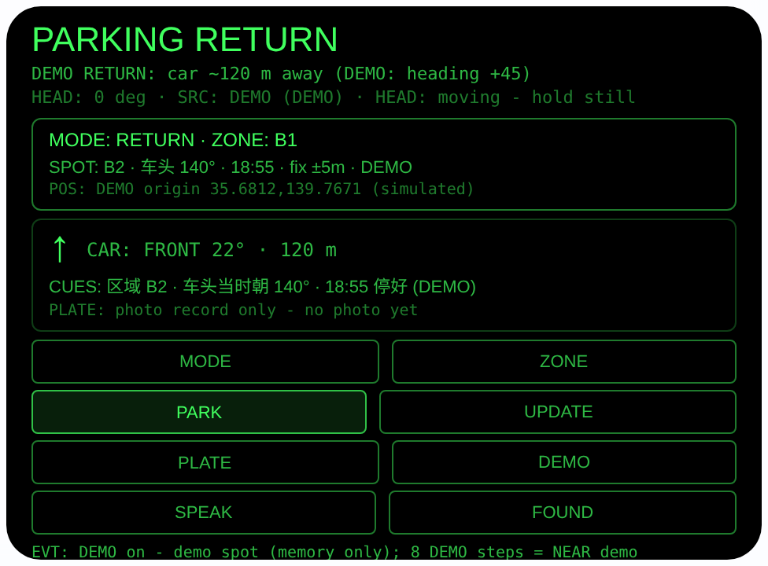
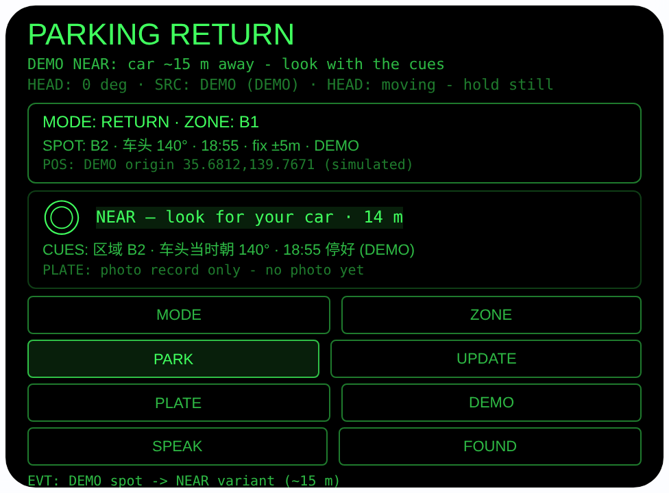

# parking-return — 找车方位（Rokid 眼镜 AIUI Agent）

50 个「指向性生活问题」Agent 的第 09 个。在大型停车场、地下车库
回来时找不到自己的车——本 Agent 在你停车下车时把三样东西绑在
一起存好：当时的 GPS 定位、你车头的朝向、你选的区域（B1/B2/
B3/地面/路边）。回来时跟着相对你头部朝向的大箭头和距离走；
走到约 25 米内，它不再硬报角度，而是亮出当初存下的区域与
车头朝向当线索，让你抬头找车。

## 预览截图

截图统一存放于仓库根目录 `screenshots/parking-return/`。





## 解决的问题

停车场找车难，难在两段：露天/地面停车场是「不知道往哪走」，
地下车库是「连 GPS 都没有」。手机地图在车库里定位漂移、朝向
乱转。本 Agent 两段都管：有定位时用「相对头朝向」的箭头指路；
没定位时，老老实实靠停车时存下的区域 + 车头朝向线索找。

## 指向性设计（为什么必须用眼镜）

- **停车 = 定位 + 车头朝向 + 区域，三者绑定存（核心）**：点 PARK
  的那一刻，`navigator.geolocation` 单次定位、头部朝向传感器
  读到的朝向（下车时你面对的方向，就是车头方向的最佳代理）、
  你用 ZONE 选的区域备注，一起存进一条记录（wx 同步存储
  `parkingSpot`）。单独存一个定位点，回来根本不够用。
- **返回 = 相对头朝向的箭头**：UPDATE 取新定位后，Haversine
  算距离、初始方位角算停车点方位，相对角 = 停车点方位 − 头部
  朝向（`AbsoluteOrientationSensor` 四元数 yaw，来源如实标注
  `SENSOR / DEMO / NONE`）。显示 8 向箭头与
  「CAR: FRONT 22° · 120 m」；|相对角| ≤ 15° 高亮
  **ON COURSE — walk straight**。永远不报东南西北。
- **NEAR 收尾靠线索 + 眼睛**：距离 < 25 米时 GPS 噪声已经大过
  方向的意义，箭头换成 ◎ 并显示 **NEAR — look for your car**，
  同时亮出线索行「区域 B2 · 车头当时朝 140° · 18:55 停好」——
  按区域和车头方向认车，最后一步是眼睛，这正是眼镜该做的。
- **没定位不编造（诚实降级）**：地下车库 PARK 时定位失败，
  记录照样存，位置标记 `no fix`，只留区域 + 车头朝向 + 时间；
  RETURN 直接进入 NEAR 态用线索找车。朝向缺失同理存为
  「未记录」，不编造角度。
- **车牌区域长焦拍照**：NEAR 后点 PLATE，用
  `ImageCapture.takePhoto({mode:'telephoto'})` 长焦拍一张
  车牌区域照片当视觉记录，和你记忆中的车比对。界面明确标注
  「photo record only — compare with your eyes (NO OCR)」：
  运行时没有 OCR，本 Agent 不读车牌、不声称识别。

## 功能流程

1. 停车下车前：ZONE 选区域（B1 / B2 / B3 / 地面 / 路边），
   站在车旁点 PARK（或头部稳定时点头、按 Enter）→ 存点，
   状态行显示「PARKED: B2 · fix ±5m · 车头 140° · 时间」；
   无定位时显示「PARKED (no fix)」并说明只存了区域+朝向
2. 回来找车：MODE 切 RETURN（有记录时打开默认就是 RETURN），
   点 UPDATE（或 Enter / 稳定时点头）取新定位，跟着箭头走，
   走一段更新一次；SPEAK 听中文播报
   「车在你左前方 40 度，约 132 米」
3. 距离 < 25 米 → NEAR 态：看线索行（区域 / 车头当时朝向 /
   停车时间）抬头找车；点 PLATE 长焦拍车牌区域照片留记录，
   用眼睛比对确认是自己的车
4. 找到车点 FOUND → 清除记录（回「车已取回」），下次停车
   重新 PARK
5. DEMO 仿真：点 DEMO 存一条标注 DEMO 的演示记录（演示原点
   +0.0010, +0.0005，约 120 米，区域 B2、车头 140°）并进入
   RETURN；之后每点一次 DEMO 朝向 +45°；满一圈（8 次）后
   演示记录切换为近处变体（约 15 米）进入 NEAR 态。演示
   记录只在内存中，绝不覆盖已存储的真实记录

> 诚实说明：箭头指直线方向，不是停车场内道路导航，墙体、
> 楼层请自行绕行——跨楼层时区域备注就是为此存的。地下车库
> 无 GPS 是常态，本 Agent 如实标记 no fix 并降级为线索模式，
> 不假装定位成功。

## 权限

| 权限 | 用途 |
|---|---|
| GEOLOCATION | PARK 存点与 RETURN 更新时单次定位，计算停车点相对方位与距离 |
| CAMERA | PLATE 长焦拍摄车牌区域照片作视觉记录（仅用户点击时启动） |

定位只在用户触发时单次请求（不开 watch）；相机只在点 PLATE
时启动、拍完即停轨道；朝向传感器不需要额外权限声明。

## 打包与预览

```bash
cd ~/workspace/rokid/parking-return
~/tools/bin/aix pack . -o ../dist/parking-return.aix
~/tools/bin/aix preview . --html-out artifacts/preview.html
```

本地预览截图走 `~/workspace/preview-tools/` 的本地 Ink + puppeteer 路线
（`shot-parking.js`；SEQ_A = DEMO 一次进入 RETURN 指引态，
SEQ_B = DEMO 再点 8 次（朝向走满一圈）切换近处变体进 NEAR 态；
按钮 canvas 坐标 DEMO (348,287)）。

## 真机测试（海外版 · 云端下发 · Path 1）

1. 推到 GitHub 后，Global AIUI Studio（aiui-global.rokid.com，en-US）用
   分支导入：`https://github.com/sakai55/rokid/tree/agent-parking-return`
   （该分支根目录即本 Agent 文件）
2. Studio 的 **Device Debug** 页签填 Basic Information，在 AIX Packaging
   点 **Repackage and Save**，确认顶部出现绿色
   **● Debug version ready — Ready for device debugging**
3. **Hi Rokid**（海外版 `com.rokid.sprite.global.aiapp`，不是国内版
   Rokid Ai App）→ 设置 → 开发者选项 → AIUI → 更新眼镜资源包，
   等「智能体资源包下载成功」
4. 对眼镜说「乐奇，打开 parking-return」，在停车场下车时选区域
   点 PARK，回程切 RETURN 跟箭头找车，近了用 PLATE 拍车牌
   区域比对，FOUND 清记录

## 真机测试信息（Global AIUI Studio · Device Debug）

| 项目 | 值 |
|---|---|
| Agent Name（Studio） | 待导入后回填 |
| Version（Build） | 1.0.0（待导入后回填） |
| App Category | 待导入后回填 |
| Intent Description | 待导入后回填 |
| Agent ID | 待导入后回填 |
| AIX Package Size | 17.65 KB（本地打包 `dist/parking-return.aix`） |
| 状态 | 本地完成，待导入 Studio |
| Studio | aiui-global.rokid.com（en-US） |
| 下发方式 | 云端下发 → Hi Rokid（海外版）更新眼镜资源包 |

## 验证情况

**已验证**

- 静态检查：app.json / package.json JSON 解析通过；`<script def>` JSON
  解析通过；`<script setup>` 与 app.js 提取后 `node --check` 语法通过；
  全目录 grep 无 `Page(` / `App(` / `Widget(` / `workers:` 残留。
- 方位数学：用 Node 对同一套 Haversine / 方位角公式独立核算——演示
  原点（35.6812, 139.7671）到远演示点（+0.0010, +0.0005）距离
  120.0 米、方位 22.1°，朝向 0° 时相对角 +22°（FRONT，箭头 ↑）
  与界面一致；近处变体（+0.00012, +0.00006）距离 14.4 米
  < 25 米，正确进入 NEAR。
- 打包：`aix pack` 成功（大小见上表）；`aix list` 核对包内含
  AGENTS.md、app.js、app.json、package.json、README.md、
  pages/index/index.ink（artifacts/ 已被 .aixignore 排除）。
- 预览渲染：aix preview + 本地 Ink + puppeteer 截图两张（见下方
  Preview Media）：RETURN 指引态完整渲染（DEMO 记录 B2、车头
  140°、「CAR: FRONT 22° · 120 m」、箭头 ↑）；DEMO 点满一圈后
  切换近处变体，显示「NEAR — look for your car · 14 m」与线索行。
  预览主机无方向传感器/无定位，初始态如实显示 `SRC: NONE`，
  传感器错误事件被处理（不崩溃）。开发中发现并修复一个真实
  布局问题：DEMO 状态文案过长换行会把按钮整体推下移位，已把
  状态文案全部压到一行内。

**未验证**

- 真机 AbsoluteOrientationSensor 朝向精度/零点、GEOLOCATION
  精度与授权流程、头部稳定与点头触发——预览主机都没有，未测。
- 地下车库真实无 GPS 场景下 PARK 的 no-fix 降级全流程、
  露天停车场真机跟箭头找车全流程——未实测。
- PLATE 长焦拍照在真机上的成像与字节数；**本 Agent 不做
  车牌 OCR**，照片只是给用户眼睛比对的视觉记录。
- TTS 中文播报在真机上的效果。

---

## 提审资料（Review Submission）

> Global AIUI Studio → Submit 页签的 Review Information 逐项对应下面四段，
> 提交时整段复制。每次提交前重新确认 Preview Media。

### Feature Description

Parking Return remembers where your car is — and which way it points. When you park, one tap stores the GPS spot together with your car's nose heading and a zone note (B1 / B2 / B3 / ground / roadside). Coming back, a big arrow shows the car relative to your head plus the distance; turn until ON COURSE and walk. Within about 25 m it switches to NEAR and shows the zone and nose-heading cues so you can spot your car, with a telephoto photo of the plate area as a visual record.

### Opening Message

Hi, I'm **Parking Return** — I'll take you back to your car.

Leaving the car? Pick a **ZONE** and tap **PARK**: I store the spot, your car's nose heading and the zone together. Coming back, switch to **RETURN**, tap **UPDATE** and follow the **arrow** — it shows the car *relative to your head*. Within ~25 m I'll switch to **NEAR** and show the cues; tap **PLATE** for a telephoto photo to compare with your eyes. Found it? Tap **FOUND**. No GPS? **DEMO** simulates it all.

### Preview Media

提交要求：3–5 个 JPG/PNG 图片或 MP4 视频，至少含 1 张图和 1 个视频，每次提交前重新确认。

- Image 1：`artifacts/preview-parking-return-index.png`（aix preview RETURN 指引态：DEMO 记录 B2、车头 140°、「CAR: FRONT 22° · 120 m」、箭头 ↑，本地文件，提交时从本地上传）
- Image 2：`artifacts/preview-parking-return-near.png`（DEMO 近处变体（约 14 米）的 NEAR 态：大字「NEAR — look for your car · 14 m」与区域/车头朝向线索行，本地文件）
- Video：待真机补 — 真机录制「停车选区域 PARK → 回程跟箭头走 → NEAR 看线索 + PLATE 拍车牌区域 → FOUND」全过程（MP4），录好后放 `artifacts/` 并更新此处
- 状态：未齐（已有 2 张图；还需至少 1 个视频，总数补到 3–5 个后才可提交）

### Change Log

#### Build 1.0.0

**Features added**

- Park once, store three things together: GPS fix, car-nose heading (from the orientation sensor as you face the car) and a zone note (B1 / B2 / B3 / ground / roadside), persisted on-device in wx storage; an honest no-fix fallback saves zone + heading + time when an underground garage has no GPS, and RETURN then guides by those cues.
- Head-relative return guidance: Haversine distance and initial bearing to the stored spot converted into an 8-way arrow plus "CAR: FRONT 22° · 120 m" relative to your head; ON COURSE highlight within 15 degrees; under 25 m a NEAR state surfaces the stored zone and nose-heading cues and hands over to your eyes.
- Telephoto plate-area photo record (PLATE) via ImageCapture telephoto mode with wx camera fallback, clearly labeled photo-record-only with no OCR claim; spoken Chinese guidance from live values (SPEAK); FOUND clears the record; DEMO simulates a ~120 m return and a ~15 m NEAR variant without ever overwriting a real stored record.

**Improvements**

- None (initial release).

**Fixes**

- None (initial release).
