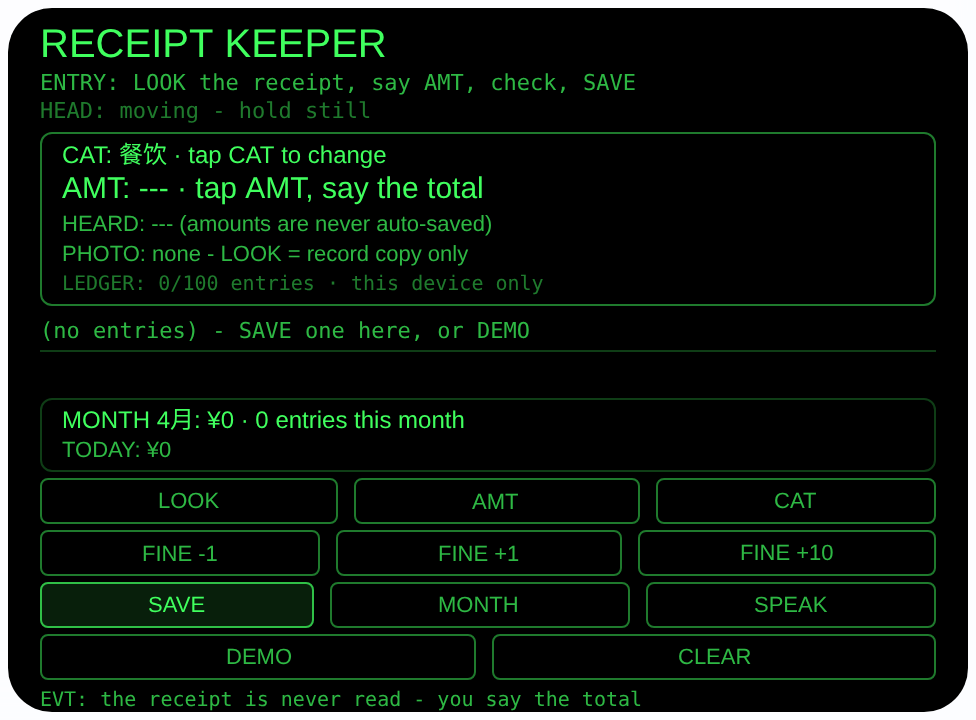
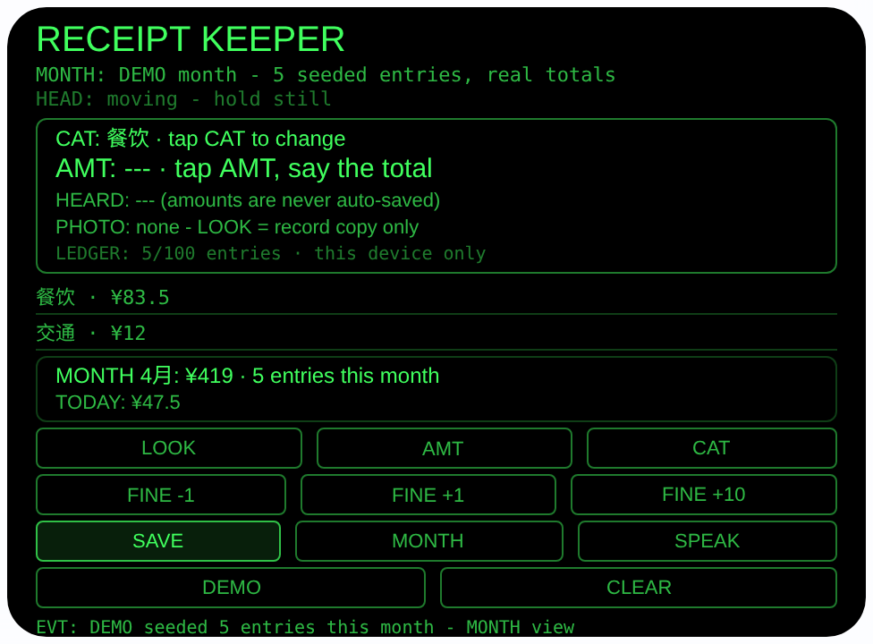

# receipt-keeper — 小票账本（Rokid 眼镜 AIUI Agent）

50 个「指向性生活问题」Agent 的第 25 个。小票随手一丢，月底
不知道钱花哪了——手机记账要掏手机、解锁、开 App、敲数字，
一套下来小票早扔了。眼镜就在你脸上：结账时看一眼小票，
长焦拍一张留底（只作你自己的视觉副本，永不被读取），嘴里
报出总价，它把听到的金额解析成数字**大字显示等你亲眼
核对**，点 SAVE 才入账。月底点 MONTH，本月各类别花了多少
它按真实日期算好，还能 SPEAK 念给你听。

## 预览截图

截图统一存放于仓库根目录 `screenshots/receipt-keeper/`。





## 解决的问题

记账失败从来不是因为懒得算，而是因为**记账的动作太重**：
每笔都要掏出手机敲半天，于是小额支出干脆不记，月底一看
总额对不上。眼镜把一笔账压缩成三步——看小票（拍照留底）、
说总价（语音报数）、点保存（核对后入账），十秒钟站在收银台
就记完。类别在核对时顺手用 CAT 选好，月底的分类汇总才有
意义。

## 指向性设计（为什么必须用眼镜）

- **看小票 = 长焦留底（诚实定位）**：`ImageCapture.takePhoto
  ({mode:'telephoto'})` 对着小票拍一张当你的视觉副本。运行时
  没有 OCR——照片永远不会被读取，小票上的字一个也不会被
  识别。账本里的金额只来自你亲口报的数；照片是给你日后
  对账看的，不是给机器读的。
- **报金额 = 解析后大字核对（金额永不自动保存）**：AMT 先按
  文档方式做佩戴者模式（`microphoneMode:'wearer'`）麦克风
  检查——4 麦优先收你自己的声音，压过商场噪声——再用
  SpeechRecognition（zh-CN）听你报总价。内置解析器同时认
  阿拉伯数字（"123.5"、"123块5"）与中文数字（一百二十三
  块五 = 123.5、三十五 = 35、十二块八 = 12.8、九块九 = 9.9、
  二百 = 200、二百五 = 250、两千零五十 = 2050、一万二千 =
  12000）。解析结果大字显示在 AMT 行：数字正是 ASR 最容易
  听错的东西，所以必须你**亲眼核对**后点 SAVE（或 Enter）
  才入账；点头只把待确认金额朗读出来给你核对，绝不触发
  保存。解析差一点（如 133 听成近误）不用重报，FINE
  −1 / +1 / +10 三键修正；解析失败如实显示听到的原文与
  「parse FAIL」请重报，主机没有识别能力时如实 SKIP。
- **汇总 = 真实日期算账**：每笔存 {金额， 类别， 日期， 时间}
  到 wx 同步存储（`receiptLedger`，最多 100 条，超出丢最旧
  的）。MONTH 按条目日期的真实年月聚合：本月各类别合计、
  总笔数、今日合计常驻显示；往月条目仍保留在存储里（直到
  100 条上限挤出），但不计入本月汇总。SPEAK 朗读：
  「本月共花 419 元。餐饮 83.5 元，交通 12 元，购物 123.5
  元，家居 200 元。今天花了 47.5 元。」

## 功能流程

1. 结账拿到小票：点 LOOK 长焦拍一张留底
2. 点 AMT，报出总价（如「一百二十三块五」）；看 AMT 行的
   大字金额核对——不对就 FINE 微调或重报
3. CAT 选类别（餐饮 / 交通 / 购物 / 家居 / 娱乐 / 其他），
   点 SAVE 入账（条目出现在列表里）
4. 月底点 MONTH 看本月分类汇总，或点 SPEAK 听它念
5. DEMO 仿真：点 DEMO 用运行时 Date 的一次快照播种本月
   5 条标注 DEMO 的条目（今天餐饮 35.5、今天交通 12、
   2 天前购物 123.5、5 天前家居 200、10 天前餐饮 48；日期
   从同一快照以纯字符串推导、钳制在本月内）并切到 MONTH，
   本月合计 ¥419、餐饮 ¥83.5、今日 ¥47.5 都是真算的

## 权限

| 权限 | 用途 |
|---|---|
| CAMERA | LOOK 长焦拍小票留作你自己的视觉副本；照片只取字节数显示，从不被读取或识别 |
| RECORD_AUDIO | AMT 报金额：先做佩戴者模式（wearer）麦克风可用性检查，识别由系统 SpeechRecognition 完成；只保存你确认过的金额文本，不录音、不保存音频 |

## 打包与预览

```bash
cd ~/workspace/rokid/receipt-keeper
~/tools/bin/aix pack . -o ../dist/receipt-keeper.aix
~/tools/bin/aix preview . --html-out artifacts/preview.html
```

本地预览截图走 `~/workspace/preview-tools/` 的本地 Ink + puppeteer 路线
（`shot-receipt.js`；SEQ_B = 点 DEMO 一次（canvas 坐标 125,318）
播种本月 5 条并切到 MONTH 视图）。

## 真机测试（海外版 · 云端下发 · Path 1）

1. 推到 GitHub 后，Global AIUI Studio（aiui-global.rokid.com，en-US）用
   分支导入：`https://github.com/sakai55/rokid/tree/agent-receipt-keeper`
   （该分支根目录即本 Agent 文件）
2. Studio 的 **Device Debug** 页签填 Basic Information，在 AIX Packaging
   点 **Repackage and Save**，确认顶部出现绿色
   **● Debug version ready — Ready for device debugging**
3. **Hi Rokid**（海外版 `com.rokid.sprite.global.aiapp`，不是国内版
   Rokid Ai App）→ 设置 → 开发者选项 → AIUI → 更新眼镜资源包，
   等「智能体资源包下载成功」
4. 对眼镜说「乐奇，打开 receipt-keeper」，真实结账场景连记
   几天：重点核对 ① AMT 在收银台噪声里报金额的解析准确率
   （中文数字与阿拉伯数字各试几次，核对环节是否够用）
   ② FINE 微调是否顺手 ③ LOOK 长焦拍小票的清晰度（日后
   对账看不看得清）④ 月底 MONTH 汇总与 SPEAK 朗读是否准确

## 真机测试信息（Global AIUI Studio · Device Debug）

| 项目 | 值 |
|---|---|
| Agent Name（Studio） | 待导入后回填 |
| Version（Build） | 1.0.0（待导入后回填） |
| App Category | 待导入后回填 |
| Intent Description | 待导入后回填 |
| Agent ID | 待导入后回填 |
| AIX Package Size | 约 19.6 KB（本地打包 `dist/receipt-keeper.aix`，含本 README；打包时间戳使字节数有 ±0.01 KB 抖动） |
| 状态 | 本地完成，待导入 Studio |
| Studio | aiui-global.rokid.com（en-US） |
| 下发方式 | 云端下发 → Hi Rokid（海外版）更新眼镜资源包 |

## 验证情况

**已验证**

- 静态检查：app.json / package.json JSON 解析通过；`<script def>` JSON
  解析通过；`<script setup>` 与 app.js 提取后 `node --check` 语法通过；
  全目录 grep 无 `Page(` / `App(` / `Widget(` / `workers:` 残留。
- 金额解析与月度数学：用 Node 加载真实页面对象（wx 存根）跑
  39 条断言全过——解析电池：一百二十三块五→123.5、三十五→35、
  十二块八→12.8、九块九→9.9、二百→200、二百五→250、1000→1000、
  两千零五十→2050、一万二千→12000、123块5→123.5、十五块三毛→15.3、
  一千二百三十四块五毛六→1234.56，不可解析的输入（「你好」等）
  一律返回 null 不猜数；月度聚合：上月条目被排除在本月总额/
  笔数/分类之外，今日合计独立正确；DEMO 播种后本月合计 419、
  餐饮 83.5、今日 47.5，重复点 DEMO 不堆积；无待确认金额时
  SAVE 不存任何东西，FINE −10 能把 133 修正为 123 再入账。
- 打包：`aix pack` 成功（大小见上表）；`aix list` 核对包内含
  AGENTS.md、app.js、app.json、package.json、README.md、
  pages/index/index.ink（artifacts/ 已被 .aixignore 排除）。
- 预览渲染：aix preview + 本地 Ink + puppeteer 截图两张（见下方
  Preview Media）：ENTRY 空账本态完整渲染（CAT/AMT/HEARD/
  PHOTO/LEDGER 五行与四排按钮齐全）；MONTH 态 DEMO 播种后
  显示分类行（餐饮 ¥83.5 / 交通 ¥12，余下滚动可见）与汇总框
  「本月 ¥419 · 5 笔 · 今日 ¥47.5」，与 Node 断言一致。
  预览主机无相机与 SpeechRecognition，LOOK 的 FAIL 路径与
  AMT 的 SKIP 路径已在代码中实现并通过静态检查。
- **预览主机时钟说明（如实）**：本地 Ink 预览运行时的 `Date`
  是虚拟化的（实测其 `getFullYear()` 返回 2060、月份在不同
  会话间漂移、`toString` 与 getter 互相矛盾），因此预览截图
  里显示的月份数字是该虚拟时钟的当月，不是真实日历月；
  DEMO 播种已改为从一次时钟快照以纯字符串推导全部日期，
  保证截图中的月度合计（¥419 / 5 笔 / 今日 ¥47.5）内部自洽。
  真机使用真实时钟，日期以设备时钟为准。

**未验证**

- 真机上 AMT 报金额的端到端准确率——中文数字口语的多样性
  （方言、「幺」等读法）解析器不保证，这是本 Agent 真机
  测试的第一号未知数；「大字核对 + FINE 微调」是为此设计
  的兜底。
- 真机长焦拍小票的清晰度与日后对账可用性、佩戴者模式
  （wearer）麦克风检查在真机上是否被接受、TTS 中文播报
  效果。
- wx 同步存储在眼镜重启后是否持久（账本跨月保留依赖它）。

---

## 提审资料（Review Submission）

> Global AIUI Studio → Submit 页签的 Review Information 逐项对应下面四段，
> 提交时整段复制。每次提交前重新确认 Preview Media。

### Feature Description

Receipt Keeper turns a glance and a sentence into a ledger entry. Photograph the receipt with the telephoto camera as your own visual copy — it is never read or OCR'd. Tap AMT and say the total ('one hundred twenty-three point five'); the parsed amount appears in big type for you to eyeball, fix with FINE -1/+1/+10 if the recogniser misheard, pick a category, and only then does SAVE store it. MONTH totals this month per category from the real dates, and SPEAK reads the summary aloud.

### Opening Message

Hi, I'm **Receipt Keeper** — I log what you spend before the receipt hits the bin.

Tap **LOOK** to photograph the receipt as your own copy (I never read it — no OCR). Tap **AMT** and say the total: I parse what I hear into a number and show it **big** — *check it*, numbers are easy to mishear, and nothing is saved until you tap **SAVE**. Wrong by a bit? **FINE** -1/+1/+10 fixes it. Pick a **CAT**, save, and at month's end **MONTH** shows where the money went while **SPEAK** reads it to you.

### Preview Media

提交要求：3–5 个 JPG/PNG 图片或 MP4 视频，至少含 1 张图和 1 个视频，每次提交前重新确认。

- Image 1：`artifacts/preview-receipt-keeper-index.png`（aix preview ENTRY 态：空账本，CAT 餐饮 / AMT 待报 / 本月与今日汇总行完整渲染，本地文件，提交时从本地上传）
- Image 2：`artifacts/preview-receipt-keeper-month.png`（MONTH 态：DEMO 播种本月 5 条后，分类行餐饮 ¥83.5 / 交通 ¥12 与汇总框「本月 ¥419 · 5 笔 · 今日 ¥47.5」，本地文件）
- Video：待真机补 — 真机录制「LOOK 拍小票 → AMT 报总价 → 大字核对 → CAT 选类别 → SAVE 入账 → MONTH 汇总 + SPEAK 朗读」全过程（MP4），录好后放 `artifacts/` 并更新此处
- 状态：未齐（已有 2 张图；还需至少 1 个视频，总数补到 3–5 个后才可提交）

### Change Log

#### Build 1.0.0

**Features added**

- Dictated amounts with a verify-before-save step: AMT runs a one-shot zh-CN SpeechRecognition after a documented wearer-mode microphone check, and a built-in parser turns the spoken total into a number — Arabic forms ('123.5', '123 kuai 5') and Chinese numerals （一百二十三块五 = 123.5, 九块九 = 9.9, 二百五 = 250, 两千零五十 = 2050) alike. The parsed amount is shown in big type and is NEVER auto-saved: SAVE (button or Enter) is the only way in, FINE -1/+1/+10 corrects near-miss parses, unparseable dictation fails honestly with the raw heard text shown, and a head nod only reads the pending entry back — it cannot save.
- Receipt photograph as a record copy only: LOOK takes a telephoto photo of the receipt (wx camera fallback) and shows its byte size; the photo is never read, OCR'd or uploaded — the ledger amount comes only from your confirmed dictation.
- On-device ledger with real-date month summary: entries {amount, category, date, time} persist in wx storage (key receiptLedger, up to 100, oldest dropped beyond the cap); the MONTH view aggregates this month's entries by the six categories （餐饮 / 交通 / 购物 / 家居 / 娱乐 / 其他） with a grand total and today's total — previous months' entries are kept in storage but excluded from the totals — and SPEAK reads the whole summary aloud; DEMO seeds five entries inside the current month from a single clock snapshot so the previewed totals (419 yuan over 5 entries, 47.5 today) are genuinely computed.

**Improvements**

- None (initial release).

**Fixes**

- None (initial release).
