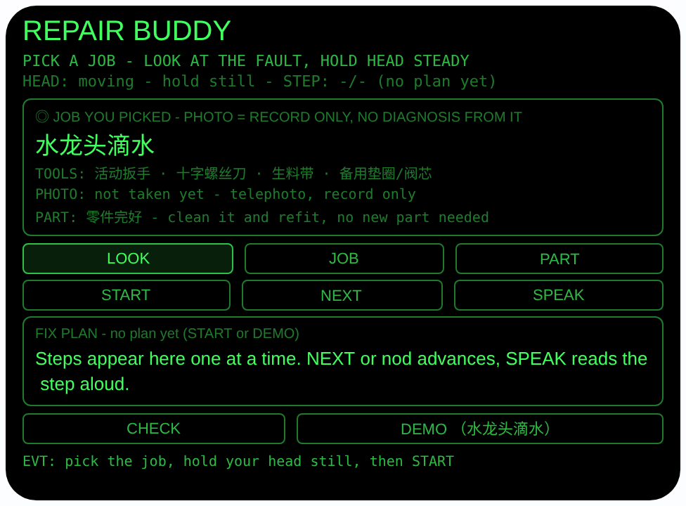
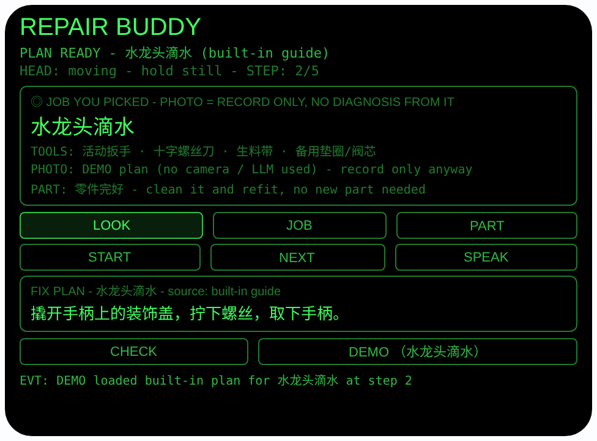

# repair-buddy — 修理搭档（Rokid 眼镜 AIUI Agent）

**Studio 导入地址**（复制到 Global AIUI Studio 的 Import Project 输入框）：

```
https://github.com/sakai55/rokid/tree/agent-repair-buddy
```


50 个「指向性生活问题」Agent 的第 12 个。修水龙头、自行车、马桶
时，双手都在活儿上——一只手扶着阀芯、一只手攥着扳手，根本腾不
出手举手机看教程；要看的零件又小，凑近了也看不清。本 Agent 把
教程挂在视线上：你选好要修的项目，眼镜一步一步带你做，语音念
一步你做一步，点头进下一步；动手前对着手里的小零件用长焦拍一
张特写留档。每个项目的第一步都是它的安全动作。

## 预览截图

截图统一存放于仓库根目录 `screenshots/repair-buddy/`。





## 解决的问题

维修教程的难点不在内容，在姿势：手机要么立在水槽边沾水，要么
躺在地上看不清，翻页还要先擦手。本 Agent 让你修哪样就看哪样：
项目选定后，当前步骤就悬在眼前、念在耳边，双手从头到尾留在
工件上；零件拆下来先长焦拍一张，装回去之前还能对照着看顺序。

## 指向性设计（为什么必须用眼镜）

- **步骤在视线内、双手在工件上**：计划一次只显示一步，大字悬
  在眼前；NEXT 或点头推进，SPEAK 用 `speechSynthesis.speak`
  念出当前步——扶阀芯的手、攥扳手的手都不用放下。
- **看零件 = 长焦特写（telephoto）**：阀芯、垫圈、拍盖、顶丝
  都很小。看着手里的零件点 LOOK，用
  `ImageCapture.takePhoto({mode:'telephoto'})` 拍特写留作视觉
  记录，界面显示字节数。照片只作记录，不参与任何判断。
- **头部稳定 = 凝视确认**：`enableWorldAwareness()` 开启世界
  感知后，`onOrientationStabilityChange` 报告头部稳定时才进入
  可用状态（HEAD STEADY）；点头（`onHeadGesture` 的 `nod`）：
  没有计划时触发 LOOK 拍照，计划进行中则推进一步。
- **零件状态由你亲眼判断（诚实边界）**：PART 轮换你看到的
  状态（零件完好 / 磨损 / 裂了），每个状态给一句后果，如
  「裂了 → replace it, do NOT force it back in（这件要换新，
  别硬装）」。运行时没有把照片变成零件结论的链路，绝不声称
  照片诊断了故障——项目也是你自己选的，不是眼镜猜的。

## 功能流程

1. 选项目：JOB 在 4 个内置项目间切换（水龙头滴水 / 自行车
   掉链 / 马桶一直流水 / 门把手松动），每个项目带工具清单
   一行；切换即重置计划。ArrowUp / ArrowDown 同样换项目
2. 看着要修的部位稳住头 → 状态变 `HEAD STEADY`；点头或点
   LOOK → telephoto 拍零件特写（只作记录），显示字节数；
   PART 标注你亲眼看到的零件状态及后果
3. 点 START 出计划：优先 LanguageModel 按所选项目生成
   （解析出 ≥4 个编号步骤才采用，标注来源 LLM，并强制第 1 步
   原样使用该项目的安全动作）；否则内置项目表（每项目 5 个
   具体步骤，标注 built-in guide）
4. NEXT 或点头逐步推进；SPEAK 朗读当前步（无计划时朗读
   工具清单 + 安全第一步）
5. 全部做完显示收尾语（如「DONE - still dripping? Book a
   plumber - say: faucet valve seat worn.」）；点 CHECK
   显示该项目的验收一行（如水龙头：慢慢开总水阀 → 看 1
   分钟不滴 = 成功），状态进入 DONE。计划没做完时 CHECK
   会提示先做完
6. DEMO 按钮：直接载入「水龙头滴水」内置计划并停在第 2 步，
   预览即可看到修到一半的步骤视图（不依赖相机/大模型）

> 安全说明：每个项目的第 1 步都是安全动作——水龙头先关总
> 水阀、马桶先关进水角阀、自行车先支稳车身、门把手先确认
> 松动来源（无水电危险）。本 Agent 只给这 4 个项目的常见
> DIY 指引，不做诊断、不替代专业维修；**燃气与强电（220V
> 线路、配电箱）不在范围内**，内置表与大模型提示词都明确
> 排除，遇到这类问题请关阀/断电并找专业人员。

## 权限

| 权限 | 用途 |
|---|---|
| CAMERA | 取流并以 telephoto 模式拍摄手里的小零件（只作视觉记录，不参与识别与判断） |

相机只在用户触发时启动：拍完立即停掉全部媒体轨道；
大模型会话用完即 destroy。

## 打包与预览

```bash
cd ~/workspace/rokid/repair-buddy
~/tools/bin/aix pack . -o ../dist/repair-buddy.aix
~/tools/bin/aix preview . --html-out artifacts/preview.html
```

本地预览截图走 `~/workspace/preview-tools/` 的本地 Ink + puppeteer 路线
（`shot-repair.js`；步骤截图的点击序列为 canvas 内 DEMO (340, 290)）。

## 真机测试（海外版 · 云端下发 · Path 1）

1. 推到 GitHub 后，Global AIUI Studio（aiui-global.rokid.com，en-US）用
   分支导入：`https://github.com/sakai55/rokid/tree/agent-repair-buddy`
   （该分支根目录即本 Agent 文件）
2. Studio 的 **Device Debug** 页签填 Basic Information，在 AIX Packaging
   点 **Repackage and Save**，确认顶部出现绿色
   **● Debug version ready — Ready for device debugging**
3. **Hi Rokid**（海外版 `com.rokid.sprite.global.aiapp`，不是国内版
   Rokid Ai App）→ 设置 → 开发者选项 → AIUI → 更新眼镜资源包，
   等「智能体资源包下载成功」
4. 对眼镜说「乐奇，打开 repair-buddy」，站到漏水的水龙头前选好
   项目，看着阀芯稳住头、点头拍特写，跟着语音一步步修完再 CHECK

## 真机测试信息（Global AIUI Studio · Device Debug）

| 项目 | 值 |
|---|---|
| Agent Name（Studio） | 待导入后回填 |
| Version（Build） | 1.0.0（待导入后回填） |
| App Category | 待导入后回填 |
| Intent Description | 待导入后回填 |
| Agent ID | 待导入后回填 |
| AIX Package Size | 16.46 KB（本地打包 `dist/repair-buddy.aix`） |
| 状态 | 本地完成，待导入 Studio |
| Studio | aiui-global.rokid.com（en-US） |
| 下发方式 | 云端下发 → Hi Rokid（海外版）更新眼镜资源包 |

## 验证情况

**已验证**

- 静态检查：app.json / package.json JSON 解析通过；`<script def>` JSON
  解析通过；`<script setup>` 与 app.js 提取后 `node --check` 语法通过；
  全目录 grep 无 `Page(` / `App(` / `Widget(` / `workers:` 残留。
- 预览渲染：aix preview + 本地 Ink + puppeteer 截图两张（见下方
  Preview Media）：首页初始态完整渲染（项目框：项目「水龙头滴水」大字、
  工具行、照片行、零件行，LOOK/JOB/PART 与 START/NEXT/SPEAK 与
  CHECK/DEMO 按钮、空计划框）；点 DEMO 后载入内置「水龙头滴水」
  计划并停在 STEP 2/5（第 2 步内容可见，来源标注 built-in guide）。
- 打包：`aix pack` 成功（16.46 KB）；`aix list` 核对包内含 README.md、AGENTS.md、
  app.js、app.json、package.json、pages/index/index.ink
  （artifacts/ 已被 .aixignore 排除）。

**未验证**

- 真机相机取流与 telephoto 模式拍小零件特写的效果（预览主机无
  相机，LOOK 的 FAIL 路径已如实写明原因，真机待测）。
- 真机 LanguageModel 生成维修计划的质量与解析成功率（预览走
  内置项目表路径，真机待测）。
- 真机头部稳定检测、点头推进步骤、TTS 朗读当前步的效果。
- **判断方式的产品边界**：本 Agent 不做故障诊断——项目由用户
  选定，零件状态由用户亲眼确认，照片只作记录；这是已知边界，
  不是待补的验证项。
- **覆盖边界**：内置表只有 4 个常见项目，给出的是常识级 DIY
  指引；燃气与强电维修不在范围内，需专业人员处理。

---

## 提审资料（Review Submission）

> Global AIUI Studio → Submit 页签的 Review Information 逐项对应下面四段，
> 提交时整段复制。每次提交前重新确认 Preview Media。

### Feature Description

Repair Buddy walks you through a fix while both hands stay on the job. Pick one of four built-in repairs — dripping faucet, dropped bike chain, running toilet, loose door handle — and follow a safety-first step plan in your line of sight: nod or tap to advance, hear each step read aloud, take a telephoto close-up of a small part as a visual record, note its condition, and finish with a one-line wrap-up check. Gas and mains electrical work are out of scope.

### Opening Message

Hi, I'm **Repair Buddy** — your hands-free repair coach.

Tap **JOB** to pick what you're fixing, look at the part and tap **LOOK** for a telephoto record close-up, then **START**: every plan begins with its safety step. **NEXT** or nod to advance, **SPEAK** to hear a step, **PART** to note the part's condition, and **CHECK** at the end to verify the fix. I coach common DIY jobs only — no gas, no mains electrics.

### Preview Media

提交要求：3–5 个 JPG/PNG 图片或 MP4 视频，至少含 1 张图和 1 个视频，每次提交前重新确认。

- Image 1：`artifacts/preview-repair-buddy-index.png`（aix preview 首页：REPAIR BUDDY 初始态，含项目框（项目「水龙头滴水」大字、工具行、照片行、零件行）、LOOK/JOB/PART、START/NEXT/SPEAK、CHECK/DEMO 按钮及空计划框，本地文件，提交时从本地上传）
- Image 2：`artifacts/preview-repair-buddy-step.png`（DEMO 载入内置「水龙头滴水」计划并停在 STEP 2/5 的运行态：第 2 步内容 + 来源标注 built-in guide，本地文件）
- Video：待真机补 — 真机录制「选项目 → 看零件点头拍特写 → 出计划 → 点头推进 + 朗读修完 → CHECK 验收」全过程（MP4），录好后放 `artifacts/` 并更新此处
- 状态：未齐（已有 2 张图；还需至少 1 个视频，总数补到 3–5 个后才可提交）

### Change Log

#### Build 1.0.0

**Features added**

- Hands-free guided repair for 4 user-picked DIY jobs (dripping faucet, dropped bike chain, running toilet, loose door handle), each with a tools line and 5 concrete steps whose step 1 is the job's safety action (shut the main water valve, close the toilet inlet valve, steady the bike, confirm the looseness source). START tries the on-device LanguageModel first (labeled LLM, with the safety step forced verbatim) and falls back to the built-in job table (labeled built-in guide).
- Gaze-directed part record: head-stability gaze confirmation (HEAD STEADY), nod to photograph the small part in your hands in telephoto mode (record only, ImageCapture with wx camera fallback) and nod to advance steps; PART cycles the wearer-confirmed part condition （完好 / 磨损 / 裂了） with a one-line consequence each.
- Wrap-up verification: after the last step, CHECK shows a per-job one-line success test (e.g. reopen the valve, watch 1 minute, no drips = success) and a DONE state; closings route unresolved jobs to a plumber, bike shop or locksmith with the fault quoted.
- DEMO loads the built-in faucet plan at step 2 so the mid-job step view is visible without camera or LLM.

**Improvements**

- None (initial release).

**Fixes**

- None (initial release).
