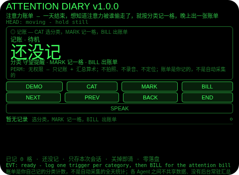
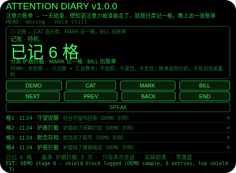
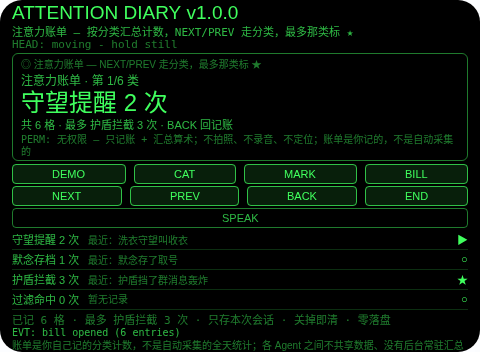
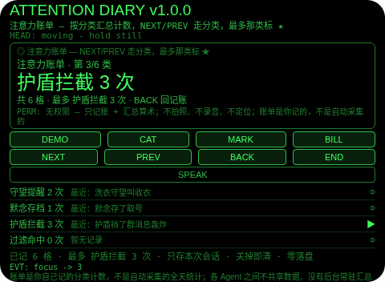
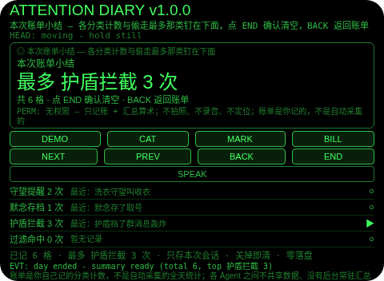

# Attention Diary（注意力账单）

**Studio 导入地址**（复制到 Global AIUI Studio 的 Import Project 输入框）：

```
https://github.com/sakai55/rokid/tree/agent-attention-diary
```

注意力外挂系列 RE05（REVIEW 回顾型，本组收官，系列第 30 个）。一天结束，想知道自己的注意力到底被谁偷走了——守望叫过几次、默念存过什么、护盾挡过多少打扰，全混成一团。本 Agent 把注意力账单外包出去：按分类记一格触发（守望提醒 / 默念存档 / 护盾拦截 / 过滤命中 / 回放确认 / 副线提醒），晚上出一张账单——各分类几次、偷走最多的是哪类、总共几格，一张表说清楚。

## 解决的问题

注意力被偷不是没感觉，是没账——守望叫了几次记不清、护盾挡了多少没数、默念存了什么想不起，晚上复盘只能凭感觉说一句「今天好累」。本 Agent 管三件事：白天按分类记一格（不用记细节，只记触发属于哪类），晚上按分类汇总成账单（不用翻记忆，哪类几次钉在表上），点名偷走最多的那类（不用猜，算术说了算）。

## 注意力外挂设计（REVIEW 回顾型）

- **账单是账本，不是采集结果**：MARK 记一格——当前分类 + 钟点 + 一句「手动记一格」；BILL 按分类汇总计数；最多那类按次数算（并列取分类表里排在前面的那类，并列关系摆在明处，不藏着）。次数只是你记的分类计数，不是传感器统计——账单算的是你记进来的格子，不量任何东西。
- **手动记账，不假装自动采集**：各 Agent 之间不共享数据、没有后台常驻汇总，attention-diary 读不到其他 Agent 的触发记录。所以账单是你自己（或 DEMO 演示）按分类记进来的，汇总是对这些记录的算术；DEMO 种子展示的就是一张完整的一天账单格式。跨 Agent 自动汇总需要平台级数据通道，目前没有——本 Agent 绝不声称它自动汇总了其他 Agent 的数据，也绝不为实现自动汇总而调用任何存储或跨 Agent API。
- **「全天」按单会话实现，代价写在明处**：舰队零落盘纪律不许调用存储 API，所以记账与出账单发生在同一次打开的会话内；关掉 Agent，账单即清。想今天记、晚上看，需要跨日留存——是否破例由 GO 另行决定，本 Agent 绝不偷偷存下来再假装是全天账单。
- **点头只记账和走线，从不替你选**：头稳点头在记账时确认当前分类为一格、在账单里走下一类（只走线，不记账、不改数）、在小结页确认清空；不稳的点头不计入 1.2 秒锁；点头从不切换分类。
- **纠错便宜，销毁需确认**：小结页返回键回到账单（不删东西，小结重建）；账单页返回键回到记账（记录全在）；确认（小结页点 END 或头稳点头）才清空本轮账单；没有 DEL 键。
- **只记本轮账单，关掉即清**：记录、计数、焦点、小结只存会话内存，关掉 Agent 即清——上一天的账单对下一天没有任何意义，存下来才是误导。
- **为什么胸前设备做不了**：账单的线索是「触发时你正在看哪类事」——胸前设备不知道你的视线与操作上下文，也就分不出触发属于哪类；账单必须贴在视线里一眼走完（低头翻手机等于又一次离场，账算到一半就断了）。两条都只有头戴设备成立。

## 与邻近 Agent 的分工

- 注意力系列 `day-lookback`（RE01）：白天时间线模板——你标记的凝视，分画面 / 数字 / 承诺三类，按时间排序。本 Agent 不是时间线：它的单位是按分类记的触发格，收尾是计数账单 + 一句「偷走最多」，不是回放。
- 注意力系列 `talk-replay`（RE02）：谈话回放模板——谈话字幕按说话方标注，回放只列承诺 / 数字 / 期限三类句。本 Agent 没有字幕、没有句子分类：它的分类是全舰队的触发来源（守望、默念、护盾、过滤、回放、副线），输出是次数，不是句子。
- 注意力系列 `route-replay`（RE04）：路线预告模板——危险点带方位和当时画面，按登记顺序走线确认。本 Agent 没有方位、没有照片：它的单位是计数的触发格，走线是跨分类，不是跨地点。

## 功能流程

1. **记账（CAT / MARK）**：CAT 在守望提醒 / 默念存档 / 护盾拦截 / 过滤命中 / 回放确认 / 副线提醒间选分类，MARK 记一格（分类 + 钟点 + 手动记一格）；大字显示已记几格，小字显示当前分类。
2. **账单（BILL / NEXT / PREV）**：至少记了一格才能 BILL；账单按分类列出每类几次（最近一条附在下面），大字显示当前类次数，小字钉住共几格、最多是哪类几次；NEXT/PREV 走分类，最多那类标 ★；账单里点头只走线，不记账。
3. **结束与小结（END）**：小结列出共几格、最多是哪类几次，并把六类计数列在下面；返回键回到账单（不删东西），小结页点 END 或头稳点头确认后清空本轮账单。
4. **演示（DEMO）**：八段演示——守望提醒（灶台守望叫回看）→ 护盾拦截（护盾挡了闲聊打扰）→ 默念存档（默念存了取号）→ 护盾拦截（护盾挡了推销电话）→ 守望提醒（洗衣守望叫收衣）→ 护盾拦截（护盾挡了群消息轰炸）→ 账单（守望 2 次、默念 1 次、护盾 3 次）→ 小结（共 6 格，最多护盾拦截 3 次）；已有用户记录或用户账单进行时 DEMO 拒绝，绝不覆盖。

## 手势映射

| 手势/按键 | 动作 |
|---|---|
| 点按（Enter） | 记账：确认当前分类为一格；账单：走下一类；小结页：确认并清空 |
| 双击（Backspace） | 小结页：回到账单；账单页：回到记账；记账页：无动作并说明 |
| 上滑（ArrowUp） | 记账/账单：下一格/下一类 |
| 下滑（ArrowDown） | 记账/账单：上一格/上一类 |
| 头稳 + 点头 | 记账：确认当前分类为一格；账单：走下一类（只走线，不记账）；小结页：确认并清空；不稳的点头不计入 1.2 秒锁；点头从不切换分类 |
| 屏上按钮 | DEMO 演示 / CAT 选分类 / MARK 记一格 / BILL 出账单 / NEXT 下一格/下一类 / PREV 上一格/上一类 / BACK 返回 / END 结束出小结（小结页点 END 即确认清空）/ SPEAK 朗读当前状态 |

## 权限说明

- 不申请任何权限（app.json 的 `permissions` 为 `[]`，静态校验明确断言这一点）：记账 + 汇总算术不需要相机、麦克风、定位。
- 不申请 `CAMERA`（没有任何拍照环节）、不申请 `RECORD_AUDIO`（没有任何收听环节：没有 ASR 路径，没有 onASRResult 处理）、不申请 `GEOLOCATION`（Agent 从不知道你在哪）。

## 打包与预览命令

```bash
~/tools/bin/aix pack . -o ../dist/attention-diary.aix
~/tools/bin/aix preview . --html-out artifacts/preview.html
```

本地预览截图管线见 `~/workspace/custom-skills/rokid-preview-screenshots/SKILL.md`（本地 Ink + puppeteer，480×352；本 Agent 的探针脚本在 `~/workspace/preview-tools/shot-attention-diary.js`，核定序列见该脚本头注；逐态探测：同一坐标在不同态可能打中别的按钮，首版截图务必逐张目视）。

## 真机测试信息表

| 项目 | 内容 |
|---|---|
| Studio 名称 | （导入后回填） |
| Version / Build | 1.0.0 / （导入后回填） |
| App Category | （导入后回填） |
| Intent Description | （导入后回填） |
| Agent ID | （导入后回填） |
| 状态 | 未导入（本地全流程完成，待 GO 在 Global Studio 导入 + 真机测试） |

## 预览截图







## 提审资料 (Review Submission)

### Feature Description

一天结束，想知道自己的注意力到底被谁偷走了。本 Agent 把注意力账单外包：按分类记一格触发（守望提醒 / 默念存档 / 护盾拦截 / 过滤命中 / 回放确认 / 副线提醒），晚上出一张账单——各分类几次、偷走最多的是哪类、总共几格。诚实边界：账单是你自己记的分类计数，不是自动采集的全天统计；各 Agent 之间不共享数据、没有后台常驻汇总，跨 Agent 自动汇总需要平台级数据通道，目前没有；次数只是你记的分类计数，不是传感器统计；只存本次会话，关掉即清；权限为空。

### Opening Message

**一天结束，算一算注意力被谁偷走了——按分类记一格，晚上出一张账单就够了。**

- 记账：CAT 选分类，MARK 记一格（分类 + 钟点）
- 账单：BILL 按分类汇总计数，NEXT/PREV 走分类，最多那类标 ★
- 结束与小结：END 出本次账单小结，共几格、最多是哪类几次钉在下面；返回键回到账单，确认后清空
- 演示：DEMO 走八段——六格记录、账单、小结（共 6 格，最多护盾拦截 3 次）
- 诚实边界：账单是你记的，不是自动采集的；只存本次会话；权限为空

### Preview Media

- 预览图片 5 张（见上方「预览截图」节，本地 480×352 预览管线逐张目视核对）
- 预览视频：待真机录制后补齐（提审需 3–5 个文件，含至少 1 张图片 + 1 段 ≤60 秒视频）

### Change Log

#### Build 1.0.0

- Features added：记账（分类选择 + 记一格）；账单（按分类汇总计数 + 最多那类标 ★）；结束小结（共几格 + 最多哪类几次）；八段 DEMO 演示
- Improvements：无（首个版本）
- Fixes：无（首个版本）
