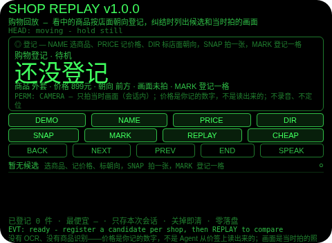
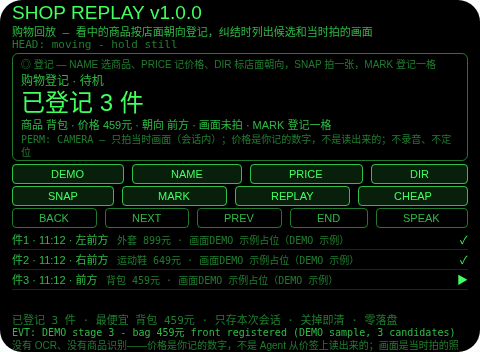
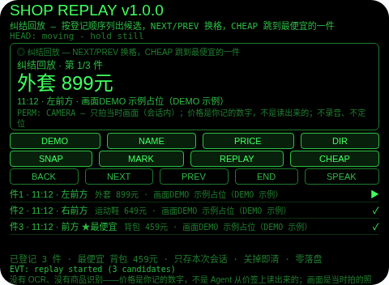
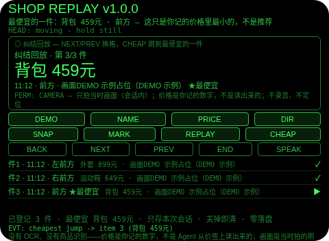
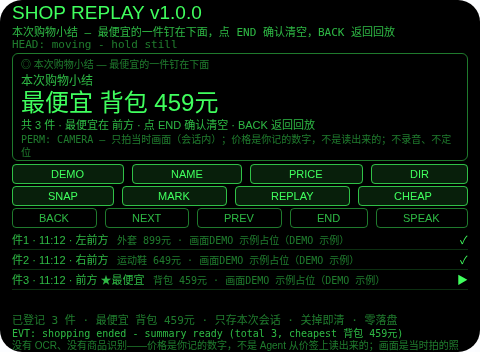

# Shop Replay（购物回放）

**Studio 导入地址**（复制到 Global AIUI Studio 的 Import Project 输入框）：

```
https://github.com/sakai55/rokid/tree/agent-shop-replay
```

**AIX 直接下载**（最新版）：[shop-replay.aix](https://raw.githubusercontent.com/sakai55/rokid/main/aix/shop-replay.aix)

注意力外挂系列 RE03（REVIEW 回顾型，本组第三位）。逛完一圈纠结：刚才犹豫的那件在哪家店？多少钱？——逛的时候每件都看中了，逛完却想不起哪件在哪家店、标价是多少。本 Agent 把购物回放外包出去：看中一件就登记一格——商品名 + 你记的价格 + 店面朝向 + 当时拍一张画面；纠结时按登记顺序列出候选，CHEAP 直接跳到你记的价格里最便宜的一件；结束小结钉住最便宜的是哪件、在哪个方向。

## 解决的问题

逛完的纠结不是没看中，是没留痕——商品混在店里、价格混在脑子里、店面混在方向里，逛完想一件就得把整条街重走一遍。本 Agent 管三件事：逛的时候把每件犹豫的商品钉上一格（商品、价格、朝向、画面四样齐），纠结时按登记顺序走一遍候选（不用重走那条街），比价时只算你记的价格里最小的一件（不用重算）。

## 注意力外挂设计（REVIEW 回顾型）

- **回放是登记，不是识别**：候选是你登记的，不是 Agent 认出来的——商品是你选的、价格是你记的、朝向是你标的、画面是你拍的。回放列的是登记原样，不加识别、不加推荐。
- **价格是你记的，不是读出来的**：没有 OCR、没有商品识别——PRICE 轮换的是你确认的数字，不是 Agent 从价签上读出来的。你记错了价格，它就错着列出来，Agent 没法替你去货架上核对；比价只是你记的数字里取最小，不是官方比价。
- **画面是当时拍的原图（会话内），不是识别结果**：SNAP 拍一张 wide 照片，转成 data URL 只存在会话内存里，钉在登记的那一格上；回放显示「已拍（会话内）」加字节数，不渲染图库、不做识别；关掉 Agent，照片和候选一起清。预览里没有相机，DEMO 候选的画面一律标 DEMO 示例占位，绝不假装是实拍。
- **朝向是记忆线索，不是导航**：每格带的朝向是你登记时面对的方向，帮你想起「那家店在左前方」——顺着朝向想起来的是店（那家外套店、那家鞋店），不是路线。
- **最便宜只是算术，不替你决定**：CHEAP 跳到价格最小的一格（并列取先登记的），小结钉住最便宜的是哪件、在哪个方向——它不替你判断哪件最值得买，值得不值得由你自己在回放时定。
- **点头只确认和走线，从不替你选**：头稳点头在登记时确认当前选择为一格、在回放时走下一格、在小结页确认清空；不稳的点头不计入 1.2 秒锁；点头从不切换商品、价格或朝向。
- **纠错便宜，销毁需确认**：小结页返回键回到回放（不删东西，小结重建）；回放页返回键回到登记（候选全在）；确认（小结页点 END 或头稳点头）才清空本轮购物；没有 DEL 键。
- **只记本轮购物，关掉即清**：候选、照片、焦点、计数只存会话内存，关掉 Agent 即清——上一轮的犹豫对下一轮没有任何意义，存下来才是误导。
- **为什么胸前设备做不了**：回放的线索是「这件是朝哪个方向的店里看中的」——胸前设备不知道你的视线朝向，也就给不出店面朝向标记；候选必须贴在视线里一眼走完（低头翻手机等于又一次离场，线走到一半就断了）。两条都只有头戴设备成立。

## 与邻近 Agent 的分工

- 注意力系列 `last-glance`（CO01）：离开存档模板——按区拍照 + LLM 一句描述，6/6 齐了才能离开。本 Agent 没有 LLM 描述、没有离开门：它的照片是每件候选的当时画面，它的收尾是比价小结，不是齐全检查。
- 注意力系列 `day-lookback`（RE01）：白天时间线模板——你标记的凝视，分画面 / 数字 / 承诺三类，画面以文字描述登记。本 Agent 不是一天：它的单位是购物候选（商品 + 价格 + 朝向 + 实拍），回放以比价收尾。
- 注意力系列 `talk-replay`（RE02）：谈话回放模板——字幕按三类句过滤。本 Agent 没有字幕、没有关键词过滤：它的回放是登记顺序加最便宜一跳。

## 功能流程

1. **购物登记（NAME / PRICE / DIR / SNAP / MARK）**：NAME 在外套 / 运动鞋 / 背包 / 围巾 / 水杯间选商品，PRICE 在示例价格间记价格（这是你确认的数字，不是读出来的），DIR 在前方 / 左前方 / 右前方 / 左方 / 右方 / 后方间标店面朝向，SNAP 拍一张当时画面（wide，会话内），MARK 登记一格；没拍也能登记（画面记为未拍），回放照样列出它。
2. **纠结回放（REPLAY / NEXT / PREV）**：至少登记了一格才能 REPLAY；回放按登记顺序列出每一格，大字显示当前格商品名 + 价格，小字显示时间 + 朝向 + 画面状态 + 第几格；NEXT/PREV 换格，点按行也能聚焦。
3. **跳到最便宜（CHEAP）**：回放中 CHEAP 直接把焦点跳到价格最小的一格（并列取先登记的），并报出「最便宜的一件」——这只是你记的价格里最小的，不是推荐。
4. **结束与小结（END）**：小结列出共几件、最便宜的是哪件多少钱、在哪个方向，并把全部候选列在下面；返回键回到回放（不删东西），小结页点 END 或头稳点头确认后清空本轮购物。
5. **演示（DEMO）**：六段演示——外套 899元左前方（DEMO 示例）→ 运动鞋 649元右前方 → 背包 459元前方 → 回放聚焦第 1 件 → CHEAP 跳到最便宜的第 3 件（背包 459元）→ 小结（共 3 件，最便宜背包 459元前方）；已有用户候选或用户回放进行时 DEMO 拒绝，绝不覆盖。

## 手势映射

| 手势/按键 | 动作 |
|---|---|
| 点按（Enter） | 登记：确认当前选择为一格；回放：走下一格；小结页：确认并清空 |
| 双击（Backspace） | 小结页：回到回放；回放页：回到登记；登记页：无动作并说明 |
| 上滑（ArrowUp） | 登记/回放：下一格 |
| 下滑（ArrowDown） | 登记/回放：上一格 |
| 头稳 + 点头 | 登记：确认当前选择为一格；回放：走下一格；小结页：确认并清空；不稳的点头不计入 1.2 秒锁；点头从不切换商品、价格或朝向 |
| 屏上按钮 | DEMO 演示 / NAME 选商品 / PRICE 记价格 / DIR 标店面朝向 / SNAP 拍一张 / MARK 登记一格 / REPLAY 回放 / CHEAP 跳到最便宜 / END 结束出小结（小结页点 END 即确认清空）/ SPEAK 朗读当前状态 / BACK 返回 / NEXT 下一格 / PREV 上一格 |

## 权限说明

- 只申请 `CAMERA`（app.json 的 `permissions` 为 `["CAMERA"]`，静态校验明确断言这一点）：当时拍画面（wide 模式，会话内）。
- 不申请 `RECORD_AUDIO`（没有任何收听环节：没有 ASR 路径，没有 onASRResult 处理）、不申请 `GEOLOCATION`（朝向是你登记时面对的方向，不是定位：Agent 从不知道你在哪）。

## 打包与预览命令

```bash
~/tools/bin/aix pack . -o ../dist/shop-replay.aix
~/tools/bin/aix preview . --html-out artifacts/preview.html
```

本地预览截图管线见 `~/workspace/custom-skills/rokid-preview-screenshots/SKILL.md`（本地 Ink + puppeteer，480×352；本 Agent 的探针脚本在 `~/workspace/preview-tools/shot-shop-replay.js`，核定序列：DEMO(66,170) → DEMO(66,180) → DEMO(66,180) → REPLAY(298,190) → CHEAP(414,190) → END(336,210)；逐态探测：待机态 DEMO 在 y=170，首格后状态行换行、按钮带下移到 y=180，回放态 REPLAY/CHEAP 在 y=190，5 按钮行的 END 在 y=210，同一坐标在不同态可能打中别的按钮，首版截图务必逐张目视）。

## 真机测试信息表

| 项目 | 内容 |
|---|---|
| Studio 名称 | （导入后回填） |
| Version / Build | 1.0.1 / （导入后回填） |
| App Category | （导入后回填） |
| Intent Description | （导入后回填） |
| Agent ID | （导入后回填） |
| 状态 | 未导入（本地全流程完成，待 GO 在 Global Studio 导入 + 真机测试） |

## 预览截图







## 提审资料 (Review Submission)

### Feature Description

逛完一圈纠结：刚才犹豫的那件在哪家店？多少钱？本 Agent 把购物回放外包：看中一件就登记一格——商品名 + 你记的价格 + 店面朝向 + 当时拍一张画面；纠结时按登记顺序列出候选，CHEAP 直接跳到你记的价格里最便宜的一件；结束小结钉住最便宜的是哪件、在哪个方向。诚实边界：没有 OCR、没有商品识别，价格是你记的数字、不是读出来的；画面是当时拍的原图（会话内）、不是识别结果；朝向只是记忆线索、不是导航；只存本轮购物会话，关掉即清；权限只有 CAMERA。

### Opening Message

**逛完别再重走那条街——候选、价格、朝向、画面，一格一格走一遍就够了。**

- 购物登记：NAME 选商品、PRICE 记价格、DIR 标店面朝向，SNAP 拍一张，MARK 登记一格
- 纠结回放：REPLAY 按登记顺序走，NEXT/PREV 换格
- 跳到最便宜：CHEAP 直接跳到你记的价格里最小的一件（并列取先登记的）
- 结束与小结：END 出本次购物小结，最便宜的一件钉在下面；返回键回到回放，确认后清空
- 演示：DEMO 走六段——外套、运动鞋、背包三格登记、回放、最便宜一跳、小结
- 诚实边界：价格是你记的，不是读出来的；画面是当时拍的原图（会话内）；只存本轮会话

### Preview Media

- 预览图片 5 张（见上方「预览截图」节，本地 480×352 预览管线逐张目视核对）
- 预览视频：待真机录制后补齐（提审需 3–5 个文件，含至少 1 张图片 + 1 段 ≤60 秒视频）

### Change Log

#### Build 1.0.0

- Features added：购物登记（商品/价格/朝向选择 + 当时拍画面 + 登记一格）；纠结回放（登记顺序走线）；最便宜一跳（你记的价格取最小，并列取先登记）；结束小结（共几件 + 最便宜哪件在哪个方向）；六段 DEMO 演示
- Improvements：无（首个版本）
- Fixes：无（首个版本）

#### Build 1.0.1

- Features added：无
- Improvements：无
- Fixes：删除 FileReader（Ink 运行时不存在，真机必死）：登记照片 Blob→dataURL 改走官方文档路径 `blob.arrayBuffer()` + 分块 `btoa`，失败接全局错误码 E2005 并如实显示
