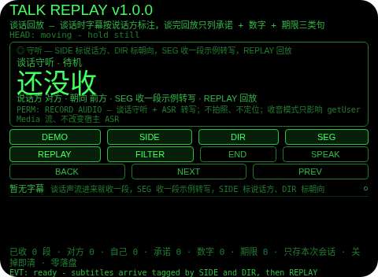
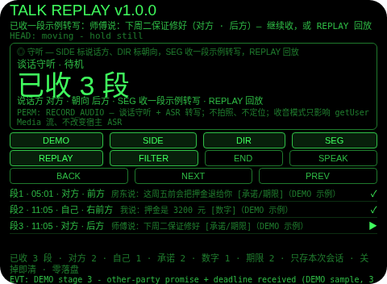
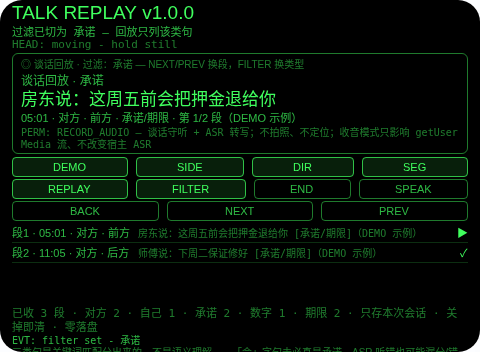
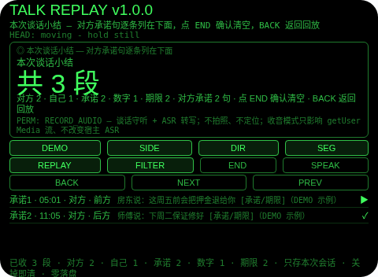

# Talk Replay（谈话回放）

**Studio 导入地址**（复制到 Global AIUI Studio 的 Import Project 输入框）：

```
https://github.com/sakai55/rokid/tree/agent-talk-replay
```

注意力外挂系列 R02（REVIEW 回顾型，本组第二位）。和房东/客户/师傅谈完，对方承诺了啥、期限是啥，越想越不确定——谈的时候每句都听见了，谈完却想不起哪句是承诺、哪个数字对应哪个期限。本 Agent 把谈话回放外包出去：谈话时字幕按说话方标注（对方 / 自己，由你切换标记）+ 朝向标记 + 时间标记，谈完回放只列三类句——承诺句（含承诺词：会 / 保证 / 答应 / 负责 / 包 / 一定）、数字句（含数字 / 金额）、期限句（含期限词：周× / ×号 / ×天内 / 之前 / 月底前），三类可切换过滤；结束小结列出三类各几句，并把对方承诺句逐条列出来。

## 解决的问题

谈完的不确定不是没听清，是没留痕——承诺混在闲聊里、数字混在条件里、期限混在客套里，事后想一件就得把整场谈话重想一遍。本 Agent 管三件事：谈话时把每段字幕钉上说话方和朝向（谁说的、朝哪边说的），谈完只把三类句拎出来给你走一遍（承诺、数字、期限分开看），结束把对方的承诺句逐条钉在小结里——复盘时你不用再重想整场谈话，只要顺着三类走。

## 注意力外挂设计（REVIEW 回顾型）

- **回放是过滤，不是录音**：字幕是谈话声流进来的转写（真机上宿主 ASR 供稿，预览里 SEG / DEMO 以标注的示例转写模拟同一条收段路径），每段带说话方 + 朝向 + 时间；回放不播录音、不贴全文，只列三类句——你要的是「对方承诺了啥、期限是啥」，不是把谈话再听一遍。
- **三类只按关键词分，不替你理解**：承诺看会 / 保证 / 答应 / 负责 / 包 / 一定，数字看数字与元 / 块 / 万 / 千 / 百，期限看周 / 号 / 天内 / 之前 / 月底 / 下周 / 明天 / 后天 / 截止。一句带「会」未必真是承诺，ASR 听错也可能漏分或错分——回放列的是候选，最终以谈话原意为准；分类错了你一眼就能看出来，因为原文就贴在类标旁边。
- **说话方是你标的，不是认出来的**：SIDE 默认对方，点一下切到自己，再点切回来；每段字幕归到你切换时所在的方。没有声纹识别——SIDE 切晚了，那段就归错方，Agent 不会替你纠正；没标的段不存在，每段都有你标的方。
- **朝向是记忆线索，不是导航**：每段带的朝向是你收段时面对的方向，帮你想起「这句是朝哪边说的」——顺着朝向想起来的是场景（对着房东说的、对着师傅说的），不是路线。
- **小结只列对方承诺，不替你判断**：结束小结列出三类各几句、对方几段、自己几段，并把对方承诺句逐条列在下面——它不替你判断哪句承诺最重要，重要性由你自己在回放时定。
- **点头只走线和确认，从不替你收字幕**：头稳点头在回放时走下一段、在小结页确认清空；在守听时点头被忽略并说明——字幕由谈话声流进来，点头不能替你编一段；不稳的点头不计入 1.2 秒锁；点头从不切换说话方或朝向。
- **纠错便宜，销毁需确认**：小结页返回键回到回放（不删东西，小结重建）；回放页返回键回到守听（字幕全在）；确认（小结页点 END 或头稳点头）才清空本次谈话；没有 DEL 键。
- **只记本次谈话，关掉即清**：字幕、过滤、焦点、计数只存会话内存，关掉 Agent 即清——上一场谈话的承诺对下一场没有任何意义，存下来才是误导。
- **为什么胸前设备做不了**：复盘的线索是「这句是谁说的、朝哪边说的」——胸前设备不知道你的视线朝向，也就给不出朝向标记；回放必须贴在视线里一眼走完（低头翻手机等于又一次离场，线走到一半就断了）。两条都只有头戴设备成立。

## 与邻近 Agent 的分工

- 注意力系列 `meeting-filter`（F04）：会议门模板——名字 / 议题关键词门 + 命中前 10 秒回放缓冲。本 Agent 没有门、没有缓冲：它保留一场谈话的全部字幕，谈完只回放三类句。
- 注意力系列 `day-lookback`（R01）：白天时间线模板——你标记的凝视，分画面 / 数字 / 承诺三类。本 Agent 不是一天：没有凝视标记、没有画面类——它的单位是谈话字幕，按关键词分承诺 / 数字 / 期限。
- 注意力系列 `lecture-filter`（F05）：课堂门模板——信号句捕捉成笔记。本 Agent 不在谈话中捕捉笔记：它在谈完之后回放谈话本身，经过滤的。

## 功能流程

1. **谈话守听（SIDE / DIR / SEG）**：SIDE 在对方 / 自己间标说话方（默认对方），DIR 在前方 / 左前方 / 右前方 / 左方 / 右方 / 后方间标朝向，字幕随谈话声流进来自动收段（预览里 SEG 收一段示例转写，DEMO 走五段演示）；点按或头稳点头不收字幕——字幕只能由谈话声流进来。
2. **谈完回放（REPLAY / NEXT / PREV）**：至少收了一段才能 REPLAY；回放按收段顺序列出每一格，大字显示当前段原文，小字显示时间 + 说话方 + 朝向 + 类别 + 第几段；NEXT/PREV 换段，点按行也能聚焦。
3. **按三类过滤（FILTER）**：回放中 FILTER 在全部 / 承诺 / 数字 / 期限间循环，只列该类句；某类下没有段时显示「暂无此类」，不编造；过滤不删东西，换回全部就全在。
4. **结束与小结（END）**：小结列出共几段、对方几段、自己几段、三类各几句，并把对方承诺句逐条列在下面；返回键回到回放（不删东西），小结页点 END 或头稳点头确认后清空本次谈话。
5. **演示（DEMO）**：五段演示——对方承诺句（房东说：这周五前会把押金退给你，前方，示例）→ 自己数字句（我说：押金是 3200 元，右前方，示例）→ 对方承诺 + 期限句（师傅说：下周二保证修好，后方，示例）→ 回放过滤到承诺（3 段中只列 2 段）→ 小结（共 3 段：承诺 2、数字 1、期限 2，对方承诺 2 句）；已有用户字幕或用户回放进行时 DEMO 拒绝，绝不覆盖。

## 手势映射

| 手势/按键 | 动作 |
|---|---|
| 点按（Enter） | 回放：走下一段；小结页：确认并清空；守听：无动作并说明（字幕由谈话声流进来） |
| 双击（Backspace） | 小结页：回到回放；回放页：回到守听；守听页：无动作并说明 |
| 上滑（ArrowUp） | 守听/回放：下一段 |
| 下滑（ArrowDown） | 守听/回放：上一段 |
| 头稳 + 点头 | 回放：走下一段；小结页：确认并清空；守听：忽略并说明；不稳的点头不计入 1.2 秒锁；点头从不切换说话方或朝向，从不收字幕 |
| 屏上按钮 | DEMO 演示 / SIDE 标说话方 / DIR 标朝向 / SEG 收一段示例转写 / REPLAY 回放 / FILTER 过滤 / END 结束出小结（小结页点 END 即确认清空）/ SPEAK 朗读当前状态 / BACK 返回 / NEXT 下一段 / PREV 上一段 |

## 权限说明

- 只申请 `RECORD_AUDIO`（app.json 的 `permissions` 为 `["RECORD_AUDIO"]`，静态校验明确断言这一点）：谈话守听 + 宿主 ASR 转写。
- 不申请 `CAMERA`（没有任何拍照环节：读合同或通知不是本 Agent 的活）、不申请 `GEOLOCATION`（朝向是你收段时面对的方向，不是定位：Agent 从不知道你在哪）。
- 收音模式说明（舰队审计结论，UI 与 README 均明说）：收音模式只影响 getUserMedia 流的拾音、不改变宿主 ASR 的拾音——本 Agent 经宿主 ASR 收字幕，不宣称远场拾音对识别本身有增益。

## 打包与预览命令

```bash
~/tools/bin/aix pack . -o ../dist/talk-replay.aix
~/tools/bin/aix preview . --html-out artifacts/preview.html
```

本地预览截图管线见 `~/workspace/custom-skills/rokid-preview-screenshots/SKILL.md`（本地 Ink + puppeteer，480×352；本 Agent 的探针脚本在 `~/workspace/preview-tools/shot-talk-replay.js`，核定序列：DEMO(66,170) → DEMO(66,180) → DEMO(66,180) → REPLAY(66,190) → FILTER(182,190) → FILTER(182,190)×2 → END(298,190)；逐态探测：待机态 DEMO 在 y=170，首段后状态行换行、按钮带下移到 y=180–185，二段后 y=190 已打中 REPLAY，同一坐标在不同态可能打中别的按钮，首版截图务必逐张目视）。

## 真机测试信息表

| 项目 | 内容 |
|---|---|
| Studio 名称 | （导入后回填） |
| Version / Build | 1.0.0 / （导入后回填） |
| App Category | （导入后回填） |
| Intent Description | （导入后回填） |
| Agent ID | （导入后回填） |
| 状态 | 未导入（本地全流程完成，待 GO 在 Global Studio 导入 + 真机测试） |

## 预览截图







## 提审资料 (Review Submission)

### Feature Description

和房东/客户/师傅谈完，对方承诺了啥、期限是啥，越想越不确定。本 Agent 把谈话回放外包：谈话时字幕按说话方标注（对方/自己，由你切换标记）+ 朝向标记 + 时间标记，谈完回放只列三类句——承诺句、数字句、期限句，三类可切换过滤；结束小结列出三类各几句，并把对方承诺句逐条列出来。诚实边界：三类句是关键词匹配分出来的，不是语义理解；说话方是你切换标记的，不是声纹识别；只存本次谈话会话，关掉即清；权限只有 RECORD_AUDIO。

### Opening Message

**谈完别再重想整场谈话——承诺、数字、期限，三类走一遍就够了。**

- 谈话守听：SIDE 标说话方（对方/自己）、DIR 标朝向，字幕随谈话声流进来
- 谈完回放：REPLAY 按收段顺序走，NEXT/PREV 换段
- 按三类过滤：FILTER 在全部 / 承诺 / 数字 / 期限间循环，只列该类句
- 结束与小结：END 出本次谈话小结，对方承诺句逐条列在下面；返回键回到回放，确认后清空
- 演示：DEMO 走五段——对方承诺、自己数字、对方承诺+期限、回放过滤到承诺、小结
- 诚实边界：三类是关键词匹配，不是语义理解；说话方是你标的，不是声纹识别；只存本次会话

### Preview Media

- 预览图片 5 张（见上方「预览截图」节，本地 480×352 预览管线逐张目视核对）
- 预览视频：待真机录制后补齐（提审需 3–5 个文件，含至少 1 张图片 + 1 段 ≤60 秒视频）

### Change Log

#### Build 1.0.0

- Features added：谈话守听（说话方/朝向标记 + 时间标记，宿主 ASR 供稿、预览以示例转写模拟）；谈完回放（收段顺序走线）；三类过滤（全部/承诺/数字/期限）；结束小结（各类计数 + 对方承诺句逐条）；五段 DEMO 演示
- Improvements：无（首个版本）
- Fixes：无（首个版本）
