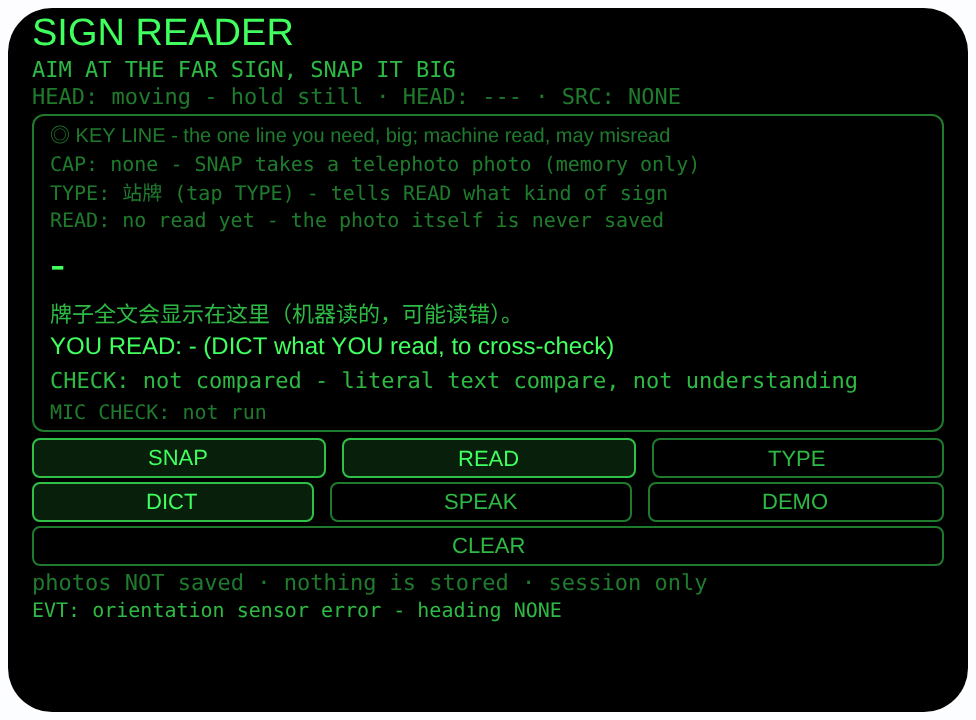
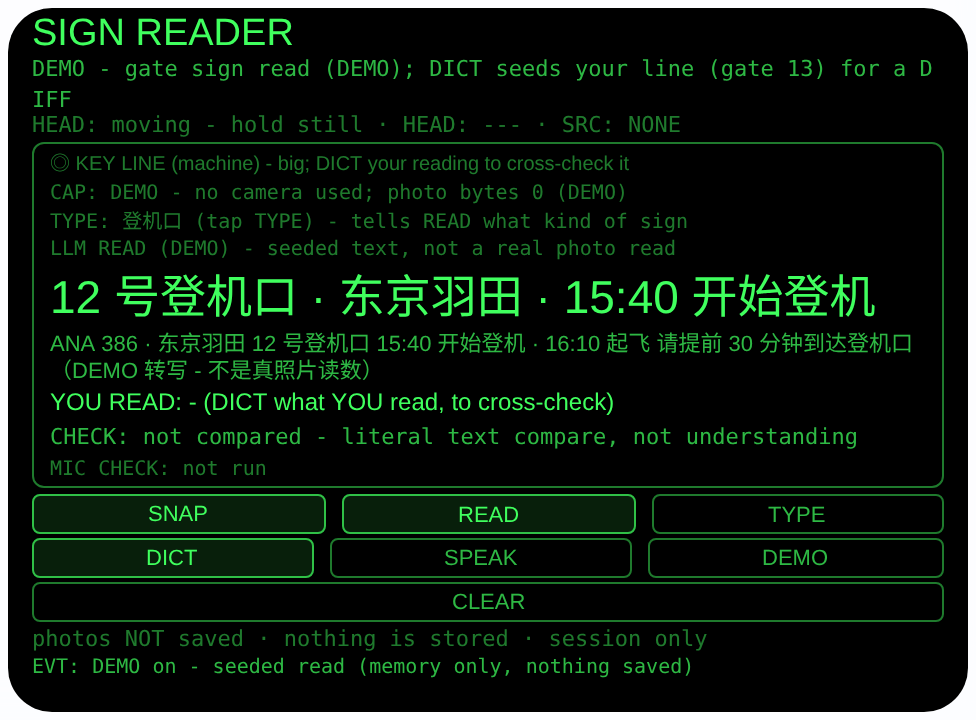
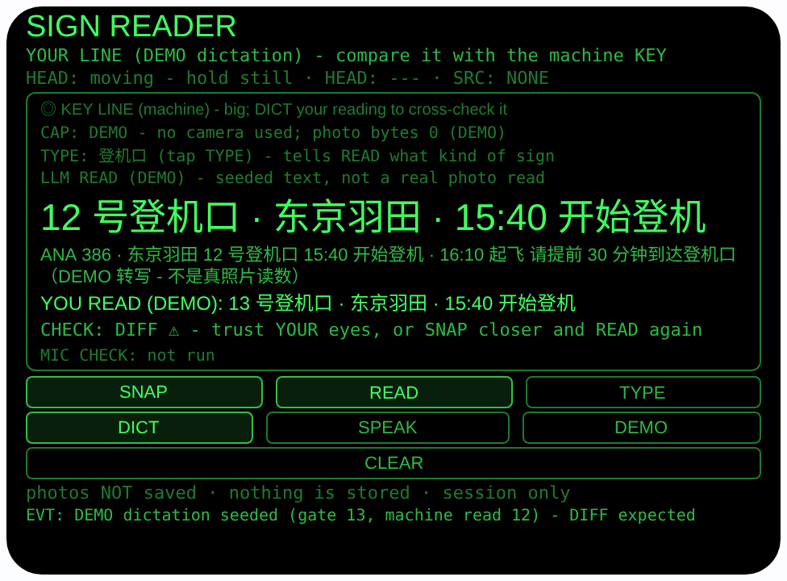

# sign-reader — 远牌读牌（Rokid 眼镜 AIUI Agent）

50 个「指向性生活问题」Agent 的第 41 个，I 组（出行定向）第一个。
站牌在马路对面、登机口信息在通道尽头、菜单牌挂在柜台上方——
太远太小看不清，走近看又来不及。本 Agent 让你看向牌子拍一张
长焦照片，眼镜把照片作为图片发给主机大模型读出来：最重要的一
行（KEY）放大显示、全文在下；再让你把**你自己**读到的关键行
说出来，两边逐字比对，一致放心、不一致以你的眼睛为准，最后
一键把关键行朗读出来。

## 预览截图

截图统一存放于仓库根目录 `screenshots/sign-reader/`。







## 解决的问题

远处牌子的信息密度高、窗口却短：公交还有两分钟到站，登机口
临时变更只播一遍，菜单看到一半队伍就往前走。手机放大拍要举
起来对焦，还得低头看屏幕。本 Agent 把「拍下 → 读出关键行 →
和你自己的眼睛核对 → 朗读」压成眼镜上的四步：看向牌子
SNAP，READ 让大模型把照片读成关键行 + 全文，你瞄一眼大字
对不对，再 DICT 把你读到的说出来比对，SPEAK 念给你听——
全程不用低头。

## 指向性设计（为什么必须用眼镜）

- **看向即取景（GAZE 长焦）**：牌子远而小，SNAP 用
  `ImageCapture.takePhoto({mode:'telephoto'})` 长焦取景——
  你看向哪块牌，拍的就是哪块，头朝向同时记进这次会话
  （`AbsoluteOrientationSensor` 四元数算 yaw；无传感器时如
  实记 `---`）。手机举起来拍，视线就离开了牌子和路况。
- **读字走官方路径（telephoto + LLM 图片输入）**：运行时
  **没有 OCR API**（档案 §4.3）。审计后的做法：照片 Blob
  经 `FileReader.readAsDataURL` 编码为 data: URL，作为
  user 消息的 `{type:'image_url'}` 内容连同文字指令发给
  主机 `LanguageModel`——这是档案 §2.9 / §4.3 给出的官方
  读字路径（同 #39/#40）。提示词带上 TYPE 选定的牌子类型
  作上下文，要求先原样摘出最重要的一行（KEY：车次方向 /
  登机口号 / 菜品价格 / 出口方向），再逐行忠实转写全文、
  看不清标 `[?]`、不许发明照片里没有的内容，返回
  `KEY:` + `TEXT:` 两段。
- **关键行放大（视线内的大字）**：KEY 行以页面最大字号显
  示——远牌读牌的产出不是一篇转写，是你转身就要用的那一
  行：几号登机口、哪路车、多少钱。全文只作核对的底稿。
- **你的眼睛作交叉验证（核对即产品）**：大模型读远牌会读
  错——门号、车次、价格、时间都是高危区。本 Agent 不让机
  器读数单独作数：DICT 把你自己读到的关键行说出来（原样
  显示），两边做**字面比对**（轻量归一化：去空白、去尾部
  标点），一致显示 `MATCH ✓`，不一致显示 `DIFF ⚠` 并明
  说以你的眼睛为准。SPEAK 朗读时也明说来源，不一致时先念
  你的版本。比对只是比字面、不理解语义——格式差异也会判
  DIFF，往安全方向错，界面常驻说明这一点。
- **什么都不存（诚实边界常驻界面）**：牌子是当下的事。
  照片 Blob 只活在内存里，本 Agent 不写任何 wx 存储；界
  面常驻行写明「photos NOT saved · nothing is stored」。

## 功能流程

1. TYPE：先选牌子类型（站牌 / 登机口 / 菜单 / 路牌 / 其
   他），作为 READ 时给模型的上下文
2. SNAP：看向牌子拍长焦照片（记录朝向 + 时间；照片只在
   内存，无相机主机如实 FAIL，并提示改走 DICT）
3. READ：照片 → data: URL → 主机大模型图片输入，返回
   KEY 关键行（大字）+ 转写全文（标注 LLM READ，提示核
   对）；模型不可用 / 转换不可用 / 模型报错 / wx 回退照
   片无 Blob，全部如实落到对应状态（原因写在 READ 行），
   照片仍作记录，并转入 DICT 兜底
4. DICT（核对/兜底）：wearer 麦克风可用性检查（结果单独
   一行 `MIC CHECK:`）后，用宿主 SpeechRecognition
   （zh-CN）在它自己的麦克风上口述你读到的关键行，原样
   显示在 `YOU READ:` 行；与机器 KEY 做字面比对出
   MATCH / DIFF；没有 SNAP 过也能直接 DICT，你的口述行
   直接成为大字 KEY；无识别主机走预置行轮换并标注 SKIP
5. SPEAK / 点头：朗读 KEY 行并明说来源（一致 / 你的版本
   优先 / 机器读数可能读错）；头部稳定时点头等同 SPEAK，
   点头从不拍照、从不 READ
6. DEMO：内存播入一条标注 DEMO 的登机口读数（KEY 为
   12 号登机口，照片字节 0）；DEMO 中 DICT 播入的是门号
   改成 13 的一行，DIFF 状态可完整预览；CLEAR 退出后恢
   复真实会话

> 诚实边界：**没有 OCR**，读字靠「照片 → 大模型图片输入」
> 这条官方路径，而宿主真机是否真的接受 image_url /
> data: URL、FileReader 是否可用，**都未经真机验证**（见
> 「未验证」第一条）——所以每条失败路径都留了一条能用的
> 路，DICT 口述在任何情况下都能把关键行顶到大字位。大模型
> 的转写是机器读数，可能读错，核对这一步不是礼貌，是防线。

## 权限

| 权限 | 用途 |
|---|---|
| CAMERA | SNAP 长焦拍远牌（照片只在内存中转、供 READ 转 data: URL，从不落盘保存） |
| RECORD_AUDIO | DICT 的佩戴者模式麦克风可用性检查（getUserMedia，检查流立即停轨）+ 宿主 SpeechRecognition 口述你读到的关键行（zh-CN） |

相机/麦克风只在用户点 SNAP / DICT 时启动，用完立即停掉全部
媒体轨道。不录音；不写任何存储；照片只随 READ 的那一次请求
经宿主通道发给大模型。

## 打包与预览

```bash
cd ~/workspace/rokid/sign-reader
~/tools/bin/aix pack. -o../dist/sign-reader.aix
~/tools/bin/aix preview. --html-out artifacts/preview.html
```

本地预览截图走 `~/workspace/preview-tools/` 的本地 Ink + puppeteer 路线
（`shot-sign.js`，独立页面副本 `preview-sign.html`；点击序列为
canvas 内坐标 DEMO (391, 245) → DICT (85, 273)，坐标经视觉
定位确认；注意 DEMO 态下状态行与转写换行会把按钮区下推约
28px，DICT 坐标按 DEMO 态定位）。

## 真机测试（海外版 · 云端下发 · Path 1）

1. 推到 GitHub 后，Global AIUI Studio（aiui-global.rokid.com，en-US）用
   分支导入：`https://github.com/sakai55/rokid/tree/agent-sign-reader`
   （该分支根目录即本 Agent 文件）
2. Studio 的 **Device Debug** 页签填 Basic Information，在 AIX Packaging
   点 **Repackage and Save**，确认顶部出现绿色
   **● Debug version ready — Ready for device debugging**
3. **Hi Rokid**（海外版 `com.rokid.sprite.global.aiapp`，不是国内版
   Rokid Ai App）→ 设置 → 开发者选项 → AIUI → 更新眼镜资源包，
   等「智能体资源包下载成功」
4. 对眼镜说「乐奇，打开 sign-reader」，在真实车站/机场/餐馆实测：
   **第一优先验证 READ 的图片通路**——SNAP 一块远处的登机口牌，
   READ 是否真的返回 KEY + 转写（验证宿主接受 image_url /
   data: URL、FileReader 可用）、KEY 摘行准不准（门号/时间是
   高危区）、看不清处是否老实标 `[?]`；图片通路若不通，READ
   是否如实落到失败状态且 DICT 兜底可用；再测长焦在不同距离
   （站牌 5 米 / 登机口 15 米）的取景清晰度、DICT 口述的识别
   率、字面比对在真实口述格式下（无分隔符）的 MATCH/DIFF
   表现、SPEAK 在嘈杂站厅里的可听度

## 真机测试信息（Global AIUI Studio · Device Debug）

| 项目 | 值 |
|---|---|
| Agent Name（Studio） | 待导入后回填 |
| Version（Build） | 1.0.0（待导入后回填） |
| App Category | 待导入后回填 |
| Intent Description | 待导入后回填 |
| Agent ID | 待导入后回填 |
| AIX Package Size | 约 24.0 KB（本地打包 `dist/sign-reader.aix`） |
| 状态 | 本地完成，待导入 Studio |
| Studio | aiui-global.rokid.com（en-US） |
| 下发方式 | 云端下发 → Hi Rokid（海外版）更新眼镜资源包 |

## 验证情况

**已验证**

- 静态检查：app.json / package.json JSON 解析通过；`<script def>` JSON
  解析通过；`<script setup>` 与 app.js 提取后 `node --check` 语法通过；
  全目录 grep 无 `Page(` / `App(` / `Widget(` / `workers:` 残留。
- 读牌逻辑（Node 实测）：把页面对象以 wx / LanguageModel /
  FileReader / SpeechRecognition / speechSynthesis /
  ImageCapture 全部打桩加载进 Node，共 71 条断言全过——含
  SNAP 以 telephoto 模式拍照、Blob 只存内存；提示词组装
  （content 数组恰两段、text 段含 TYPE 选定的牌子类型与
  KEY/TEXT 格式要求、image_url 段携带 data: 前缀 URL、
  system 只经 initialPrompts 首条、prompt 后 session 被
  destroy）；KEY/TEXT 解析（标准两段、全角冒号、无标签
  salvage、仅 KEY、空回复返回 null）；字面比对归一化（空
  白与尾部标点差异判 MATCH、数字不同判 DIFF、归一化不吞
  真实差异）；DICT 通路（检查流轨道在识别开始前已全部停
  掉、检查结果独立 `MIC CHECK:` 行、聆听标注
  `(host ASR)`、识别原文 verbatim 成为你的行、无照片时你
  的行直接成为大字 KEY、无识别主机走预置轮换并标注
  SKIP）；SPEAK 来源纪律（一致时声明核对一致、DIFF 时先
  念你的版本并点名机器版本、只有机器读数时先声明可能读
  错、无 KEY 时如实拒绝、TTS 从不设置 utterance.lang）；
  失败迁移全覆盖（无大模型 / availability 非 available /
  FileReader 缺失 / 转换结果非 data: / 模型抛错 / 模型空
  回复，全部如实落到对应状态且失败原因保留在 READ 行、
  待存照片保留、DICT 兜底可用；wx 照片无 Blob → READ 如
  实 n/a 而 DICT 仍可用；SNAP 全失败如实 FAIL）；点头纪
  律（无 KEY 不动、不稳不动、稳且有 KEY 才 SPEAK、点头永
  不拍照/永不 READ、非 nod 手势忽略）；DEMO 播种（登机口
  读数标注 DEMO、照片字节 0、TYPE 切到登机口、DICT 播入
  13 号门行触发 DIFF、CLEAR 后真实会话恢复）；**全程零
  wx 存储写入**（setStorageSync 调用计数为 0）。
- 打包：`aix pack` 成功；`aix list` 核对包内含 README.md、AGENTS.md、
  app.js、app.json、package.json、pages/index/index.ink
  （artifacts/ 已被.aixignore 排除）。
- 预览渲染：aix preview + 本地 Ink + puppeteer 截图三张（见下方
  Preview Media）：首页初始态完整渲染（KEY 框含 CAP/TYPE/
  READ/KEY/全文/YOU READ/CHECK/MIC CHECK 各行、SNAP/READ/
  TYPE 与 DICT/SPEAK/DEMO 按钮及常驻诚实行）；点 DEMO 到达
  播种态：登机口 KEY 大字（12 号登机口 · 东京羽田 · 15:40
  开始登机）与转写全文正确渲染、标注 DEMO；再点 DICT 到达
  核对态：YOU READ 行为 13 号登机口（DEMO 口述），CHECK
  显示 DIFF ⚠ 并提示以你的眼睛为准。

**未验证**

- **真机 READ 图片通路**：宿主 `LanguageModel` 是否
  真的接受 user 消息里的 `{type:'image_url'}` content、data:
  URL 是否被接受、Blob → `FileReader.readAsDataURL` 在眼镜运
  行时里是否可用——档案 §2.9 只保证文档层面成立，三者都要真
  机实测。若图片通路在真机不通，READ 会如实落到失败状态，
  本 Agent 靠 DICT 口述仍可完整使用（你的眼睛 + 大字显示 +
  朗读），但「拍照读远牌」这个核心卖点要等真机结论。
- 真机大模型读远牌的质量：门号/车次/价格/时间的摘行与转
  写准确率、`[?]` 诚实标注的遵从度、KEY 摘行是否摘对「最
  重要的一行」、两段格式的稳定性；格式跑偏时解析按行
  salvage，KEY 与全文可能分错段。
- 真机长焦拍远牌的清晰度与成功率（距离、逆光、反光玻璃
  后的牌子、夜间站牌）；wx 回退照片在真机上的形态（回退
  照片没有 Blob，READ 对它是如实 n/a、只能 DICT——真机上
  回退触发频率待测）。
- 真机 DICT 识别率与字面比对的实际表现：宿主识别器把口
  述关键行转成的格式（分隔符、数字写法、繁简）与机器 KEY
  的格式差异会不会频繁误判 DIFF（比对是字面比对，误判方
  向是安全的——多提醒核对——但频率待真机观察）；站厅噪
  声下宿主识别器听关键行的准确度（wearer 检查流不参与识
  别）；头部朝向读数的精度与零点参考（宿主定义）；点头
  SPEAK 在赶车场景的误触率。

---

## 提审资料（Review Submission）

> Global AIUI Studio → Submit 页签的 Review Information 逐项对应下面四段，
> 提交时整段复制。每次提交前重新确认 Preview Media。

### Feature Description

Sign Reader makes far signs readable. Aim at a bus stop, departure gate, menu or road sign, tap SNAP for a telephoto photo, then READ: the photo goes to the host AI as an image - the official read-text path, there is no OCR - and the sign's key line comes back big on screen, full text below, labelled a machine read. DICT lets you say what YOU read; the two are compared and flagged MATCH or DIFF. SPEAK reads the key line aloud, preferring your version on a diff. Session only - nothing stored.

（496 字符）

### Opening Message

Hi, I'm **Sign Reader** - far signs, read big.

**SNAP** takes a telephoto photo of the sign (memory only, never saved). **TYPE** sets what kind of sign it is. **READ** sends the photo to the host AI as an image and shows the sign's **key line big**, with the full text below - a machine read that **may misread**. **DICT** what YOU read and I compare the two literally: **MATCH**, or **DIFF** - on a diff, trust your eyes. **SPEAK** reads the key line aloud. Nothing is stored.

（478 字符）

### Preview Media

提交要求：3–5 个 JPG/PNG 图片或 MP4 视频，至少含 1 张图和 1 个视频，每次提交前重新确认。

- Image 1：`artifacts/preview-sign-reader-index.png`（aix preview 首页：SIGN READER 初始态，含 KEY 框各行、SNAP/READ/TYPE 与 DICT/SPEAK/DEMO 按钮及「photos NOT saved · nothing is stored」常驻诚实行，本地文件，提交时从本地上传）
- Image 2：`artifacts/preview-sign-reader-demo.png`（DEMO 播种态：登机口牌的机器读数——KEY 大字「12 号登机口 · 东京羽田 · 15:40 开始登机」+ 转写全文，标注 DEMO，本地文件）
- Image 3：`artifacts/preview-sign-reader-diff.png`（DICT 核对态：YOU READ 为 13 号登机口（DEMO 口述），与机器 KEY 不一致，CHECK 显示 DIFF ⚠ 并提示以你的眼睛为准，本地文件）
- Video：待真机补 — 真机录制「看向远处登机口牌 SNAP → READ 读出 KEY 大字与全文 → DICT 说出自己读到的门号 → CHECK 出 MATCH/DIFF → SPEAK 朗读关键行」全过程（MP4），录好后放 `artifacts/` 并更新此处
- 状态：未齐（已有 3 张图；还需至少 1 个视频，总数保持在 3–5 个后才可提交）

### Change Log

#### Build 1.0.0

**Features added**

- Telephoto sign capture with the official read-text path: SNAP photographs the sign with ImageCapture in telephoto mode (wx camera-context fallback), records the head heading and a single-snapshot timestamp, and holds the photo Blob in memory only - photos are never written to any storage, and this agent writes no storage at all (session only). TYPE chips (bus stop / departure gate / menu / road sign / other) are picked before READ and passed as prompt context. READ encodes the Blob to a data: URL and sends it to the host LanguageModel as an image_url part of one user message (multimodal content in the user role only, system prompt via initialPrompts, availability checked first, session destroyed after), asking for the sign's single most important line verbatim (KEY) plus a faithful line-by-line transcription - unreadable spots marked [?], nothing invented - parsed with a line-salvage fallback. The KEY line is displayed in the page's largest type, labelled a machine read that may misread.
- Your-eyes cross-check: DICT first runs a wearer-mode microphone availability check (stream opened, settings read back, tracks stopped at once - the check does not feed or shape recognition), then the host SpeechRecognition (zh-CN) on its own microphone hears the key line as YOU read it, verbatim. When both exist, the two are compared literally after light normalisation (whitespace removed, trailing punctuation stripped) and flagged MATCH or DIFF on screen, with the comparison stated to be literal text, not understanding. SPEAK reads the KEY line aloud and announces its source: the agreed line on a MATCH, your version first on a DIFF, and a may-be-wrong warning when only the machine read exists. A steady-head nod only ever speaks an on-screen KEY - it never snaps, reads or dictates. DICT also works with no photo at all (your line becomes the big KEY), and an honest preset cycle covers hosts with no recogniser. Every READ failure state (no model, model unavailable, conversion unavailable, model error, empty reply, wx-fallback photo with no Blob) keeps the photo as a record, states the reason on the READ line, and points at the DICT path.
- DEMO seeds a labelled departure-gate read (KEY: gate 12, photo bytes 0) entirely in memory; DICT inside DEMO seeds your line with the gate number changed to 13, so the DIFF cross-check state previews fully; leaving DEMO restores the real session untouched.

**Improvements**

- None (initial release).

**Fixes**

- None (initial release).
