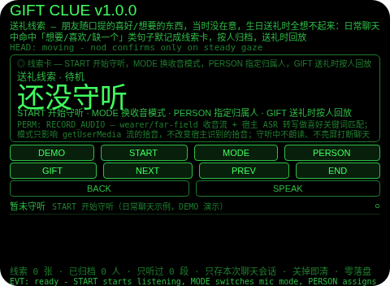
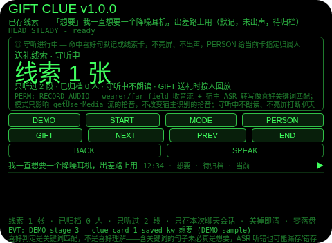
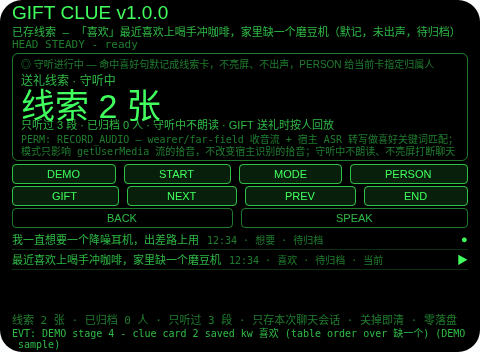
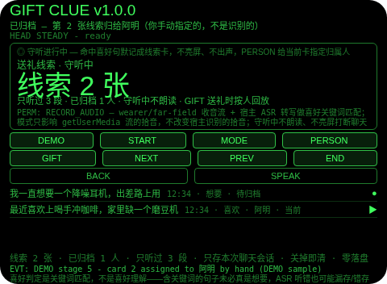
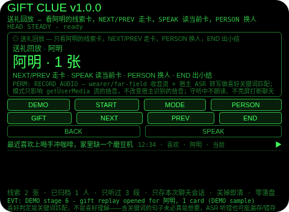
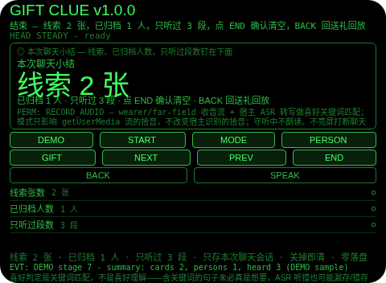

# Gift Clue（送礼线索）

**Studio 导入地址**（复制到 Global AIUI Studio 的 Import Project 输入框）：

```
https://github.com/sakai55/rokid/tree/agent-gift-clue
```

注意力外挂系列 SO05（SOCIAL 社交型，本组最后一个，系列第 40 个）。朋友随口提的喜好/想要的东西，当时没在意，生日送礼时全想不起来。本 Agent 把记线索外包出去：wearer/far-field 守听日常聊天，命中「想要/喜欢/缺一个」类句子默记成线索卡（不亮屏、不出声），你点 PERSON 给当前卡手动指定归属人，送礼时点 GIFT 按人回放该人的线索卡；结束出小结（线索几张、已归档几人、只听过几段）。

## 解决的问题

送礼的注意力是事后的：朋友随口说一句「一直想要一个降噪耳机」，当时正在聊天，没人会停下来记；到了生日，想送点合心意的，全想不起来。本 Agent 管四件事：守听（wearer/far-field 收音 + 宿主 ASR 转写逐段过喜好关键词门）、默记成卡（命中句存入线索卡，原句 + 时间标记，守听中不亮屏、不出声、不打断聊天；未命中句只计数、判定即丢弃，不存全文）、按人归档（卡先落待归档，你点 PERSON 在 阿明/小林/老陈 间轮换手动指定归属人——归属人是你指定的，不是识别的）、送礼时回放（点 GIFT 只看一人的线索卡，逐条走读，SPEAK 读当前卡，PERSON 换人，END 出小结）。

## 注意力外挂设计（SOCIAL 社交型）

- **门是关键词，不是喜好理解**：每段转写只过一张关键词表（想要/喜欢/缺一个/想要一个/好想要/一直想要，表顺序首词胜出——想要是 想要一个 与 一直想要 的子串，表顺序下这两类句归入 想要）——含词即成卡，不含词只计数、判定即丢弃。含关键词的句子未必真是想要，ASR 听错也可能漏存/错存，线索卡只是候选，UI 与本 README 如实写明这一点。
- **命中是默记，不是提醒**：命中句既不亮横幅也不出声——出声或亮屏都会打断正在进行的聊天，而线索的价值恰恰在于「当时不打断、事后能想起」。语音只发生在 SPEAK（报计数、读当前送礼卡、读小结）里。
- **归属人是你指定的，不是识别的**：卡从不自动认人——没有说话人识别，归属只能由你点 PERSON 手动指定（待归档 → 阿明 → 小林 → 老陈 → 待归档）。谁说的、卡归谁，是两回事；点错了再点 PERSON 就能改回来，纠错便宜。
- **送礼回放是同一次打开内的回放，不是跨天存档**：GIFT 回放的是本次会话的线索卡——Agent 零落盘，关掉即清，生日当天打开它并不会找回上个月的线索。这一点 UI 与本 README 明说，不暗示跨会话记忆。
- **点头不能替你编一句**：守听中点头与 Enter 一律忽略并说明——字幕只能由谈话声流进来，点头不能替你编一段聊天。点头只在待机起守听、在送礼回放走下一张卡、在小结页确认清空；不稳的点头不计入 1.2 秒锁；点头从不改卡的归属人——归属只能由 PERSON 指定。
- **纠错便宜，销毁需确认**：送礼页返回键回守听（线索卡保留，GIFT 从当前卡的归属人重新打开）；守听页返回键回待机（本轮保留，START 恢复同一轮）；小结页返回键回送礼回放（不删东西，小结重建）；确认（小结页点 END 或头稳点头）才清空本轮线索卡与计数；没有 DEL 键。
- **只记本次聊天，关掉即清**：线索卡、只听过段数与小结只存会话内存，关掉 Agent 即清——上一轮聊天的线索对下一轮聊天没有任何意义，存下来才是误导。
- **收音模式只管拾音流**：MODE 在守听前切换 wearer/far-field，只影响 getUserMedia 流的拾音，不改变宿主 ASR 的拾音；守听中 MODE 拒绝。
- **为什么胸前设备做不了**：送礼线索的线索是「你正在和朋友面对面聊天、视线和注意力都在对方身上」——胸前设备分不出「在聊天」和「在路过」，也就分不出「该默记」和「不该打扰」；送礼时回放也必须贴在视线里按人逐条走读，掏手机翻记录等于当场离场。两条都只有头戴设备成立。

## 与邻近 Agent 的分工

- 注意力系列 `elder-ear`（SO03）：老人聊天叮嘱捕捉——关键词命中成清单，聊完 TTS 逐条复述确认。本 Agent 不是复述工具：它的命中是按人归档的线索卡，非命中被丢弃，收口是送礼时按人视觉回放，不是语音复述确认。
- 注意力系列 `standup-echo`（SO04）：站会模块关键词门——命中成关联笔记，非命中成一行截取摘要，会后 REVIEW 关联在前、摘要在后。本 Agent 不留摘要行：它的非命中只计数、判定即丢弃，命中是带手动归属人的线索卡，收口是送礼时按人回放。
- 注意力系列 `chat-catchup`（SO01）：谈话中走神时的无声接续——滚动字幕缓冲，HELP 给最近 15 秒要点。本 Agent 不留滚动缓冲、不在谈话中服务：它只存默记的线索卡，守听中保持沉默，服务只在 GIFT 回放里出现。

## 功能流程

1. **收音模式（MODE）**：待机时点 MODE 在 wearer/far-field 间切换（默认 wearer）；守听中点 MODE 会拒绝并说明只在守听前切换。
2. **开始守听（START）**：待机时点 START 开始守听，ASR 转写逐段过喜好关键词门；待机时点 GIFT/END 会拒绝并说明先 START。
3. **命中默记成卡**：含关键词的句子默记成线索卡（原句 + HH:MM 时间 + 首词关键词），先落待归档，守听中不亮屏、不出声；不含关键词的句子只计数、判定即丢弃；空转写与无文本 ASR 忽略。
4. **按人归档（PERSON）**：守听中点 PERSON 给当前卡轮换归属人（待归档 → 阿明 → 小林 → 老陈 → 待归档）；无卡时点 PERSON 会忽略并说明；送礼回放中点 PERSON 换回放的人。
5. **送礼时回放（GIFT）**：守听中点 GIFT 进入送礼回放，默认看当前卡的归属人（无归属时看首个已有卡的人，否则看阿明），NEXT/PREV 走卡，SPEAK 读当前卡；无卡时点 GIFT 会拒绝并说明无可回放。
6. **结束与小结（END）**：守听或送礼回放中点 END 出小结（线索几张、已归档几人、只听过几段）；返回键回送礼回放或守听（不删东西），小结页点 END 或头稳点头确认后清空本轮线索卡与计数。
7. **演示（DEMO）**：七段演示——START 开始守听 → 非命中句只计数、判定即丢弃 → 命中想要存卡 1 → 命中喜欢存卡 2（表顺序胜过缺一个）→ PERSON 手动把卡 2 归给阿明 → GIFT 送礼回放看阿明的 1 张卡 → END 出小结（线索 2 张、已归档 1 人、只听过 3 段）；已有用户守听或用户线索卡进行时 DEMO 拒绝，绝不覆盖。

## 手势映射

| 手势/按键 | 动作 |
|---|---|
| 点按（Enter） | 待机：开始守听；守听中：忽略并说明（字幕只能由谈话声流进来）；送礼回放：走下一张卡；小结页：确认并清空 |
| 双击（Backspace） | 小结页：回送礼回放；送礼回放：回守听（线索卡保留）；守听中：回待机（本轮保留）；待机页：无动作并说明 |
| 上滑（ArrowUp） | 守听/送礼回放：下一张卡；其他态：无动作并说明 |
| 下滑（ArrowDown） | 守听/送礼回放：上一张卡；其他态：无动作并说明 |
| 头稳 + 点头 | 待机：开始守听；守听中：忽略并说明；送礼回放：走下一张卡；小结页：确认并清空；不稳的点头不计入 1.2 秒锁；点头从不编句子、从不改归属人 |
| 屏上按钮 | DEMO 演示 / START 开始守听 / MODE 换收音模式 / PERSON 指定归属人（送礼回放中为换人）/ GIFT 送礼时按人回放 / NEXT 下一张卡 / PREV 上一张卡 / END 结束出小结（小结页点 END 即确认清空）/ BACK 返回 / SPEAK 朗读当前状态或当前卡 |

## 权限说明

- 只申请 `RECORD_AUDIO`（app.json 的 `permissions` 为 `["RECORD_AUDIO"]`，静态校验明确断言这一点）：守听日常聊天 + 宿主 ASR 转写需要麦克风。
- 不申请 `CAMERA`（没有任何拍照环节）、不申请 `GEOLOCATION`（Agent 从不知道你在哪）。

## 打包与预览命令

```bash
~/tools/bin/aix pack . -o ../dist/gift-clue.aix
~/tools/bin/aix preview . --html-out artifacts/preview.html
```

预览截图用本地管线拍摄（见 `~/workspace/custom-skills/rokid-preview-screenshots/SKILL.md`），坐标以逐态扫探 + 逐张目视核定，脚本在 `~/workspace/preview-tools/shot-gift-clue.js`。

## 真机测试信息

| 项目 | 内容 |
|---|---|
| Studio 名称 | （待 GO 导入后回填） |
| Version / Build | 1.0.0 / （待回填） |
| App Category | （待回填） |
| Intent Description | （待回填） |
| Agent ID | （待回填） |
| 状态 | 未导入（SOP 第 9 步，GO 触发） |

已验证：Node 断言 harness 111/111、AIX 包内容 8 项、预览截图 6 张逐张目视。未验证：真机 ASR 命中率、真机点头与按键行为、Studio 导入与打包（均需 GO 真机流程）。

## 预览截图








## 提审资料 (Review Submission)

### Feature Description

送礼线索：朋友随口提的喜好，别等到生日才想不起来。守听日常聊天，命中想要、喜欢、缺一个类句子默记成线索卡，不亮屏、不出声；点 PERSON 给当前卡手动指定归属人，送礼时点 GIFT 按人回放该人的线索卡，结束出小结。关键词匹配不是喜好理解，归属人是手动指定不是识别的，送礼回放是同一次打开内的回放、不是跨天存档，只存本次聊天会话，关掉即清。

### Opening Message

和朋友聊天时点 START，我会在后台守听：谁随口说一句想要什么、喜欢什么，我默记成一张线索卡，不出声、不打断你们。聊完点 PERSON 给每张卡指定归到谁名下，生日快到点 GIFT，就能按人翻出他随口提过的那些想要——不用再凭记忆猜他喜欢什么。

### Preview Media

- 图片：`screenshots/gift-clue/` 内 6 张预览截图（待机、守听中、命中成卡、按人归档后、送礼时按人回放、结束小结）。
- 视频：待真机录制后补齐（Studio 提审需 3–5 个文件，至少 1 张图 + 1 段 ≤60 秒视频）。

### Change Log

- Build 1.0.0 — Features added：日常聊天守听喜好关键词门（命中默记成线索卡）、按人手动归档、送礼时按人回放、结束小结、收音模式切换、DEMO 七段演示。Improvements：无（首版）。Fixes：无（首版）。

## 如实说明

- 喜好判定是关键词匹配，不是喜好理解：含关键词的句子未必真是想要，ASR 听错也可能漏存/错存，线索卡只是候选。
- 归属人是你手动指定的，没有说话人识别：线索卡从不自动认人，点错了点 PERSON 就能改回来。
- 送礼时回放是指同一次打开内的回放，不是跨天存档：Agent 零落盘，关掉即清，生日当天打开它并不会找回上个月的线索。
- 收音模式只影响 getUserMedia 流的拾音，不改变宿主 ASR 的拾音；守听类命中率取决于真机 ASR 与环境噪音，是 best-effort，不是安防级保证。
- 只存本次聊天会话：线索卡与计数只在会话内存里，关掉即清；没有跨会话留存，没有室内定位，没有拍照与录音文件留存。
