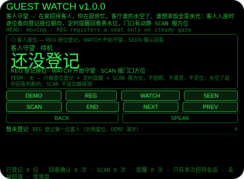
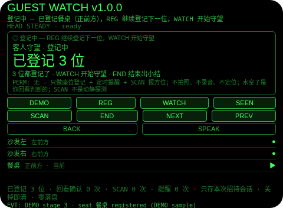
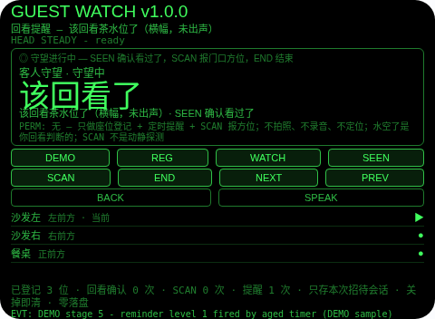
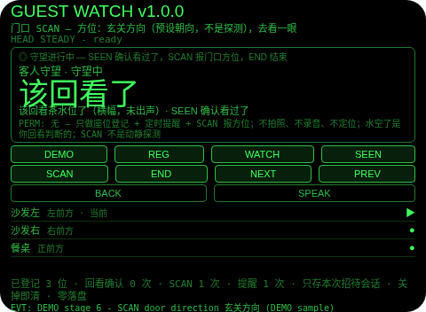
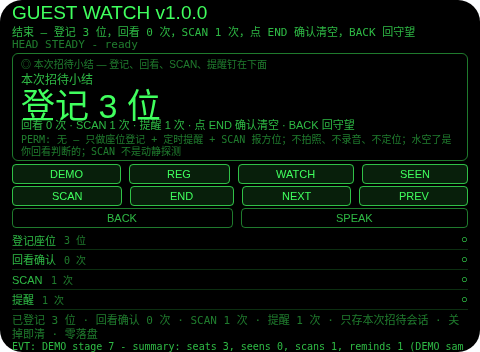

# Guest Watch（客人守望）

**Studio 导入地址**（复制到 Global AIUI Studio 的 Import Project 输入框）：

```
https://github.com/sakai55/rokid/tree/agent-guest-watch
```

注意力外挂系列 S02（SOCIAL 社交型，本组第二个，系列第 37 个）。在家招待客人，你在厨房忙，客厅谁的水空了、谁想添饭全靠余光。本 Agent 把守望外包出去：客人入座时逐位看向登记座位朝向，定时提醒回看茶水位，门口有动静 SCAN 报方位；结束出小结（登记几位、回看确认几次、SCAN 几次、提醒几次）。

## 解决的问题

招待客人的注意力是两头的：灶上要看着火，客厅也不能冷场——谁的水见底了、谁的碗空了，全靠你抽空扭头看一眼，一忙起来就漏。本 Agent 管四件事：逐位登记（客人入座时看向座位方向停稳，登记一格座位朝向）、定时提醒（守望中每 5 分钟提醒回看茶水位，未确认则升级提醒，确认看过了计时重置）、门口 SCAN（你察觉门口有动静时点 SCAN，报预设的门口方位并提示去看一眼）、结束小结（登记、回看、SCAN、提醒四项计数钉在下面）。

## 注意力外挂设计（SOCIAL 社交型）

- **提醒是时间，不是测量**：守望中 30 秒一轮询、5 分钟一阶梯——5 分钟横幅（不出声）、10 分钟横幅 + 一次 TTS、15 分钟强横幅 + 一次 TTS，之后封顶不再出声。提醒只说「该回看茶水位了」，绝不说「谁的水空了」——Agent 没有水位检测，空不空只能由你回看时自己判断。
- **SCAN 不是动静探测**：「门口有动静」是你察觉后按 SCAN 登记的，不是 Agent 检测到的；SCAN 报的方位（玄关方向）是你预设的门口朝向，不是传感器探测。UI 与本 README 如实写明这一点；它不是监控/安防设备。
- **座位是看向登记，不是定位**：每位客人的座位（沙发左/沙发右/餐桌）都是你入座时看向登记的方向，REG 只在头稳时登记，头不稳点 REG 会拒绝并说明。座位朝向不是室内定位。
- **SCAN 是主动点按，不是点头**：点头在待机/登记态是登记下一位、在守望中是确认回看、在小结页是确认清空，从不 SCAN——门口的事值得你主动点一下，不能由点头误触。点头从不切换焦点。
- **纠错便宜，销毁需确认**：守望页返回键回登记（座位保留、计时停）；登记页返回键回待机（座位保留，REG 恢复同一张单不重复）；小结页返回键回守望（不删东西，小结重建）；确认（小结页点 END 或头稳点头）才清空本轮座位与计数；没有 DEL 键。
- **只记本轮招待，关掉即清**：座位、回看次数、SCAN 次数、提醒等级与小结只存会话内存，关掉 Agent 即清——上一轮招待的座位对下一轮招待没有任何意义，存下来才是误导。
- **为什么胸前设备做不了**：守望的线索是「你正在家里、视线在厨房与客厅之间切换」——胸前设备不知道你是在招待还是在独处，也就分不出「该提醒回看」和「不该打扰」；提醒也必须贴在视线里分级呈现（先横幅后出声），掏手机看等于又一次离场。两条都只有头戴设备成立。

## 与邻近 Agent 的分工

- 注意力系列 `play-watch`（D01）：游乐场孩子活动区定时回看——方向登记 + 定时提醒 + 三级升级的阶梯形状是同款。本 Agent 不是孩子守望：它的单位是家中的客人座位，并且多了一个门口 SCAN。
- 注意力系列 `bag-watch`（D02）：在途行李副线 + 离开门拦截——未确认的行李会拦住你不放行。本 Agent 没有离开门：它的结束就是小结，不拦人——招待结束由你说了算，小结只照实记哪些没回看。
- 注意力系列 `chat-catchup`（S01）：谈话中走神时的无声接续——滚动字幕缓冲，HELP 给最近 15 秒要点。本 Agent 不守听、不缓冲字幕：它按计时守望座位，SCAN 报的是预设的门口方位。

## 功能流程

1. **逐位登记（REG）**：看向座位方向停稳，REG 登记一格（沙发左 → 沙发右 → 餐桌，示例座位组）；头不稳点 REG 会拒绝并说明先停稳；3 位都登记后再点 REG 会拒绝并说明 WATCH 开始守望；待机时点 WATCH/SEEN/SCAN/END 会拒绝并说明先 REG。
2. **开始守望（WATCH）**：登记页点 WATCH 开始守望，计时启动；NEXT/PREV 走座位、点行聚焦。
3. **定时提醒与确认（SEEN）**：5 分钟横幅、10 分钟横幅 + 一次 TTS、15 分钟强横幅 + 一次 TTS，之后封顶；SEEN 确认看过了，计时与等级重置。
4. **门口 SCAN**：守望中点 SCAN，报门口方位（玄关方向，预设朝向）+ 一次 TTS，提示去看一眼，SCAN 计 1 次；待机/登记态点 SCAN 会拒绝并说明只在守望中可用。
5. **结束与小结（END）**：守望中或登记页点 END 出小结（登记几位、回看几次、SCAN 几次、提醒几次）；返回键回守望（不删东西），小结页点 END 或头稳点头确认后清空本轮座位与计数。
6. **演示（DEMO）**：七段演示——登记沙发左 → 登记沙发右 → 登记餐桌 → WATCH 开始守望 → 计时推过 5 分钟出 1 级提醒（横幅，未出声）→ SCAN 报门口方位 → END 出小结（登记 3 位、回看 0 次、SCAN 1 次、提醒 1 次）；已有用户登记或用户守望进行时 DEMO 拒绝，绝不覆盖。

## 手势映射

| 手势/按键 | 动作 |
|---|---|
| 点按（Enter） | 待机/登记：登记下一位；守望中：确认回看（SEEN）；小结页：确认并清空 |
| 双击（Backspace） | 小结页：回守望；守望中：回登记（座位保留、计时停）；登记页：回待机（座位保留）；待机页：无动作并说明 |
| 上滑（ArrowUp） | 登记/守望中：下一位座位；其他态：无动作并说明 |
| 下滑（ArrowDown） | 登记/守望中：上一位座位；其他态：无动作并说明 |
| 头稳 + 点头 | 待机/登记：登记下一位；守望中：确认回看；小结页：确认并清空；不稳的点头不计入 1.2 秒锁；点头从不切换焦点、从不 SCAN |
| 屏上按钮 | DEMO 演示 / REG 登记座位 / WATCH 开始守望 / SEEN 确认回看 / SCAN 报门口方位 / END 结束出小结（小结页点 END 即确认清空）/ NEXT 下一位 / PREV 上一位 / BACK 返回 / SPEAK 朗读当前状态 |

## 权限说明

- 不申请任何权限（app.json 的 `permissions` 为 `[]`，静态校验明确断言这一点）：座位登记 + 定时提醒 + 预设方位上报不需要摄像头、麦克风或位置。
- 不申请 `CAMERA`（没有任何拍照环节）、不申请 `RECORD_AUDIO`（没有任何守听环节，没有 ASR 路径）、不申请 `GEOLOCATION`（Agent 从不知道你在哪）。

## 打包与预览命令

```bash
~/tools/bin/aix pack . -o ../dist/guest-watch.aix
~/tools/bin/aix preview . --html-out artifacts/preview.html
```

本地预览截图管线见 `~/workspace/custom-skills/rokid-preview-screenshots/SKILL.md`（本地 Ink + puppeteer，480×352；本 Agent 的探针脚本在 `~/workspace/preview-tools/shot-guest-watch.js`，核定序列见该脚本头注，逐态探测、逐张目视）。

## 真机测试信息表

| 项目 | 内容 |
|---|---|
| Studio 名称 | （导入后回填） |
| Version / Build | 1.0.0 / （导入后回填） |
| App Category | （导入后回填） |
| Intent Description | （导入后回填） |
| Agent ID | （导入后回填） |
| 状态 | 未导入（本地全流程完成，待 GO 在 Global Studio 导入 + 真机测试） |

## 预览截图







## 提审资料 (Review Submission)

### Feature Description

在家招待客人，你在厨房忙，客厅谁的水空了、谁想添饭全靠余光。本 Agent 把守望外包：客人入座时逐位看向登记座位朝向，守望中每 5 分钟提醒回看茶水位（5 分钟横幅、10 分钟横幅加一次语音、15 分钟强提醒后封顶），确认看过了计时重置；门口有动静点 SCAN 报预设的门口方位；结束出小结。诚实边界：没有水位检测、没有动静探测，水空了由你回看判断，SCAN 方位是预设朝向不是探测；它不是监控设备；只存本次招待会话，关掉即清；权限为空。

### Opening Message

**厨房忙着，客厅也别冷场：座位逐位登记，定时提醒你回看茶水位，门口有动静 SCAN 报方位。**

- 登记：看向座位停稳，REG 逐位登记（沙发左/沙发右/餐桌示例组），头不稳拒绝
- 守望：WATCH 开始守望，5 分钟横幅、10 分钟出声一次、15 分钟强提醒后封顶，SEEN 确认看过了计时重置
- 门口：守望中点 SCAN，报预设门口方位（玄关方向）并提示去看一眼
- 结束：END 出小结（登记、回看、SCAN、提醒计数），小结页 END 确认清空
- 演示：DEMO 走七段——登记 3 位、开始守望、1 级提醒、SCAN、小结
- 诚实边界：没有水位/动静检测，SCAN 方位是预设不是探测，权限为空

### Preview Media

- 预览图片 5 张（见上方「预览截图」节，本地 480×352 预览管线逐张目视核对）
- 预览视频：待真机录制后补齐（提审需 3–5 个文件，含至少 1 张图片 + 1 段 ≤60 秒视频）

### Change Log

#### Build 1.0.0

- Features added：逐位座位登记（看向停稳触发，示例座位组沙发左/沙发右/餐桌）；守望计时（30 秒轮询、5 分钟三级提醒阶梯，1 级横幅、2 级横幅加一次语音、3 级强提醒后封顶）；SEEN 确认回看（计时与等级重置）；门口 SCAN（报预设方位玄关方向加一次语音）；结束小结（登记/回看/SCAN/提醒计数）；七段 DEMO 演示
- Improvements：无（首个版本）
- Fixes：无（首个版本）
