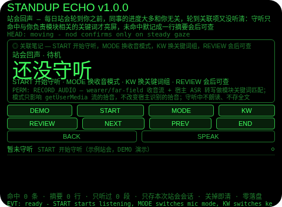
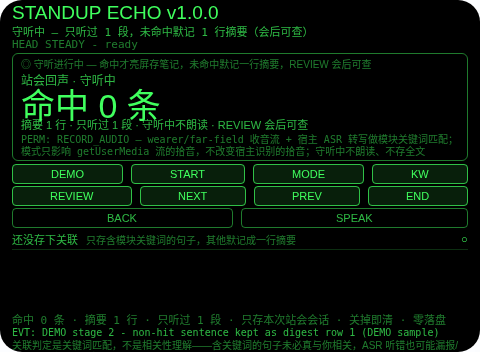
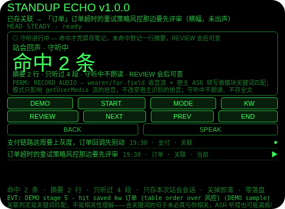
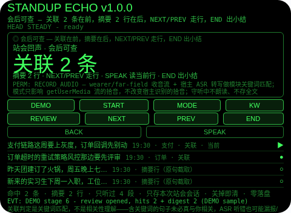
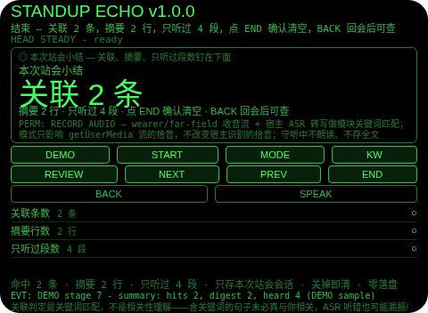

# Standup Echo（站会回声）

**Studio 导入地址**（复制到 Global AIUI Studio 的 Import Project 输入框）：

```
https://github.com/sakai55/rokid/tree/agent-standup-echo
```

**AIX 直接下载**（最新版）：[standup-echo.aix](https://raw.githubusercontent.com/sakai55/rokid/main/aix/standup-echo.aix)

注意力外挂系列 SO04（SOCIAL 社交型，本组第四个，系列第 39 个）。每日站会轮到你之前，同事的进度大多和你无关，轮到关联项又没听清。本 Agent 把筛选外包出去：wearer/far-field 守听站会，只命中与你负责模块相关的关键词才亮屏存笔记，未命中默记成一行摘要，会后 REVIEW 列出关联笔记 + 摘要行；结束出小结（命中几条、摘要几行、只听过几段）。

## 解决的问题

站会的注意力是两头的：你要坐在那儿等轮到你，同事讲的大多和你负责的模块无关——走神是常态，可一旦讲到关联项，没听清又不敢打断重问。本 Agent 管四件事：守听（wearer/far-field 收音 + 宿主 ASR 转写逐段过模块关键词门）、亮屏存笔记（命中句亮横幅存入，原句 + 时间标记，守听中不朗读、不打断站会）、默记摘要（未命中句截取前 14 字成一行，会后可查，不存全文）、会后可查（点 REVIEW，关联在前、摘要在后逐行走读，END 出小结）。

## 注意力外挂设计（SOCIAL 社交型）

- **门是关键词，不是相关性理解**：每段转写只过一张关键词表（默认 支付/订单/风控，待机时 KW 可轮换到 库存/物流/配送，表顺序首词胜出）——含词即存档，不含词默记一行摘要。含关键词的句子未必真与你相关，ASR 听错也可能漏报/误报，笔记只是候选，UI 与本 README 如实写明这一点。
- **摘要行是截取，不是提炼**：未命中句只留前 14 字加省略号，不改写、不概括、不补全——摘要行是指回原话的指针，不是 Agent 对这句话的理解。全文从不保存。
- **守听不说话，会后才看**：命中只是横幅，守听中一次 TTS 都没有——出声会打断正在开的站会。语音只发生在 SPEAK（报计数或读当前会后行）里。
- **笔记与摘要不分说话方**：没有说话人识别，归档只按关键词与截取，不按谁说的分——同事说的和你说的含词句都会进笔记，会后逐行走读才是过滤。
- **点头不能替你编一句**：守听中点头与 Enter 一律忽略并说明——字幕只能由谈话声流进来，点头不能替你编一段站会。点头只在待机起守听、在会后走下一行、在小结页确认清空；不稳的点头不计入 1.2 秒锁；点头从不在守听中切换焦点。
- **纠错便宜，销毁需确认**：会后页返回键回守听（笔记与摘要保留，REVIEW 从第一行重新可查）；守听页返回键回待机（本轮保留，START 恢复同一轮）；小结页返回键回会后（不删东西，小结重建）；确认（小结页点 END 或头稳点头）才清空本轮笔记、摘要与计数；没有 DEL 键。
- **只记本站会，关掉即清**：命中笔记、摘要行、只听过段数与小结只存会话内存，关掉 Agent 即清——上一轮站会的笔记对下一轮站会没有任何意义，存下来才是误导。
- **收音模式只管拾音流**：MODE 在守听前切换 wearer/far-field，只影响 getUserMedia 流的拾音，不改变宿主 ASR 的拾音；守听中 MODE 与 KW 均拒绝。
- **为什么胸前设备做不了**：站会的线索是「你坐在会里、视线和注意力都在发言方向上」——胸前设备分不出「在开会」和「在路过」，也就分不出「该默记」和「不该打扰」；会后复查也必须贴在视线里逐行走读（关联在前、摘要在后），掏手机翻记录等于当场离场。两条都只有头戴设备成立。

## 与邻近 Agent 的分工

- 注意力系列 `meeting-filter`（FI04）：会议名字/议题关键词门 + 命中前 10 秒回放缓冲——它回放的是命中前刚说过的话。本 Agent 不留滚动缓冲、不在会中回放：它的非命中句变成一行摘要行，只在会后 REVIEW 里出现。
- 注意力系列 `elder-ear`（SO03）：老人聊天叮嘱捕捉——关键词命中成清单，聊完 TTS 逐条复述确认。本 Agent 不是复述工具：它的命中是模块关联笔记，非命中也被保留为摘要行，收口是会后视觉走读，不是语音复述。
- 注意力系列 `chat-catchup`（SO01）：谈话中走神时的无声接续——滚动字幕缓冲，HELP 给最近 15 秒要点。本 Agent 不留滚动缓冲、不在谈话中服务：它只存命中笔记与摘要行，守听中保持沉默，服务只在会后 REVIEW 里出现。

## 功能流程

1. **收音模式（MODE）与关键词组（KW）**：待机时点 MODE 在 wearer/far-field 间切换（默认 wearer），点 KW 在 支付/订单/风控 与 库存/物流/配送 两组间轮换；守听中点 MODE 或 KW 会拒绝并说明只在守听前切换。
2. **开始守听（START）**：待机时点 START 开始守听，ASR 转写逐段过模块关键词门；待机时点 REVIEW/END 会拒绝并说明先 START。
3. **命中亮屏存笔记**：含关键词的句子亮横幅存入（原句 + HH:MM 时间 + 首词关键词），守听中不朗读；不含关键词的句子截取前 14 字成一行摘要（带时间标记），不存全文；空转写与无文本 ASR 忽略。
4. **会后可查（REVIEW）**：守听中点 REVIEW 进入会后可查，关联笔记在前、摘要行在后，NEXT/PREV 走行，SPEAK 读当前行；无笔记无摘要时点 REVIEW 会拒绝并说明无可查。
5. **结束与小结（END）**：守听或会后中点 END 出小结（关联几条、摘要几行、只听过几段）；返回键回会后或守听（不删东西），小结页点 END 或头稳点头确认后清空本轮笔记、摘要与计数。
6. **演示（DEMO）**：七段演示——START 开始守听 → 非命中句默记摘要行 1 → 命中支付存 1 条 → 非命中句默记摘要行 2 → 命中订单存 2 条（表顺序胜过风控）→ REVIEW 会后可查（关联 2 条 + 摘要 2 行）→ END 出小结（关联 2 条、摘要 2 行、只听过 4 段）；已有用户守听或用户笔记进行时 DEMO 拒绝，绝不覆盖。

## 手势映射

| 手势/按键 | 动作 |
|---|---|
| 点按（Enter） | 待机：开始守听；守听中：忽略并说明（字幕只能由谈话声流进来）；会后：走下一行；小结页：确认并清空 |
| 双击（Backspace） | 小结页：回会后；会后：回守听（笔记与摘要保留）；守听中：回待机（本轮保留）；待机页：无动作并说明 |
| 上滑（ArrowUp） | 守听/会后：下一条笔记或下一行；其他态：无动作并说明 |
| 下滑（ArrowDown） | 守听/会后：上一条笔记或上一行；其他态：无动作并说明 |
| 头稳 + 点头 | 待机：开始守听；守听中：忽略并说明；会后：走下一行；小结页：确认并清空；不稳的点头不计入 1.2 秒锁；点头从不编句子 |
| 屏上按钮 | DEMO 演示 / START 开始守听 / MODE 换收音模式 / KW 换关键词组 / REVIEW 会后可查 / NEXT 下一行 / PREV 上一行 / END 结束出小结（小结页点 END 即确认清空）/ BACK 返回 / SPEAK 朗读当前状态或当前行 |

## 权限说明

- 只申请 `RECORD_AUDIO`（app.json 的 `permissions` 为 `["RECORD_AUDIO"]`，静态校验明确断言这一点）：守听站会 + 宿主 ASR 转写需要麦克风。
- 不申请 `CAMERA`（没有任何拍照环节）、不申请 `GEOLOCATION`（Agent 从不知道你在哪）。

## 打包与预览命令

```bash
~/tools/bin/aix pack . -o ../dist/standup-echo.aix
~/tools/bin/aix preview . --html-out artifacts/preview.html
```

预览截图用本地管线拍摄（见 `~/workspace/custom-skills/rokid-preview-screenshots/SKILL.md`），坐标以逐态扫探 + 逐张目视核定，脚本在 `~/workspace/preview-tools/shot-standup-echo.js`。

## 真机测试信息

| 项目 | 内容 |
|---|---|
| Studio 名称 | （待 GO 导入后回填） |
| Version / Build | 1.0.0 / （待回填） |
| App Category | （待回填） |
| Intent Description | （待回填） |
| Agent ID | （待回填） |
| 状态 | 未导入（SOP 第 9 步，GO 触发） |

已验证：Node 断言 harness 101/101、AIX 包内容 8 项、预览截图 5 张逐张目视。未验证：真机 ASR 命中率、真机点头与按键行为、Studio 导入与打包（均需 GO 真机流程）。

## 预览截图







## 提审资料 (Review Submission)

### Feature Description

站会回声：每日站会只听与你负责模块相关的部分。守听站会转写，命中模块关键词（支付/订单/风控，可轮换）才亮屏存入关联笔记；未命中句默记成一行原句截取摘要，会后 REVIEW 按关联在前、摘要在后逐行可查，结束出小结。关键词匹配不是相关性理解，摘要行是截取不是提炼，无说话人识别，只存本站会会话，关掉即清。

### Opening Message

站会开始前点 START，我会在后台守听：讲到支付、订单、风控这些和你模块相关的句子，我亮屏存一条关联笔记；其他句子我默记成一行摘要，不打断你。站会结束点 REVIEW，关联笔记在前、摘要行在后，逐行走读一遍就知道刚才错过了什么——不用再追着同事重问一遍。

### Preview Media

- 图片：`screenshots/standup-echo/` 内 5 张预览截图（待机、守听中、命中亮屏、会后可查、结束小结）。
- 视频：待真机录制后补齐（Studio 提审需 3–5 个文件，至少 1 张图 + 1 段 ≤60 秒视频）。

### Change Log

- Build 1.0.0 — Features added：站会守听模块关键词门（命中亮屏存笔记）、未命中句一行截取摘要、会后 REVIEW（关联在前、摘要在后）、结束小结、关键词组轮换、收音模式切换、DEMO 七段演示。Improvements：无（首版）。Fixes：无（首版）。

## 如实说明

- 关联判定是关键词匹配，不是相关性理解：含关键词的句子未必真与你相关，ASR 听错也可能漏报/误报，笔记只是候选。
- 未命中摘要行是原句前 14 字截取，不是提炼：摘要行不改写、不概括，读摘要行想不起原话时以现场为准。
- 没有说话人识别：笔记与摘要不分说话方，不按谁说的归档。
- 收音模式只影响 getUserMedia 流的拾音，不改变宿主 ASR 的拾音；守听类命中率取决于真机 ASR 与环境噪音，是 best-effort，不是安防级保证。
- 只存本站会会话：命中笔记、摘要行与计数只在会话内存里，关掉即清；没有跨站会留存，没有室内定位，没有拍照与录音文件留存。
