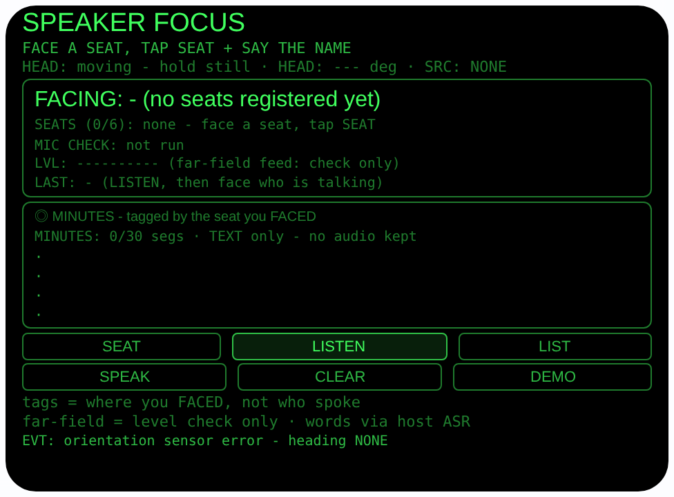
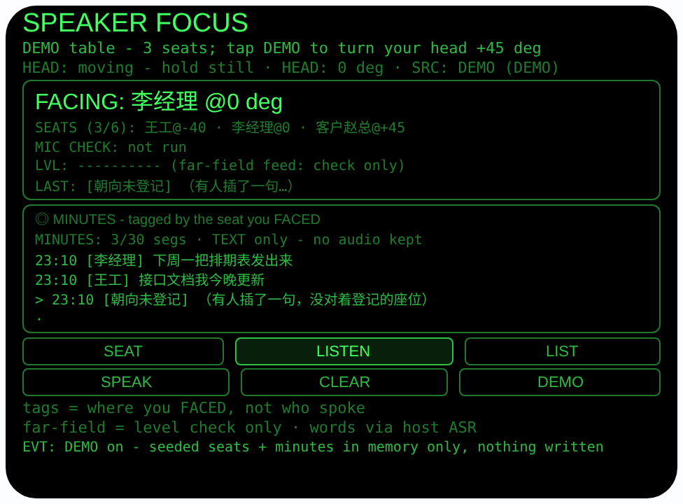
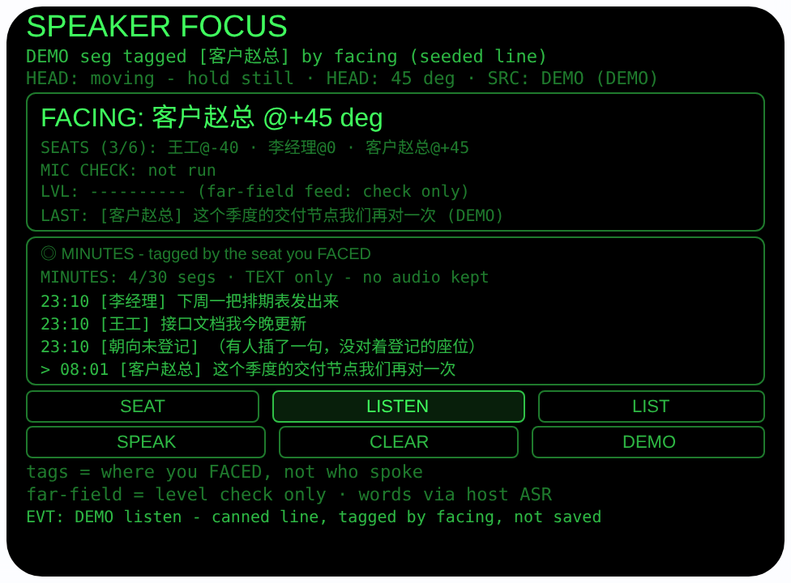

# speaker-focus — 发言聚焦（Rokid 眼镜 AIUI Agent）

**Studio 导入地址**（复制到 Global AIUI Studio 的 Import Project 输入框）：

```
https://github.com/sakai55/rokid/tree/agent-speaker-focus
```


50 个「指向性生活问题」Agent 的第 Z46 个。多人会议最累的不是听，
是**跟人**：三四个人轮流开口，你低头记两行就丢了谁在说，纪要
写成一锅粥。本 Agent 的办法是把「谁」换成「你当时看着哪个方
向」：会前把每个座位绑在你的头部朝向上，会中你转头对准正在
说话的人，它把每句话按你当时面对的座位打上标签，散会按方
向分组念给你听。

> 诚实说明前置：标注是**朝向，不是身份**。本 Agent 没有声纹
> 或说话人识别——两个人换座、你转头慢一拍，标签就会错。朗读
> 永远说「你当时看着 X 的方向时，记下：……」，从不说「X
> 说」。far-field 麦克风模式只用于聆听前的**可用性检查 + 电
> 平显示**，检查流停轨之后才轮到宿主识别在自己的麦克风上工
> 作——模式不改变识别听到什么（2026-10-24 能力边界审计口
> 径）。纪要只存文字，从不存音频。

## 预览截图

截图统一存放于仓库根目录 `screenshots/speaker-focus/`。







## 解决的问题

会议纪要的难点不是记录，是归属：话都记下来了，却分不清哪句
是谁的意思，回去整理时全靠回忆。本 Agent 不假装能认人，它把
归属问题降维成方向问题——你的头本来就会朝向正在说话的人，
这个朝向就是免费的标注信号。座位事先按朝向登记好名字，之后
你只需要「看着说话的人」，纪要自己带上标签。

## 指向性设计（为什么必须用眼镜）

- **朝向即座位（HEAD）**：座位登记 = 把 `AbsoluteOrientationSensor`
  的 yaw 与一个名字绑定；聆听时每句定稿按那一刻的朝向落进
  ±30° 的座位锥（|相对角| 最小者胜，并列取先登记者），锥外
  如实记「朝向未登记」。手机放在桌上没有「你正看着谁」这个
  信号。
- **面对即聚焦（MIC4 的诚实用法）**：转头对准发言者这个动作
  本身就是交互的核心。far-field 模式按文档只作用于
  getUserMedia 流，本 Agent 只拿它做聆听前的可用性检查和会
  议室电平显示，停轨后才启动宿主识别——检查与识别物理上分
  开，界面 `MIC CHECK:` 行与常驻诚实行都写明。
- **免手纪要（HANDS-FREE）**：点头（头稳）开一轮聆听、单击
  开/停、滑动翻纪要——开会时手在键盘和本子上，操作全靠头和
  镜腿。

## 手势映射

本 Agent 的全部主流程（登记座位 → 开聆听轮 → 翻看纪要 → 听
朗读）都可以只用眼镜腿触控板手势 + 头部动作完成，不必点屏
幕按钮。手势与键码的对应来自官方文档档案 §3.2.1。

| 手势 | 键码 | 在本 Agent 中的动作 |
|---|---|---|
| 单击触控板 | Enter | 开 / 停一轮聆听（与 LISTEN 等效）；座位命名中 = 确认当前预置名牌（名牌模式），或退出语音命名改走名牌（语音模式） |
| 滑动触控板 | ArrowUp / ArrowDown | 翻动纪要窗（向旧 / 向新各一段）；座位命名的名牌模式时 = 前后轮换预置名牌（座位1..6 / 主持人 / 客户） |
| 双击触控板 | Backspace | 返回 / 关闭（由宿主处理，本 Agent 只记录事件） |
| 长按触控板 | —（系统级） | 唤醒 AI 助手（系统功能，不经过本 Agent） |
| 头部稳定时点头 | onHeadGesture `nod` | 空闲时开启一轮聆听；点头从不登记座位、从不清纪要、从不停正在进行的聆听 |
| 屏幕按钮 | — | 只保留 6 个：SEAT（开启一次座位登记：绑朝向 + 口述姓名）、LISTEN（先做 far-field 检查再开宿主识别轮）、LIST（纪要窗回到最新）、SPEAK（按朝向分组朗读纪要）、CLEAR（两段确认清纪要、保留座位）、DEMO（无传感器时仿真一张演示桌：朝向 +45° 步进） |

登记座位需要先点 SEAT 开启命名——这是刻意的：把一个方向绑
成某个人的名字是需要明确意图的动作，手势纪律不代办；命名本
身（口述或名牌轮换 + 单击确认）全程可手势完成。

## 功能流程

1. 开会前逐个登记：看着一个座位点 SEAT，说出姓名（先自动做
   一次佩戴者模式麦克风可用性检查，结果记在 `MIC CHECK:`
   行；识别在宿主麦克风上进行，姓名原样存下）。最多 6 个座
   位；主机没有识别时改走标注过的预置名牌（座位1..6 / 主持
   人 / 客户）
2. 点 LISTEN（或单击，或头稳时点头）：先做 far-field 检查
   （读回实际模式、显示约 0.6 秒会议室电平、停轨），随后宿
   主识别开始——`LISTENING (host ASR)` 行写明识别走宿主麦
   克风
3. 谁说话你就看向谁：每句定稿按你那一刻的朝向打标签（锥内
   记座位名，锥外记「朝向未登记」），`FACING:` 大字实时显
   示你正对着哪个座位，`LAST:` 显示刚记下的一段
4. 再点 LISTEN 停轮。LIST 翻看纪要（最近 4 段，滑动翻窗），
   SPEAK 按朝向分组朗读，开场先声明标注只是方向、不是声音
   识别
5. CLEAR 点两次清掉纪要（座位保留，下次开会直接用）；座位
   与纪要都是纯文字，存本机 wx 存储，关掉重开还在
6. DEMO 按钮：播入演示桌（王工 @−40° / 李经理 @0° / 客户
   赵总 @+45° + 3 段纪要），再点每次转头 +45° 看 FACING 变
   化，DEMO 中 LISTEN 播入示例句并按演示朝向标注；转满一圈
   退出，真实记录分毫不差

> 诚实说明：座位朝向只对你登记时坐的位置成立——换座位、换
> 会议室请重新登记。前后排同方向的两个人，朝向分不开他们。
> 没有后台监听：页面关掉就没有在记纪要。麦克风模式（far-
> field / wearer）都不影响宿主识别的结果，检查流与识别流是
> 两条路，文档与界面同口径。

## 权限

| 权限 | 用途 |
|---|---|
| RECORD_AUDIO | 登记姓名前的佩戴者模式麦克风可用性检查、姓名口述识别；聆听轮前的 far-field 可用性检查 + 电平显示、宿主发言识别 |

只申请 RECORD_AUDIO 一个权限：没有拍照、没有定位。麦克风只
在用户点 SEAT / LISTEN（或点头开聆听）时启动；检查流读完电
平立即停轨，识别走宿主通道；全程不录音、不存音频，纪要只有
识别出的文字。

## 打包与预览

```bash
cd ~/workspace/rokid/speaker-focus
~/tools/bin/aix pack . -o ../dist/speaker-focus.aix
~/tools/bin/aix preview . --html-out artifacts/preview.html
```

本地预览截图走 `~/workspace/preview-tools/` 的本地 Ink + puppeteer 路线
（`shot-speaker.js`，独立页面副本 `preview-speaker.html`；按钮
点击坐标在 shot 脚本运行日志中按 canvas 坐标记录）。

## 真机测试（海外版 · 云端下发 · Path 1）

1. 推到 GitHub 后，Global AIUI Studio（aiui-global.rokid.com，en-US）用
   分支导入：`https://github.com/sakai55/rokid/tree/agent-speaker-focus`
   （该分支根目录即本 Agent 文件）
2. Studio 的 **Device Debug** 页签填 Basic Information，在 AIX Packaging
   点 **Repackage and Save**，确认顶部出现绿色
   **● Debug version ready — Ready for device debugging**
3. **Hi Rokid**（海外版 `com.rokid.sprite.global.aiapp`，不是国内版
   Rokid Ai App）→ 设置 → 开发者选项 → AIUI → 更新眼镜资源包，
   等「智能体资源包下载成功」
4. 对眼镜说「乐奇，打开 speaker-focus」，找两位同事配合：先
   分别看着两人点 SEAT 登记姓名（核对 `MIC CHECK:` 行与姓名
   是否原样存下）；开 LISTEN，请两人轮流说话、你依次转头对
   准，核对每段标签是否跟着你的朝向走；故意在 A 说话时看着
   B，验证标签记成 B（朝向标注的预期行为，不是认人）；停轮
   后 SPEAK 听一遍分组朗读措辞；杀掉重开验证座位与纪要还在

## 真机测试信息（Global AIUI Studio · Device Debug）

| 项目 | 值 |
|---|---|
| Agent Name（Studio） | 待导入后回填 |
| Version（Build） | 1.0.0（待导入后回填） |
| App Category | 待导入后回填 |
| Intent Description | 待导入后回填 |
| Agent ID | 待导入后回填 |
| AIX Package Size | 约 23.1 KB（本地打包 `dist/speaker-focus.aix`） |
| 状态 | 本地完成，待导入 Studio |
| Studio | aiui-global.rokid.com（en-US） |
| 下发方式 | 云端下发 → Hi Rokid（海外版）更新眼镜资源包 |

## 验证情况

**已验证**

- 静态检查：app.json / package.json JSON 解析通过；`<script def>` JSON
  解析通过；`<script setup>` 与 app.js 提取后 `node --check` 语法通过；
  全目录 grep 无 `Page(` / `App(` / `Widget(` / `workers:` 残留；
  屏幕按钮只剩 SEAT / LISTEN / LIST / SPEAK / CLEAR / DEMO 六个 bindtap。
- 状态机测试：Node 里以 wx/传感器/ASR/getUserMedia/Web Audio
  存根加载页面对象跑 **84 条断言全过**——覆盖：无朝向时 SEAT
  拒绝登记（绝不编造方向）、姓名口述原样入库（仅去首尾空
  格）、座位上限 6 与第 7 个拒绝、最近座位数学（±30° 锥边
  界内/外、|相对角| 最小胜、并列取先登记者、无座位/无朝向返
  回空）、FACING 实时读数、聆听轮调用次序（far-field 检查开
  流 → 读回模式 → 电平显示 → **停轨之后**宿主 ASR 才 start，
  以跨存根调用顺序日志断言）、far-field 不支持时回退默认麦
  克风并如实标注、按朝向打标签（锥内记座位名 / 锥外与无座位
  记「朝向未登记」/ 原文原样）、无识别宿主 LISTEN 如实
  SKIP、无 getUserMedia 时检查行如实 n/a、落盘载荷纯文字
  （speakerSeats 只有 name/headingDeg/src、speakerMinutes 只
  有 date/time/seat/text，无 blob/data:/音频字段）、重开恢复
  座位与纪要、SPEAK 分组措辞（「你当时看着 X 的方向时」+
  「不是声音识别」声明 + 从不出现「X 说」+ 首次出现顺序 +
  空纪要口头指引）、CLEAR 两段确认（只清纪要、座位保留、清
  空落盘）、纪要上限 30 丢最旧、纪要窗滑动、名牌回退（无识
  别进入名牌模式 / 滑动轮换 / 单击确认、识别报错同样回退且
  来源标注 chip）、点头纪律（不稳不启、空闲头稳开聆听、聆听
  中点头无副作用、点头永不登记座位、永不清纪要）、手势全流
  程（SEAT 开命名 → 点头开轮 → 按朝向落段 → 单击停轮 → 滑
  动翻窗 → SPEAK 朗读且 TTS 从不设置 lang）、DEMO 播种与转
  头步进、DEMO 全程零落盘（写计数断言）、退出恢复真实记
  录、界面两条诚实常驻行。
- 打包：`aix pack` 成功（README 定稿后执行）；`aix list` 核对包内含
  README.md、AGENTS.md、app.js、app.json、package.json、
  pages/index/index.ink（artifacts/ 已被 .aixignore 排除）。
- 预览渲染：aix preview + 本地 Ink + puppeteer 截图三张（见
  Preview Media）：首页初始态完整渲染；DEMO 演示桌三座位与
  三段纪要、FACING 指向李经理；DEMO 转头 +45° 后 FACING 指
  向客户赵总且聆听示例句按朝向落段。

**未验证**

- **真机宿主 SpeechRecognition 的连续识别行为（第一优先核
  对）**：本 Agent 按 `continuous = true` + 逐条定稿回调设
  计；宿主若只支持单次识别（识别一轮自动停），聆听轮会在第
  一段后结束（界面会如实显示轮结束、段数照常入账），需要真
  机确认后决定是否改成「一段一轮自动续开」。
- **far-field 检查流的真机表现**：设备是否接受
  `microphoneMode: 'far-field'`、读回的 settings 是否带模式
  名、电平读数在真实会议室的量级，都未经真机验证；不支持时
  的回退标注路径已在本地存根下验证。
- 传感器 yaw 的零点参考系与左右方向：座位朝向全程相对登记
  （同一坐姿下登记与使用），零点约定不影响锥内判定；但换坐
  姿/站起走动后朝向漂移的幅度需真机核对。头部稳定检测、点
  头手势与触控板手势在本 Agent 键位映射下的实际触发情况、
  ±30° 锥宽在真实会议桌间距下是否合用（座位挨得近可能需要
  收窄），均待真机自测后调整。

---

## 提审资料（Review Submission）

> Global AIUI Studio → Submit 页签的 Review Information 逐项对应下面四段，
> 提交时整段复制。每次提交前重新确认 Preview Media。

### Feature Description

Meeting minutes that know where you were looking. Speaker Focus registers up to six seats by the direction you face them, each named by your voice. During a listen round, every captioned line is tagged with the seat you were facing as it was heard - never by voice identity. Far-field mic mode is used only as an availability and level check; the words come from the host recogniser. Minutes read back grouped by facing direction and are stored as text only, never audio.

（471 字符）

### Opening Message

Hi, I'm **Speaker Focus** — I keep meeting minutes tagged by the seat you were facing.

Face a seat and tap **SEAT**, then say the name. Tap **LISTEN** — or hold your head steady and **nod** — and face whoever is talking: each captioned line is saved with the seat you faced at that moment. **SPEAK** reads the minutes back grouped by direction. Tags show where you looked, not who spoke, so check the names before you share the minutes.

（437 字符）

### Preview Media

提交要求：3–5 个 JPG/PNG 图片或 MP4 视频，至少含 1 张图和 1 个视频，每次提交前重新确认。

- Image 1：`artifacts/preview-speaker-focus-index.png`（aix preview 首页：SPEAKER FOCUS 初始态，含 FACING/座位/MIC CHECK/LVL/LAST 行、纪要框与 SEAT/LISTEN/LIST/SPEAK/CLEAR/DEMO 六个按钮及两条诚实常驻行，本地文件，提交时从本地上传）
- Image 2：`artifacts/preview-speaker-focus-demo.png`（DEMO 演示桌态：王工 @-40 / 李经理 @0 / 客户赵总 @+45 三座位、3 段已标注纪要，FACING 指向李经理，本地文件）
- Image 3：`artifacts/preview-speaker-focus-listen.png`（DEMO 转头 +45° 后：FACING 指向客户赵总，聆听播入的示例句已按朝向落段并标 DEMO，本地文件）
- Video：待真机补 — 真机录制「逐个看座位 SEAT 口述登记 → LISTEN 开轮 → 轮流转头对准说话者、纪要逐段落标签 → SPEAK 分组朗读」全过程（MP4），录好后放 `artifacts/` 并更新此处
- 状态：未齐（已有 3 张图；还需至少 1 个视频，总数保持在 3–5 个后才可提交）

### Change Log

#### Build 1.0.0

**Features added**

- Seat registration by facing: look at a seat, tap SEAT and say the name - the seat is bound to your current head heading (up to 6 seats, persisted as text). Naming runs a documented wearer-mode microphone availability check first, then host speech recognition stores the name verbatim; hosts without recognition fall back to labelled preset name chips cycled by swipe and confirmed by tap.
- Listen rounds with facing tags: each round first runs the far-field mode as a check only - stream opened, selected mode read back, room level shown for about half a second, then every track stopped - and only then starts host speech recognition. Every finalised line is tagged with the seat you were facing at that moment (nearest registered seat within 30 degrees), or "no seat faced" when you faced none. The screen states permanently that tags are where you faced, not who spoke.
- Minutes, kept as text only: up to 30 segments with time, facing tag and verbatim words, persisted locally; LIST pages through them, SPEAK reads them back grouped by facing tag in first-appearance order, always phrased as "while you were facing X's direction" and prefixed with the not-voice-identity disclaimer. CLEAR wipes the minutes in two taps and keeps the seats.
- Gesture-first operation (temple touchpad, dossier §3.2.1): single tap starts/stops a listen round (and confirms naming), swipe scrolls the minutes (or cycles name chips while naming), double-tap is host back, and a steady-head nod starts a round when idle - a nod never registers a seat and never clears minutes. Six on-screen buttons remain, each mirroring a gesture or holding a deliberate action the gesture discipline does not perform.
- DEMO table: three seeded seats and three tagged segments in memory only; each further DEMO tap turns the simulated head 45 degrees so the FACING readout and listen tagging can be previewed end to end, and a full circle restores the real record untouched.

**Improvements**

- None (initial release).

**Fixes**

- None (initial release).
