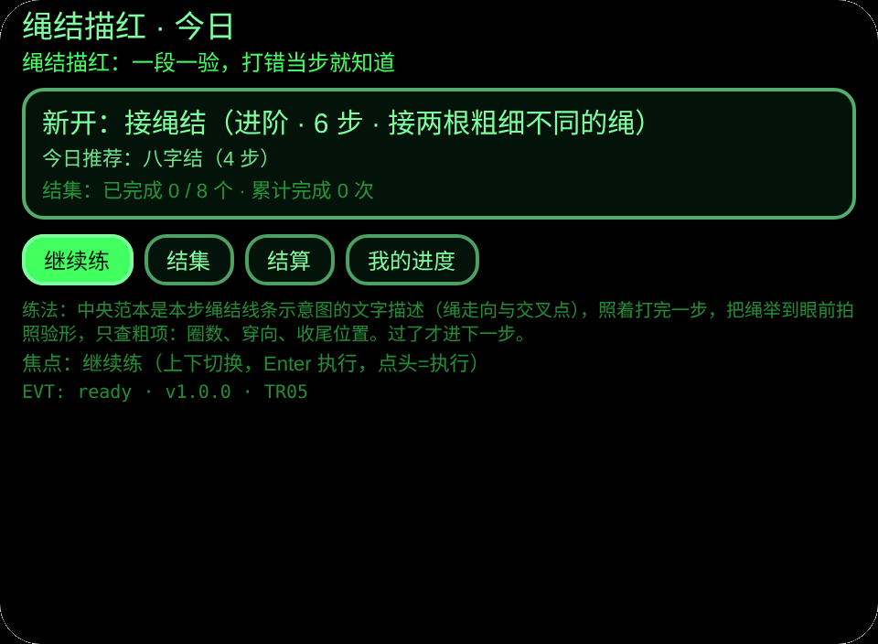
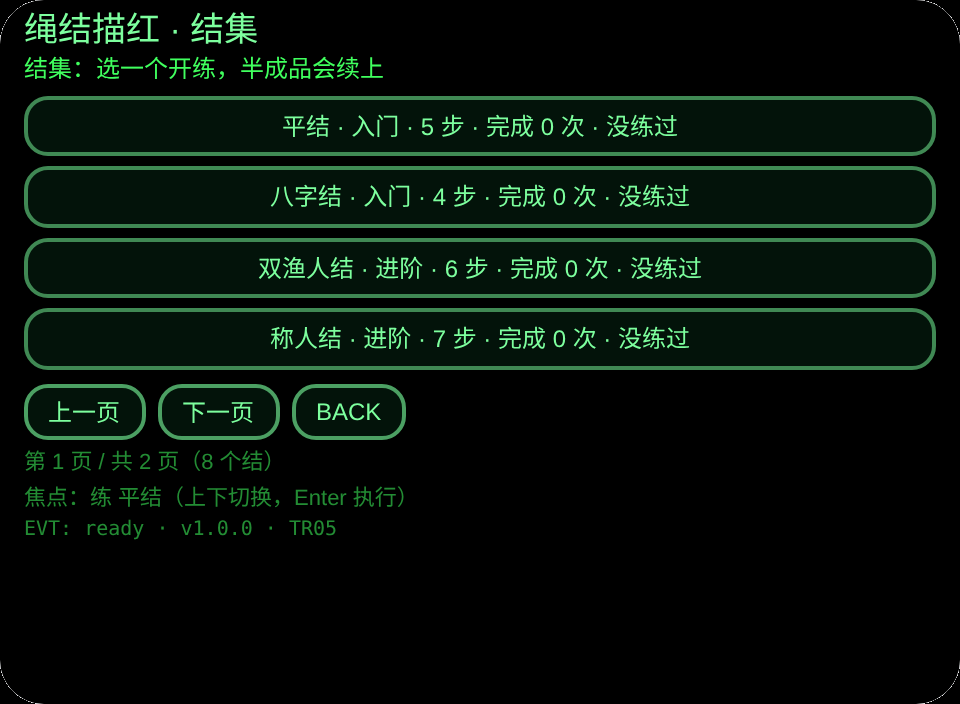
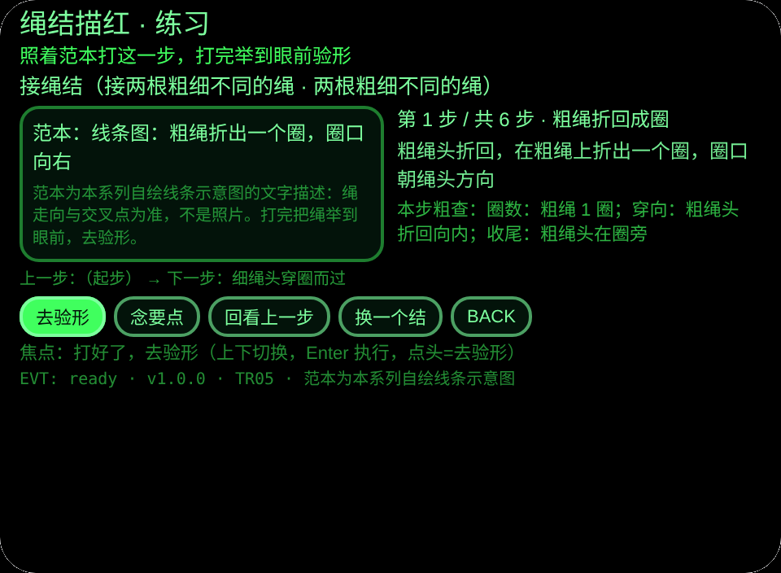
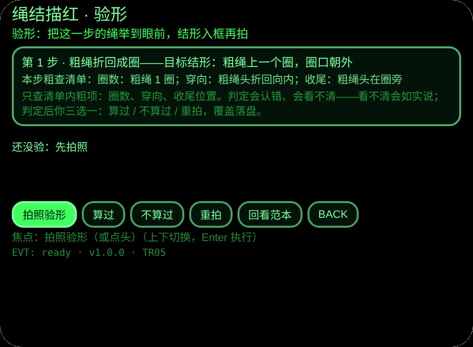
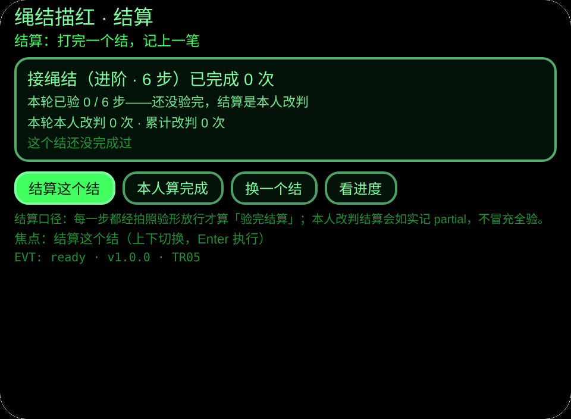
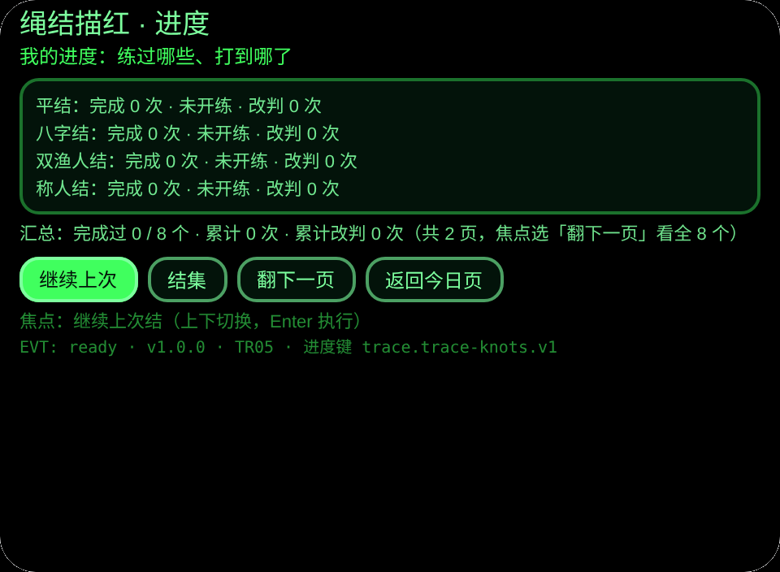

# TR05 Trace Knots · 绳结描红

**Studio 导入地址**（复制到 Global AIUI Studio 的 Import Project 输入框）：

```
https://github.com/sakai55/rokid/tree/agent-trace-knots
```

**AIX 最新版下载**：[trace-knots.aix](https://raw.githubusercontent.com/sakai55/rokid/main/aix/trace-knots.aix)

描红系列 TR05：中央范本 + 边上步骤 + 做一步验一步。出门露营或教孩子系鞋带前，照着眼镜把一个结从头打到对：每步范本是绳结线条示意图的文字描述（绳走向与交叉点），打完把绳举到眼前拍照验形，只查粗项，过了才进下一步；判定后你三选一：算过 / 不算过 / 重拍。

## 预览截图

（Web 预览渲染：验形页无相机时如实显示待拍状态；截图待本批预览管线生成后落位。）








## 方向构成

描红系列壳：范本显示在 `pages/practice/index.ink`（中央范本区 + 右侧步骤栏）；步骤条在同一页的步骤栏与前后步提示；拍照验收在 `pages/check/index.ink`（用户主动点头/点按触发 `judge.js` 的 `takePhotoDataUrl('default')`）；LLM 图片判定在 `judge.js` 的 `judgePhoto`（固定提示词合同：对照范本描述 → 只查清单内粗项 → 输出结构化判定 → 看不清就说看不清）；判定纠正/跳过路径在验形页三选（算过 / 不算过 / 重拍，覆盖落盘）；进度持久化在 `judge.js` 的 `loadKey`/`saveKey` 与进度键 `trace.trace-knots.v1`。

## 结构与功能（6 页闭环）

| 页 | 内容 |
|---|---|
| 今日 | 没打完的结优先续练、今日推荐（按日期轮换）、结集总进度 |
| 结集 | 8 个结分页陈列：难度、步数、完成次数、打到第几步；半成品从断点续练 |
| 练习 | 中央范本为本步线条示意图文字描述；右侧步名 + 本步要点 + 本步粗查清单，TTS 同步念；可回看上一步（只看不改进度） |
| 验形 | 把这一步举到眼前拍照，LLM 对照本步目标结形只查三类粗项：圈数、穿向、收尾位置；看不清如实说、重拍；判定后三选：算过进下一步、不算过重做、重拍，覆盖落盘 |
| 结算 | 已验步数、本轮改判次数；全部验完直接结算，没验完可本人改判结算（如实记 partial，不冒充全验） |
| 进度 | 逐结完成次数 / 断点 / 改判数、汇总，跨会话保存 |

## 内容集（自撰，可数）

8 个结共 42 步，每步在 `knots.js` 里有步名、操作要点、目标结形描述、本步粗查清单与线条示意图文字描述：平结 5 步、八字结 4 步、双渔人结 6 步、称人结 7 步、蝴蝶结 5 步、单结 4 步、接绳结 6 步、活结 5 步。每结另有静态可验性说明：结形定格后圈数、穿向、绳头位置都留在绳上，一张照片足以粗查，无须看打结过程。范本图为本系列自绘线条示意图的文字描述，以绳走向与交叉点为准，不是照片；要点为自撰练习提示，不抄图库与绳结书图。

## 手势表

| 手势/按键 | 作用 |
|---|---|
| 点头 | 执行焦点（验形页 = 拍照） |
| 单指点按（Enter） | 确认 |
| 上下滑 | 切焦点 / 翻页 |
| 双击（Backspace） | 返回（结集页已接线） |

按钮为绳环式（圆角 12px + 2px 粗边框），呼应绳圈，与 TR04 的纸签式不同。

## 权限

| 权限 | 用途 |
|---|---|
| `CAMERA` | 每步打完后拍绳结，转 data URL 给 LLM 图片输入粗查 |

## 诚实边界

- 定格判定，非连续追踪：系统只在每步结束时拍一张照片验收，不盯打结过程、不做实时纠偏；动态手势与手的轨迹不在本台范围。
- 只查粗项：圈数、穿向、收尾位置三类，不评美观、不打分；LLM 会认错、会看不清，看不清如实说重拍，判定后最后由用户三选定夺。
- 识别只是闭环一步：本体是「学打结 + 逐步验收 + 落盘进度」整套闭环，不是单纯认绳结。

## 错误码

本台遵循全局错误码表（仓库根 `ERROR-CODES.md`，裸码 `E####`）。出错时屏显裸码 + 一行说明，最近一次错误保存在 `lastError`（含码、slug、版本、原文截断）。回报问题时请带上眼镜上显示的码。
本台用到：E1001 相机打开失败、E1002 相机权限未给、E1003 拍照器不可用、E1007 相机设备不存在、E1009 拍照失败、E2013 文本编码失败、E5001 记录保存失败、E5002 记录读取失败、E6001 大模型不可用、E6002 大模型请求失败、E6011 大模型输出不可用、E8001 页面切换失败、E9001 未分类错误。

## 设备测试信息表

| 项 | 值 |
|---|---|
| Studio name | （待导入后回填） |
| Version / Build | 1.0.0 |
| App Category | （待导入后回填） |
| Intent Description | 绳结描红：8 个结 42 步逐段范本，逐步拍照粗查三项，本人三选覆盖，断点续练 |
| Agent ID | （待导入后回填） |
| 状态 | 已建成，待 GO 导入真机测试（提审等 GO 确认真机测试完成） |

## 提审资料 (Review Submission)

- **Feature Description**（≤500 字）：绳结描红练习：8 个结共 42 步，每步的绳结线条范本浮在眼前，照着用真绳打，打完把绳举到眼前拍照，只查圈数、穿向和收尾位置，过了才进下一步；判定后可由本人三选覆盖（算过 / 不算过 / 重拍），半成品下次续练，完成次数跨会话保存。
- **Opening Message**：今天打一个结：一段一打，一打一验，打错当步就知道。
- **Preview Media**：见「预览截图」6 张（图片）；视频待真机阶段补（提审需 3–5 个文件、含 ≥1 视频 ≤60s）。
- **Change Log**（Build 1.0.0）：Features added — 6 页闭环（今日 / 结集 / 练习 / 验形 / 结算 / 进度）、8 个结 42 步结形数据、逐步拍照粗查三类、TTS 要点、本人三选覆盖与 partial 结算、断点续练与跨会话进度；Improvements — 无；Fixes — 无。
