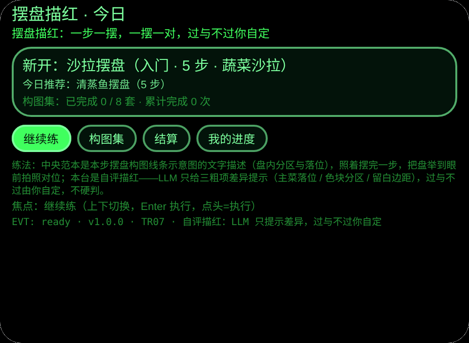
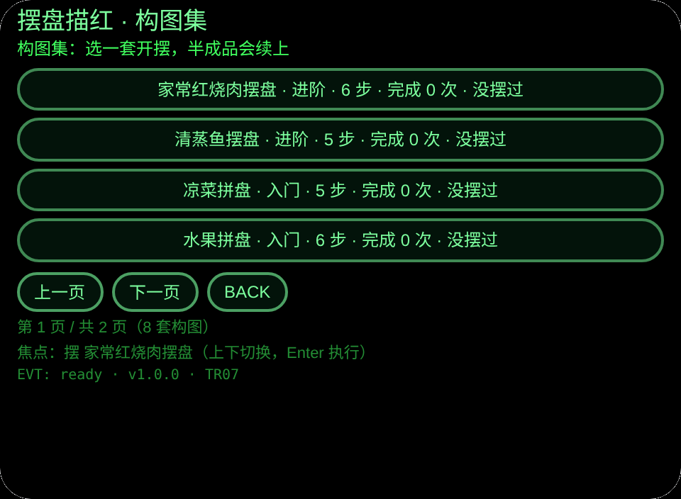
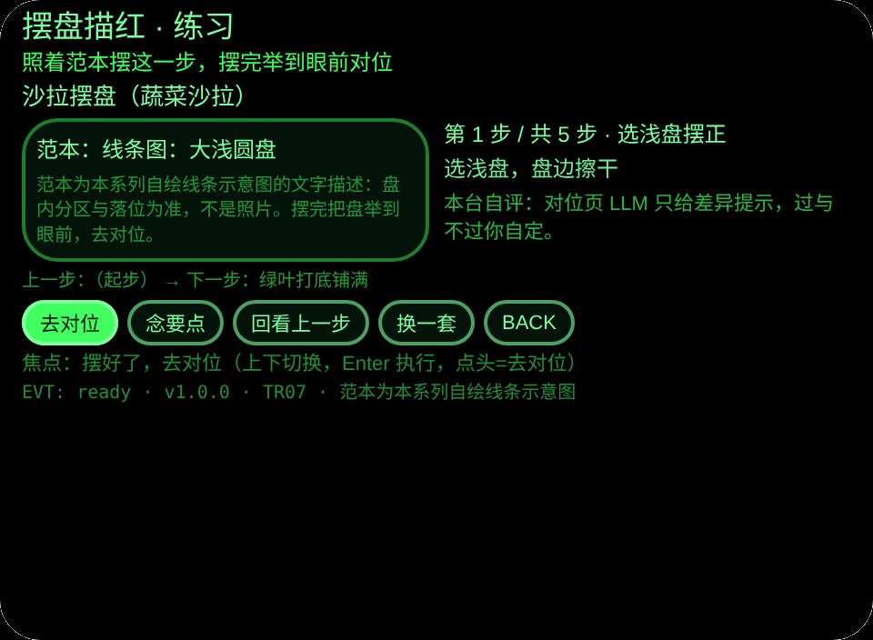
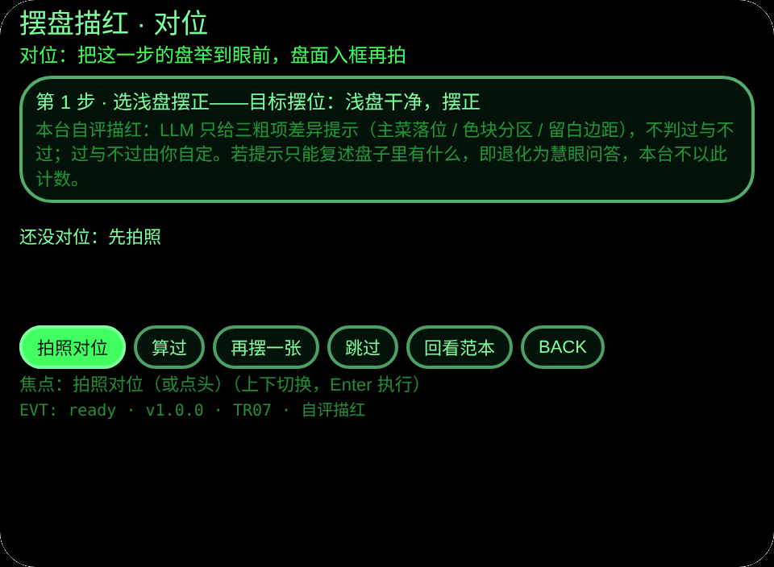
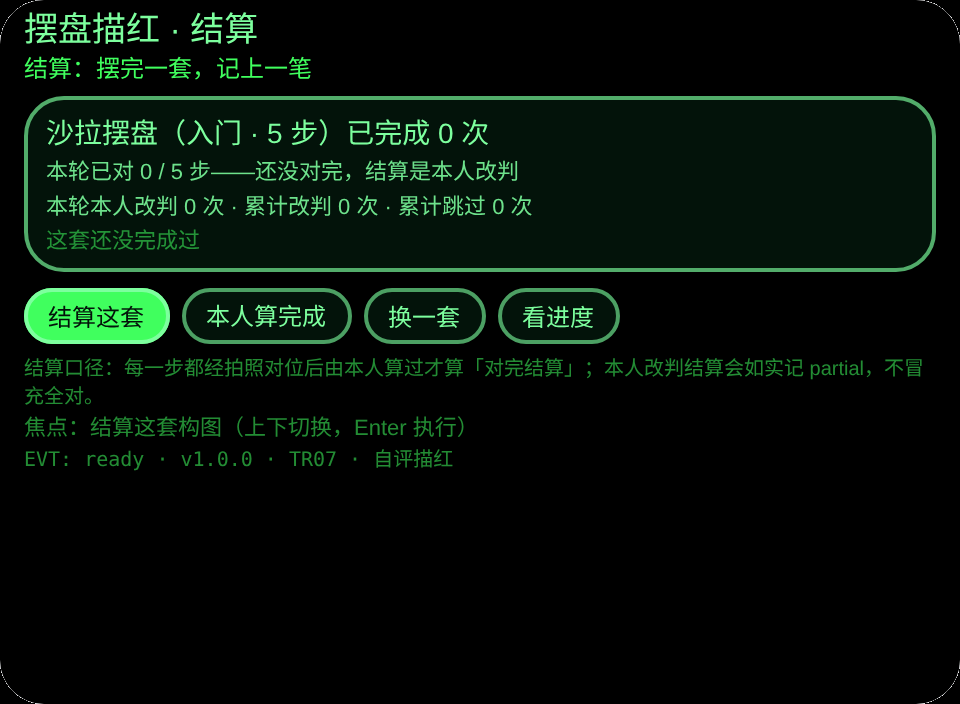
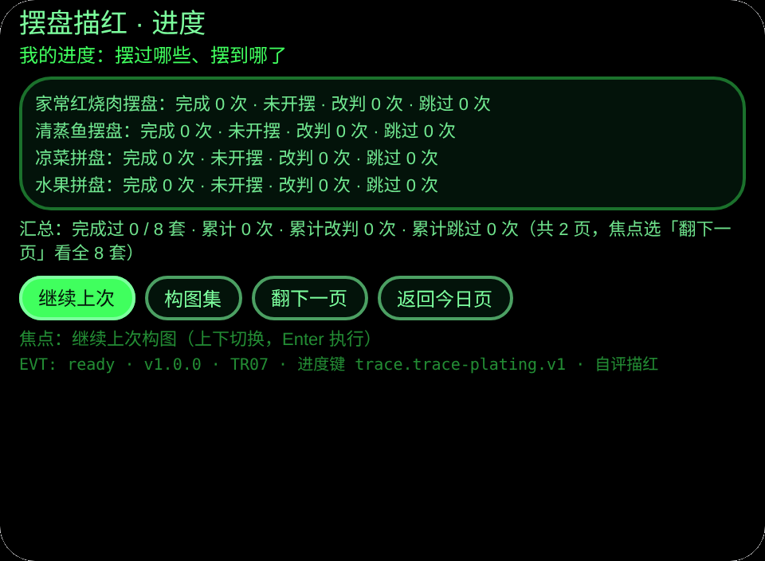

# TR07 Trace Plating · 摆盘描红

**Studio 导入地址**（复制到 Global AIUI Studio 的 Import Project 输入框）：

```
https://github.com/sakai55/rokid/tree/agent-trace-plating
```

**AIX 最新版下载**：[trace-plating.aix](https://raw.githubusercontent.com/sakai55/rokid/main/aix/trace-plating.aix)

描红系列 TR07：中央范本 + 边上步骤 + 做一步验一步。家宴上桌前，照着眼镜把一盘菜摆出餐馆样子：每步范本是摆盘构图线条示意图的文字描述（盘内分区与落位），摆完把盘举到眼前拍照对位。

## 自评描红（本台建台即定，置顶）

**本台是自评描红**：LLM 只给三粗项差异提示（主菜落位 / 色块分区 / 留白边距），过与不过由用户自定，不硬判。对位页用户三选：算过 / 再摆一张 / 跳过。**若判定只能复述盘子里有什么，即退化为慧眼问答，本台不以此计数**——对位页提示词只许答三粗项差异，明确不许复述盘中菜品。

## 预览截图

（Web 预览渲染：对位页无相机时如实显示待拍状态；截图待本批预览管线生成后落位。）








## 方向构成

描红系列壳：范本显示在 `pages/practice/index.ink`（中央范本区 + 右侧步骤栏）；步骤条在同一页的步骤栏与前后步提示；拍照验收在 `pages/check/index.ink`（用户主动点头/点按触发 `judge.js` 的 `takePhotoDataUrl('default')`）；LLM 图片判定在 `judge.js` 的 `judgePhoto`（自评提示词合同：对照范本描述 → 只给三粗项差异提示 → 看不清就说看不清，不判过与不过）；判定纠正/跳过路径在对位页三选（算过 / 再摆一张 / 跳过，跳过记跳过与改判）；进度持久化在 `judge.js` 的 `loadKey`/`saveKey` 与进度键 `trace.trace-plating.v1`。

## 结构与功能（6 页闭环）

| 页 | 内容 |
|---|---|
| 今日 | 没摆完的构图优先续练、今日推荐（按日期轮换）、构图集总进度 |
| 构图集 | 8 套构图分页陈列：难度、步数、完成次数、摆到第几步；半成品从断点续练 |
| 练习 | 中央范本为本步线条示意图文字描述；右侧步名 + 本步要点，TTS 同步念；可回看上一步（只看不改进度） |
| 对位 | 把这一步举到眼前拍照，LLM 只给三粗项差异提示：主菜落位、色块分区、留白边距；看不清如实说、重拍；用户三选：算过进下一步、再摆一张重摆重拍、跳过进下一步（记跳过与改判） |
| 结算 | 已对步数、本轮改判与跳过次数；全部对完直接结算，没对完可本人改判结算（如实记 partial，不冒充全对） |
| 进度 | 逐套完成次数 / 断点 / 改判数 / 跳过数、汇总，跨会话保存 |

## 内容集（自撰，可数）

8 套构图共 41 步，每步在 `platings.js` 里有步名、操作要点、目标摆位描述与线条示意图文字描述：家常红烧肉摆盘 6 步、清蒸鱼摆盘 5 步、凉菜拼盘 5 步、水果拼盘 6 步、便当摆盘 6 步、面条摆盘 4 步、沙拉摆盘 5 步、点心摆盘 4 步。范本图为本系列自绘线条示意图的文字描述，以盘内分区与落位为准，不是照片；要点为自撰练习提示，不抄图库与菜谱书图。

## 手势表

| 手势/按键 | 作用 |
|---|---|
| 点头 | 执行焦点（对位页 = 拍照） |
| 单指点按（Enter） | 确认 |
| 上下滑 | 切焦点 / 翻页 |
| 双击（Backspace） | 返回（构图集页已接线） |

按钮为盘沿式（圆角 20px + 双圈盘沿阴影），呼应盘沿，与 TR04 的纸签式、TR05 的绳环式不同。

## 权限

| 权限 | 用途 |
|---|---|
| `CAMERA` | 每步摆完后拍盘面，转 data URL 给 LLM 图片输入对位提示 |

## 诚实边界

- 定格提示，非连续追踪：系统只在每步结束时拍一张照片给差异提示，不盯摆盘过程、不做实时纠偏。
- 自评口径：LLM 只提示三粗项差异，不判过与不过、不评口味、不打分；看不清如实说重拍；最后由用户三选定夺；跳过如实记跳过与改判。
- 退化红线：若判定只能复述盘子里有什么，即退化为慧眼问答，本台不以此计数。
- 识别只是闭环一步：本体是「学摆盘 + 逐步对位 + 落盘进度」整套闭环，不是单纯认菜品。

## 错误码

本台遵循全局错误码表（仓库根 `ERROR-CODES.md`，裸码 `E####`）。出错时屏显裸码 + 一行说明，最近一次错误保存在 `lastError`（含码、slug、版本、原文截断）。回报问题时请带上眼镜上显示的码。
本台用到：E1001 相机打开失败、E1002 相机权限未给、E1003 拍照器不可用、E1007 相机设备不存在、E1009 拍照失败、E2013 文本编码失败、E5001 记录保存失败、E5002 记录读取失败、E6001 大模型不可用、E6002 大模型请求失败、E6011 大模型输出不可用、E8001 页面切换失败、E9001 未分类错误。

## 设备测试信息表

| 项 | 值 |
|---|---|
| Studio name | （待导入后回填） |
| Version / Build | 1.0.0 |
| App Category | （待导入后回填） |
| Intent Description | 摆盘描红：8 套构图 41 步逐段范本，逐步拍照三粗项差异提示，自评三选，断点续练 |
| Agent ID | （待导入后回填） |
| 状态 | 已建成，待 GO 导入真机测试（提审等 GO 确认真机测试完成） |

## 提审资料 (Review Submission)

- **Feature Description**（≤500 字）：摆盘描红练习（自评）：8 套构图共 41 步，每步的摆盘构图范本浮在眼前，照着用真盘摆，摆完把盘举到眼前拍照，只给主菜落位、色块分区和留白边距三项差异提示，过与不过由本人自定（三选：算过 / 再摆一张 / 跳过），半成品下次续练，完成次数跨会话保存。
- **Opening Message**：今天摆一盘：一步一摆，一摆一对，过与不过你自定。
- **Preview Media**：见「预览截图」6 张（图片）；视频待真机阶段补（提审需 3–5 个文件、含 ≥1 视频 ≤60s）。
- **Change Log**（Build 1.0.0）：Features added — 6 页闭环（今日 / 构图集 / 练习 / 对位 / 结算 / 进度）、8 套构图 41 步摆位数据、逐步拍照三粗项差异提示、自评三选与 partial 结算、断点续练与跨会话进度；Improvements — 无；Fixes — 无。
