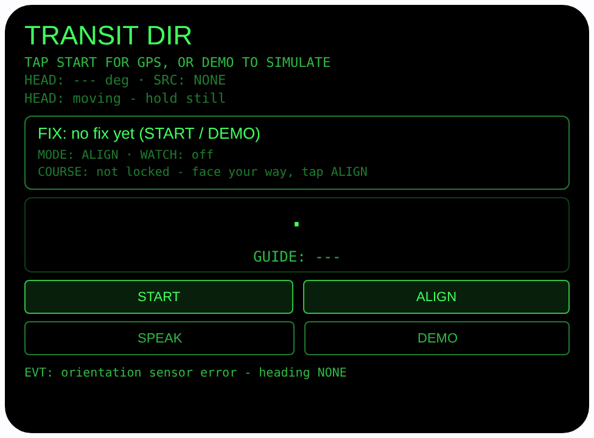
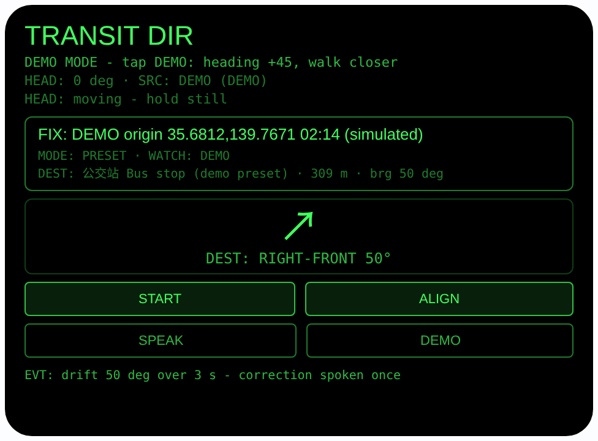
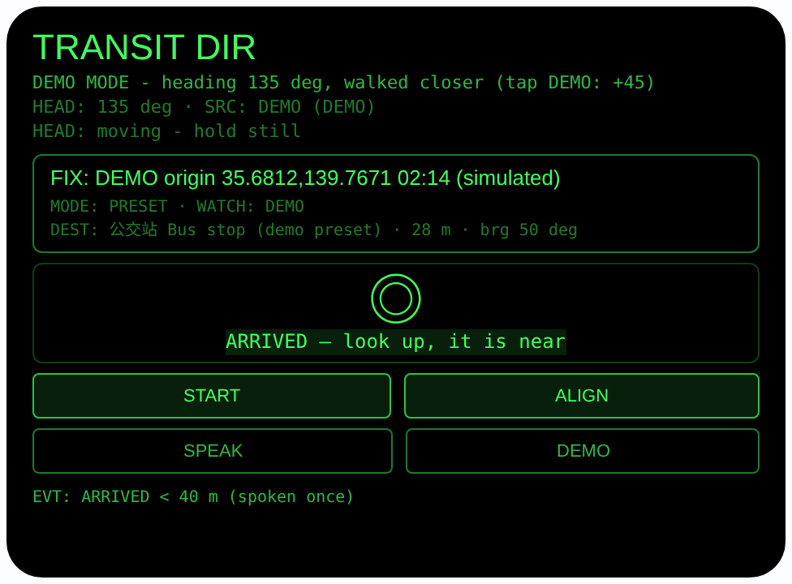

# transit-direction — 出站定向（Rokid 眼镜 AIUI Agent）

50 个「指向性生活问题」Agent 的第 42 个。出了地铁站最大的崩溃不是
路远，是**方向感清零**：站内地图看懂了，一出地面就分不清自己面朝
哪条街，手机导航的蓝点箭头转来转去，越看越晕。本 Agent 的办法是
把「对准」这一步交给你的头：看完地图、朝你要走的方向转过头，
点一下锁定，之后箭头和语音负责把你留在这个方向上。

## 预览截图

截图统一存放于仓库根目录 `screenshots/transit-direction/`。







## 解决的问题

手机导航默认你能把地图方向和现实方向对起来——出站口恰恰是这个
假设崩掉的地方：地下转了三圈，罗盘又受钢结构干扰，箭头朝哪边都
像对又都不像。本 Agent 不给你一张地图，只干一件事：**出发前用
你的头校准一次方向，出发后持续守住它**。校准不需要知道目的地
在哪——站内地图已经告诉你「出 3 号口往左手边那条街走」，你抬头
找到那条街、面朝它，剩下的交给锁定。

## 指向性设计（为什么必须用眼镜）

- **头部朝向即航向（HEAD/ALIGN）**：ALIGN 把你点下锁定那一刻的
  头部朝向定为航向，全程只比较「当前朝向 vs 锁定朝向」两个
  相对量。传感器 yaw 的零点参考系由宿主定义、官方未文档化——
  相对比较让这个问题根本不出现，这是 ALIGN 模式的设计根基。
- **偏离纠正（DRIFT）**：走路时人会不自觉偏。偏离 > 30° 持续
  3 秒（500 ms 一拍、拍数计时，不靠反复读时钟）→ 语音纠正
  一次：「你偏向左边了，往右修正 X 度」——措辞与相对角符号
  严格对应（相对角为正 = 目标在右手边 = 你往左偏了）；回到
  ≤15° 才重新布防，同一次偏离绝不重复念。
- **持续定位（GEO-H）**：START 单次定位后接 `watchPosition`
  持续更新，PRESET 模式的距离随你走动实时变；watch 失效如实
  标注并回退手动重定位，不假装在跟踪。
- **手势优先（档案 §3.2.1）**：全部主流程只用触控板手势 +
  头稳 + 点头就能走完（见下方「手势映射」）；屏幕只保留
  START / ALIGN / SPEAK / DEMO 四个与手势等效的按钮。

## 手势映射

本 Agent 的全部主流程（取定位 → 锁定航向 → 跟随指引 / 选预设 →
听状态）都可以只用眼镜腿触控板手势 + 头部动作完成，不必点屏幕
按钮。手势与键码的对应来自官方文档档案 §3.2.1。

| 手势 | 键码 | 在本 Agent 中的动作 |
|---|---|---|
| 单击触控板 | Enter | 情景主操作：无定位时 = START 取定位；ALIGN 模式 = 锁定当前朝向为航向；PRESET 模式且 watch 失效/不可用 = 手动 UPDATE 重定位；其余时候 = 朗读当前指引 |
| 滑动触控板 | ArrowUp / ArrowDown | ALIGN 模式下 = 进入 PRESET 模式；PRESET 模式下 = 前后轮换预设目的地（公交站 / 便利店 / 公园入口，均为内置演示预设） |
| 双击触控板 | Backspace | 返回 / 关闭（由宿主处理，本 Agent 只记录事件） |
| 长按触控板 | —（系统级） | 唤醒 AI 助手（系统功能，不经过本 Agent） |
| 头部稳定时点头 | onHeadGesture `nod` | 朗读当前指引（与 SPEAK 等效）；点头从不锁定航向、从不发起定位 |
| 屏幕按钮 | — | 只保留 4 个：START（取定位并锚定原点）、ALIGN（锁定朝向）、SPEAK（朗读指引）、DEMO（无 GPS 时仿真：朝向 +45° 步进 + 向目的地走近），与手势一一等效 |

## 功能流程

1. 到了出站口，单击（或点 START）取一次 GPS 定位，大字显示
   坐标与精度；随后 watchPosition 持续更新你的位置
2. 看站内地图确认要走的街，转头面朝那个方向，单击（或点
   ALIGN）锁定航向 → 大箭头相对你的头部实时指着锁定方向，
   ON COURSE 就直走；偏离 > 30° 满 3 秒，语音纠正你往哪边修
3. 每个路口街道拐弯时：停下来看路，重新面朝新方向，再锁一次
4. 换个玩法：滑动触控板进入 PRESET 模式选内置演示目的地
   （公交站 / 便利店 / 公园入口），跟着方位箭头走，距离实时
   刷新，< 40 米显示 ARRIVED
5. 任何时候头稳住点一下头（或点 SPEAK），朗读当前指引状态
6. DEMO 按钮：登记 DEMO 原点与公交站预设，再点每次模拟朝向
   +45° 并向目的地走近一段，可完整预览指引/抵近/到达三态

> 诚实说明：ALIGN 守的是你锁定的**方向**，不是去目的地的
> 路线——它不知道目的地在哪，街道拐弯必须重新锁定。PRESET
> 的目的地是内置**演示**坐标（本 build 没有坐标输入口）；
> PRESET 的绝对方位依赖传感器 yaw 的宿主参考系，真机首测请
> 对已知方向核对一次左右（见「未验证」）。麦克风与相机本
> Agent 都不用。

## 权限

| 权限 | 用途 |
|---|---|
| GEOLOCATION | START 单次定位、watchPosition 持续更新当前位置、PRESET 模式的距离/方位计算 |

只申请定位一个权限：没有拍照、没有语音输入；朗读走宿主 TTS，
朝向传感器在 AIUI 里不需要单独的权限声明。定位只在用户点
START/单击后开启，页面隐藏/卸载即停 watch 与传感器。

## 打包与预览

```bash
cd ~/workspace/rokid/transit-direction
~/tools/bin/aix pack . -o ../dist/transit-direction.aix
~/tools/bin/aix preview . --html-out artifacts/preview.html
```

本地预览截图走 `~/workspace/preview-tools/` 的本地 Ink + puppeteer 路线
（`shot-transit.js`，独立页面副本 `preview-transit.html`；DEMO 按钮
点击坐标在 shot 脚本运行日志中按 canvas 坐标记录）。

## 真机测试（海外版 · 云端下发 · Path 1）

1. 推到 GitHub 后，Global AIUI Studio（aiui-global.rokid.com，en-US）用
   分支导入：`https://github.com/sakai55/rokid/tree/agent-transit-direction`
   （该分支根目录即本 Agent 文件）
2. Studio 的 **Device Debug** 页签填 Basic Information，在 AIX Packaging
   点 **Repackage and Save**，确认顶部出现绿色
   **● Debug version ready — Ready for device debugging**
3. **Hi Rokid**（海外版 `com.rokid.sprite.global.aiapp`，不是国内版
   Rokid Ai App）→ 设置 → 开发者选项 → AIUI → 更新眼镜资源包，
   等「智能体资源包下载成功」
4. 对眼镜说「乐奇，打开 transit-direction」，站在地铁站出站口：
   单击取定位，看站内地图后转头面朝要走的街、单击锁定，直行
   一段后故意往一侧偏 40° 以上保持 3 秒，验证语音纠正的左右
   方向是否正确；到路口重新锁定一次；再滑动切到公交站预设，
   对照已知方向核对 PRESET 箭头的左右是否镜像（见「未验证」
   第一条），边走边看距离是否随 watchPosition 变小、40 米内
   是否进入 ARRIVED

## 真机测试信息（Global AIUI Studio · Device Debug）

| 项目 | 值 |
|---|---|
| Agent Name（Studio） | 待导入后回填 |
| Version（Build） | 1.0.0（待导入后回填） |
| App Category | 待导入后回填 |
| Intent Description | 待导入后回填 |
| Agent ID | 待导入后回填 |
| AIX Package Size | 约 20.0 KB（本地打包 `dist/transit-direction.aix`） |
| 状态 | 本地完成，待导入 Studio |
| Studio | aiui-global.rokid.com（en-US） |
| 下发方式 | 云端下发 → Hi Rokid（海外版）更新眼镜资源包 |

## 验证情况

**已验证**

- 静态检查：app.json / package.json JSON 解析通过；`<script def>` JSON
  解析通过；`<script setup>` 与 app.js 提取后 `node --check` 语法通过；
  全目录 grep 无 `Page(` / `App(` / `Widget(` / `workers:` 残留；
  屏幕按钮只剩 START / ALIGN / SPEAK / DEMO 四个 bindtap。
- 状态机测试：Node 里以 wx/geolocation/传感器存根加载页面对象跑
  **70 条断言全过**——覆盖：方位角/Haversine 对已知偏移的量值
  （正北约 0°、0.01° 纬度约 1112 m、正东约 90°/904 m）、相对角
  符号约定（+ 为右）、ON COURSE 带宽（±15° 内亮、16° 灭）、
  偏离纠正（偏 40° 时 2.5 秒不念、满 3 秒只念一次、持续偏离
  不重复、回正重新布防、左右措辞与相对角符号一致、被 ≤30°
  打断后 3 秒累计清零）、ALIGN 无朝向时拒绝锁定、锁定后指引
  数学、START 取定位后 watchPosition 真正接上并随推送更新
  距离、抵近 < 40 米 ARRIVED 只念一次、离开重新布防、watch
  报错标注 WATCH FAIL 并回退手动重定位、无 watchPosition 的
  主机走 n/a + UPDATE 路径、onUnload 清 watch、点头纪律
  （头动时不念、指引中头稳才念、非点头手势忽略、未指引时
  点头不锁定不定位）、手势全流程（单击取定位→单击锁定→
  滑动进 PRESET→滑动轮换预设→双击无副作用→PRESET+watch
  存活时单击只朗读不重定位）、DEMO 原点锚定与 walk-in 距离
  单调收缩直至 ARRIVED、TTS 从不设置 lang。
- 打包：`aix pack` 成功；`aix list` 核对包内含 README.md、AGENTS.md、
  app.js、app.json、package.json、pages/index/index.ink
  （artifacts/ 已被 .aixignore 排除）。
- 预览渲染：aix preview + 本地 Ink + puppeteer 截图三张（见
  Preview Media）：首页初始态完整渲染；DEMO 进入预设指引态
  箭头与相对角显示正确；DEMO walk-in 至 40 米内进入 ARRIVED。

**未验证**

- **传感器 yaw 的零点参考系（第一优先核对）**：官方档案只给
  四元数、未文档化其参考系约定。ALIGN 模式全程相对比较，不受
  影响；但 PRESET 模式把传感器 yaw 与地理方位角放在同一标尺
  上算相对角——若宿主约定方向相反，指引将左右镜像。真机首测
  必须对已知方位点核对左右方向后，PRESET 才可信。
- 真机 watchPosition 的更新频率与稳定性（出站口高楼峡谷里
  GPS 跳变会让距离读数抖动，40 米 ARRIVED 阈值可能需要按
  真机表现调整）；watch 失败时手动 UPDATE 的实际手感。
- 真机头部稳定检测、点头手势与触控板手势（单击/滑动/双击）
  在本 Agent 键位映射下的实际触发情况；偏离纠正 TTS 的
  播报效果与 3 秒/30° 阈值在真实步行中的合用性（走路时头部
  自然摆动可能频繁穿越 30°，阈值真机后再调）。

---

## 提审资料（Review Submission）

> Global AIUI Studio → Submit 页签的 Review Information 逐项对应下面四段，
> 提交时整段复制。每次提交前重新确认 Preview Media。

### Feature Description

Just stepped out of the station and the map's arrow points everywhere? Transit Direction fixes your exit heading. Tap for a GPS fix, face the way you must walk and lock it with ALIGN: a big head-relative arrow holds that course, and a voice corrects you if you drift over 30 degrees for 3 seconds. Or swipe to a built-in demo preset destination and follow its arrow with live distance. ALIGN holds a direction, not a route - re-align at every corner.

（450 字符）

### Opening Message

Hi, I'm **Transit Direction** — I point you the right way out of the station.

Tap once (or **START**) for a GPS fix. Read the station map, face the street you must take, and tap again (or **ALIGN**) to lock your facing as the course; I'll keep the arrow on it and speak up if you drift. **Swipe** switches to a built-in demo destination. Hold your head steady and **nod** any time to hear the guidance. Streets bend — re-lock at every corner.

（443 字符）

### Preview Media

提交要求：3–5 个 JPG/PNG 图片或 MP4 视频，至少含 1 张图和 1 个视频，每次提交前重新确认。

- Image 1：`artifacts/preview-transit-direction-index.png`（aix preview 首页：TRANSIT DIR 初始态，含定位/模式/航向行、箭头区与 START/ALIGN/SPEAK/DEMO 四个按钮，本地文件，提交时从本地上传）
- Image 2：`artifacts/preview-transit-direction-guide.png`（DEMO 预设指引态：模拟原点 + 公交站预设，右前方约 50°、距离约 309 米，箭头与相对角行完整显示，本地文件）
- Image 3：`artifacts/preview-transit-direction-arrived.png`（DEMO walk-in 抵近态：距离 < 40 米，ARRIVED 高亮行与 ◎ 标记，本地文件）
- Video：待真机补 — 真机录制「出站口单击取定位 → 看地图转头单击锁定 → 直行 → 故意偏离触发语音纠正 → 路口重新锁定」全过程（MP4），录好后放 `artifacts/` 并更新此处
- 状态：未齐（已有 3 张图；还需至少 1 个视频，总数保持在 3–5 个后才可提交）

### Change Log

#### Build 1.0.0

**Features added**

- ALIGN course lock: at the station exit, face the way you must walk and tap (or press ALIGN) - the agent locks your current head heading as the course and keeps a big head-relative arrow on it. The comparison is purely relative (current vs locked heading), so the host-defined sensor zero never enters into it. The lock line shows the bearing and lock time and reminds you to re-align at corners: it holds a direction, not a route.
- Spoken drift correction: drifting more than 30 degrees off the locked course (or off a preset bearing) for 3 continuous seconds triggers exactly one spoken correction per drift episode - "you drifted left, correct right by X degrees", with the wording tied to the relative-angle sign and covered by tests; returning within 15 degrees re-arms.
- Live position watch: after the single START fix, watchPosition keeps the current position fresh so preset distances update as you walk; a failed or unavailable watch is labelled on screen and falls back to a manual re-fix (the single tap does this contextually). An arrival state under 40 m is spoken once per approach.
- PRESET demo destinations: three built-in demo presets (bus stop, convenience store, park gate) expressed as small offsets anchored to the START origin - the origin never moves with you, so distance genuinely shrinks as you approach. Disclosed on screen and in copy as demo data; this build has no destination-coordinate input.
- Gesture-first operation (temple touchpad, dossier §3.2.1): single tap = contextual primary action (fix / lock / manual re-fix / speak), swipe = enter PRESET mode and cycle presets, double-tap = host back, steady-head nod = speak the guidance. Only four on-screen buttons remain (START / ALIGN / SPEAK / DEMO), each mirroring a gesture.

**Improvements**

- None (initial release).

**Fixes**

- None (initial release).
