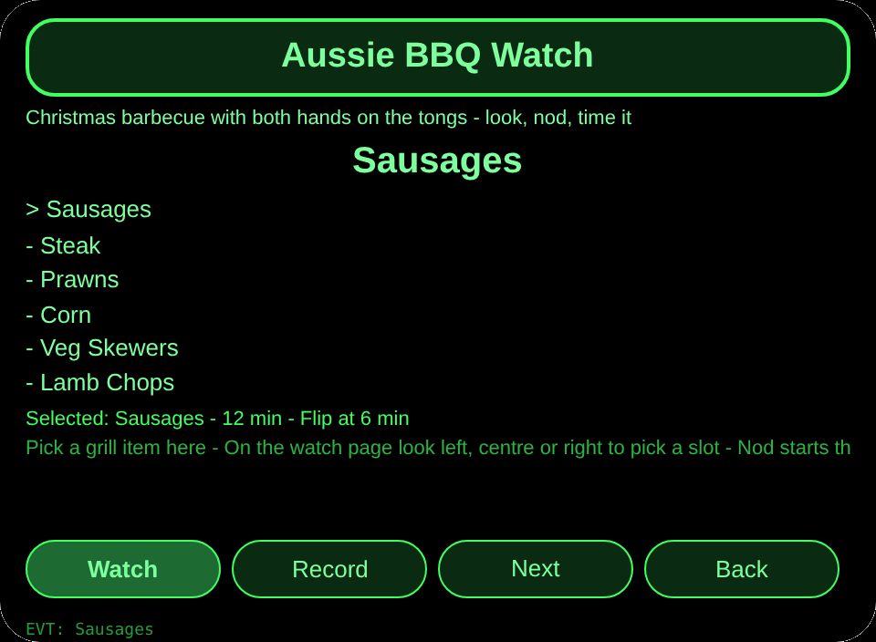
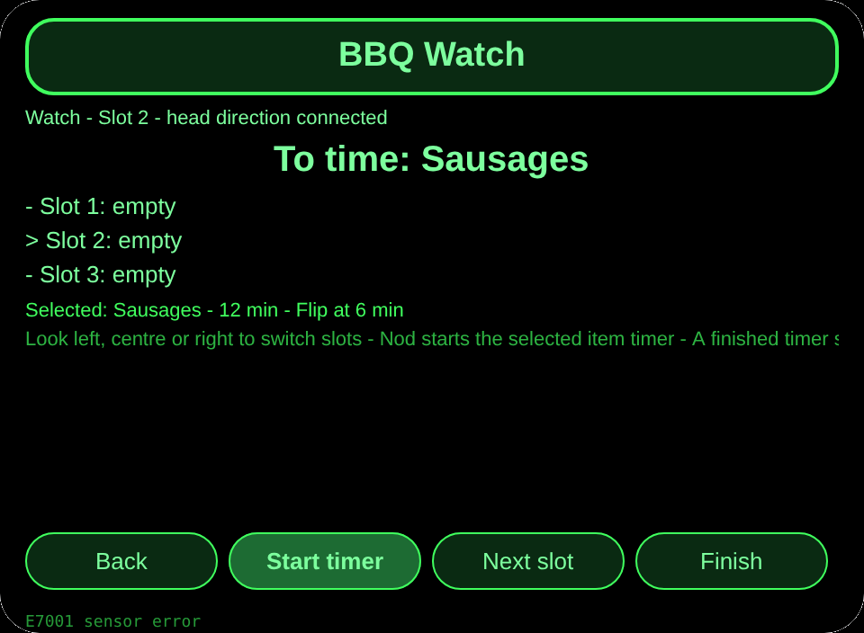
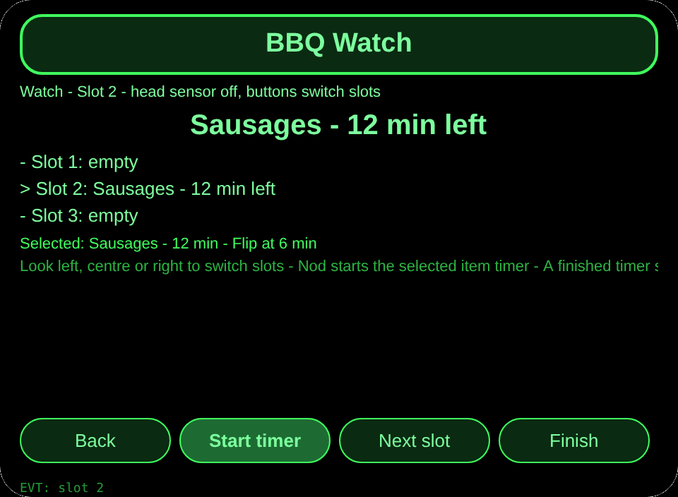
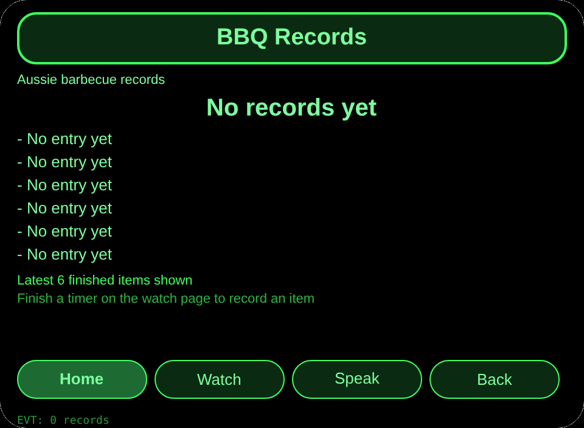

# Aussie BBQ Watch

**Studio import address** (copy into the Import Project box in Global AIUI Studio):

```
https://github.com/sakai55/rokid/tree/agent-aussie-bbq-watch
```

**Latest AIX download:** [aussie-bbq-watch.aix](https://raw.githubusercontent.com/sakai55/rokid/main/aix/aussie-bbq-watch.aix)

AIX size: 11,640 bytes.

WA09 aussie-bbq-watch - Australia - Attention (watch) x directional. At an Australian Christmas barbecue, the cook with both hands on the tongs looks at a grill slot, nods to start its timer, hears when it is done, and records the finished item without putting the tongs down.

## Direction mix

Attention (watch) x directional

## Scene

At an Australian Christmas barbecue, the cook with both hands on the tongs looks at a grill slot, nods to start its timer, hears when it is done, and records the finished item without putting the tongs down.

## Glasses-exclusive capability

Head-direction coordination plus hands-free timing: the cook looks left, centre, or right to pick one of 3 grill slots and nods to start its timer while both hands hold tongs. A phone timer needs a free hand and a look down, which the cook does not have at the grill.

Wiring evidence: pages/watch/index.ink _startSensor with a typeof guard on AbsoluteOrientationSensor maps yaw below minus 0.35 to slot 1, above plus 0.35 to slot 3, and the centre to slot 2, with buttons as fallback and E7001 on sensor failure; primaryTap starts a timer or, on a done timer, finishes it; finishTap writes a record only when the timer is done.

## Pages

| Page | Role |
|---|---|
| pages/index | 6 grill items with minutes and flip point, plus settled count |
| pages/watch | 3 timer slots picked by head yaw zones, nod starts, Finish records only a done timer |
| pages/record | Latest 6 finished items and total count |

## Content set

6 grill items: Sausages 12 min (flip at 6 min), Steak 8 min (flip at 4 min), Prawns 4 min (flip at 2 min), Corn 10 min (flip at 5 min), Veg Skewers 8 min (flip at 4 min), Lamb Chops 10 min (flip at 5 min). 3 timer slots on the watch page. Finished items are counted by their real number.

## Persistence

Cross-session storage key `aussieBbqWatchV1`: picked grill item, 3 slot timers with item name, minutes, and start time, finished-item records array, lastError.

## Permissions

No permissions are declared. Head direction uses the device orientation sensor and spoken feedback uses the host speech path; no location or camera is used.

## Gesture map

| Temple touchpad gesture | Key event | Role in this agent |
|---|---|---|
| Single tap | Enter | Main confirm (the main button on each page) |
| Swipe up / swipe down | ArrowUp / ArrowDown | Change the selection |
| Nod (head steady) | onHeadGesture nod | Same as main confirm |
| Double tap | Backspace | Back to the previous page |

## Error codes

- `E5001` Storage write failed
- `E5002` Storage read failed
- `E3005` Spoken feedback failed
- `E8001` Page move failed
- `E7001` Head direction sensor failed

Failures always show the bare code on screen, and lastError keeps the code plus slug, version, and original text.

## Preview screenshots






## Review submission

### Feature Description

An Australian Christmas barbecue watch: the cook looks at one of 3 grill slots and nods to start its timer while both hands hold the tongs. Six grill items carry suggested minutes and a flip point, a done timer speaks once, and Finish records only a truly done item.

### Opening Message

Pick a grill item, look at a slot, and nod to start its timer. When it speaks done, finish it and the record is kept.

### Preview Media

- [preview-aussie-bbq-watch-video.mp4](https://raw.githubusercontent.com/sakai55/rokid/main/screenshots/aussie-bbq-watch/preview-aussie-bbq-watch-video.mp4)
- `preview-aussie-bbq-watch-index.png`
- `preview-aussie-bbq-watch-watch-s2.png`
- `preview-aussie-bbq-watch-record.png`

### Change Log

- Features added: 6 grill items with minutes and flip points, 3 head-direction timer slots, nod start, done alert, and finish-only-when-done records.
- Improvements: None in this first build.
- Fixes: None in this first build.

## Device test info

| Item | Value |
|---|---|
| Studio name | Not entered |
| Version | 1.0.0 |
| Category | Not entered |
| Intent description | Not entered |
| Agent ID | Not entered |
| Status | Not imported |
