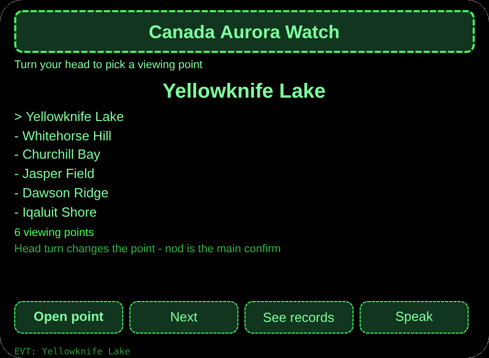
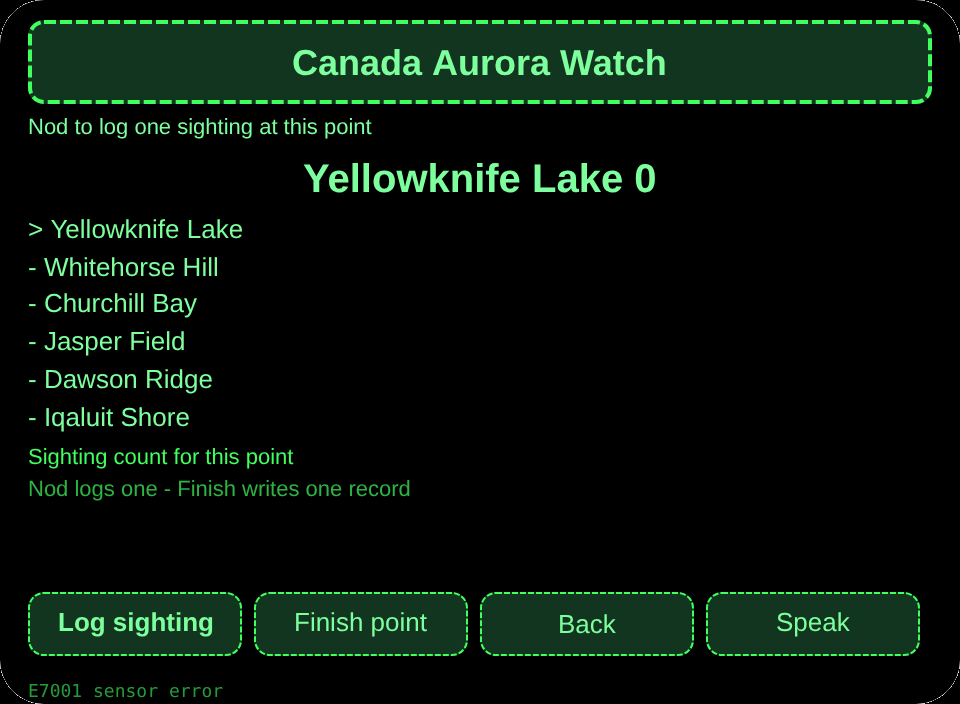
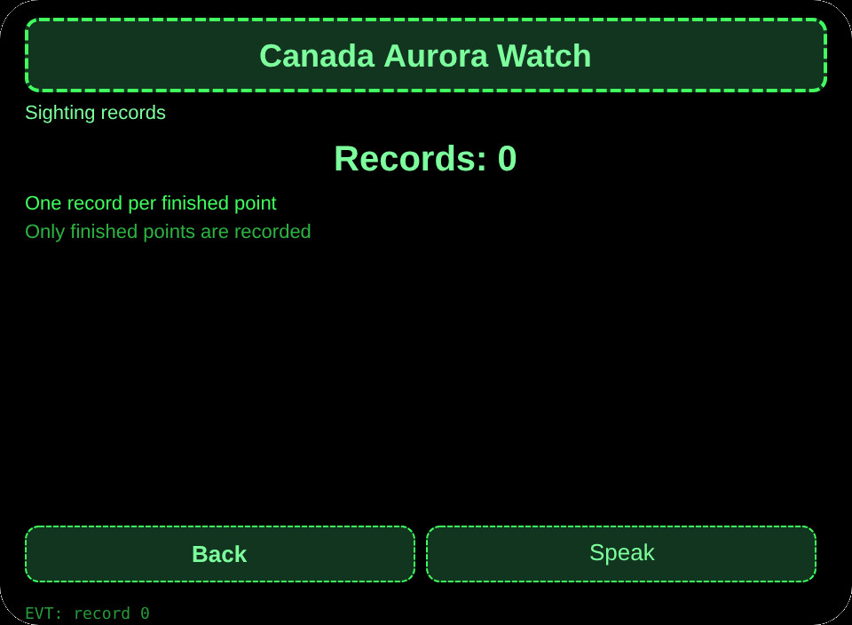

# Canada Aurora Watch

**Studio import address** (copy into the Global AIUI Studio Import Project box):

```
https://github.com/sakai55/rokid/tree/agent-canada-aurora-watch
```

[canada-aurora-watch.aix](https://raw.githubusercontent.com/sakai55/rokid/main/aix/canada-aurora-watch.aix)

## Features

A Canada aurora viewer in gloves turns the head to pick a viewing point, nods to log each sighting, and finishes a point with a settled record.

## Scene

A Canada aurora viewer in gloves, hands too cold for a phone, picks a viewing point by head turn and logs sightings by nodding.

## Direction composition

Canada local scene x attention (watching) x directional (head-turn point selection).

## Glasses-only capability

Hands-busy first-person capture + head-direction coordination: gloved hands cannot work a phone, so the head picks the point and a nod logs the sighting. Wiring: pages/watch/index.ink _startSensor + _onYaw + onHeadGesture nod to primaryTap.

## Pages

| Pages | Pages |
|---|---|
| pages/index | 6 viewing points |
| pages/watch | Head-turn point + nod sighting log |
| pages/record | Sighting records |

## Content set

6 viewing points (Yellowknife Lake, Whitehorse Hill, Churchill Bay, Jasper Field, Dawson Ridge, Iqaluit Shore). Sighting records counted by real number.

## Cross-session storage

Storage key `canadaAuroraWatchV1` (picked point, sighting records, lastError).

## Permissions

No declared permissions. Speech is host-managed and needs no declaration.

## Gesture map

| Single tap | Enter | Main confirm |
| Swipe up / down | ArrowUp / ArrowDown | Change selection |
| Nod | onHeadGesture('nod') | Same as main confirm |
| Double tap | Backspace | Back |

## Error codes

- `E5001` Storage write failed
- `E5002` Storage read failed
- `E3005` Speech failed
- `E8001` Navigation failed
- `E7001` Head sensor unavailable or read failed

- This agent does not forecast the aurora; sightings are only what the viewer logs.
- Without a sensor, buttons pick the viewing point.

## Preview screenshots






## Review Submission

### Feature Description

A Canada aurora viewer in gloves turns the head to pick a viewing point, nods to log each sighting, and finishes a point with a settled record.

### Opening Message

A Canada aurora viewer in gloves turns the head to pick a viewing point, nods to log each sighting, and finishes a point with a settled record.

### Preview Media

[preview-canada-aurora-watch-video.mp4](https://raw.githubusercontent.com/sakai55/rokid/main/screenshots/canada-aurora-watch/preview-canada-aurora-watch-video.mp4)


### Change Log

- Features：First release features as above.
- Improvements：None.
- Fixes：None.

## Device test info

| Studio name | To be filled |
|---|---|
| Studio name | To be filled |
| Version / Build | To be filled |
| App Category | To be filled |
| Intent Description | To be filled |
| Agent ID | To be filled |
| Status | To be filled |
