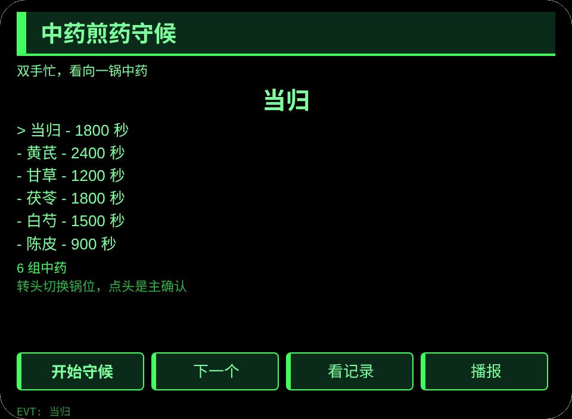
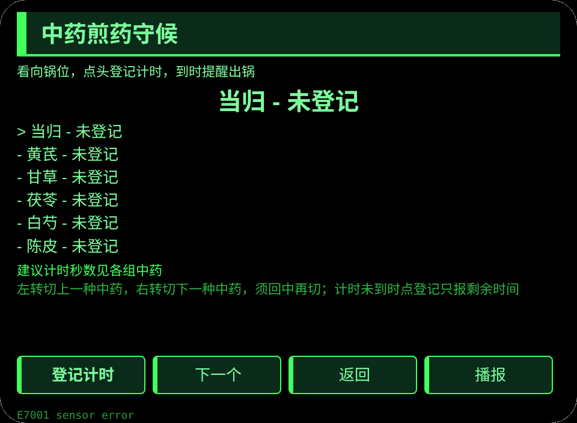
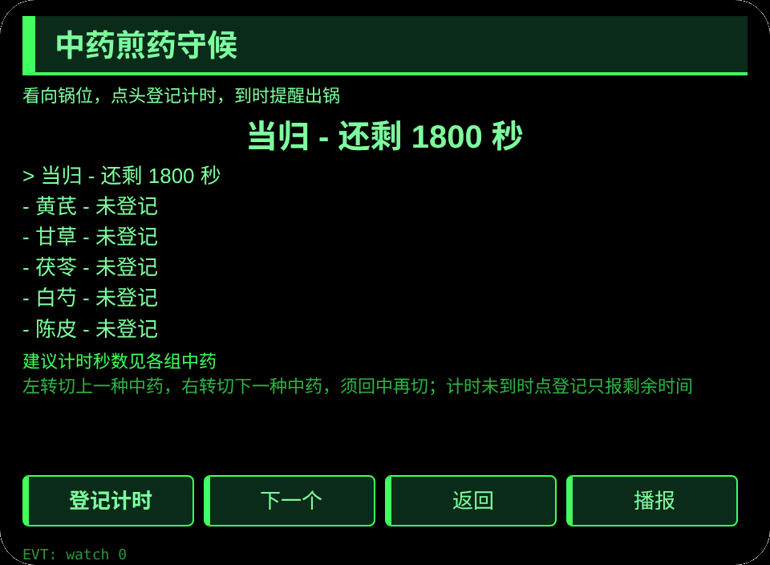
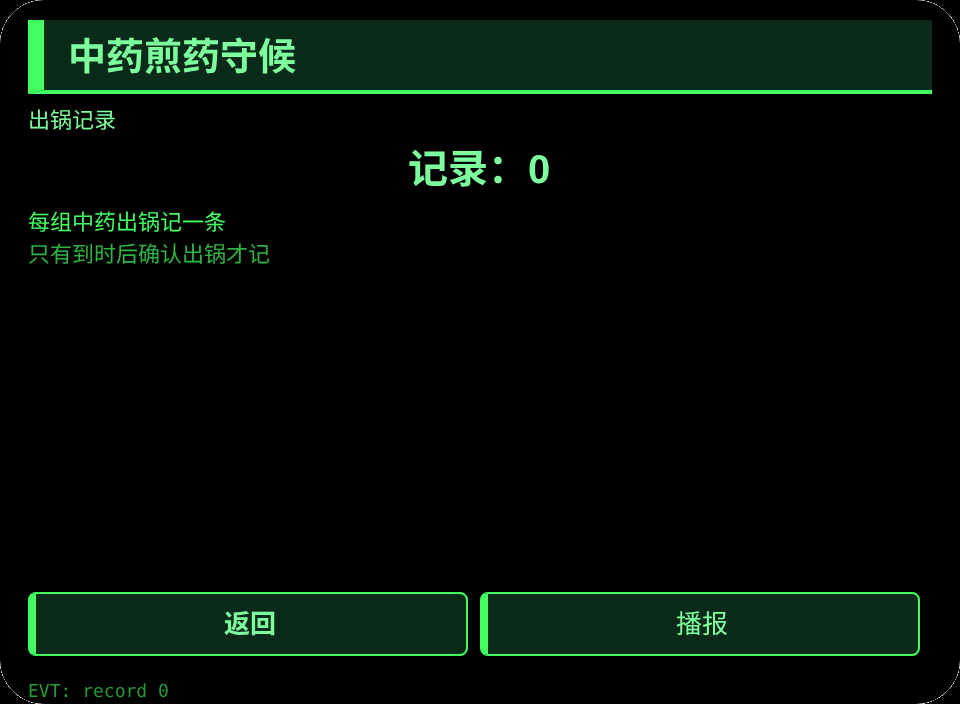

# 中药煎药守候

**Studio 导入地址**（复制到 Global AIUI Studio 的 Import Project 输入框）：

```
https://github.com/sakai55/rokid/tree/agent-china-herbal-watch
```

[china-herbal-watch.aix](https://raw.githubusercontent.com/sakai55/rokid/main/aix/china-herbal-watch.aix)

## 功能

中国家庭煎中药时煎药者双手忙，看向一锅中药、点头登记计时，到时提醒出锅，出锅记录跨会话保存。

## 场景

中国家庭煎中药时煎药者双手忙，看向一锅中药、点头登记计时，多锅不煎过。

## 方向构成

中国在地 × 注意力（守候）× 指向性（转头切药位）。注意力承载多锅中药计时守候与到时提醒；指向性承载转头切药位。

## 眼镜独占能力

视线与头部方向协调：转头切药位、点头登记计时，不用掏手机。接线：pages/watch/index.ink 的 _startSensor＋_onYaw（回正再武装、左退一种／右进一种）＋ onHeadGesture 点头触发 primaryTap 登记；守候页 onLoad 读存储 selected 定初始药位；无传感器时按钮切药位可玩。传感器失败报 E7001。

## 页面

| 页面 | 页面 |
|---|---|
| pages/index | 6 组中药与家庭煎药计时预设秒数 |
| pages/watch | 看向切药位、点头登记计时、到时提醒 |
| pages/record | 出锅记录 |

## 内容集

中药 6 组与家庭煎药计时预设秒数：当归 1800 秒、黄芪 2400 秒、甘草 1200 秒、茯苓 1800 秒、白芍 1500 秒、陈皮 900 秒。6 个药名均为真实中药材名（《本草纲目》分类：当归补血类、黄芪益气类、甘草益气类、茯苓利水渗湿类、白芍补血类、陈皮芳香理气类）。秒数为家庭计时预设，不是医嘱、不提供医疗建议。

## 跨会话持久化

存储键 `chinaHerbalWatchV1`（各锅中药计时、出锅记录、lastError）。

## 权限

无清单权限。语音播报不需要清单权限，相机与定位不用。

## 手势映射

| 单指点按 | Enter | 主确认 |
| 上滑／下滑 | ArrowUp / ArrowDown | 切换选项 |
| 点头 | onHeadGesture('nod') | 等同主确认 |
| 双击 | Backspace | 返回上一页 |

## 错误码

- `E5001` 存储写入失败
- `E5002` 存储读取失败
- `E3005` 语音播报失败
- `E8001` 页面跳转失败
- `E7001` 头部传感器不可用或读数失败

## 判定说明

原拟 china-soup-watch（WA49）已存在为 WA16（watch/china-soup-watch），故不用；本台中药煎药守候为替代概念，herbal／中药在全仓 .ink 中 0 命中；既有中国守候台均为菜肴计时，无煎药守候。


## 诚实边界

- 只按时间提醒，不声称测药效、不给用药建议；本智能体不提供医疗建议，用药与煎药请遵医嘱。
- 计时秒数为家庭计时预设，不是实测标准，也不是医嘱。
- 计时未到时点登记只报剩余时间，不写记录。
- 到时提醒每锅只说一次，出锅记录只由到时后的登记确认写下。
- 无传感器时按钮切药位可玩，计时本身不依赖传感器。

## 预览截图







## 提审资料

### Feature Description

中国家庭煎中药时煎药者双手忙，看向一锅中药、点头登记计时，到时提醒出锅，出锅记录跨会话保存。

### Opening Message

煎药守候开始！看向一锅药、点头登记计时，到时提醒你出锅。

### Preview Media

[preview-china-herbal-watch-video.mp4](https://raw.githubusercontent.com/sakai55/rokid/main/screenshots/china-herbal-watch/preview-china-herbal-watch-video.mp4)


### Change Log

- Features：首版功能见上文页面表。
- Improvements：无。
- Fixes：无.

## 设备测试信息

| Studio 名称 | 待填 |
|---|---|
| Studio 名称 | 待填 |
| Version / Build | 待填 |
| App Category | 待填 |
| Intent Description | 待填 |
| Agent ID | 待填 |
| 状态 | 待填 |
