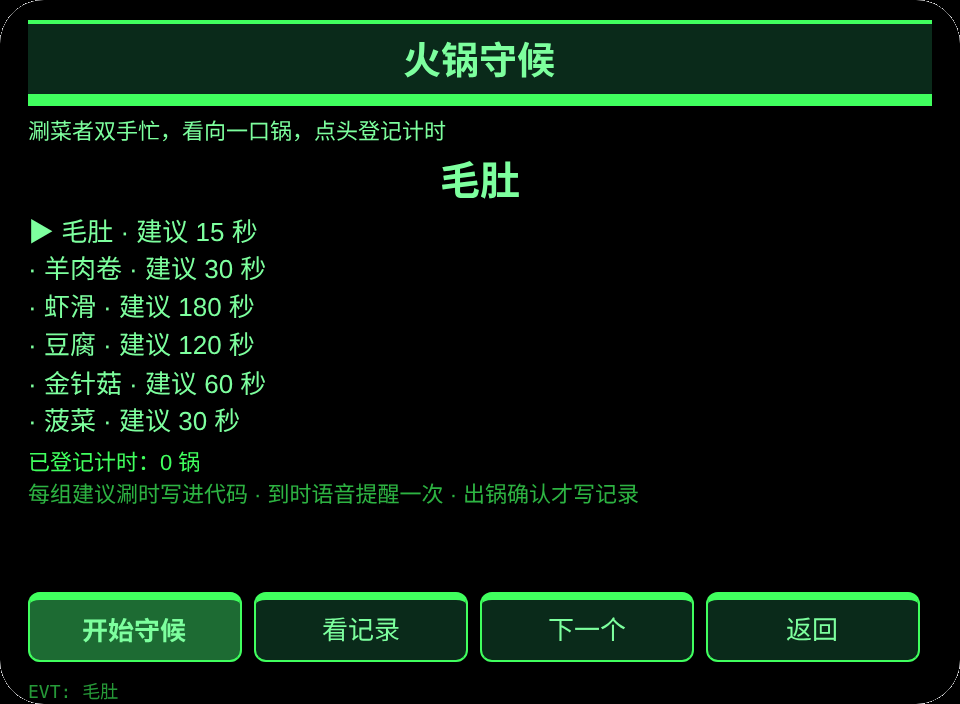
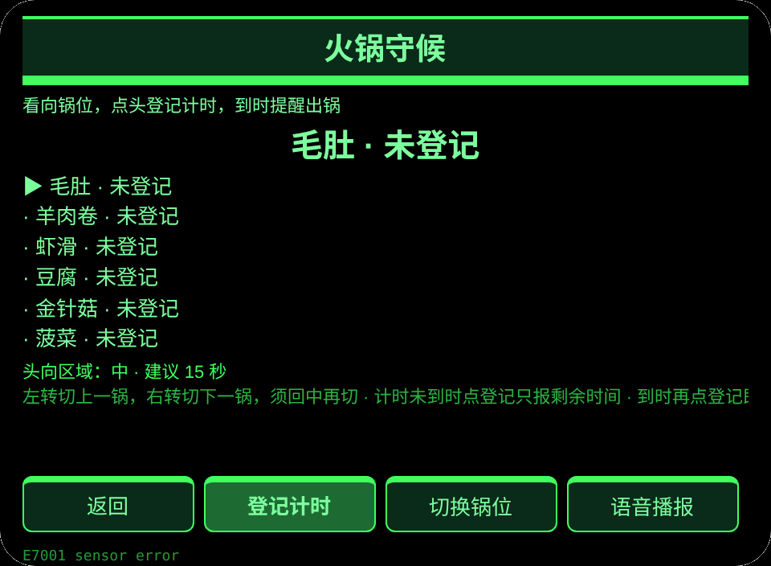
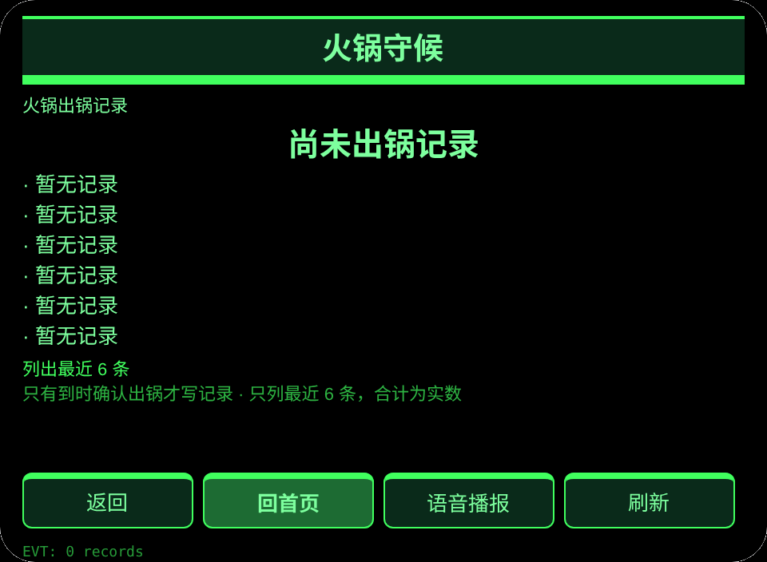

# 火锅守候

**Studio 导入地址**（复制到 Global AIUI Studio 的 Import Project 输入框）：

```
https://github.com/sakai55/rokid/tree/agent-china-hotpot-watch
```

[china-hotpot-watch.aix](https://raw.githubusercontent.com/sakai55/rokid/main/aix/china-hotpot-watch.aix)

## 功能

家庭吃火锅时，涮菜者双手拿筷子漏勺，看向一口锅、点头登记计时，多锅不涮过，到时提醒出锅并留记录。

## 场景

中国家庭吃火锅时，涮菜者双手拿筷子漏勺、看向一口锅、点头登记计时，多锅不涮过。

## 方向构成

中国在地 × 注意力（守候多锅计时）× 指向性（头向切锅位）。守候承担多锅计时与到时提醒，注意力与指向性共同构成双手忙时的守候闭环。

## 眼镜独占能力

视线与头部方向协调＋双手忙时点头计时：双手拿筷子漏勺时无法掏手机，头转向哪口锅就守哪口锅，点头即登记。接线：pages/watch/index.ink 的 _startSensor（存在性守卫）＋ _onYaw（回正门切锅位）＋ onHeadGesture 点头触发 primaryTap 登记计时；到时 _recompute 内语音提醒一次，出锅确认写记录；无传感器时按钮切锅位兜底。

## 页面

| 页面 | 职责 |
|---|---|
| pages/index | 6 组锅与菜品、已登记计时数 |
| pages/watch | 头向切锅位、点头登记计时、到时提醒出锅 |
| pages/record | 最近 6 条出锅记录与合计 |

## 内容集

6 组锅／菜品与建议涮时：毛肚 15 秒、羊肉卷 30 秒、虾滑 180 秒、豆腐 120 秒、金针菇 60 秒、菠菜 30 秒。出锅记录按实数计。

## 跨会话持久化

存储键 `chinaHotpotWatchV1`。存各锅计时（菜品、建议秒数、开始时间、是否已提醒）、出锅记录数组、lastError。

## 权限

无清单权限。语音播报不需要清单权限，相机与定位不用。

## 手势映射

| 镜腿手势 | 按键事件 | 本台作用 |
|---|---|---|
| 单指点按 | Enter | 主确认（各页主按钮） |
| 上滑／下滑 | ArrowUp / ArrowDown | 切换选项 |
| 点头 | onHeadGesture('nod') | 等同主确认 |
| 双击 | Backspace | 返回上一页 |

## 错误码

- `E5001` 存储写入失败
- `E5002` 存储读取失败
- `E3005` 语音播报失败
- `E8001` 页面跳转失败
- `E7001` 头部传感器不可用或读数失败

失败时屏显裸码，lastError 里同时记裸码、slug、版本与原文。

## 预览截图





## 提审资料

### Feature Description

家庭吃火锅时，涮菜者双手拿筷子漏勺，看向一口锅、点头登记计时，多锅不涮过，到时提醒出锅并留记录。

### Opening Message

火锅开涮了，看向那口锅、点一下头，我帮你守着时间。

### Preview Media

[preview-china-hotpot-watch-video.mp4](https://raw.githubusercontent.com/sakai55/rokid/main/screenshots/china-hotpot-watch/preview-china-hotpot-watch-video.mp4)


### Change Log

- Features：首版功能，见上文页面表。
- Improvements：无。
- Fixes：无。

## 设备测试信息

| 项目 | 内容 |
|---|---|
| Studio 名称 | 待填 |
| Version / Build | 待填 |
| App Category | 待填 |
| Intent Description | 待填 |
| Agent ID | 待填 |
| 状态 | 待填 |
