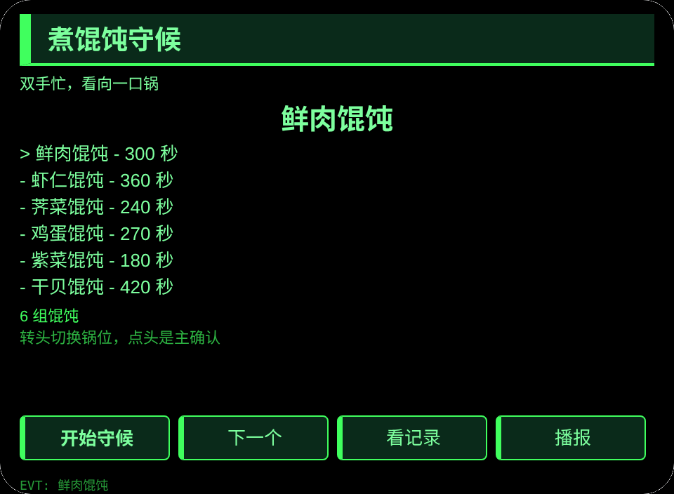
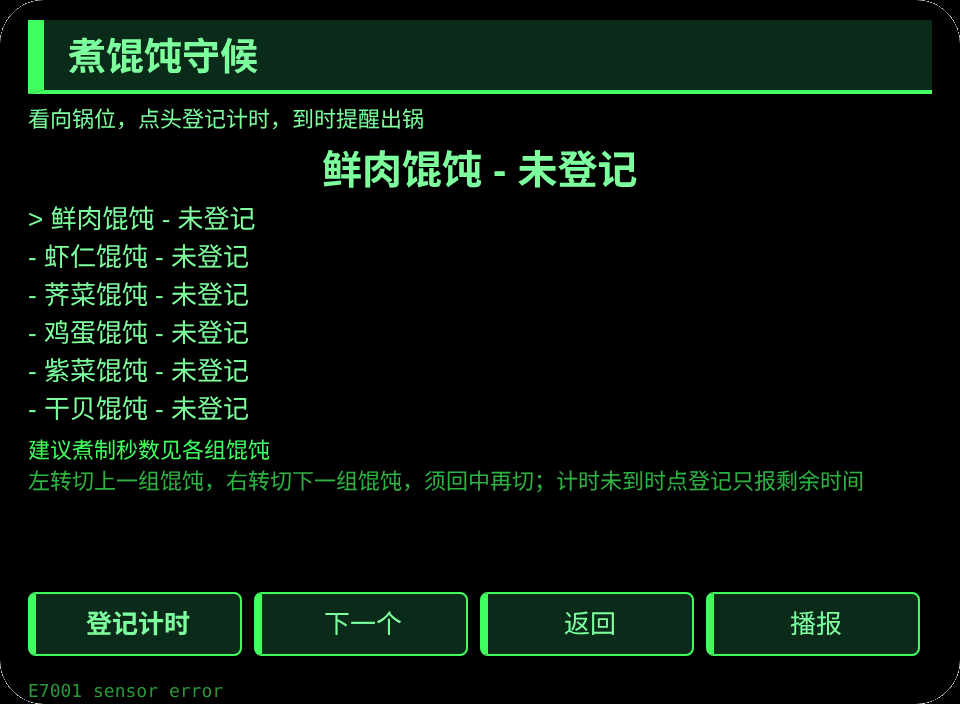
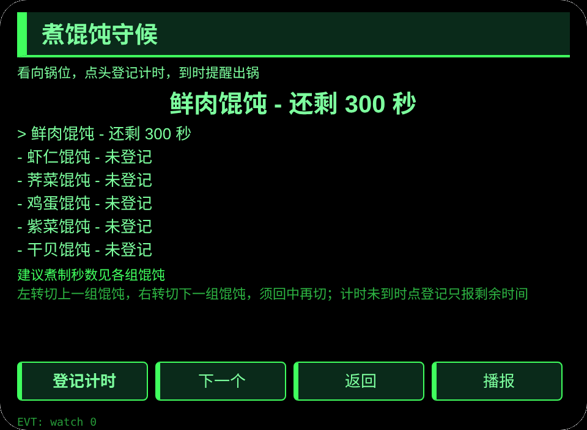
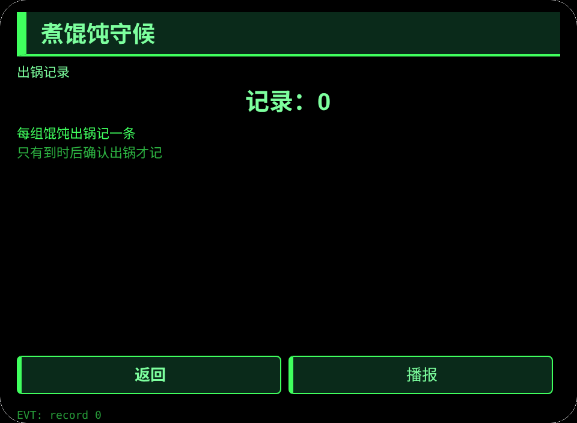

# 煮馄饨守候

**Studio 导入地址**（复制到 Global AIUI Studio 的 Import Project 输入框）：

```
https://github.com/sakai55/rokid/tree/agent-china-wonton-watch
```

[china-wonton-watch.aix](https://raw.githubusercontent.com/sakai55/rokid/main/aix/china-wonton-watch.aix)

## 功能

中国家庭煮馄饨时做饭者双手忙、看向一口锅、点头登记计时，到时提醒出锅并留记录，多锅不煮破。

## 场景

中国家庭煮馄饨时做饭者双手忙，看向一口锅、点头登记计时，多锅不煮破。

## 方向构成

中国在地 × 注意力（多锅计时守候）× 指向性（转头切锅位）。

## 眼镜独占能力

视线与头部方向协调＋双手忙时点头计时：双手忙无法掏手机，转头到哪种馄饨就守哪种馄饨，点头即登记。接线：pages/watch/index.ink 的 _startSensor＋_onYaw＋点头触发 primaryTap 登记计时。守候页 onLoad 读存储 selected 定初始点位。

## 页面

| 页面 | 页面 |
|---|---|
| pages/index | 6 组馄饨与建议秒数 |
| pages/watch | 转头切锅位、点头登记计时、到时提醒出锅 |
| pages/record | 出锅记录 |

## 内容集

6 组馄饨与建议煮制秒数：鲜肉馄饨 300 秒、虾仁馄饨 360 秒、荠菜馄饨 240 秒、鸡蛋馄饨 270 秒、紫菜馄饨 180 秒、干贝馄饨 420 秒。

## 跨会话持久化

存储键 `chinaWontonWatchV1`（各锅计时、出锅记录、lastError）。

## 权限

无清单权限。语音播报不需要清单权限，相机与定位不用。

## 手势映射

| 单指点按 | Enter | 主确认 |
| 上滑／下滑 | ArrowUp / ArrowDown | 切换选项 |
| 点头 | onHeadGesture('nod') | 等同主确认 |
| 双击 | Backspace | 返回上一页 |

## 错误码

- `E5001` 存储写入失败
- `E5002` 存储读取失败
- `E3005` 语音播报失败
- `E8001` 页面跳转失败
- `E7001` 头部传感器不可用或读数失败

- 只按时间提醒，不声称测熟度；熟度以现场判断为准。
- 计时未到时点登记只报剩余时间，不写记录。
- 到时提醒每锅只说一次，出锅记录只由到时后的登记确认写下。
- 无传感器时按钮切锅位可玩，计时本身不依赖传感器。

## 预览截图






## 提审资料

### Feature Description

中国家庭煮馄饨时做饭者双手忙、看向一口锅、点头登记计时，到时提醒出锅并留记录，多锅不煮破。

### Opening Message

中国家庭煮馄饨时做饭者双手忙、看向一口锅、点头登记计时，到时提醒出锅并留记录，多锅不煮破。

### Preview Media

[preview-china-wonton-watch-video.mp4](https://raw.githubusercontent.com/sakai55/rokid/main/screenshots/china-wonton-watch/preview-china-wonton-watch-video.mp4)


### Change Log

- Features：首版功能见上文页面表。
- Improvements：无。
- Fixes：无.

## 设备测试信息

| Studio 名称 | 待填 |
|---|---|
| Studio 名称 | 待填 |
| Version / Build | 待填 |
| App Category | 待填 |
| Intent Description | 待填 |
| Agent ID | 待填 |
| 状态 | 待填 |
