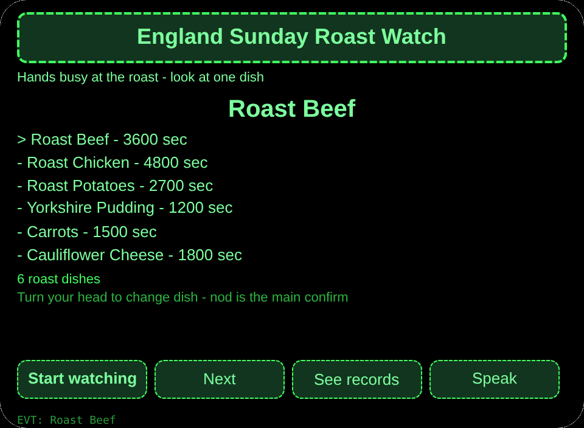
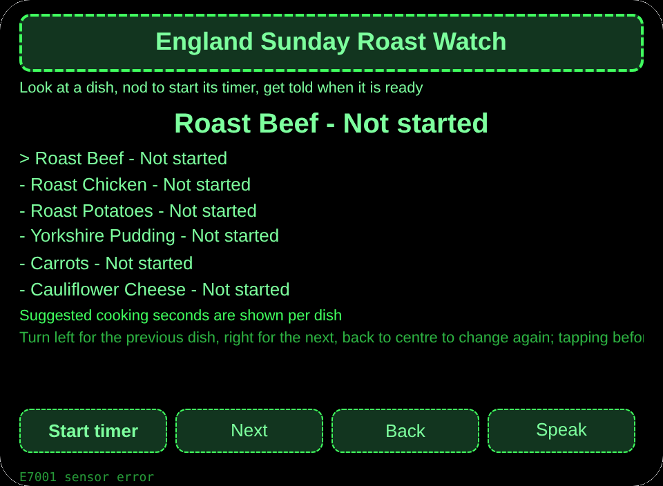
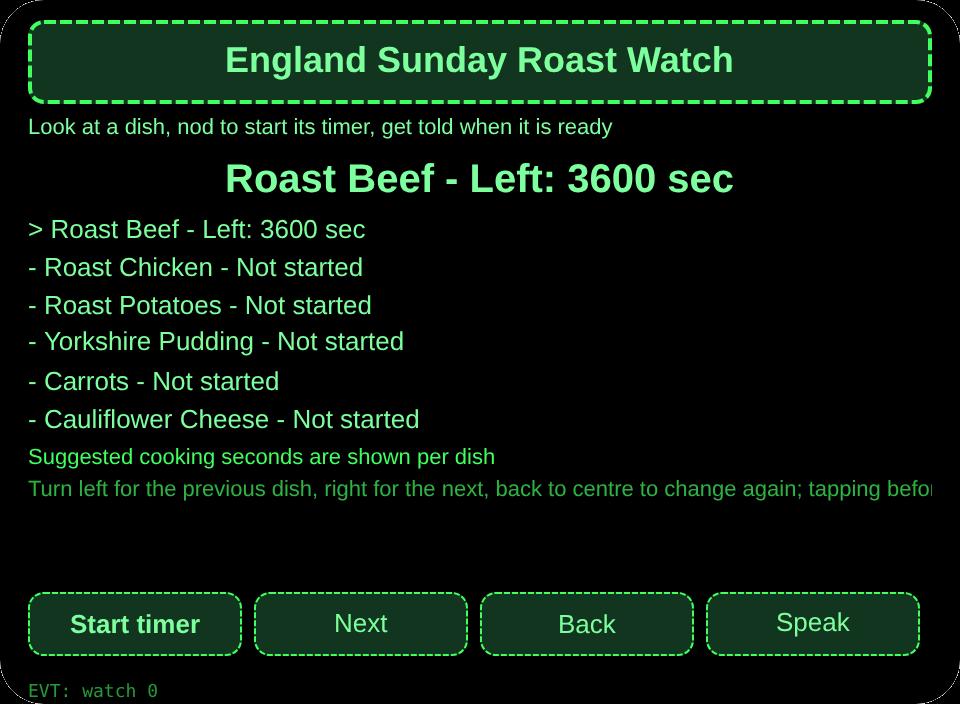
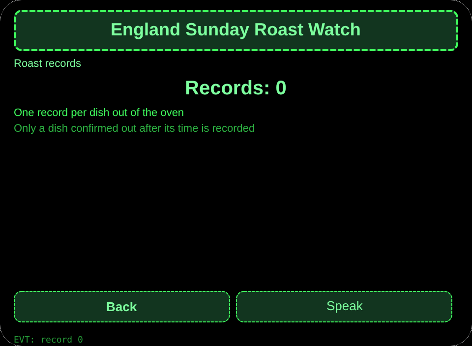

# England Sunday Roast Watch

**Studio import address** (copy into the Global AIUI Studio Import Project box):

```
https://github.com/sakai55/rokid/tree/agent-england-sunday-roast-watch
```

[england-sunday-roast-watch.aix](https://raw.githubusercontent.com/sakai55/rokid/main/aix/england-sunday-roast-watch.aix)

## Features

While the English Sunday roast cooks, the family with both hands busy looks at one dish, nods to start its timer, and is told when it is ready - six dishes, none overcooked.

## Scene

While the English Sunday roast cooks, the family with both hands busy with hot trays looks at one dish, nods to start its timer, and is told when it is ready.

## Direction composition

England local scene x attention (multi-dish timer watch) x directional (head-turn dish selection). Three gates: scene (an English family on Sunday roast day with both hands busy at the oven); loop (pick a dish, nod to start its timer, hear the ready reminder, log the dish out); thickness (6 roast dishes with suggested seconds + multi-step flow + cross-session records). Attention carries the timing watch; directional carries the head-turn dish selection.

## Glasses-only capability

Head-direction coordination + nod to start a timer while hands are busy: with both hands busy, the family cannot take out a phone; looking at a dish selects it and a nod starts its timer. Wiring: pages/watch/index.ink _startSensor + _onYaw + onHeadGesture nod to primaryTap to start the timer. The watch page onLoad reads stored selected to set the initial dish.

## Pages

| Pages | Pages |
|---|---|
| pages/index | 6 roast dishes with suggested seconds |
| pages/watch | Head-turn dish switch, nod to start timer, ready reminder |
| pages/record | Out-of-the-oven records |

## Content set

6 roast dishes with suggested seconds (presets, see README): Roast Beef 3600, Roast Chicken 4800, Roast Potatoes 2700, Yorkshire Pudding 1200, Carrots 1500, Cauliflower Cheese 1800.

## Cross-session storage

Storage key `englandSundayRoastWatchV1` (timers per dish, out-of-the-oven records, lastError).

## Permissions

No declared permissions. Speech is host-managed and needs no declaration.

## Gesture map

| Single tap | Enter | Main confirm |
| Swipe up / down | ArrowUp / ArrowDown | Change selection |
| Nod | onHeadGesture('nod') | Same as main confirm |
| Double tap | Backspace | Back |

## Error codes

- `E5001` Storage write failed
- `E5002` Storage read failed
- `E3005` Speech failed
- `E8001` Navigation failed
- `E7001` Head sensor unavailable or read failed

- This agent does not measure doneness; it only reminds by time. Seconds are presets and vary with oven heat and dish size.
- Tapping before time only tells the time left; no record is written.
- Each dish reminds only once when its time is up; the out record is written only by confirming after time.
- Without a sensor, buttons change the dish; timing itself does not depend on the sensor.

## Preview screenshots






## Review Submission

### Feature Description

While the English Sunday roast cooks, the family with both hands busy looks at one dish, nods to start its timer, and is told when it is ready - six dishes, none overcooked.

### Opening Message

While the English Sunday roast cooks, the family with both hands busy looks at one dish, nods to start its timer, and is told when it is ready - six dishes, none overcooked.

### Preview Media

[preview-england-sunday-roast-watch-video.mp4](https://raw.githubusercontent.com/sakai55/rokid/main/screenshots/england-sunday-roast-watch/preview-england-sunday-roast-watch-video.mp4)


### Change Log

- Features：First release features as above.
- Improvements：None.
- Fixes：None.

## Device test info

| Studio name | To be filled |
|---|---|
| Studio name | To be filled |
| Version / Build | To be filled |
| App Category | To be filled |
| Intent Description | To be filled |
| Agent ID | To be filled |
| Status | To be filled |
