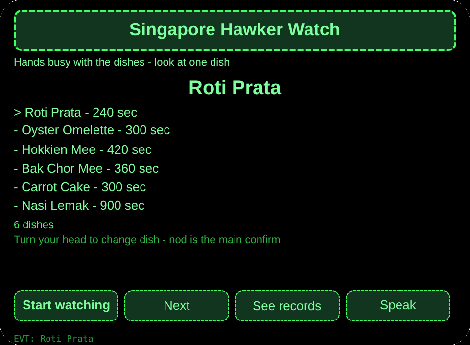
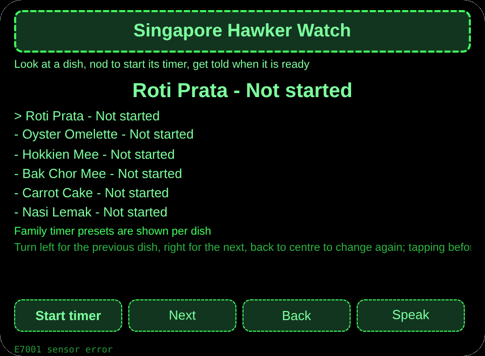
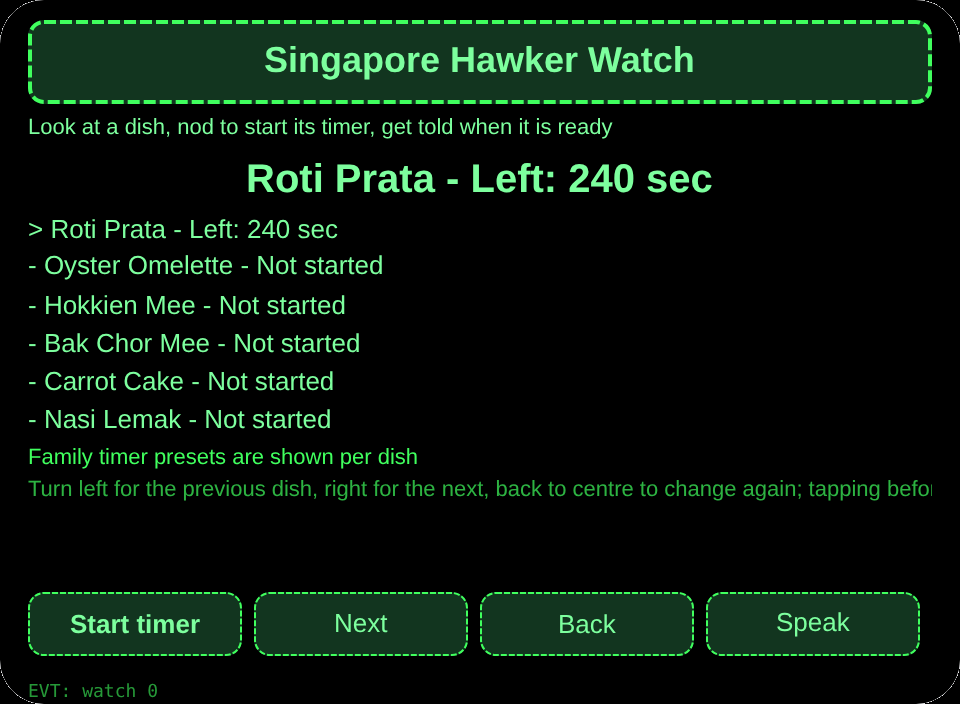
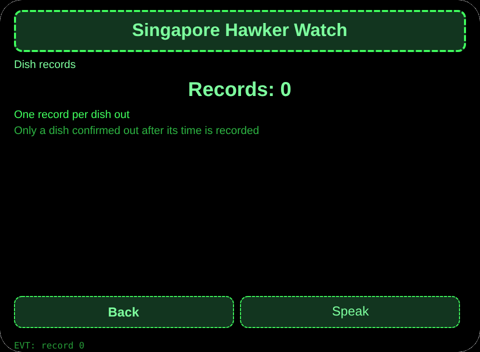

# Singapore Hawker Watch

**Studio import address** (copy into the Global AIUI Studio Import Project box):

```
https://github.com/sakai55/rokid/tree/agent-singapore-hawker-watch
```

**Latest AIX package:** [singapore-hawker-watch.aix](https://raw.githubusercontent.com/sakai55/rokid/main/aix/singapore-hawker-watch.aix)

## Features

While hawker dishes cook at home in Singapore, the cook with both hands busy on hot woks looks at one dish, nods to start its timer, and is told when it is ready - six dishes, none overcooked.

## Scene

A Singapore family cooking hawker dishes keeps both hands busy with hot woks and watches six dishes by looking at one dish and nodding to start its timer, so nothing overcooks.

## Direction composition

- Attention (watch): the core - six dish timers watched at once, one spoken reminder per dish when its time is up, and a dish-out record only when confirmed after time.
- Directional: head-turn dish selection - looking left or right moves between the six dishes, returning to centre re-arms the switch, and a nod confirms.

## Glasses-only capability

Head-direction coordination + nod to start a timer while hands are busy: with both hands on hot woks, the cook cannot take out a phone; looking at a dish selects it and a nod starts its timer. Wiring: pages/watch/index.ink `_startSensor` (AbsoluteOrientationSensor, yaw zones re-arm below 0.15 rad and switch past +/-0.35 rad) + `_onYaw` + `onHeadGesture('nod')` to `primaryTap` to start the timer. The watch page `onLoad` reads the stored selected dish to set the initial position. Sensor failure surfaces `E7001`; buttons remain as a fallback, but timing itself never depends on the sensor.

## Pages

| Page | Content |
|---|---|
| pages/index | 6 dishes with family timer presets |
| pages/watch | Head-turn dish switch, nod to start timer, ready reminder |
| pages/record | Dish-out records |

## Content set

6 hawker dishes with family timer presets (seconds): Roti Prata 240, Oyster Omelette 300, Hokkien Mee 420, Bak Chor Mee 360, Carrot Cake 300, Nasi Lemak 900. All six are real Singapore hawker dishes, verified by web search on 2026-11-27; none repeats a stall name from the visit guide `singapore-hawker-guide` (Chicken Rice, Laksa, Char Kway Teow, Hainanese Curry, Satay, Sugar Cane Juice) or from `singapore-laksa-watch` (Laksa).

## Cross-session storage

Storage key `singaporeHawkerWatchV1` (timers per dish, dish-out records, selected dish, lastError).

## Honest boundaries

- The seconds shown are family timer presets, not measured doneness: the agent reminds by time only and does not claim to measure whether a dish is cooked.
- Tapping before time only tells the time left; no record is written.
- Each dish reminds only once when its time is up; the out record is written only by confirming after time.
- Without a sensor, buttons change the dish; timing itself does not depend on the sensor.

## Permissions

No declared permissions. Speech is host-managed and needs no declaration.

## Gesture map

| Single tap | Enter | Main confirm |
| Swipe up / down | ArrowUp / ArrowDown | Change selection |
| Nod | onHeadGesture('nod') | Same as main confirm |
| Double tap | Backspace | Back |

## Error codes

- `E5001` Storage write failed
- `E5002` Storage read failed
- `E3005` Speech failed
- `E8001` Navigation failed
- `E7001` Head sensor unavailable or read failed

## Preview screenshots






## Review Submission

### Feature Description

While hawker dishes cook at home in Singapore, the cook with both hands busy on hot woks looks at one dish, nods to start its timer, and is told when it is ready - six dishes, none overcooked.

### Opening Message

While hawker dishes cook at home in Singapore, the cook with both hands busy on hot woks looks at one dish, nods to start its timer, and is told when it is ready - six dishes, none overcooked.

### Preview Media

[preview-singapore-hawker-watch-video.mp4](https://raw.githubusercontent.com/sakai55/rokid/main/screenshots/singapore-hawker-watch/preview-singapore-hawker-watch-video.mp4)


### Change Log

- Features added: First release - six-dish hawker timer watch with head-turn selection, nod-to-start timers, spoken ready reminders, and dish-out records.
- Improvements: None.
- Fixes: None.

## Device test info

| Field | Value |
|---|---|
| Studio name | To be filled |
| Version / Build | To be filled |
| App Category | To be filled |
| Intent Description | To be filled |
| Agent ID | To be filled |
| Status | To be filled |
