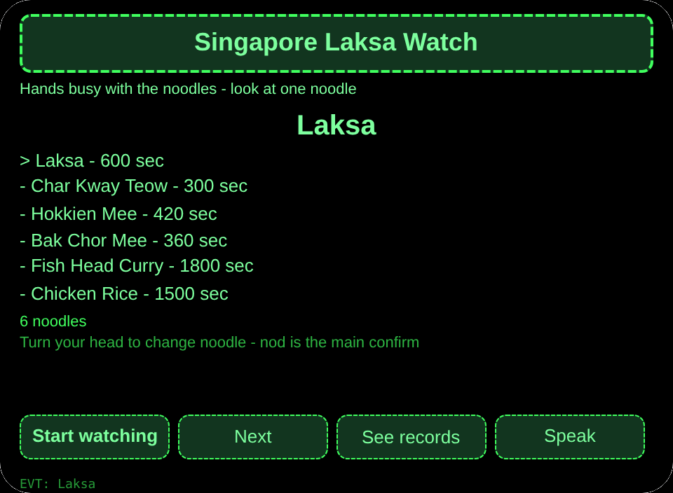
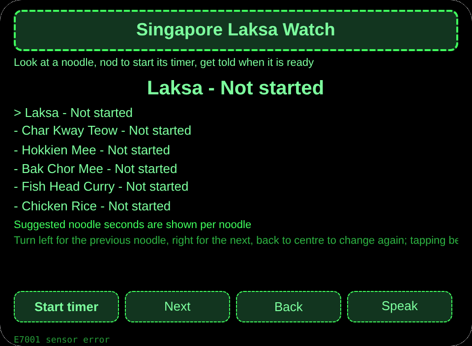
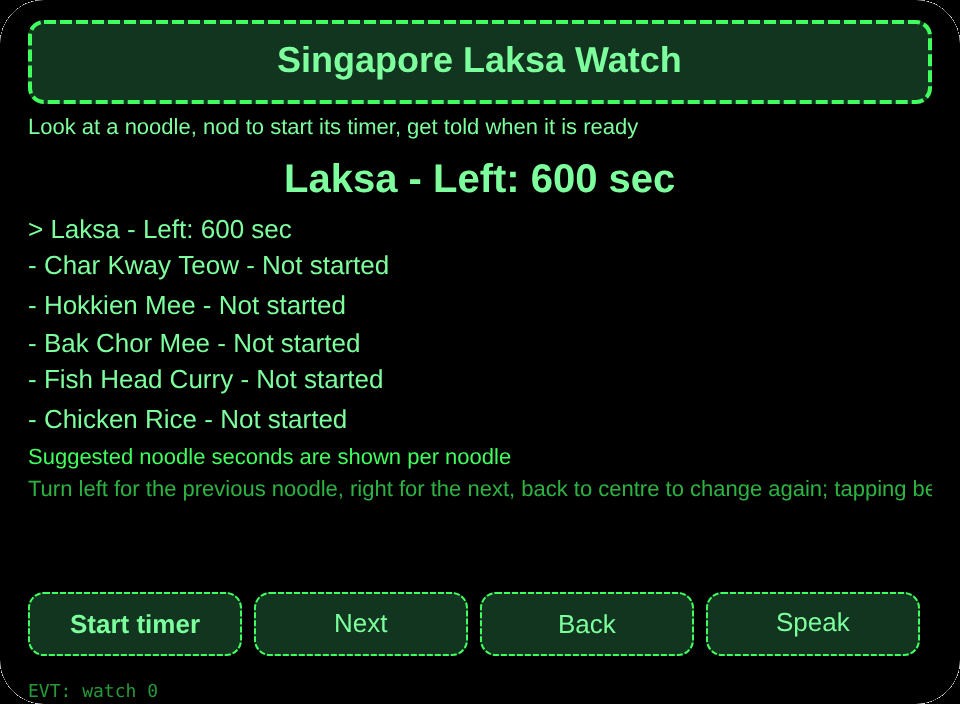
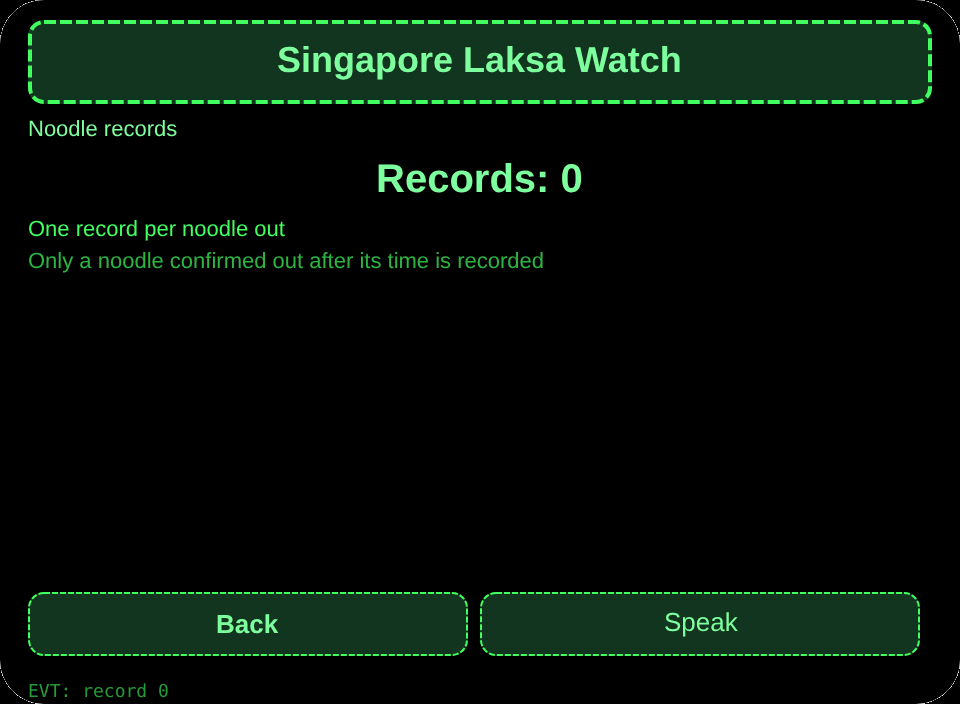

# Singapore Laksa Watch

**Studio import address** (copy into the Global AIUI Studio Import Project box):

```
https://github.com/sakai55/rokid/tree/agent-singapore-laksa-watch
```

[singapore-laksa-watch.aix](https://raw.githubusercontent.com/sakai55/rokid/main/aix/singapore-laksa-watch.aix)

## Features

While noodles cook at a Singapore hawker centre, the cook with both hands busy looks at one noodle, nods to start its timer, and is told when it is ready - several pots, none overcooked.

## Scene

While noodles cook at a Singapore hawker centre, the cook with both hands busy looks at one noodle, nods to start its timer, and is told when it is ready.

## Direction composition

Singapore local scene x attention (multi-pot noodle timer watch) x directional (head-turn noodle selection).

## Glasses-only capability

Head-direction coordination + nod to start a timer while hands are busy: with both hands on the noodles, the cook cannot take out a phone; looking at a noodle selects it and a nod starts its timer. Wiring: pages/watch/index.ink _startSensor + _onYaw + onHeadGesture nod to primaryTap to start the timer. The watch page onLoad reads stored selected to set the initial noodle.

## Pages

| Pages | Pages |
|---|---|
| pages/index | 6 noodles with suggested seconds |
| pages/watch | Head-turn noodle switch, nod to start timer, ready reminder |
| pages/record | Noodle-out records |

## Content set

6 noodles with suggested seconds: Laksa 600, Char Kway Teow 300, Hokkien Mee 420, Bak Chor Mee 360, Fish Head Curry 1800, Chicken Rice 1500.

## Cross-session storage

Storage key `singaporeLaksaWatchV1` (timers per noodle, noodle-out records, lastError).

## Permissions

No declared permissions. Speech is host-managed and needs no declaration.

## Gesture map

| Single tap | Enter | Main confirm |
| Swipe up / down | ArrowUp / ArrowDown | Change selection |
| Nod | onHeadGesture('nod') | Same as main confirm |
| Double tap | Backspace | Back |

## Error codes

- `E5001` Storage write failed
- `E5002` Storage read failed
- `E3005` Speech failed
- `E8001` Navigation failed
- `E7001` Head sensor unavailable or read failed

- Tapping before time only tells the time left; no record is written.
- Each noodle reminds only once when its time is up; the out record is written only by confirming after time.
- Without a sensor, buttons change the noodle; timing itself does not depend on the sensor.

## Preview screenshots






## Review Submission

### Feature Description

While noodles cook at a Singapore hawker centre, the cook with both hands busy looks at one noodle, nods to start its timer, and is told when it is ready - several pots, none overcooked.

### Opening Message

While noodles cook at a Singapore hawker centre, the cook with both hands busy looks at one noodle, nods to start its timer, and is told when it is ready - several pots, none overcooked.

### Preview Media

[preview-singapore-laksa-watch-video.mp4](https://raw.githubusercontent.com/sakai55/rokid/main/screenshots/singapore-laksa-watch/preview-singapore-laksa-watch-video.mp4)


### Change Log

- Features：First release features as above.
- Improvements：None.
- Fixes：None.

## Device test info

| Studio name | To be filled |
|---|---|
| Studio name | To be filled |
| Version / Build | To be filled |
| App Category | To be filled |
| Intent Description | To be filled |
| Agent ID | To be filled |
| Status | To be filled |
