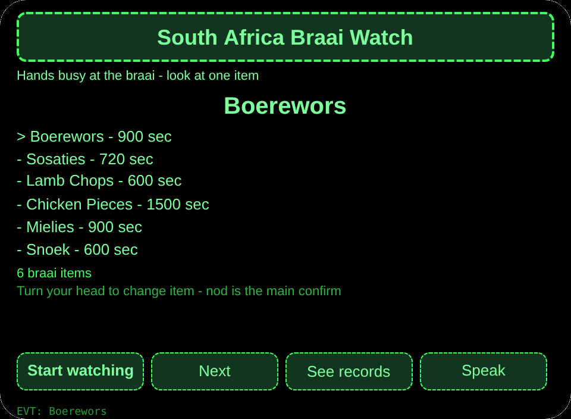
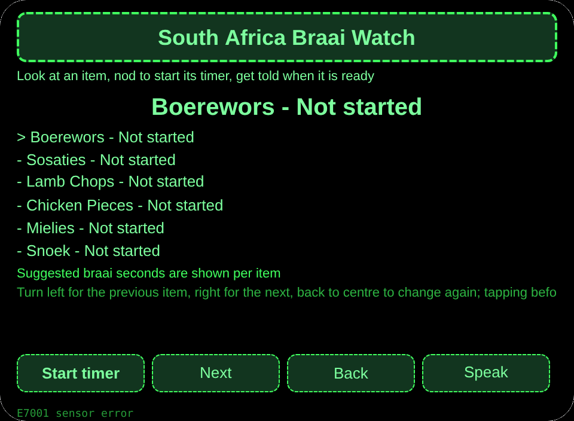
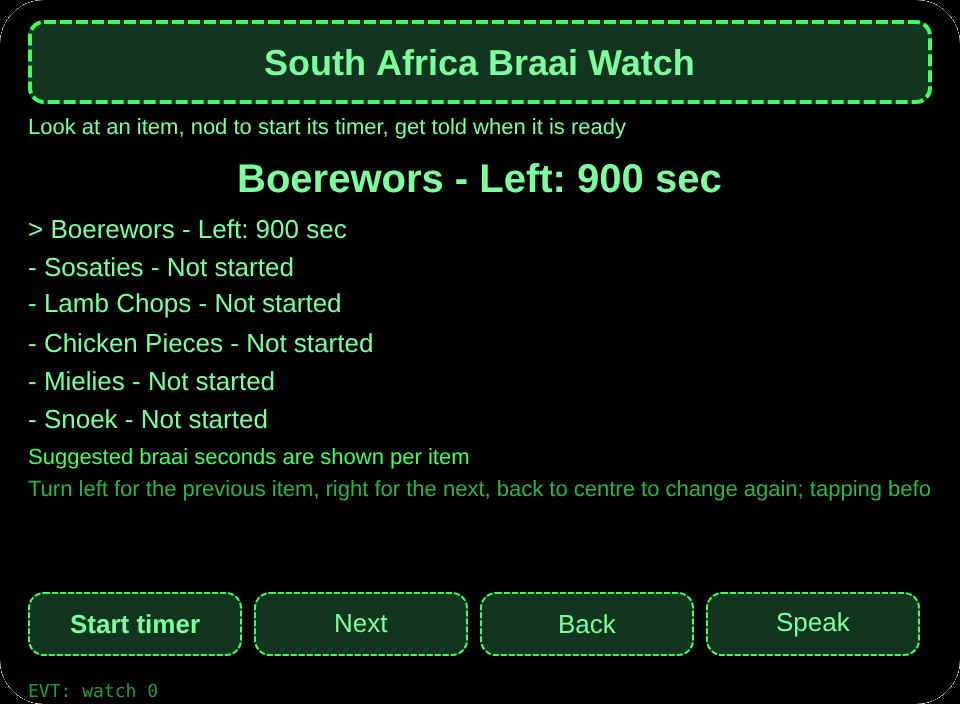
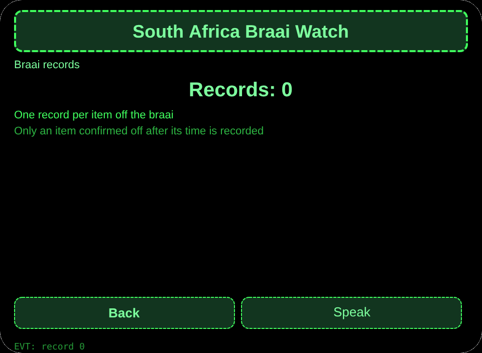

# South Africa Braai Watch

**Studio import address** (copy into the Global AIUI Studio Import Project box):

```
https://github.com/sakai55/rokid/tree/agent-south-africa-braai-watch
```

[south-africa-braai-watch.aix](https://raw.githubusercontent.com/sakai55/rokid/main/aix/south-africa-braai-watch.aix)

## Features

While the braai cooks, the cook with both hands busy looks at one braai item, nods to start its timer, and is told when it is ready - several items, none burnt.

## Scene

While the braai cooks, the cook with both hands busy looks at one braai item, nods to start its timer, and is told when it is ready.

## Direction composition

South Africa local scene x attention (multi-item timer watch) x directional (head-turn item selection). Three gates: scene (a cook on braai day with both hands busy at the fire); loop (pick an item, nod to start its timer, hear the ready reminder, log the item off); thickness (6 braai items with suggested seconds + multi-step flow + cross-session records). Attention carries the timing watch; directional carries the head-turn item selection.

## Glasses-only capability

Head-direction coordination + nod to start a timer while hands are busy: with both hands busy, the cook cannot take out a phone; looking at an item selects it and a nod starts its timer. Wiring: pages/watch/index.ink _startSensor + _onYaw + onHeadGesture nod to primaryTap to start the timer. The watch page onLoad reads stored selected to set the initial item.

## Pages

| Pages | Pages |
|---|---|
| pages/index | 6 braai items with suggested seconds |
| pages/watch | Head-turn item switch, nod to start timer, ready reminder |
| pages/record | Off-the-braai records |

## Content set

6 braai items with suggested seconds: Boerewors 900, Sosaties 720, Lamb Chops 600, Chicken Pieces 1500, Mielies 900, Snoek 600.

## Cross-session storage

Storage key `southAfricaBraaiWatchV1` (timers per item, off-the-fire records, lastError).

## Permissions

No declared permissions. Speech is host-managed and needs no declaration.

## Gesture map

| Single tap | Enter | Main confirm |
| Swipe up / down | ArrowUp / ArrowDown | Change selection |
| Nod | onHeadGesture('nod') | Same as main confirm |
| Double tap | Backspace | Back |

## Error codes

- `E5001` Storage write failed
- `E5002` Storage read failed
- `E3005` Speech failed
- `E8001` Navigation failed
- `E7001` Head sensor unavailable or read failed

- This agent does not measure doneness; it only reminds by time. Seconds are a guide and vary with fire heat and item size.
- Tapping before time only tells the time left; no record is written.
- Each item reminds only once when its time is up; the off record is written only by confirming after time.
- Without a sensor, buttons change the item; timing itself does not depend on the sensor.

## Preview screenshots






## Review Submission

### Feature Description

While the braai cooks, the cook with both hands busy looks at one braai item, nods to start its timer, and is told when it is ready - several items, none burnt.

### Opening Message

While the braai cooks, the cook with both hands busy looks at one braai item, nods to start its timer, and is told when it is ready - several items, none burnt.

### Preview Media

[preview-south-africa-braai-watch-video.mp4](https://raw.githubusercontent.com/sakai55/rokid/main/screenshots/south-africa-braai-watch/preview-south-africa-braai-watch-video.mp4)


### Change Log

- Features：First release features as above.
- Improvements：None.
- Fixes：None.

## Device test info

| Studio name | To be filled |
|---|---|
| Studio name | To be filled |
| Version / Build | To be filled |
| App Category | To be filled |
| Intent Description | To be filled |
| Agent ID | To be filled |
| Status | To be filled |
